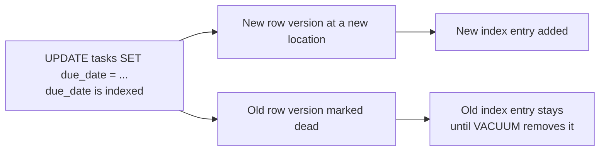
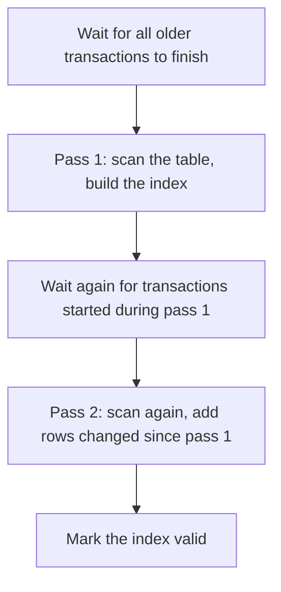

# Index Maintenance and Bloat

An index is not a thing you create once and forget. It grows, it gets untidy,
and on a busy table it can slowly become bigger and slower than the data it
points at. This file is the upkeep: how to measure that, how to fix it without
taking the application down, and what to run after a big migration.

> **📌 In one line:** indexes accumulate dead entries and empty space over time,
> and the tools that fix it — `REINDEX CONCURRENTLY`, `CREATE INDEX
> CONCURRENTLY`, `ANALYZE`, `fillfactor` — are safe only if you use the right
> variant.

## Table of Contents

1. [What Bloat Is](#what-bloat-is)
2. [Measuring Bloat](#measuring-bloat)
3. [Why Bloat Hurts](#why-bloat-hurts)
4. [REINDEX versus REINDEX CONCURRENTLY](#reindex-versus-reindex-concurrently)
5. [Invalid Indexes and How to Find Them](#invalid-indexes-and-how-to-find-them)
6. [CREATE INDEX CONCURRENTLY](#create-index-concurrently)
7. [ANALYZE: Keeping the Planner Honest](#analyze-keeping-the-planner-honest)
8. [fillfactor: Leaving Room on the Page](#fillfactor-leaving-room-on-the-page)
9. [VACUUM's Role in Index Cleanup](#vacuums-role-in-index-cleanup)
10. [A Practical Maintenance Routine](#a-practical-maintenance-routine)
11. [Advanced: What Blocks Cleanup](#advanced-what-blocks-cleanup)
12. [Common Mistakes](#common-mistakes)
13. [Questions to Test Yourself](#questions-to-test-yourself)
14. [Related](#related)

---

## What Bloat Is

**Bloat** is space an index occupies but no longer uses: entries pointing at
dead rows, and gaps left where entries were removed.

It comes from how PostgreSQL writes. An `UPDATE` does not change a row in
place — it writes a new version and marks the old one dead, and a `DELETE` only
marks the row dead. The full mechanism is
[../transactions-and-concurrency/03-mvcc-part-1.md](../transactions-and-concurrency/03-mvcc-part-1.md);
what matters here is the effect on an index.



Watch one leaf page over a week of updates:

```text
day 1, freshly built (90% full by default)
┌──────────────────────────────────────────────┐
│ 2026-03-01 2026-03-02 2026-03-04 2026-03-07  │  300 live entries
└──────────────────────────────────────────────┘

day 4, after many updates: dead entries (x) accumulate
┌──────────────────────────────────────────────┐
│ x 2026-03-02 x x 2026-03-07 x 2026-03-09 x   │  120 live, 180 dead
└──────────────────────────────────────────────┘

day 7, after VACUUM: dead entries gone, page still the same size
┌──────────────────────────────────────────────┐
│ 2026-03-02 ...   [ free space, not returned ] │  120 live, 180 slots free
└──────────────────────────────────────────────┘
```

Two points people miss:

- **`VACUUM` removes dead entries but does not shrink the index file.** Freed
  slots are reused by future inserts *on that page* — which helps only when new
  values actually land there.
- With a monotonically increasing key such as `created_at` or a sequence, new
  values always land at the right-hand end of the tree, so freed space in old
  pages is never reused and the index grows even though the row count is stable.

That second case — a high-churn table indexed on an ever-increasing column — is
where serious bloat lives.

---

## Measuring Bloat

Start with plain sizes. This tells you where to look, and costs nothing:

```sql
SELECT s.relname AS table_name,
       s.indexrelname AS index_name,
       pg_size_pretty(pg_relation_size(s.indexrelid)) AS index_size,
       pg_size_pretty(pg_relation_size(s.relid))      AS table_size,
       s.idx_scan
FROM pg_stat_user_indexes s
ORDER BY pg_relation_size(s.indexrelid) DESC
LIMIT 10;
```

```text
 table_name    |       index_name        | index_size | table_size | idx_scan
---------------+-------------------------+------------+------------+----------
 notifications | idx_notif_user_created  | 1904 MB    | 3204 MB    | 88412004
 tasks         | idx_tasks_due_date      |  402 MB    |  488 MB    |  1204882
 tasks         | idx_tasks_pkey          |  107 MB    |  488 MB    | 40028113
```

Compare rows 2 and 3. Both index `tasks`. The primary key on a `bigint` is
107 MB; `idx_tasks_due_date` indexes a `date` — a *smaller* type — yet takes
402 MB. That gap is the signal.

For a real measurement, the `pgstattuple` extension reports how full an index
actually is:

```sql
CREATE EXTENSION IF NOT EXISTS pgstattuple;

SELECT * FROM pgstatindex('idx_tasks_due_date');
```

```text
 version | tree_level | index_size | leaf_pages | avg_leaf_density | leaf_fragmentation
---------+------------+------------+------------+------------------+--------------------
       4 |          2 |  421527552 |      51012 |            23.4  |              41.8
```

`avg_leaf_density` is the number to read: what percentage of each leaf page
holds live entries. A freshly built B-tree is about 90.

| `avg_leaf_density` | Verdict | Action |
|---|---|---|
| 70–90 | healthy | nothing |
| 50–70 | some bloat, normal on a busy table | watch it |
| 30–50 | significant | schedule a `REINDEX CONCURRENTLY` |
| under 30 | severe | reindex, then ask why — long transactions? autovacuum too slow? |

> **💡 Tip:** `pgstattuple` reads the whole index, so run it off-peak or on a
> replica. The estimate-only bloat queries that circulate online are fine for a
> dashboard but can be wrong by a wide margin.

---

## Why Bloat Hurts

A bloated index is not "just" wasted disk.

| Effect | What happens |
|---|---|
| More pages to read | the same 300 entries spread over 4 pages instead of 1, so a range scan reads 4x the pages |
| Worse cache hit ratio | those mostly-empty pages occupy shared buffers, pushing out useful data |
| Deeper tree | more leaf pages can mean an extra level, adding a page read to every lookup |
| Slower vacuum | vacuum scans the whole index, so a bloated index makes every future vacuum slower |
| Slower backups and restores | more bytes to copy, more to rebuild |

```text
 healthy leaf pages (90% full)     bloated leaf pages (25% full)
 ┌────────┬────────┐               ┌────────┬────────┬────────┬────────┐
 │ 300 e. │ 300 e. │  2 reads      │ 75 e.  │ 75 e.  │ 75 e.  │ 75 e.  │  4 reads
 └────────┴────────┘               └────────┴────────┴────────┴────────┘
```

---

## REINDEX versus REINDEX CONCURRENTLY

`REINDEX` rebuilds an index from scratch: a new, densely packed copy replaces
the old one. It is the cure for bloat. Which form you use is an operational
decision, and getting it wrong causes an outage.

```sql
-- ❌ BROKEN on a live system — blocks every read and write on the table
REINDEX INDEX idx_tasks_due_date;
```

Plain `REINDEX` takes an `ACCESS EXCLUSIVE` lock on the table for the entire
rebuild. On a 400 MB index that is minutes; every `SELECT`, `INSERT` and
`UPDATE` on `tasks` waits behind it, and connections pile up until the pool is
exhausted. See
[../transactions-and-concurrency/04-locks-part-1.md](../transactions-and-concurrency/04-locks-part-1.md).

```sql
-- ✅ FIXED — builds a new copy alongside, swaps it in at the end
REINDEX INDEX CONCURRENTLY idx_tasks_due_date;
```

```text
 avg_leaf_density before: 23.4   index_size: 402 MB
 avg_leaf_density after : 90.0   index_size: 104 MB
```

What `CONCURRENTLY` changes:

| | `REINDEX` | `REINDEX CONCURRENTLY` |
|---|---|---|
| Lock on the table | `ACCESS EXCLUSIVE` — blocks everything | allows reads and writes throughout |
| Speed | faster | slower; two passes plus a wait |
| Safe on a live system | no | yes |
| Can run inside a transaction | yes | **no** |
| If it fails midway | index is unchanged | leaves an **invalid** index behind |
| Disk needed | roughly one extra copy | roughly one extra copy, held longer |

> **⚠️ Warning:** `REINDEX CONCURRENTLY` needs enough free disk for a second
> copy of the index while it runs. Check before you start on a large one.

You can also reindex a whole table (`REINDEX TABLE CONCURRENTLY tasks;`) — it
processes each index in turn, so allow time.

---

## Invalid Indexes and How to Find Them

Because `REINDEX CONCURRENTLY` and `CREATE INDEX CONCURRENTLY` build in two
passes without a blocking lock, a failure — a cancelled statement, a deadlock, a
disconnected session — can leave an index in an **invalid** state. An invalid
index is still maintained on every write but is **never used by the planner**:
the worst of both worlds, and silent.

Always check afterwards:

```sql
SELECT i.indexrelid::regclass AS index_name,
       i.indrelid::regclass   AS table_name,
       i.indisvalid,
       i.indisready,
       pg_size_pretty(pg_relation_size(i.indexrelid)) AS size
FROM pg_index i
WHERE NOT i.indisvalid OR NOT i.indisready;
```

```text
      index_name           | table_name | indisvalid | indisready | size
---------------------------+------------+------------+------------+-------
 idx_tasks_due_date_ccnew  | tasks      | f          | t          | 88 MB
```

The `_ccnew` suffix marks a leftover from a failed concurrent rebuild. Drop it
and try again:

```sql
DROP INDEX CONCURRENTLY idx_tasks_due_date_ccnew;
REINDEX INDEX CONCURRENTLY idx_tasks_due_date;
```

> **📌 Remember:** every concurrent build or rebuild ends with the invalid-index
> check. Put that query in your runbook — nothing else will tell you.

---

## CREATE INDEX CONCURRENTLY

The same rule applies to *adding* an index to a live table.

```sql
-- ❌ BROKEN in production — blocks writes for the whole build
CREATE INDEX idx_tasks_assignee ON tasks (assignee_id);

-- ✅ FIXED — writers keep working
CREATE INDEX CONCURRENTLY idx_tasks_assignee ON tasks (assignee_id);
```

Plain `CREATE INDEX` takes a `SHARE` lock: reads continue, **all writes block**
until the build finishes. On 5,000,000 rows that is a minute or two of failed
writes.

`CONCURRENTLY` avoids that by doing more work:



That is why it is slower: **two full table scans** plus two waits. The waits are
the catch — a single long-running transaction, even an idle one that has read
something, holds the build at the waiting stage indefinitely.

And the constraint that surprises everyone: **`CONCURRENTLY` cannot run inside
a transaction block.** Most migration tools wrap each migration in a
transaction by default, so the migration fails with
`CREATE INDEX CONCURRENTLY cannot run inside a transaction block`. The fix is
to disable the wrapper for that migration and to keep it in a file of its own.
The application-side details are in
[../../backend-fundamentals/10-database-integration/01-orm-vs-query-builder.md](../../backend-fundamentals/10-database-integration/01-orm-vs-query-builder.md).

```sql
-- after any concurrent build
ANALYZE tasks;   -- and then check pg_index for invalid indexes
```

---

## ANALYZE: Keeping the Planner Honest

An index the planner does not trust is an index the planner does not use.

`ANALYZE` samples a table and stores statistics — row counts, most common
values, histograms, correlation — that the planner uses to estimate how many
rows a condition will match. That estimation is
[../query-planner/cardinality-estimation-and-statistics.md](../query-planner/cardinality-estimation-and-statistics.md);
here is only what you must *do*.

Autovacuum runs `ANALYZE` automatically after enough rows change. It is good
enough most of the time. It is not good enough in three situations:

| Situation | What goes wrong | Do this |
|---|---|---|
| Right after a bulk load | statistics still describe an empty table, so the planner nested-loops over millions of rows | `ANALYZE tasks;` before letting traffic in |
| Right after a big migration or backfill | value distribution changed completely | `ANALYZE` the changed tables in the same deployment |
| Right after a restore or `pg_upgrade` | there are no statistics at all | `vacuumdb --analyze-in-stages` |

The symptom of stale statistics is visible in any plan: a large gap between
`rows=` (the estimate) and `actual rows=`.

```text
->  Index Scan using idx_tasks_project on tasks
      (cost=0.43..8.45 rows=1 width=45)
      (actual time=0.021..184.402 rows=41208 loops=1)
                                  ↑ estimated 1, got 41,208
```

An estimate off by four orders of magnitude means every decision above that
node — join order, join algorithm, whether to use an index at all — was made on
fiction.

> **💡 Tip:** `ANALYZE` is cheap and takes only a light lock — if unsure, run
> it. A new index is not really "live" until the table has been analyzed.

---

## fillfactor: Leaving Room on the Page

`fillfactor` says how full to pack a page when building. It applies to tables
and to indexes, and it is the direct lever on HOT updates — see
[03-when-not-to-index-part-1.md](03-when-not-to-index-part-1.md).

Defaults: **100 for tables**, **90 for B-tree indexes**.

A HOT update needs the new row version to fit **on the same heap page**. With
`fillfactor = 100`, a freshly loaded table has no spare room, so the new version
goes to another page and every index must be updated. Leaving 20% free keeps
those updates HOT:

```sql
-- tasks is updated constantly (status, due_date, assignee)
ALTER TABLE tasks SET (fillfactor = 80);

-- the setting applies to pages written from now on;
-- rewrite existing pages with a full rebuild:
VACUUM FULL tasks;   -- ACCESS EXCLUSIVE: maintenance window only
```

```text
 hot_pct before: 6.5     after fillfactor=80 and a rewrite: 71.2
```

| Table pattern | Suggested `fillfactor` | Why |
|---|---|---|
| Append-only (`notifications`, event logs) | 100 (default) | rows never update, so free space is pure waste |
| Read-mostly reference data (`companies`) | 100 | same |
| Heavily updated (`tasks`, session tables) | 70–85 | leaves room for HOT updates |
| Index on a random key with heavy churn | 70–80 | fewer page splits |

> **⚠️ Warning:** a lower `fillfactor` means a bigger table and more pages to
> read. Change it when `hot_pct` is low, not on principle.

---

## VACUUM's Role in Index Cleanup

Vacuum is what actually removes dead index entries. In outline:

1. Scan the table and collect the dead row pointers.
2. Scan **every index** and remove entries pointing at them.
3. Mark the freed space reusable, and update the visibility map — which is what
   enables index-only scans, from
   [01-how-indexes-work-part-2.md](01-how-indexes-work-part-2.md).

Three consequences for indexing specifically:

- More indexes means a slower vacuum, because step 2 repeats per index.
- If autovacuum cannot keep up on a hot table, dead entries pile up and bloat
  grows faster than reindexing can fix it.
- `VACUUM` frees space *inside* pages; only `REINDEX` or `VACUUM FULL` returns
  space to the file system.

Autovacuum tuning, freezing, and transaction ID wraparound belong in
[../operations/02-vacuum-and-autovacuum-part-1.md](../operations/02-vacuum-and-autovacuum-part-1.md)
(tuning) and [part 2](../operations/02-vacuum-and-autovacuum-part-2.md) (freezing and wraparound).

---

## A Practical Maintenance Routine

Nothing here needs to be heroic. Put it in a calendar.

| Check | Frequency | Command or query | Act when |
|---|---|---|---|
| Index sizes versus table size | monthly | `pg_relation_size` query above | an index approaches or exceeds its table |
| Unused indexes | quarterly | `pg_stat_user_indexes` — [03 part 2](03-when-not-to-index-part-2.md) | `idx_scan` near zero after a full cycle |
| Invalid indexes | after every concurrent build | `pg_index WHERE NOT indisvalid` | any row returned |
| Bloat on the largest indexes | quarterly, off-peak | `pgstatindex` | `avg_leaf_density` under 50 |
| `hot_pct` on update-heavy tables | quarterly | `pg_stat_user_tables` | under ~50% on a hot table |
| Autovacuum keeping up | weekly | `last_autovacuum` in `pg_stat_user_tables` | older than a day on a hot table |

---

## Advanced: What Blocks Cleanup

**A long-running transaction stops all of it.** Vacuum may only remove a row
version that no running transaction could still need. One open transaction —
including one sitting `idle in transaction` because an application forgot to
commit — pins that boundary. Vacuum keeps running, removes nothing, and bloat
grows across every table.

```sql
SELECT pid,
       state,
       NOW() - xact_start AS transaction_age,
       LEFT(query, 60) AS query
FROM pg_stat_activity
WHERE state <> 'idle'
  AND xact_start < NOW() - INTERVAL '5 minutes'
ORDER BY xact_start;
```

```text
  pid  |       state         | transaction_age |            query
-------+---------------------+-----------------+------------------------------
 41022 | idle in transaction | 04:12:33        | SELECT id FROM invoices WHE...
```

Four hours of open transaction means four hours of dead rows nobody may remove.
Set `idle_in_transaction_session_timeout` so this cannot happen quietly.

**Do maintenance windows still matter?** Less than they used to. Concurrent
builds and rebuilds mean most index work can happen during the day. Three
things still deserve a window:

- `VACUUM FULL` and any `ALTER TABLE` that rewrites the table — both take
  `ACCESS EXCLUSIVE`.
- A `REINDEX CONCURRENTLY` on a very large index — safe, but heavy on I/O and
  it doubles disk use while it runs.

> **📌 Remember:** the modern rule is not "avoid maintenance", it is "use the
> concurrent variant, set a `lock_timeout`, and check for invalid indexes
> afterwards".

---

## Common Mistakes

| Mistake | Why it is wrong | Do this instead |
|---|---|---|
| Running plain `REINDEX` on a live table | `ACCESS EXCLUSIVE` blocks every read and write | `REINDEX INDEX CONCURRENTLY` |
| Running plain `CREATE INDEX` in a migration | Blocks all writes for the whole build | `CREATE INDEX CONCURRENTLY`, outside a transaction |
| Not checking for invalid indexes after a concurrent build | An invalid index is maintained but never used | Query `pg_index WHERE NOT indisvalid` every time |
| Expecting `VACUUM` to shrink an index file | It frees space inside pages only | `REINDEX CONCURRENTLY` to reclaim disk |
| Using `VACUUM FULL` as routine maintenance | It rewrites the table under an exclusive lock | Reserve it for a window; use `REINDEX CONCURRENTLY` normally |
| Skipping `ANALYZE` after a bulk load | The planner still believes the table is empty | `ANALYZE` before traffic arrives |
| Ignoring `idle in transaction` sessions | They block dead-row cleanup database-wide | Set `idle_in_transaction_session_timeout` |

---

## Questions to Test Yourself

1. Where does index bloat come from, and why does `VACUUM` not make the index
   file smaller?
2. Why does a monotonically increasing key bloat differently from a random one?
3. `avg_leaf_density` is 23. What does that mean in plain words, and what do you
   do?
4. What lock does plain `REINDEX` take, and what does `CONCURRENTLY` change
   about it?
5. What is an invalid index, how does one appear, and how do you find it?
6. Why does `CREATE INDEX CONCURRENTLY` need two table scans, and why can it
   not run inside a transaction?
7. Name three moments when you must run `ANALYZE` manually, and the plan symptom
   that says you forgot.
8. What does `fillfactor` do, which tables should have it lowered, and how can
   one idle transaction cause bloat across the whole database?

---

## Related

- [01-how-indexes-work-part-2.md](01-how-indexes-work-part-2.md) — the
  visibility map that vacuum maintains, and index-only scans.
- [03-when-not-to-index-part-1.md](03-when-not-to-index-part-1.md) — HOT
  updates, the reason `fillfactor` exists.
- [03-when-not-to-index-part-2.md](03-when-not-to-index-part-2.md) — dropping
  the indexes this maintenance would otherwise have to keep alive.
- [../transactions-and-concurrency/03-mvcc-part-1.md](../transactions-and-concurrency/03-mvcc-part-1.md)
  — dead row versions, the source of bloat.
- [../transactions-and-concurrency/04-locks-part-1.md](../transactions-and-concurrency/04-locks-part-1.md)
  — `ACCESS EXCLUSIVE` and the queue that forms behind blocked DDL.
- [../query-planner/cardinality-estimation-and-statistics.md](../query-planner/cardinality-estimation-and-statistics.md)
  — what `ANALYZE` collects and how the planner uses it.
- [../operations/02-vacuum-and-autovacuum-part-1.md](../operations/02-vacuum-and-autovacuum-part-1.md)
  — autovacuum tuning, freezing and wraparound.
- [../../backend-fundamentals/10-database-integration/01-orm-vs-query-builder.md](../../backend-fundamentals/10-database-integration/01-orm-vs-query-builder.md)
  — running concurrent index builds from a migration tool.
