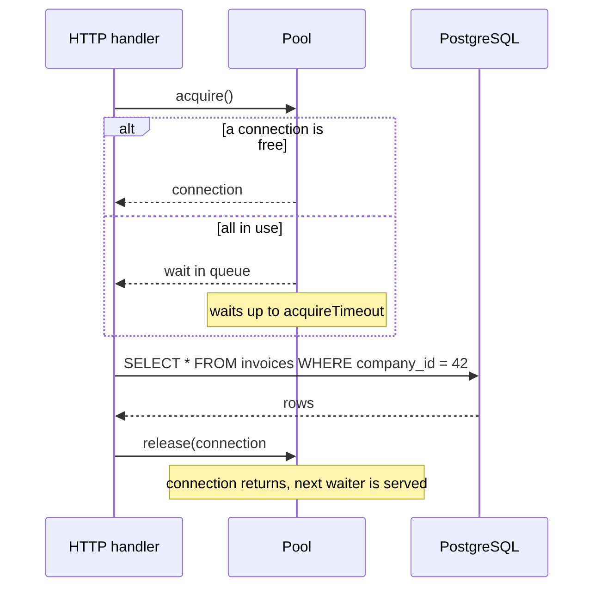
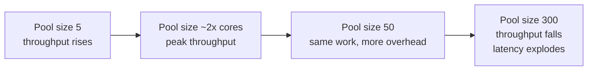

# Connection Pooling — Part 1: Cost, Sizing, and Leaks

Your API is slow. The dashboard says the database CPU is at 20%, disk is quiet,
and no query in the slow log takes more than 40 ms. But every request waits two
seconds before it does anything. The database is not busy — your application is
standing in a queue to *talk* to it.

That queue is the connection pool. This file explains what a pool is, why
PostgreSQL makes pools necessary, how to size one (the answer surprises most
people), and the two failure modes you will actually meet: the multiplication
trap and the leaked connection.

> **📌 In one line:** a connection in PostgreSQL is an operating-system process,
> not a socket — so you reuse a small number of them instead of making new ones,
> and "small" really does mean small.

## Table of Contents

1. [Why a Connection Is Expensive in PostgreSQL](#why-a-connection-is-expensive-in-postgresql)
2. [What a Pool Is](#what-a-pool-is)
3. [The Settings That Matter](#the-settings-that-matter)
4. [Sizing: Why a Bigger Pool Is Usually Slower](#sizing-why-a-bigger-pool-is-usually-slower)
5. [The Multiplication Trap](#the-multiplication-trap)
6. [Recognising an Exhausted Pool](#recognising-an-exhausted-pool)
7. [Pool Leaks](#pool-leaks)
8. [Common Mistakes](#common-mistakes)
9. [Questions to Test Yourself](#questions-to-test-yourself)
10. [Related](#related)

---

## Why a Connection Is Expensive in PostgreSQL

Most databases handle a new client with a thread. PostgreSQL does something
heavier: the supervisor process (the *postmaster*) **forks a whole operating
system process** for every connection. That process is called a *backend*, and
it lives for as long as the connection lives.

```text
                       ┌──────────────┐
   client connects ──▶ │  postmaster  │
                       └──────┬───────┘
                              │ fork()
      ┌────────────┬──────────┼──────────┬────────────┐
      ▼            ▼          ▼          ▼            ▼
  ┌────────┐  ┌────────┐  ┌────────┐ ┌────────┐  ┌────────┐
  │backend │  │backend │  │backend │ │backend │  │backend │
  │ ~8 MB  │  │ ~8 MB  │  │ ~8 MB  │ │ ~8 MB  │  │ ~8 MB  │
  └────────┘  └────────┘  └────────┘ └────────┘  └────────┘
```

Three separate costs come out of that design.

**1. Setup time.** Opening a connection means a TCP handshake, then usually a
TLS handshake, then authentication, then the `fork()` and the new backend's own
startup work. On a normal network that is roughly **20–50 ms**, and more across
availability zones. A query that takes 3 ms now costs 40 ms because you paid for
a connection you threw away afterwards.

**2. Memory.** Each backend holds private memory that is not shared with the
others — its catalog cache, plan cache, and buffers. A quiet backend is commonly
**5–10 MB**. Then every sort, hash join, or `ORDER BY` node in a running query
can allocate up to `work_mem` *per node*, so an active backend can be far
larger. Five hundred idle connections can eat several gigabytes before a single
query runs.

**3. Scheduling.** The operating system has to schedule all those processes.
PostgreSQL also keeps shared state (the lock table, the snapshot list) that gets
more expensive to scan as the number of backends grows.

> **⚠️ Warning:** `max_connections` in `postgresql.conf` is a hard ceiling, often
> left at 100. Connection 101 does not queue — it is rejected with
> `FATAL: sorry, too many clients already`. That is an error your users see.

MySQL uses threads instead of processes, so a connection there is cheaper. The
advice below still applies to MySQL, just with more headroom.

---

## What a Pool Is

Think of a **taxi rank** outside a train station. Five taxis wait there. A
passenger walks up, takes the one at the front, rides somewhere, and the taxi
comes back to the rank for the next passenger. Nobody builds a new taxi for each
passenger, and nobody lets a passenger keep a taxi parked outside their house
all day.

A connection pool is that rank. It opens a fixed set of connections when the
application starts and lends them out. Your code does not open connections — it
**borrows** one, uses it, and **returns** it.



Three states matter, and every pool metric is about them:

```text
  pool size = 10

  ┌───────────────────────────────────────────────┐
  │ in use: 7      idle: 3      waiting queue: 0  │  healthy
  ├───────────────────────────────────────────────┤
  │ in use: 10     idle: 0      waiting queue: 46 │  exhausted
  └───────────────────────────────────────────────┘
```

When the pool is exhausted, requests do not fail immediately. They **queue**.
Each waiter sits there until either a connection is returned or the acquire
timeout fires. This is why an exhausted pool looks like "everything is slow"
rather than "the database is down".

---

## The Settings That Matter

Every pool library uses different names for the same ideas. These are the five
that change behaviour.

| Setting | Plain meaning | Sensible start | If set wrong |
|---|---|---|---|
| `min` | Connections kept open even when idle | 2–5 | Too low: cold-start latency after a quiet period |
| `max` | Hard ceiling of connections this instance opens | See sizing below | Too high: the database thrashes; too low: queueing |
| Idle timeout | Close a connection unused for this long | 30–60 s | Too short: constant reconnect churn |
| Acquire timeout | How long a caller waits for a free connection | 3–10 s | Too long: requests pile up instead of failing fast |
| `statement_timeout` | Server-side cap on one query's runtime | 5–15 s for web requests | Unset: one runaway query holds a pool slot forever |

`statement_timeout` is a PostgreSQL setting, not a pool setting, but it belongs
in this table because it is the only one that can *free* a stuck connection.
Without it, a query that will never finish holds its pool slot until someone
notices.

```ts
// AdonisJS: config/database.ts
// Express/Knex uses the same `pool` block; node-postgres calls max "max" too.
export default defineConfig({
  connections: {
    postgres: {
      client: 'pg',
      connection: {
        host: env.get('DB_HOST'),
        database: env.get('DB_DATABASE'),
        // Applied to every connection the pool opens.
        options: '-c statement_timeout=10000',
      },
      pool: {
        min: 2,
        max: 10,
        acquireTimeoutMillis: 5000,   // fail fast instead of queueing forever
        idleTimeoutMillis: 30000,
      },
    },
  },
})
```

---

## Sizing: Why a Bigger Pool Is Usually Slower

Here is the part that feels wrong the first time you read it.

**More connections do not make the database do more work. Past a point, they
make it do less.**

A database server has a fixed number of CPU cores and a fixed amount of disk
parallelism. If the machine has 4 cores, then **4 queries can actually run at
any instant**. Everything else is waiting, whether it waits politely in your
pool or noisily inside the database.

The difference is that waiting inside the database is not free:

- **Context switching.** The operating system keeps swapping between 200
  backends, and each swap costs cache misses.
- **Lock contention.** More concurrent transactions means more of them fighting
  for the same rows and the same internal structures.
- **Memory pressure.** Each active query can claim `work_mem` per sort node.
  200 concurrent queries can push the machine into swap, and a swapping database
  is a stopped database.



The practical starting formula, used widely and worth memorising:

```text
  connections = (cpu_cores × 2) + effective_disk_spindles
```

On a modern 4-core cloud instance with SSD storage, that gives roughly
**8–12 connections in total** for a purely CPU-and-disk-bound workload. Round it
to 10 and measure.

Why `× 2` and not `× 1`? Because a query is not always using the CPU. It also
waits for disk reads and network writes. The doubling gives the CPU something to
switch to during those waits. Add more than that and you are just paying for
switching with nothing to gain.

> **💡 Tip:** the number to tune is *total connections to the database*, not the
> pool size of one process. Start from the database's capacity and divide
> backwards into per-instance pools. The next section is why.

Two adjustments to the formula:

- If your queries wait on **external things inside a transaction** (they should
  not — see Part 2), you need more connections. Fix the transactions instead.
- If the database also serves background jobs and migrations, reserve a slice
  for them. A migration that cannot get a connection is a stuck deploy.

---

## The Multiplication Trap

A pool is per **process**, not per application. This is where real outages come
from.

```text
  max_connections = 100   (the database's hard limit)

  10 app instances  ×  pool max 20   =  200 connections wanted
  ─────────────────────────────────────────────────────────────
  100 succeed. The other 100 get:
  FATAL: sorry, too many clients already
```

Work the real arithmetic for a typical deployment:

| Consumer | Instances | Pool max | Connections |
|---|---|---|---|
| API servers | 6 | 10 | 60 |
| Background worker | 2 | 5 | 10 |
| Scheduled jobs / cron | 1 | 3 | 3 |
| Migrations during deploy | 1 | 2 | 2 |
| Superuser reserved slots | — | — | 3 |
| Your `psql` session, monitoring agent | — | — | 5 |
| **Total** | | | **83** |

83 against `max_connections = 100` is a comfortable fit. Now autoscaling adds
four more API instances during a traffic spike:

```text
  10 API × 10  +  10 + 3 + 2 + 3 + 5  =  123     ✗ over the limit
```

**This is the silent part.** Nobody changed the pool config. Nobody deployed
anything. The scaling rule that was supposed to *help* with the traffic spike is
what turns a slow minute into an outage — and it fires exactly when load is
highest, so the failure lands on your busiest traffic.

> **⚠️ Warning:** calculate your pool size from **maximum** instance count, not
> the usual count. If your autoscaler can reach 20 instances, your pool budget is
> based on 20, even if you normally run 6.

Three ways out, in order of preference:

1. **Shrink the per-instance pool.** With 20 possible instances and a budget of
   80 connections, each pool gets 4. That feels tiny and it is usually correct —
   the database can only run a handful of queries at once anyway.
2. **Put PgBouncer in front** so thousands of client connections share a few
   dozen real ones. Covered in [Part 2](01-connection-pooling-part-2.md).
3. **Raise `max_connections`.** The last resort, and it costs memory on the
   database server. Raising it does not make the database faster; it only moves
   the queue from your pool into PostgreSQL, where it is worse.

---

## Recognising an Exhausted Pool

The signature is distinctive once you have seen it:

| Symptom | What it looks like |
|---|---|
| Latency | Every endpoint slows at once, including trivial ones |
| Database CPU | Low. The database looks *idle* |
| Slow query log | Empty, or nothing above a few hundred ms |
| Pool metrics | `waitingCount` above zero, `idleCount` at zero |
| Errors | `TimeoutError: Knex: Timeout acquiring a connection` |

The giveaway is the combination of **slow application** and **calm database**.
The time is being spent before the query is ever sent.

First, look at the database side. This query groups current connections by state
and application:

```sql
SELECT
    application_name,
    state,
    count(*)                                    AS connections,
    max(now() - state_change)                   AS longest_in_state
FROM pg_stat_activity
WHERE datname = current_database()
GROUP BY application_name, state
ORDER BY connections DESC;
```

```text
 application_name |        state        | connections | longest_in_state
------------------+---------------------+-------------+------------------
 api-server       | idle                |          52 | 00:04:11
 api-server       | idle in transaction |          14 | 00:09:47
 api-server       | active              |           3 | 00:00:00.412
 worker           | idle                |           9 | 00:01:02
```

Read that output carefully, because it tells the whole story:

- **`active`** — actually running a query right now. Only 3.
- **`idle`** — connected, inside no transaction, doing nothing. Fine. This is a
  pool holding its connections open, which is the point of a pool.
- **`idle in transaction`** — the dangerous one. The session ran `BEGIN`, did
  something, and is now waiting on the application. It holds its locks and its
  snapshot the entire time. Fourteen of them, one for nearly ten minutes.

So the database has 78 connections open and is executing 3 queries. The pool is
full of sessions that are holding connections without using them.

Second, expose your pool's own numbers as metrics. Every library offers them:

```ts
// node-postgres exposes counters directly on the pool object.
setInterval(() => {
  logger.info({
    total: pool.totalCount,    // connections the pool owns
    idle: pool.idleCount,      // free right now
    waiting: pool.waitingCount // callers queued for a connection
  }, 'db.pool')
}, 10_000)
```

> **📌 Remember:** `waiting > 0` for more than a moment is the single clearest
> signal that your pool is the bottleneck. Alert on it.

---

## Pool Leaks

A leak is simple: code borrows a connection and never gives it back. The pool
shrinks by one. Do it on an error path that happens a hundred times a day and by
evening the pool is empty and every request times out.

The classic shape is a manual acquire with an early return between acquire and
release.

```ts
// ❌ BROKEN — every non-happy path leaks the connection forever.
async function archiveProject(projectId: number, userId: number) {
  const client = await pool.connect()

  const project = await client.query(
    'SELECT company_id FROM projects WHERE id = $1', [projectId]
  )

  if (project.rowCount === 0) {
    return null                      // leak: release() never runs
  }

  // If this throws (constraint violation, timeout), we also leak.
  await client.query(
    'UPDATE projects SET archived_at = now() WHERE id = $1', [projectId]
  )

  client.release()
  return project.rows[0]
}
```

There are two leaks here, and the second is worse because it is invisible. An
early `return` is at least visible in the code; a thrown error can come from any
line, including the driver itself.

```ts
// ✅ FIXED — try/finally guarantees release on every exit path.
async function archiveProject(projectId: number, userId: number) {
  const client = await pool.connect()
  try {
    const project = await client.query(
      'SELECT company_id FROM projects WHERE id = $1', [projectId]
    )
    if (project.rowCount === 0) return null

    await client.query(
      'UPDATE projects SET archived_at = now() WHERE id = $1', [projectId]
    )
    return project.rows[0]
  } finally {
    client.release()   // runs on return, on throw, on everything
  }
}
```

Better still, do not manage the connection yourself at all. Use the pool's
managed API, which acquires and releases around your callback:

```ts
// ✅ BEST — the library owns acquire/release; you cannot forget.
const project = await pool.query(
  'UPDATE projects SET archived_at = now() WHERE id = $1 RETURNING company_id',
  [projectId]
)

// AdonisJS transaction — commits on success, rolls back and releases on throw.
const invoice = await db.transaction(async (trx) => {
  const row = await trx.from('invoices').where('id', invoiceId).forUpdate().first()
  await trx.from('invoices').where('id', invoiceId).update({ status: 'paid' })
  return row
})
```

> **💡 Tip:** only reach for a manual `connect()` when you genuinely need several
> statements on the *same* session — a transaction, a cursor, an advisory lock.
> For a single statement, `pool.query()` cannot leak.

How to catch a leak before production does:

- Set the acquire timeout to a few seconds so a leak shows up as a clear error
  instead of a hang.
- Graph `totalCount - idleCount` over time. A leak is a staircase that only
  goes up and never comes down, even at 3 a.m. when traffic is zero.
- Most libraries have a "long-held connection" warning setting. Turn it on in
  staging and log a stack trace.

---

## Common Mistakes

| Mistake | Why it is wrong | Do this instead |
|---|---|---|
| Creating a new `Pool` per request or per module | You now have many pools, each with its own max. Connection count multiplies invisibly | Create one pool at boot and export it |
| Setting pool max to 50 "to be safe" | Past roughly 2× cores you add contention, not throughput, and you blow the `max_connections` budget | Start near `(cores × 2)` total and measure |
| Sizing the pool from the usual instance count | Autoscaling raises instances without raising `max_connections` | Size from the maximum instances the autoscaler can create |
| No acquire timeout | Requests queue forever; the failure looks like a hang with no error | Set 3–10 s so you fail fast and see the error |
| No `statement_timeout` | One runaway query holds a pool slot indefinitely | Set a server-side timeout for web-facing connections |
| Manual `connect()` with early returns | Any return or throw between acquire and release leaks a connection | `try/finally`, or the pool's managed API |
| Treating a high `idle` count as a problem | Idle connections are the pool working correctly | Watch `idle in transaction` and `waiting` instead |

---

## Questions to Test Yourself

1. PostgreSQL forks a process per connection. Name the three distinct costs that
   follow from that, and give a rough number for each.
2. Your API latency is 2 s per request, the database is at 15% CPU, and the slow
   query log is empty. What is your first hypothesis, and which single query do
   you run to confirm it?
3. Explain to a teammate why raising the pool from 20 to 60 made the application
   *slower*, using the words "cores" and "context switching".
4. You run up to 15 API instances and 3 workers. `max_connections` is 100. What
   pool maximum do you give each, and how much headroom did you leave and why?
5. What is the difference between a connection in state `idle` and one in state
   `idle in transaction`? Which one should wake you at night?
6. Write the two-line change that turns the BROKEN `archiveProject` above into
   leak-proof code, and say exactly which failure paths it fixes.
7. Your pool has `waitingCount: 40` and `idleCount: 0`, and the database shows 6
   active queries out of 80 connections. Is the fix a bigger pool? Justify.

---

## Related

- [Connection Pooling — Part 2](01-connection-pooling-part-2.md) — transactions
  and pooling, PgBouncer modes, serverless connection storms, graceful shutdown,
  and layering timeouts.
- [Monitoring and Troubleshooting — Part 1](05-monitoring-and-troubleshooting-part-1.md)
  — the full `pg_stat_activity` toolkit this file only sampled.
- [../transactions-and-concurrency/01-transactions-and-acid-part-2.md](../transactions-and-concurrency/01-transactions-and-acid-part-2.md)
  — why a transaction must be short, which is also why it must not hold a pool slot.
- [../../backend-fundamentals/10-database-integration/01-orm-vs-query-builder.md](../../backend-fundamentals/10-database-integration/01-orm-vs-query-builder.md)
  — where pool configuration lives in an application and how ORMs wrap it.

---

Continued in [Part 2](01-connection-pooling-part-2.md).
