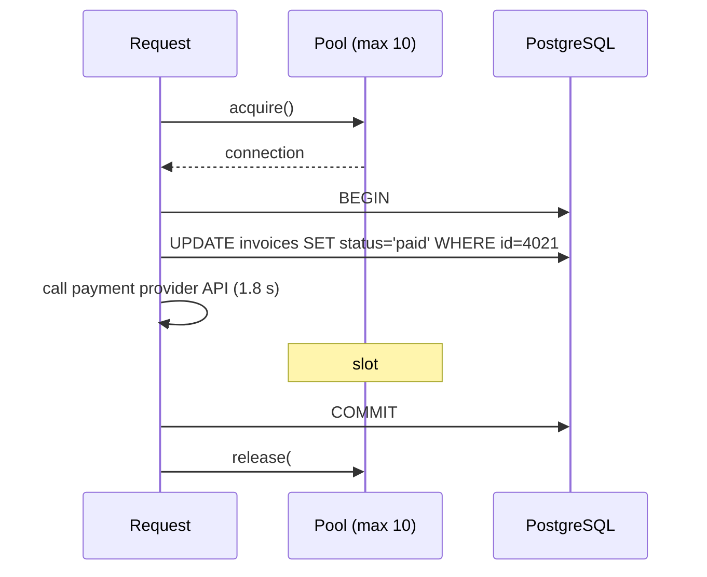
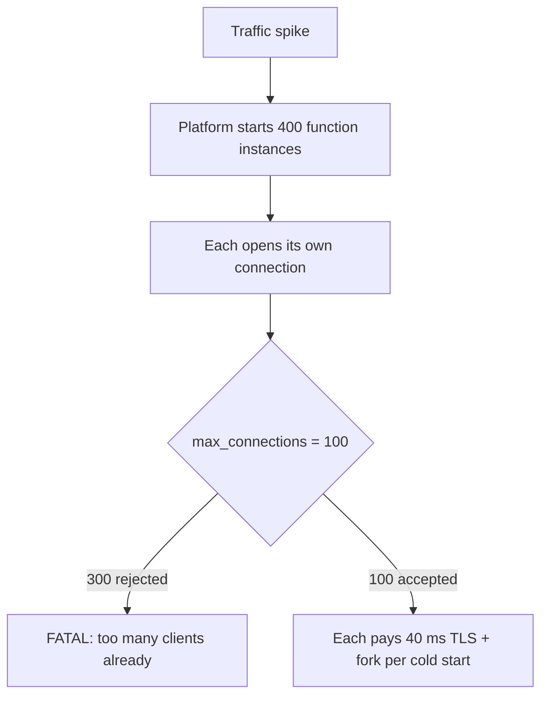
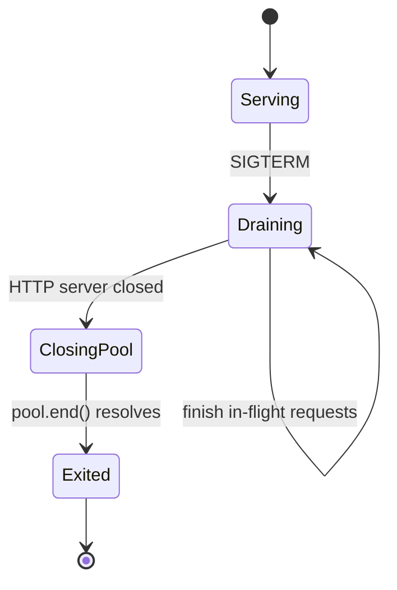

# Connection Pooling — Part 2: Transactions, PgBouncer, and Shutdown

This continues [Part 1](01-connection-pooling-part-1.md).

Part 1 established that a PostgreSQL connection is an operating-system process,
that a pool lends out a small fixed set of them, that a bigger pool is usually
slower, and that pool size multiplied by instance count must stay under
`max_connections`. Part 2 is about the things that *hold* a connection longer
than you meant — transactions — and the tools that let many clients share few
connections: PgBouncer, serverless proxies, and a clean shutdown.

> **📌 In one line:** a pool slot is held for the whole life of a transaction, so
> every "how do I get more connections?" question is really "why is something
> holding a connection while doing nothing?"

## Table of Contents

1. [Transactions Pin a Connection](#transactions-pin-a-connection)
2. [PgBouncer and Its Three Modes](#pgbouncer-and-its-three-modes)
3. [What Transaction Mode Breaks](#what-transaction-mode-breaks)
4. [Serverless and the Connection Storm](#serverless-and-the-connection-storm)
5. [Graceful Shutdown: Draining the Pool](#graceful-shutdown-draining-the-pool)
6. [Advanced: Layering Timeouts](#advanced-layering-timeouts)
7. [Common Mistakes](#common-mistakes)
8. [Questions to Test Yourself](#questions-to-test-yourself)
9. [Related](#related)

---

## Transactions Pin a Connection

A transaction is session state. `BEGIN`, the statements, and `COMMIT` must all
travel down the **same** connection, because the open transaction, its locks,
and its snapshot live inside that one backend process.

So the moment your code opens a transaction, that pool slot is **pinned**. It is
unavailable to every other request until `COMMIT` or `ROLLBACK`.



That 1.8-second HTTP call is the problem. The database did nothing for 1.8
seconds, but one tenth of your pool was gone.

The arithmetic is unforgiving. With a pool of 10 and transactions that hold a
connection for 2 seconds, you can serve **5 such requests per second** — no
matter how fast your queries are.

```ts
// ❌ BROKEN — an external call inside the transaction pins the connection
//            and holds a row lock for the whole round trip.
await db.transaction(async (trx) => {
  const invoice = await trx.from('invoices').where('id', invoiceId).first()
  const charge = await stripe.charges.create({ amount: invoice.amount_cents })
  await trx.from('invoices').where('id', invoiceId).update({
    status: 'paid', paid_at: new Date(), provider_ref: charge.id,
  })
})
```

```ts
// ✅ FIXED — the network call happens outside the transaction. The database
//           is only touched for the short write that records the result.
const invoice = await db.from('invoices').where('id', invoiceId).first()
const charge = await stripe.charges.create({ amount: invoice.amount_cents })

await db.transaction(async (trx) => {
  await trx.from('invoices')
    .where({ id: invoiceId, status: 'pending' })   // guard against double-pay
    .update({ status: 'paid', paid_at: new Date(), provider_ref: charge.id })
})
```

The guard on `status` matters: outside a transaction two requests could both
read `pending`, so the `WHERE` clause makes the write itself the check.

The rules that follow:

- Open the transaction as **late** as possible and close it as **early** as
  possible.
- Never put an HTTP call, a queue publish, an email send, or a file upload
  inside one.
- Do computation before `BEGIN`, not between `BEGIN` and `COMMIT`.
- A long-running transaction also blocks vacuum — see
  [02-vacuum-and-autovacuum-part-2.md](02-vacuum-and-autovacuum-part-2.md).

For the locking and isolation mechanics behind all of this, see
[../transactions-and-concurrency/](../transactions-and-concurrency/), especially
[01-transactions-and-acid-part-1.md](../transactions-and-concurrency/01-transactions-and-acid-part-1.md)
and [04-locks-part-1.md](../transactions-and-concurrency/04-locks-part-1.md).

---

## PgBouncer and Its Three Modes

Your application pool solves "do not open a connection per query". It does not
solve "twenty instances each want their own pool". For that you put a second,
shared pool **outside** the application: a connection pooler. PgBouncer is the
common choice for PostgreSQL.

```text
  ┌──────────┐ ┌──────────┐ ┌──────────┐   many client connections
  │  app 1   │ │  app 2   │ │  app 20  │   (cheap, PgBouncer is one process)
  └────┬─────┘ └────┬─────┘ └────┬─────┘
       └────────────┼────────────┘
                    ▼
            ┌───────────────┐
            │   PgBouncer   │   1000 clients in, 20 server connections out
            └───────┬───────┘
                    ▼
            ┌───────────────┐
            │  PostgreSQL   │   20 backend processes
            └───────────────┘
```

PgBouncer is lightweight because it does not fork per client. The whole trick is
*when* it hands a real server connection back to its own pool.

| Mode | A server connection is returned when | Reuse | Safe for |
|---|---|---|---|
| **Session** | The client disconnects | Poor — same as no pooler for long-lived clients | Anything; it changes no semantics |
| **Transaction** | `COMMIT` or `ROLLBACK` completes | Very good — this is the useful mode | Apps that avoid session state |
| **Statement** | Each single statement completes | Extreme | Autocommit-only workloads; multi-statement transactions are rejected |

**Session mode** is safe but mostly pointless if your app already pools: each
client still owns a server connection for its whole life.

**Transaction mode** is the reason PgBouncer exists. Between your transactions,
the server connection goes back to the shared pool and serves someone else. A
hundred application connections can sit on top of fifteen real ones, because at
any instant most of them are idle.

**Statement mode** forbids multi-statement transactions entirely. It exists for
narrow read-only workloads. Assume you do not want it.

You need a pooler when:

- Instance count × pool size is pushing `max_connections` (the multiplication
  trap from Part 1).
- You run serverless or short-lived processes.
- You have many small services each needing a few connections.

You do **not** need one when you run three stable instances with a pool of 10
each. Adding a pooler adds a network hop, a process to monitor, and a new
failure point.

---

## What Transaction Mode Breaks

Transaction mode gives your transaction a *different server connection each
time*. So anything that assumes "the same session as last time" breaks — usually
not at deploy, but later, in a way that is hard to trace.

| Feature | Why it breaks in transaction mode | What to do |
|---|---|---|
| **Prepared statements** | Prepared on one server connection, executed on another. Common symptom: `prepared statement "s1" does not exist` | Disable server-side prepares in the driver, or use recent PgBouncer's prepared-statement support and check your version |
| **Session-level `SET`** | `SET search_path` / `SET timezone` applies to the connection you happened to get; the next statement may land elsewhere | Use `SET LOCAL` inside a transaction, or set it in the connection string |
| **`LISTEN` / `NOTIFY`** | `LISTEN` registers interest on one backend. Your notification arrives on a connection nobody is holding | Use a dedicated direct connection (bypass the pooler) for listeners |
| **Advisory locks across statements** | A session-level advisory lock is released only by the session that took it — which you no longer have | Use transaction-scoped `pg_advisory_xact_lock()`, which releases at `COMMIT` |
| **Temporary tables** | `CREATE TEMP TABLE` lives in one session and vanishes from your next statement's point of view | Use a CTE, or a real table with a cleanup job |
| **Cursors held outside a transaction** | `WITH HOLD` cursors survive commit on one session only | Keep cursors inside one transaction |

```sql
-- ❌ BROKEN under PgBouncer transaction mode:
-- these two statements may run on different server connections.
SELECT pg_advisory_lock(42);
UPDATE projects SET status = 'archived' WHERE company_id = 42;
SELECT pg_advisory_unlock(42);

-- ✅ FIXED — transaction-scoped lock, released automatically at COMMIT,
--           and guaranteed to be on the same connection as the UPDATE.
BEGIN;
SELECT pg_advisory_xact_lock(42);
UPDATE projects SET status = 'archived' WHERE company_id = 42;
COMMIT;
```

> **⚠️ Warning:** these failures are intermittent. Under light load PgBouncer may
> hand you the same connection twice and everything works. The bug appears under
> load, in production, months later.

---

## Serverless and the Connection Storm

Serverless functions turn the pooling model inside out. Each invocation is a
short-lived process. There is no long-running application to hold a pool.



Two things go wrong at once. The **storm**: hundreds of instances connect within
a second. And the **waste**: each connection is used for one 5 ms query and then
abandoned, so you paid 40 ms of setup for 5 ms of work.

The standard answers, in rough order of preference:

1. **Put a pooler in the middle.** PgBouncer in transaction mode, or your cloud
   provider's managed equivalent (RDS Proxy, Cloud SQL connectors, or the
   HTTP-based proxies some Postgres platforms offer). Functions connect to the
   pooler; the pooler holds a small stable set of real connections.
2. **Set the per-instance pool to 1.** A serverless instance handles one request
   at a time. A pool of 10 there is 10 times the connections for no benefit.
3. **Reuse the connection across invocations.** Declare the client *outside* the
   handler so a warm instance reuses it. This is the single cheapest fix.
4. **Query over HTTP.** Some platforms expose a stateless HTTP query endpoint,
   which removes the connection concept entirely for simple queries.
5. **Do not run serverless for database-heavy work.** A small always-on service
   with a normal pool is often simpler and cheaper.

```ts
// ❌ BROKEN — a new pool per invocation. Every cold start pays full setup,
//            and nothing is ever reused.
export async function handler(event: ApiEvent) {
  const pool = new Pool({ connectionString: process.env.DATABASE_URL })
  const res = await pool.query('SELECT id, name FROM companies WHERE id = $1', [event.companyId])
  await pool.end()
  return res.rows[0]
}

// ✅ FIXED — module scope, so a warm instance reuses the connection.
//            max: 1 because this instance serves one request at a time.
const pool = new Pool({ connectionString: process.env.DATABASE_URL, max: 1 })

export async function handler(event: ApiEvent) {
  const res = await pool.query('SELECT id, name FROM companies WHERE id = $1', [event.companyId])
  return res.rows[0]
}
```

---

## Graceful Shutdown: Draining the Pool

When you deploy, the orchestrator sends `SIGTERM` to your process and waits a
grace period before `SIGKILL`. If you exit immediately, in-flight requests die
mid-transaction. Those transactions roll back, but the user sees a 502 and the
connections are torn down abruptly.

The correct order matters: stop *taking* work before you stop *doing* work.



```ts
let shuttingDown = false

async function shutdown(signal: string) {
  if (shuttingDown) return          // SIGTERM can arrive twice
  shuttingDown = true
  logger.info({ signal }, 'shutdown started')

  // 1. Stop accepting new connections; in-flight requests keep running.
  //    Readiness probes should already be failing so the load balancer
  //    stopped sending traffic before this point.
  await new Promise<void>((resolve) => server.close(() => resolve()))

  // 2. Stop background workers that also borrow connections.
  await jobQueue.stop()

  // 3. Now the pool should be idle. end() waits for borrowed connections
  //    to be returned, then closes them cleanly.
  await pool.end()

  logger.info('shutdown complete')
  process.exit(0)
}

process.on('SIGTERM', () => shutdown('SIGTERM'))
process.on('SIGINT', () => shutdown('SIGINT'))
```

> **⚠️ Warning:** calling `pool.end()` first is a common mistake. In-flight
> requests then fail with "pool is ended" — you converted a clean deploy into
> errors for exactly the users you were trying to protect.

Three details that decide whether this actually works:

- **Fail the readiness probe first**, ideally a few seconds before closing the
  server, so the load balancer drains you before you stop listening.
- **Keep the drain shorter than the grace period.** If Kubernetes kills at 30 s
  and your longest request takes 60 s, the drain never completes. Cap request
  duration instead.
- **Add a hard timeout** on the whole shutdown so a stuck connection cannot hang
  the deploy forever.

The process lifecycle around this lives in
[../../backend-fundamentals/03-request-lifecycle/01-anatomy-of-a-backend-app.md](../../backend-fundamentals/03-request-lifecycle/01-anatomy-of-a-backend-app.md).

---

## Advanced: Layering Timeouts

Every layer of the stack has a timeout. If they are set carelessly, the **wrong
one fires first**, and you lose the information that would have told you what
went wrong.

The rule: **the innermost timeout must be the shortest.** Each outer layer gets
more time than the layer inside it.

```text
   load balancer      60 s   ────────────────────────────────────────┐
   HTTP request       30 s   ──────────────────────────────┐         │
   pool acquire        5 s   ──────────────┐               │         │
   statement_timeout  10 s   ────────┐     │               │         │
                                     ▼     ▼               ▼         ▼
                                  query  acquire        request     LB
```

| Layer | Setting | Example | Fires when |
|---|---|---|---|
| Query | `statement_timeout` | 10 s | One SQL statement runs too long |
| Lock wait | `lock_timeout` | 3 s | A statement waits too long for a lock |
| Idle transaction | `idle_in_transaction_session_timeout` | 60 s | A transaction is left open by a stuck app |
| Pool | Acquire timeout | 5 s | No connection became free in time |
| Application | HTTP request timeout | 30 s | The whole handler is too slow |
| Edge | Load balancer / proxy timeout | 60 s | Everything else already failed |

Why the ordering matters in practice. Suppose the load balancer times out at
15 s and `statement_timeout` is 30 s. A slow query runs; the load balancer gives
up at 15 s and returns 504 to the user; the client disconnects — **but the query
keeps running on the database**, still holding its pool slot and its locks. You
get a 504 with no error in your logs and a connection you cannot account for.
Reverse the order and you get a clean `canceling statement due to statement
timeout` naming the exact query.

```sql
-- Set on the connection string or per role, not per query.
ALTER ROLE api_user SET statement_timeout = '10s';
ALTER ROLE api_user SET lock_timeout = '3s';
ALTER ROLE api_user SET idle_in_transaction_session_timeout = '60s';

-- Background reporting jobs legitimately need longer.
ALTER ROLE report_user SET statement_timeout = '10min';
```

`idle_in_transaction_session_timeout` is the safety net for the `idle in
transaction` sessions you saw in Part 1. It kills a session that opened a
transaction and stopped talking — freeing its pool slot, its locks, and its
snapshot.

> **📌 Remember:** separate database roles for web requests and background jobs
> let you give each the timeout it deserves. One global value is always wrong for
> somebody.

Errors from these timeouts should be classified and handled, not swallowed —
see
[../../backend-fundamentals/07-error-handling/01-error-taxonomy.md](../../backend-fundamentals/07-error-handling/01-error-taxonomy.md).

---

## Common Mistakes

| Mistake | Why it is wrong | Do this instead |
|---|---|---|
| HTTP call inside a transaction | Pins a pool slot and holds locks for the full round trip | Do network work before `BEGIN` |
| Using PgBouncer transaction mode with server-side prepared statements | `prepared statement does not exist` under load | Disable server-side prepares, or check your PgBouncer version's support |
| Session-level `pg_advisory_lock` behind a pooler | The unlock may run on a different connection; the lock never releases | `pg_advisory_xact_lock` inside a transaction |
| `LISTEN` through a transaction-mode pooler | Notifications arrive on a connection nobody holds | A dedicated direct connection for listeners |
| A pool of 10 in a serverless function | One request per instance; 9 connections are pure waste | `max: 1`, client at module scope, plus a pooler |
| `pool.end()` before closing the HTTP server | In-flight requests fail with "pool is ended" | Close the server, stop workers, then end the pool |
| Load balancer timeout shorter than `statement_timeout` | The user gets a 504 while the query keeps burning a pool slot | Innermost timeout shortest, outermost longest |
| No `idle_in_transaction_session_timeout` | One stuck client holds locks and blocks vacuum indefinitely | Set it per role |

---

## Questions to Test Yourself

1. Your pool has 10 connections and each transaction holds one for 2 seconds.
   What is the maximum request rate, and why does making the queries faster not
   help?
2. Explain in two sentences why PgBouncer in transaction mode lets 500 clients
   share 20 server connections, and what assumption that relies on.
3. You deploy PgBouncer in transaction mode and a week later see intermittent
   `prepared statement "s3" does not exist`. What happened, and name two fixes.
4. Why does `pg_advisory_xact_lock()` work behind a pooler when
   `pg_advisory_lock()` does not?
5. A serverless endpoint works in testing and fails with "too many clients" on
   launch day. Give three changes, ordered by how much each helps.
6. Put these in the order they should fire, shortest first: load balancer
   timeout, pool acquire timeout, HTTP request timeout, `statement_timeout`.
   Then describe what goes wrong if the first and last are swapped.
7. Write the correct shutdown sequence in four steps, and say what breaks if you
   swap the first two.

---

## Related

- [Connection Pooling — Part 1](01-connection-pooling-part-1.md) — why
  connections are expensive, pool sizing, the multiplication trap, and leaks.
- [02-vacuum-and-autovacuum-part-2.md](02-vacuum-and-autovacuum-part-2.md) — the
  long-running transaction that pins a pool slot also blocks vacuum.
- [05-monitoring-and-troubleshooting-part-1.md](05-monitoring-and-troubleshooting-part-1.md)
  — finding idle-in-transaction sessions and terminating them safely.
- [../transactions-and-concurrency/04-locks-part-1.md](../transactions-and-concurrency/04-locks-part-1.md)
  — what a pinned transaction is actually holding while it waits.
- [../../backend-fundamentals/03-request-lifecycle/01-anatomy-of-a-backend-app.md](../../backend-fundamentals/03-request-lifecycle/01-anatomy-of-a-backend-app.md)
  — process startup and shutdown around the pool.
- [../../backend-fundamentals/07-error-handling/01-error-taxonomy.md](../../backend-fundamentals/07-error-handling/01-error-taxonomy.md)
  — classifying timeout and connection errors for retry decisions.
