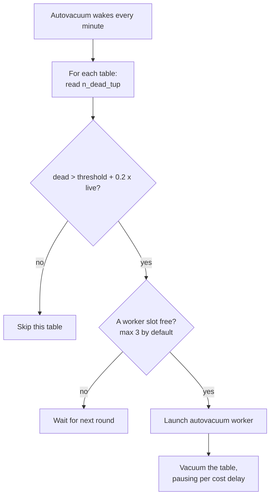

# Vacuum and Autovacuum — Part 1: What It Does and How It Is Triggered

Three things happen to a PostgreSQL database that is not vacuumed properly.
Tables grow much larger than the data inside them. Queries that used to take
20 ms start taking 2 seconds, because the database reads mostly empty pages. And
eventually — this is not a metaphor — **the database refuses to accept writes**
to protect itself.

Vacuum prevents all three. It is not an optimisation you turn on when you have
time. It is maintenance the database must do to keep working, and your job is to
make sure it can.

> **📌 In one line:** an `UPDATE` in PostgreSQL leaves the old row behind, and
> vacuum is the process that makes that leftover space usable again.

## Table of Contents

1. [Why Dead Rows Exist](#why-dead-rows-exist)
2. [What VACUUM Actually Does](#what-vacuum-actually-does)
3. [VACUUM vs VACUUM FULL](#vacuum-vs-vacuum-full)
4. [Autovacuum: What Triggers It](#autovacuum-what-triggers-it)
5. [The Large Table Problem](#the-large-table-problem)
6. [Tuning Autovacuum Per Table](#tuning-autovacuum-per-table)
7. [How Hard Autovacuum Works: Cost Delay](#how-hard-autovacuum-works-cost-delay)
8. [Common Mistakes](#common-mistakes)
9. [Questions to Test Yourself](#questions-to-test-yourself)
10. [Related](#related)

---

## Why Dead Rows Exist

Three sentences, because this is covered properly elsewhere.

PostgreSQL uses MVCC (Multi-Version Concurrency Control): an `UPDATE` does not
change a row in place, it writes a **new version** of the row and marks the old
one as deleted from a certain transaction onwards. The old version must stay on
disk while any older transaction might still need to see it. Once no transaction
can see it any more, it is a **dead tuple** — wasted space that nothing will ever
read again.

For the full mechanics — `xmin`, `xmax`, snapshots, visibility — read
[../transactions-and-concurrency/03-mvcc-part-1.md](../transactions-and-concurrency/03-mvcc-part-1.md).
This file is about the cleanup.

The important consequence: **a `DELETE` does not free space, and an `UPDATE`
consumes space.** A table where every row is updated once a day doubles in size
each day unless something cleans up.

```text
  UPDATE invoices SET status = 'paid' WHERE id = 4021;

  before:  [ ... | invoice 4021 (pending) | ... ]
  after:   [ ... | invoice 4021 (dead)    | ... | invoice 4021 (paid) ]
                  ^^^^^^^^^^^^^^^^^^^^^^^
                  still occupies disk space
```

---

## What VACUUM Actually Does

`VACUUM` walks the table, finds tuples that no transaction can see any more, and
does three things.

**1. Marks their space reusable.** Not returned to the operating system — marked
as free *inside the table file*, in a structure called the free space map. The
next `INSERT` or `UPDATE` can write there instead of growing the file.

```text
  page 4172, before VACUUM                page 4172, after VACUUM
  ┌──────────────────────────┐            ┌──────────────────────────┐
  │ tuple 1  live            │            │ tuple 1  live            │
  │ tuple 2  DEAD            │            │ ······  free space ····· │
  │ tuple 3  DEAD            │            │ ······  free space ····· │
  │ tuple 4  live            │            │ tuple 4  live            │
  │ tuple 5  DEAD            │            │ ······  free space ····· │
  │ (no room for new rows)   │            │ (room for 3 new rows)    │
  └──────────────────────────┘            └──────────────────────────┘
      file size: 8 KB                         file size: 8 KB
```

The file is the same size afterwards. That is the point people miss: **plain
vacuum stops the table growing; it does not shrink it.**

**2. Updates the visibility map.** This is a small bitmap with two bits per page,
recording "every tuple on this page is visible to everyone" and "every tuple on
this page is frozen". It makes index-only scans possible and lets later vacuums
skip pages entirely. More on this in
[Part 2](02-vacuum-and-autovacuum-part-2.md).

**3. Removes matching index entries.** Dead tuples have index pointers too, and
those are cleaned in the same pass. This is why vacuum cost grows with the number
of indexes on a table.

`ANALYZE` is a separate job that samples the table and updates the planner's
statistics. Autovacuum runs both, and you can run them together by hand:

```sql
-- Clean dead tuples and refresh planner statistics for one table.
VACUUM (VERBOSE, ANALYZE) invoices;
```

```text
INFO:  vacuuming "public.invoices"
INFO:  scanned index "invoices_pkey" to remove 184203 row versions
INFO:  "invoices": removed 184203 row versions in 6140 pages
INFO:  "invoices": found 184203 removable, 2418877 nonremovable row versions
       in 41982 out of 128340 pages
DETAIL:  0 dead row versions cannot be removed yet, oldest xmin: 918237741
```

Read the last line every time. `0 dead row versions cannot be removed yet` means
vacuum could clean everything it found. A large number there means something is
holding an old snapshot, which is the subject of Part 2.

Stale statistics are a separate problem with its own symptoms — see
[../query-planner/cardinality-estimation-and-statistics.md](../query-planner/cardinality-estimation-and-statistics.md).

---

## VACUUM vs VACUUM FULL

This is the single most important operational distinction in this file, and
getting it wrong causes outages.

| | `VACUUM` | `VACUUM FULL` |
|---|---|---|
| What it does | Marks dead space reusable in place | Rewrites the whole table into a new file |
| File size after | Unchanged | Shrunk to the live data |
| Space returned to OS | No | Yes |
| Lock taken | `SHARE UPDATE EXCLUSIVE` | `ACCESS EXCLUSIVE` |
| Blocks `SELECT`? | No | **Yes** |
| Blocks `INSERT`/`UPDATE`? | No | **Yes** |
| Extra disk needed | None | Up to another full copy of the table |
| Rebuilds indexes | No | Yes |
| Runs automatically | Yes (autovacuum) | Never |
| Safe on a live table | Yes | **No** |

> **⚠️ Warning:** `VACUUM FULL` on a live production table is one of the most
> common ways an engineer causes an outage. It takes an `ACCESS EXCLUSIVE` lock,
> which blocks *everything* on that table — including plain `SELECT`. On a 40 GB
> table that can mean twenty minutes of total unavailability, and it will not
> stop when you press Ctrl-C in the wrong window.

It is worse than it sounds, because of queueing. While `VACUUM FULL` holds the
lock, every query that arrives joins a queue behind it — and those queries hold
*their* pool slots. Your connection pool fills within seconds and the whole
application goes down, not just the feature that touches that table. See
[../transactions-and-concurrency/04-locks-part-1.md](../transactions-and-concurrency/04-locks-part-1.md)
for the queueing mechanism.

What to do instead when a table really is bloated:

1. **Accept the bloat.** A table with 30% free space is *working normally*. That
   space will be reused by the next writes. Reclaiming it only to refill it is
   wasted risk.
2. **Use `pg_repack`.** An extension that rewrites the table into a new file
   while the table stays online, taking a brief exclusive lock only at the swap
   at the end. This is the standard answer for a genuinely bloated live table.
3. **Fix the cause.** Bloat that keeps coming back means vacuum is being blocked
   or is running too rarely. Part 2 is about finding out which.
4. **`VACUUM FULL` only in a planned maintenance window**, on a table you have
   measured, with the duration estimated from a copy.

```sql
-- Measure before you act: how much of this table is actually dead?
SELECT
    relname                                   AS table_name,
    n_live_tup,
    n_dead_tup,
    round(100.0 * n_dead_tup
          / nullif(n_live_tup + n_dead_tup, 0), 1) AS dead_pct,
    pg_size_pretty(pg_total_relation_size(relid)) AS total_size
FROM pg_stat_user_tables
ORDER BY n_dead_tup DESC
LIMIT 10;
```

```text
  table_name    | n_live_tup | n_dead_tup | dead_pct | total_size
----------------+------------+------------+----------+------------
 notifications  |    8412003 |    6209884 |     42.5 | 9184 MB
 tasks          |    2341882 |     118422 |      4.8 | 3021 MB
 invoices       |    2418877 |      12043 |      0.5 | 1204 MB
```

`notifications` at 42% dead is a real problem worth acting on. `invoices` at
0.5% is healthy and needs nothing.

The reclaim script people write, and the one they should write:

```sql
-- ❌ BROKEN — deletes 6 million rows in one transaction, then takes an
--            ACCESS EXCLUSIVE lock on a 9 GB table during business hours.
DELETE FROM notifications
WHERE created_at < now() - interval '90 days';

VACUUM FULL notifications;
```

Two problems. The single huge `DELETE` runs as one long transaction, which
itself blocks vacuum everywhere else in the database (Part 2 explains why). Then
`VACUUM FULL` blocks every reader and writer of the table until it finishes.

```sql
-- ✅ FIXED — delete in small batches so each transaction is short, and let
--           autovacuum reuse the freed space in place. No exclusive lock.
DELETE FROM notifications
WHERE id IN (
    SELECT id
    FROM notifications
    WHERE created_at < now() - interval '90 days'
    ORDER BY id
    LIMIT 10000
);
-- Repeat in a loop from the application or a job, with a short pause
-- between batches, until zero rows are affected.
```

Batch deletes are covered in more depth in
[../query-patterns/bulk-write-performance.md](../query-patterns/bulk-write-performance.md).

---

## Autovacuum: What Triggers It

You almost never run `VACUUM` by hand. A background process called **autovacuum**
does it for you. Understanding when it decides to act is most of the skill.

Autovacuum wakes up every `autovacuum_naptime` (default 1 minute), looks at
every table, and compares the dead tuple count against a threshold it computes:

```text
  vacuum threshold =
        autovacuum_vacuum_threshold            (default 50 rows)
      + autovacuum_vacuum_scale_factor         (default 0.2 = 20%)
      × number of live rows in the table
```

In plain words: **vacuum this table when 20% of its rows are dead, plus 50.**



A separate, similar rule triggers `ANALYZE`, using
`autovacuum_analyze_scale_factor` (default 0.1, so 10%) — statistics are
refreshed twice as eagerly as space is reclaimed.

Two limits are worth knowing:

- `autovacuum_max_workers` (default 3) — only three tables are vacuumed at once
  across the whole database. A big table can starve the small ones.
- `autovacuum_naptime` (default 1 minute) — the shortest possible delay before
  a table is even considered.

---

## The Large Table Problem

The default scale factor of 0.2 is reasonable for a small table and absurd for a
large one. Work it out.

| Table | Live rows | Dead rows needed before vacuum runs |
|---|---|---|
| `companies` | 5,000 | 1,050 |
| `projects` | 200,000 | 40,050 |
| `tasks` | 5,000,000 | 1,000,050 |
| `notifications` | 100,000,000 | **20,000,050** |

Read the last row again. On a 100-million-row table, default settings wait for
**twenty million dead rows** before autovacuum touches it.

The consequences stack up:

- The table carries 20 million rows of wasted space before cleanup begins.
- When vacuum finally runs it has an enormous amount of work to do, so it runs
  for a long time and generates a lot of I/O — often at the worst moment.
- Meanwhile every sequential scan reads those dead rows' pages, so queries get
  slower and slower between vacuums.
- Statistics go stale for long stretches, so the planner starts choosing bad
  plans on a table that has not changed shape.

> **📌 Remember:** the scale factor is a *percentage*, so the bigger the table,
> the longer it waits. Large, frequently-updated tables need per-table settings.
> This is the most common autovacuum tuning you will ever do.

---

## Tuning Autovacuum Per Table

Do not change the global defaults first. Change the settings on the specific
tables that need it, using `ALTER TABLE`.

For a large, hot table, drop the scale factor and rely on the fixed threshold:

```sql
-- notifications: 100M rows, heavy insert and update traffic.
-- 0.2 means 20M dead rows; 0.01 means 1M, which is still plenty.
ALTER TABLE notifications SET (
    autovacuum_vacuum_scale_factor  = 0.01,
    autovacuum_vacuum_threshold     = 10000,
    autovacuum_analyze_scale_factor = 0.005,
    autovacuum_analyze_threshold    = 10000
);
```

For a very hot, small table — a counter table, a job queue — go further and make
the scale factor effectively zero, so the fixed threshold decides:

```sql
-- A queue table churns constantly: rows inserted, updated, deleted all day.
ALTER TABLE task_queue SET (
    autovacuum_vacuum_scale_factor = 0.0,
    autovacuum_vacuum_threshold    = 1000,   -- vacuum every 1000 dead rows
    autovacuum_vacuum_cost_delay   = 0       -- and do it without pausing
);
```

(`task_queue` is a table added for this example; it is not part of the shared
schema.)

Check what is currently set on a table:

```sql
SELECT relname, reloptions
FROM pg_class
WHERE relname IN ('notifications', 'tasks', 'invoices');
```

```text
    relname     |                      reloptions
----------------+-------------------------------------------------------
 notifications  | {autovacuum_vacuum_scale_factor=0.01,autovacuum_vacuum_threshold=10000}
 tasks          |
 invoices       |
```

A `NULL` in `reloptions` means the table uses the global defaults.

To remove a per-table setting and go back to the default:

```sql
ALTER TABLE notifications RESET (autovacuum_vacuum_scale_factor);
```

---

## How Hard Autovacuum Works: Cost Delay

Autovacuum deliberately runs slowly, so it does not saturate your disk while
users are waiting. It counts an internal "cost" for the pages it touches, and
when the cost passes a limit it **sleeps**.

| Setting | Meaning | Typical default |
|---|---|---|
| `autovacuum_vacuum_cost_limit` | Cost units before sleeping | 200 (or inherits `vacuum_cost_limit`) |
| `autovacuum_vacuum_cost_delay` | How long to sleep | A few milliseconds — the default was lowered in recent versions, so check yours |
| `vacuum_cost_page_hit` | Cost of a page already in cache | 1 |
| `vacuum_cost_page_miss` | Cost of a page read from disk | 2–10 depending on version |
| `vacuum_cost_page_dirty` | Cost of a page vacuum modifies | 20 |

The practical reading: **a higher cost limit or a lower delay makes autovacuum
faster and more disruptive.** On modern SSD-backed servers the conservative
defaults are usually too slow, and the common tuning is to raise the cost limit
substantially:

```sql
-- Global: let autovacuum use more of the I/O budget on fast storage.
ALTER SYSTEM SET autovacuum_vacuum_cost_limit = 2000;
SELECT pg_reload_conf();

-- Per table: let this one table be vacuumed with no throttling at all.
ALTER TABLE notifications SET (autovacuum_vacuum_cost_delay = 0);
```

> **💡 Tip:** if you see autovacuum running on the same table for hours, the
> cost delay is usually why. It is not stuck — it is sleeping, on purpose.
> Raising the cost limit is the fix, not cancelling it.

Also raise `autovacuum_work_mem` if you have big tables with many indexes. It
controls how many dead tuple pointers a single vacuum pass can hold. When it
fills up, vacuum must scan every index again from the start — so one pass turns
into five, and the whole job takes far longer than it should.

---

## Common Mistakes

| Mistake | Why it is wrong | Do this instead |
|---|---|---|
| Running `VACUUM FULL` on a live table | `ACCESS EXCLUSIVE` blocks every query, and the queue behind it fills the connection pool | `pg_repack`, or accept the bloat |
| Expecting `VACUUM` to shrink the file | Plain vacuum marks space reusable inside the file; it does not return it to the OS | Measure whether you actually need the space back |
| Expecting `DELETE` to free disk space | Deleted rows stay as dead tuples until vacuum runs, and even then the file does not shrink | Delete, then let autovacuum reuse the space |
| Turning autovacuum off to "reduce load" | Bloat grows without limit and you eventually hit wraparound protection | Tune it per table; make it run more often, not less |
| Using default scale factors on a 100M-row table | Waits for 20M dead rows before doing anything | `autovacuum_vacuum_scale_factor = 0.01` on that table |
| Changing global settings for one problem table | Affects every table, including ones that were fine | `ALTER TABLE ... SET (...)` for the specific table |
| Cancelling a long-running autovacuum | It was probably sleeping on cost delay; cancelling it means it starts over later with more work | Raise `autovacuum_vacuum_cost_limit` |

---

## Questions to Test Yourself

1. You delete 2 million rows from `notifications`. Does the table file get
   smaller? Explain what actually happens, in two steps.
2. State the three things plain `VACUUM` does, and which one makes index-only
   scans possible.
3. Your `tasks` table has 5 million live rows and default autovacuum settings.
   How many dead rows accumulate before autovacuum runs? Show the arithmetic.
4. A colleague proposes `VACUUM FULL invoices` at 2 p.m. to reclaim 3 GB. Give
   two reasons not to, and two alternatives.
5. Write the `ALTER TABLE` statement that makes autovacuum run on `notifications`
   after roughly 1% of rows are dead, and explain why 1% and not 20%.
6. Autovacuum has been running on one table for three hours. Is it stuck? What
   is the most likely explanation and the setting that controls it?
7. Why does the cost of vacuuming a table grow with the number of indexes on it?

---

## Related

- [Vacuum and Autovacuum — Part 2](02-vacuum-and-autovacuum-part-2.md) — why
  autovacuum gets blocked, the diagnostic queries, monitoring thresholds, and
  transaction id wraparound.
- [../transactions-and-concurrency/03-mvcc-part-1.md](../transactions-and-concurrency/03-mvcc-part-1.md)
  — where dead tuples come from, in full.
- [../transactions-and-concurrency/04-locks-part-1.md](../transactions-and-concurrency/04-locks-part-1.md)
  — why an `ACCESS EXCLUSIVE` lock takes the whole application down, not just one
  table.
- [../query-planner/cardinality-estimation-and-statistics.md](../query-planner/cardinality-estimation-and-statistics.md)
  — what `ANALYZE` feeds, and what bad plans look like when it is stale.
- [01-connection-pooling-part-2.md](01-connection-pooling-part-2.md) — the long
  transaction that pins a pool slot is the same one that blocks vacuum.

---

Continued in [Part 2](02-vacuum-and-autovacuum-part-2.md).
