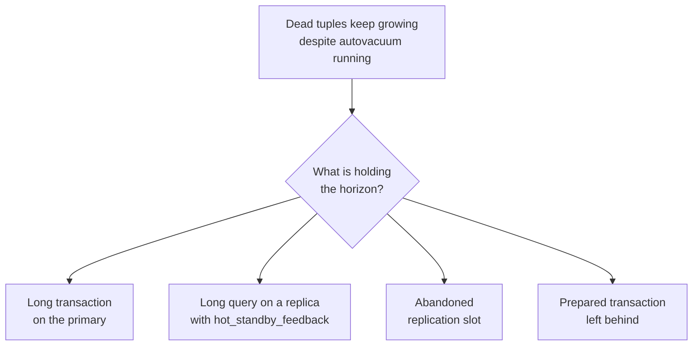
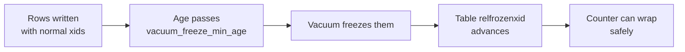

# Vacuum and Autovacuum — Part 2: When It Gets Blocked, and Wraparound

This continues [Part 1](02-vacuum-and-autovacuum-part-1.md).

Part 1 explained that `UPDATE` and `DELETE` leave dead tuples behind, that plain
`VACUUM` makes their space reusable without locking anything, that `VACUUM FULL`
blocks the entire table and should not be run on a live system, and that
autovacuum triggers on a percentage of dead rows that is far too generous for
large tables.

Part 2 is the part you will use during an incident: autovacuum is running, the
dead tuple count keeps climbing anyway, and you need to know why.

> **📌 In one line:** vacuum can only remove a row version that **no transaction
> anywhere in the system could still need** — so one old snapshot, held by
> anything, freezes cleanup for every table at once.

## Table of Contents

1. [The One Rule That Explains Every Blockage](#the-one-rule-that-explains-every-blockage)
2. [Blocker 1: A Long-Running Transaction](#blocker-1-a-long-running-transaction)
3. [Blocker 2: A Long Query on a Replica](#blocker-2-a-long-query-on-a-replica)
4. [Blocker 3: An Abandoned Replication Slot](#blocker-3-an-abandoned-replication-slot)
5. [Blocker 4: A Prepared Transaction](#blocker-4-a-prepared-transaction)
6. [One Query to Find the Culprit](#one-query-to-find-the-culprit)
7. [Monitoring: What to Watch and When to Alarm](#monitoring-what-to-watch-and-when-to-alarm)
8. [Transaction ID Wraparound](#transaction-id-wraparound)
9. [Advanced: Vacuum and Index-Only Scans](#advanced-vacuum-and-index-only-scans)
10. [Common Mistakes](#common-mistakes)
11. [Questions to Test Yourself](#questions-to-test-yourself)
12. [Related](#related)

---

## The One Rule That Explains Every Blockage

PostgreSQL tracks the oldest transaction that is still running anywhere. Call it
the **horizon** (its internal name is `xmin`). A dead tuple can only be removed
if it became dead **before** that horizon. If any transaction started before the
tuple died, that transaction might still want to read it, so the tuple stays.

```text
   time ───────────────────────────────────────────────────────▶

   txn 918200  BEGIN ──────────────────────────────────────── (still open)
                 ▲
                 └── the horizon. Nothing after this point can be cleaned.

   txn 918241        UPDATE invoices ... (created a dead tuple)   ✗ kept
   txn 919002        DELETE FROM notifications ...                ✗ kept
```

Two consequences follow, and both surprise people. **One open transaction blocks
cleanup on every table**, not just the ones it touched — the horizon is global.
And **autovacuum still runs**: it scans, works, and reports success while
removing almost nothing. "Autovacuum is running" is not evidence that cleanup is
happening. That is why the `VERBOSE` line from Part 1 matters:

```text
DETAIL:  4821934 dead row versions cannot be removed yet, oldest xmin: 918200
```

A big number there plus a stuck `oldest xmin` is the signature of a blocked
vacuum. Four things can hold the horizon back:



---

## Blocker 1: A Long-Running Transaction

The most common cause by far. Some session ran `BEGIN` and has not finished —
either because it is running a genuinely long query, or because it is sitting
`idle in transaction` waiting on application code.

Find it:

```sql
SELECT
    pid,
    usename,
    application_name,
    state,
    now() - xact_start AS transaction_age,
    now() - query_start AS query_age,
    left(query, 60)     AS query
FROM pg_stat_activity
WHERE xact_start IS NOT NULL
  AND state <> 'idle'
ORDER BY xact_start
LIMIT 10;
```

```text
  pid  | usename  | application_name |        state        | transaction_age | query
-------+----------+------------------+---------------------+-----------------+-------------------------
 24817 | api_user | api-server       | idle in transaction |    04:12:38     | SELECT id FROM invoices
 25902 | report   | analytics        | active              |    00:41:02     | SELECT company_id, sum(
```

Session 24817 has held a transaction open for **four hours** and is not even
running a query. Nothing in the database has been properly vacuumed since it
started.

The usual cause is application code that opens a transaction and then does slow
work inside it:

```ts
// ❌ BROKEN — the transaction stays open across every iteration, including
//            the API call. On 5000 invoices this runs for hours, and the
//            whole database stops being vacuumable for that entire time.
await db.transaction(async (trx) => {
  const invoices = await trx.from('invoices').where('status', 'pending')

  for (const invoice of invoices) {
    const result = await billingProvider.charge(invoice)      // network call
    await trx.from('invoices').where('id', invoice.id).update({
      status: result.ok ? 'paid' : 'failed',
    })
  }
})
```

```ts
// ✅ FIXED — read outside any transaction, and use one short transaction per
//           invoice. The horizon advances continuously.
const invoices = await db.from('invoices').where('status', 'pending')

for (const invoice of invoices) {
  const result = await billingProvider.charge(invoice)        // outside the txn
  await db.transaction(async (trx) => {
    await trx.from('invoices').where('id', invoice.id).update({
      status: result.ok ? 'paid' : 'failed',
    })
  })
}
```

The defence in depth is a server-side timeout, so a stuck client cannot hold the
horizon indefinitely — `ALTER ROLE api_user SET
idle_in_transaction_session_timeout = '60s';`. See
[01-connection-pooling-part-2.md](01-connection-pooling-part-2.md) for how these
timeouts should be layered.

---

## Blocker 2: A Long Query on a Replica

A read replica replays the primary's changes. If the replica is running a
30-minute report and replay wants to remove a row that report is reading, the
two conflict. PostgreSQL resolves this in one of two ways, and you choose which.

| `hot_standby_feedback` | What happens on the replica | What happens on the primary |
|---|---|---|
| `off` (default) | Long queries get cancelled: `ERROR: canceling statement due to conflict with recovery` | Vacuum is unaffected |
| `on` | Long queries complete safely | The replica's oldest snapshot **holds back the primary's horizon** |

So turning it `on` fixes cancelled reports by moving the problem to the primary,
where it shows up as bloat that nobody connects to the replica.

Detect it from the primary:

```sql
SELECT
    client_addr,
    application_name,
    state,
    backend_xmin,                       -- non-null means feedback is holding
    age(backend_xmin) AS xmin_age,
    replay_lag
FROM pg_stat_replication;
```

```text
  client_addr  | application_name |   state   | backend_xmin | xmin_age  | replay_lag
---------------+------------------+-----------+--------------+-----------+------------
 10.0.3.14     | replica-reports  | streaming |    918200    | 41208833  | 00:00:00.2
 10.0.3.15     | replica-api      | streaming |              |           | 00:00:00.1
```

`replica-reports` is holding the horizon 41 million transactions back. That is
your bloat.

What to do: put `statement_timeout` on the replica's reporting role so no query
can hold the horizon for more than, say, 15 minutes; or use
`max_standby_streaming_delay` to allow a bounded replay delay instead of
feedback; or move heavy reporting off the replay path entirely with a
[materialized view](03-materialized-views.md) refreshed on a schedule. This is
picked up again in
[04-read-replicas-and-replication-lag.md](04-read-replicas-and-replication-lag.md).

---

## Blocker 3: An Abandoned Replication Slot

A **replication slot** is a bookmark the primary keeps for a consumer — a
replica, or a change-data-capture tool such as Debezium. The slot's promise is:
"I will keep everything you have not consumed yet."

If the consumer goes away and nobody drops the slot, the primary keeps that
promise forever. It holds WAL files (filling the disk) and, for logical slots,
holds the horizon back (blocking vacuum).

```sql
SELECT
    slot_name,
    slot_type,
    active,                                   -- false = nobody is consuming
    age(xmin)                    AS xmin_age,
    pg_size_pretty(
        pg_wal_lsn_diff(pg_current_wal_lsn(), restart_lsn)
    )                            AS wal_retained
FROM pg_replication_slots
ORDER BY wal_retained DESC;
```

```text
     slot_name      | slot_type | active | xmin_age  | wal_retained
--------------------+-----------+--------+-----------+--------------
 debezium_tasks_cdc | logical   | f      | 88412003  | 214 GB
 replica_api        | physical  | t      |           | 48 MB
```

`active = f` with 214 GB retained is a decommissioned CDC pipeline nobody
cleaned up. It is filling the disk and blocking vacuum at the same time.

Once you have confirmed the consumer is gone for good, drop it with
`SELECT pg_drop_replication_slot('debezium_tasks_cdc');`.

> **⚠️ Warning:** dropping a slot that a real replica still uses breaks that
> replica permanently — it will need a full rebuild. `active = f` can also mean a
> replica that is temporarily down and about to reconnect. Set
> `max_slot_wal_keep_size` so a dead slot cannot consume unlimited disk.

---

## Blocker 4: A Prepared Transaction

Two-phase commit (`PREPARE TRANSACTION`) lets a transaction be prepared now and
committed later by a coordinator. If the coordinator crashes, the prepared
transaction stays open **forever**, across restarts, holding the horizon.

```sql
SELECT gid, prepared, owner, age(transaction) AS xid_age
FROM pg_prepared_xacts
ORDER BY prepared;
```

```text
        gid         |          prepared          |  owner   |  xid_age
--------------------+----------------------------+----------+-----------
 tx-billing-8841022 | 2026-06-02 11:04:18.223+00 | api_user | 190412887
```

Prepared on 2 June and never resolved. Resolve it explicitly with
`ROLLBACK PREPARED 'tx-billing-8841022';` (or `COMMIT PREPARED` if it should
have succeeded).

> **💡 Tip:** if you do not use distributed transactions, set
> `max_prepared_transactions = 0`. Then this failure mode cannot happen at all.
> It is the default in most installations — check yours.

---

## One Query to Find the Culprit

During an incident you do not want four queries. This one compares all four
sources of the horizon and tells you which is oldest:

```sql
SELECT 'backend'   AS source, pid::text AS id, age(backend_xmin) AS xid_age
FROM pg_stat_activity WHERE backend_xmin IS NOT NULL
UNION ALL
SELECT 'replica', coalesce(client_addr::text, application_name), age(backend_xmin)
FROM pg_stat_replication WHERE backend_xmin IS NOT NULL
UNION ALL
SELECT 'slot', slot_name, age(xmin)
FROM pg_replication_slots WHERE xmin IS NOT NULL
UNION ALL
SELECT 'prepared', gid, age(transaction)
FROM pg_prepared_xacts
ORDER BY xid_age DESC NULLS LAST
LIMIT 10;
```

```text
  source  |         id          |  xid_age
----------+---------------------+-----------
 slot     | debezium_tasks_cdc  |  88412003
 replica  | 10.0.3.14           |  41208833
 backend  | 24817               |   4102918
```

The top row is what you fix first; everything below it is irrelevant until it is gone.

---

## Monitoring: What to Watch and When to Alarm

`pg_stat_user_tables` is where autovacuum reports on itself.

| Column | Meaning |
|---|---|
| `n_live_tup` / `n_dead_tup` | Estimated live and dead rows |
| `last_vacuum` / `last_autovacuum` | When it last ran (manual / automatic) |
| `last_analyze` / `last_autoanalyze` | When statistics were last refreshed |
| `vacuum_count` / `autovacuum_count` | How many times, since stats were reset |
| `n_mod_since_analyze` | Changes since the last `ANALYZE` |

The dead-percentage query from
[Part 1](02-vacuum-and-autovacuum-part-1.md#vacuum-vs-vacuum-full) reads this
view; add `last_autovacuum` to it to see both bloat and staleness together.

What deserves an alarm:

| Metric | Warning | Critical | What it usually means |
|---|---|---|---|
| Dead tuple percentage on a large table | > 20% | > 40% | Autovacuum is too slow or blocked |
| `last_autovacuum` on a busy table | > 24 h ago | > 7 days ago | Scale factor too high, or blocked |
| Oldest transaction age | > 15 min | > 1 h | A stuck session holding the horizon |
| Inactive replication slot | any, > 1 h | any, > 6 h | Disk and horizon both at risk |
| `age(datfrozenxid)` | > 500 M | > 1 B | Wraparound risk — see below |

> **📌 Remember:** alert on the **oldest open transaction**, not only on dead
> tuples — the transaction age rises first, and dead tuples are the symptom that
> follows an hour later.

---

## Transaction ID Wraparound

This sounds alarming and is usually harmless. Understand it once and it becomes
a routine monitoring item.

Every transaction gets a number, and that number is a fixed-size integer, so
there are about **4 billion** of them. PostgreSQL uses the number to decide
whether a row version is in your past or your future, with roughly half the range
each. If the counter simply kept climbing, old rows would eventually appear to be
in the future and become invisible — data loss.

The fix is **freezing**. Vacuum marks very old rows as "frozen", meaning "visible
to everyone, forever, regardless of the counter". Frozen rows no longer depend on
transaction numbers, so the counter can safely wrap around them.



Autovacuum handles this by itself. When a table's age passes
`autovacuum_freeze_max_age` (commonly 200 million), an **anti-wraparound
autovacuum** is launched on it — and this one cannot be skipped. It runs even if
autovacuum is disabled.

The failure only happens when vacuum has been blocked for a very long time by one
of the four causes above. Then PostgreSQL protects your data the only way it can:

```text
ERROR:  database is not accepting commands to avoid wraparound data loss
        in database "saas_production"
HINT:  Stop the postmaster and vacuum that database in single-user mode.
```

That is a full write outage with a slow recovery. It is also entirely
preventable, because the database warns you for weeks first.

Check how close you are:

```sql
SELECT
    datname,
    age(datfrozenxid)                              AS xid_age,
    round(100.0 * age(datfrozenxid) / 2000000000.0, 1) AS pct_to_limit
FROM pg_database
ORDER BY xid_age DESC;
```

```text
     datname      |  xid_age  | pct_to_limit
------------------+-----------+--------------
 saas_production  | 214880122 |         10.7
 postgres         |  48200011 |          2.4
```

To find the single table holding it back, run the same idea against `pg_class`:
`SELECT relname, age(relfrozenxid) FROM pg_class WHERE relkind = 'r' ORDER BY 2
DESC LIMIT 5;`.

> **⚠️ Warning:** when your logs say `database "x" must be vacuumed within N
> transactions`, that is not noise. It is a countdown to a write outage. Treat it
> as a page-someone incident, find the blocker with the query above, and remove
> it.

Normal operation sits well below 200 million; above roughly 1 billion, act the
same day.

---

## Advanced: Vacuum and Index-Only Scans

Vacuum matters even on a table with almost no deletes, and the reason is the
visibility map from Part 1.

An **index-only scan** answers a query from the index alone, without reading the
table. That is much faster — but the index does not record whether a row is
visible to your transaction. So PostgreSQL checks the visibility map: if the page
is marked all-visible, it trusts the index and skips the table read. If not, it
must read the table row anyway, which is called a *heap fetch*.

Vacuum is what sets those all-visible bits. **No recent vacuum means no
all-visible pages means no real index-only scans.**

Take a monthly invoice count grouped by company, served by an index on
`(issued_at, company_id)`. Before a vacuum:

```text
 Index Only Scan using invoices_issued_at_company_idx on invoices
   Heap Fetches: 412883
   Execution Time: 884.201 ms
```

After `VACUUM invoices;`:

```text
 Index Only Scan using invoices_issued_at_company_idx on invoices
   Heap Fetches: 0
   Execution Time: 61.418 ms
```

Same query, same index, same data — a 14× difference from `Heap Fetches` alone.

> **💡 Tip:** a high `Heap Fetches` number on an index-only scan is a direct
> signal that the table needs vacuuming, regardless of what the dead tuple count
> says.

So an append-mostly table — `invoices`, `notifications`, an audit log — still
benefits from regular vacuuming even though almost nothing is ever deleted from
it, because newly inserted pages are not marked all-visible until vacuum visits
them. Recent PostgreSQL versions also trigger autovacuum on insert volume for
exactly this reason; check whether your version has that setting. Index-only
scans themselves are covered in
[../query-optimization/covering-indexes.md](../query-optimization/covering-indexes.md).

---

## Common Mistakes

| Mistake | Why it is wrong | Do this instead |
|---|---|---|
| Assuming "autovacuum is running" means cleanup is happening | It runs and removes nothing while the horizon is held | Check `dead row versions cannot be removed yet` and the horizon query |
| Only looking at the table with the bloat | The blocker is usually a session or slot unrelated to that table | Find the oldest horizon holder first |
| Turning on `hot_standby_feedback` and forgetting it | Replica reports now bloat the primary invisibly | Add `statement_timeout` on the replica's reporting role |
| Leaving an inactive replication slot in place | Retains WAL until the disk fills and blocks vacuum | Monitor `active = false`; set `max_slot_wal_keep_size` |
| Ignoring "must be vacuumed within N transactions" warnings | It ends in a refusal to accept writes | Treat it as an incident and find the blocker |
| Assuming an insert-only table needs no vacuum | Without all-visible pages, index-only scans do heap fetches | Vacuum it anyway; watch `Heap Fetches` |

---

## Questions to Test Yourself

1. Autovacuum has run on `notifications` twenty times today and `n_dead_tup`
   keeps rising. Give the one-sentence explanation and the first query you run.
2. Why does a single open transaction on `companies` prevent cleanup of dead
   rows in `notifications`, a table it never touched?
3. Name the four things that can hold back the horizon, and the system view that
   reveals each one.
4. Your team turns on `hot_standby_feedback` to stop reports being cancelled.
   What new problem have they created, and where would you see it?
5. Explain transaction id wraparound to a teammate in four sentences, without
   using the word "panic".
6. A replication slot shows `active = false` and 214 GB retained. List what you
   check before dropping it.
7. `EXPLAIN` shows an index-only scan with `Heap Fetches: 412883`. What is wrong,
   and what single command usually fixes it?
8. Why does an append-only audit table still need regular vacuuming?

---

## Related

- [Vacuum and Autovacuum — Part 1](02-vacuum-and-autovacuum-part-1.md) — what
  vacuum does, `VACUUM FULL`, and autovacuum triggering and tuning.
- [01-connection-pooling-part-2.md](01-connection-pooling-part-2.md) — the
  transaction-shortening habits that keep the horizon moving.
- [04-read-replicas-and-replication-lag.md](04-read-replicas-and-replication-lag.md)
  — `hot_standby_feedback` from the replica's side.
- [05-monitoring-and-troubleshooting-part-1.md](05-monitoring-and-troubleshooting-part-1.md)
  — finding and terminating the session that holds the horizon.
- [../transactions-and-concurrency/03-mvcc-part-1.md](../transactions-and-concurrency/03-mvcc-part-1.md)
  — snapshots and visibility, which is what "the horizon" really means.
