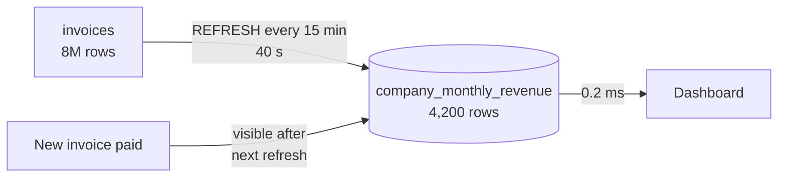

# Materialized Views

The company dashboard shows revenue per month for the last two years. The query
behind it scans eight million invoices, groups them, and takes **eight seconds**.
Forty users load that dashboard every minute. So your database spends 320 seconds
of work every 60 seconds computing the same forty numbers over and over.

Nobody needs those numbers to be accurate to the second. A materialized view lets
you compute them once, store the answer, and serve it in 4 ms.

> **📌 In one line:** a materialized view is a query whose *result* is saved to
> disk — fast to read, but frozen in time until you refresh it.

## Table of Contents

1. [View vs Materialized View vs Summary Table](#view-vs-materialized-view-vs-summary-table)
2. [Creating and Querying One](#creating-and-querying-one)
3. [REFRESH and REFRESH CONCURRENTLY](#refresh-and-refresh-concurrently)
4. [Indexing a Materialized View](#indexing-a-materialized-view)
5. [Refresh Strategies](#refresh-strategies)
6. [Worked Example: Monthly Revenue](#worked-example-monthly-revenue)
7. [When a Materialized View Is the Wrong Tool](#when-a-materialized-view-is-the-wrong-tool)
8. [Alternatives](#alternatives)
9. [Advanced: Cost, Chaining, and No Incremental Refresh](#advanced-cost-chaining-and-no-incremental-refresh)
10. [Common Mistakes](#common-mistakes)
11. [Questions to Test Yourself](#questions-to-test-yourself)
12. [Related](#related)

---

## View vs Materialized View vs Summary Table

A **view** is a saved query. It stores no data. Every time you select from it,
PostgreSQL runs the underlying query again. It is a naming convenience, not a
performance feature.

A **materialized view** stores the result rows on disk, like a table. Reading it
touches no base tables at all. The price is that the stored rows are a snapshot.

A **summary table** is a real table you create and update yourself, from triggers
or application code.

| | View | Materialized View | Summary table you maintain |
|---|---|---|---|
| Stores data | No | Yes | Yes |
| Read speed | Same as the query | Fast — it is just a table read | Fast |
| Freshness | Always current | Stale until refreshed | As fresh as your update code |
| Can be indexed | No (indexes the base tables) | Yes | Yes |
| Write cost | None | One big refresh | Small cost on every write |
| Who keeps it correct | The database | You (a refresh schedule) | You (every code path) |
| Incremental updates | N/A | Not built in | Yes, that is the point |
| Effort to build | Minutes | Minutes | Days, and easy to get wrong |

```text
   VIEW                         MATERIALIZED VIEW
   ┌──────────────┐             ┌──────────────┐
   │ SELECT ...   │             │ SELECT ...   │   stored rows on disk
   └──────┬───────┘             └──────┬───────┘   ┌──────────────┐
          │ runs every time            │ runs on   │ 2026-01 | 41 │
          ▼                            │ REFRESH   │ 2026-02 | 38 │
   ┌──────────────┐                    └──────────▶│ 2026-03 | 52 │
   │ 8M invoices  │                                └──────────────┘
   └──────────────┘                                  read directly
```

> **💡 Tip:** if the query is slow because of a missing index, a view will not
> help and neither will a materialized view. Try
> [../query-optimization/slow-query-fixes.md](../query-optimization/slow-query-fixes.md)
> **first**. A materialized view is for work that is genuinely expensive, not for
> work that is badly planned.

---

## Creating and Querying One

The syntax is a `CREATE` wrapped around any `SELECT`:

```sql
CREATE MATERIALIZED VIEW company_monthly_revenue AS
SELECT
    c.id                                    AS company_id,
    c.name                                  AS company_name,
    date_trunc('month', i.issued_at)        AS month,
    count(*)                                AS invoice_count,
    sum(i.amount_cents)                     AS revenue_cents
FROM invoices i
JOIN companies c ON c.id = i.company_id
WHERE i.status = 'paid'
GROUP BY c.id, c.name, date_trunc('month', i.issued_at);
```

You query it exactly like a table:

```sql
SELECT month, revenue_cents
FROM company_monthly_revenue
WHERE company_id = 42
ORDER BY month DESC
LIMIT 12;
```

Here is the part people get wrong. **It is a snapshot.** New invoices arriving
after creation do not appear. Paid invoices do not update the totals. The stored
rows are exactly what the query returned at the moment you created or last
refreshed the view, and they stay that way forever if you never refresh.

```text
  10:00  CREATE MATERIALIZED VIEW ...   → revenue for March = 41,200
  10:15  a 500-euro invoice is paid
  10:20  SELECT FROM company_monthly_revenue → still 41,200
```

Use `WITH NO DATA` if you want to create the structure now and populate it later
— the view is unreadable until its first refresh:

```sql
CREATE MATERIALIZED VIEW company_monthly_revenue AS SELECT ... WITH NO DATA;
-- SELECT here fails: materialized view "..." has not been populated
REFRESH MATERIALIZED VIEW company_monthly_revenue;
```

---

## REFRESH and REFRESH CONCURRENTLY

Refreshing re-runs the query and replaces the stored rows. There are two forms,
and the difference decides whether refreshing causes an incident.

```sql
-- Form 1: plain. Fast, but takes an ACCESS EXCLUSIVE lock.
REFRESH MATERIALIZED VIEW company_monthly_revenue;

-- Form 2: concurrent. Readers keep working throughout.
REFRESH MATERIALIZED VIEW CONCURRENTLY company_monthly_revenue;
```

| | Plain `REFRESH` | `REFRESH ... CONCURRENTLY` |
|---|---|---|
| Lock taken | `ACCESS EXCLUSIVE` | `EXCLUSIVE` — readers are not blocked |
| Readers during refresh | **Blocked** until it finishes | Keep reading the old data |
| Speed | Faster | Slower, often 2–3× |
| Requires a unique index | No | **Yes** |
| Extra disk during refresh | One new copy | One new copy plus diff work |
| Works on an empty view | Yes | No — must be populated first |

The plain form builds the new data and then swaps it in, holding a lock that
blocks every `SELECT` on the view. If your refresh takes 90 seconds, your
dashboard is down for 90 seconds.

The concurrent form builds the new data into a temporary table, computes the
difference, and applies it as `INSERT`/`UPDATE`/`DELETE` against the existing
rows. Readers see the old data until the moment it completes. That diffing is
why it is slower and why it needs a unique index — it has to match old rows to
new ones.

```sql
-- ❌ BROKEN — a cron job that blocks the dashboard for 90 seconds every hour.
REFRESH MATERIALIZED VIEW company_monthly_revenue;

-- ✅ FIXED — create the unique index once, then always refresh concurrently.
CREATE UNIQUE INDEX company_monthly_revenue_pk
    ON company_monthly_revenue (company_id, month);

REFRESH MATERIALIZED VIEW CONCURRENTLY company_monthly_revenue;
```

> **⚠️ Warning:** the unique index must be genuinely unique across the view's
> rows. If `(company_id, month)` can repeat, the concurrent refresh fails. Pick
> the columns that form the natural key of the aggregation — usually exactly the
> `GROUP BY` columns.

---

## Indexing a Materialized View

This is one of the biggest advantages over a plain view. A materialized view is
stored, so it can carry its own indexes, tuned for how the dashboard reads it —
not for how the base tables are written.

```sql
-- Required for concurrent refresh, and it is also the lookup index.
CREATE UNIQUE INDEX company_monthly_revenue_pk
    ON company_monthly_revenue (company_id, month);

-- For the "top companies this month" panel.
CREATE INDEX company_monthly_revenue_month_rev_idx
    ON company_monthly_revenue (month, revenue_cents DESC);
```

Two practical notes. Indexes on a materialized view are maintained during every
refresh, so each extra index makes refreshing slower — the same trade-off as on a
normal table. And a plain (non-concurrent) refresh rebuilds them, which is part
of why it is faster overall but blocks for longer in one stretch.

Column order in a composite index matters here just as much as on a base table —
see
[../query-optimization/composite-index-ordering.md](../query-optimization/composite-index-ordering.md).

---

## Refresh Strategies

Before choosing, answer one product question: **how stale is acceptable?**

That is not a technical question. Ask the person who wants the dashboard. "Is
data from an hour ago fine?" The answer is almost always yes for reporting and
almost always no for anything a user just changed themselves.

| Strategy | How it works | Staleness | Best for |
|---|---|---|---|
| **Scheduled** | A cron job or scheduler refreshes every N minutes | Up to N minutes | Reporting, analytics, billing summaries |
| **Event-triggered** | Refresh after a known event, e.g. nightly invoice run | Until the next event | Data that changes in batches |
| **Hand-built incremental** | Your own code updates only affected rows in a real table | Near zero | High write rate where a full refresh is too slow |

A scheduled refresh in AdonisJS (the Express equivalent is any cron library):

```ts
// Runs every 15 minutes. Keep it out of the HTTP request path entirely.
export default class RefreshRevenueView extends BaseCommand {
  public async run() {
    const started = Date.now()
    await Database.rawQuery(
      'REFRESH MATERIALIZED VIEW CONCURRENTLY company_monthly_revenue'
    )
    logger.info({ ms: Date.now() - started }, 'matview.refreshed')
  }
}
```

> **💡 Tip:** always log the refresh duration. The day it grows past your refresh
> interval, you want to find out from a graph, not from users seeing stale
> numbers.

Two rules that prevent most trouble:

- **Never refresh inside a web request.** The user who triggers it waits for the
  whole refresh, and concurrent requests can pile up refreshes on top of each
  other.
- **Guard against overlap.** Take an advisory lock so a second refresh cannot
  start while the first is still running:
  `SELECT pg_try_advisory_lock(918001);`

---

## Worked Example: Monthly Revenue

Start with the dashboard query as it exists today:

```sql
SELECT
    date_trunc('month', i.issued_at) AS month,
    sum(i.amount_cents)              AS revenue_cents,
    count(*)                         AS invoice_count
FROM invoices i
WHERE i.company_id = 42
  AND i.status = 'paid'
  AND i.issued_at >= now() - interval '24 months'
GROUP BY 1
ORDER BY 1 DESC;
```

```text
 GroupAggregate  (cost=418200.11..441882.40 rows=24 width=24)
                 (actual time=7914.201..8102.884 rows=24 loops=1)
   ->  Seq Scan on invoices i  (actual time=0.041..6210.118 rows=812043 loops=1)
         Filter: ((company_id = 42) AND (status = 'paid'))
         Rows Removed by Filter: 7204118
 Planning Time: 0.412 ms
 Execution Time: 8103.221 ms
```

Eight seconds, and 7.2 million rows discarded by the filter. Now the materialized
view (created above), its indexes, and the same question:

```sql
SELECT month, revenue_cents, invoice_count
FROM company_monthly_revenue
WHERE company_id = 42
  AND month >= date_trunc('month', now()) - interval '24 months'
ORDER BY month DESC;
```

```text
 Index Scan using company_monthly_revenue_pk on company_monthly_revenue
   (actual time=0.028..0.121 rows=24 loops=1)
   Index Cond: ((company_id = 42) AND (month >= ...))
 Planning Time: 0.098 ms
 Execution Time: 0.184 ms
```

| | Before | After |
|---|---|---|
| Execution time | 8,103 ms | 0.18 ms |
| Rows scanned | 8,016,161 | 24 |
| Cost per dashboard load | 8 s of database CPU | Nothing measurable |
| Freshness | Live | Up to 15 minutes old |

The refresh itself takes around 40 seconds and runs every 15 minutes, so the
database does 40 seconds of work per 15 minutes instead of 320 seconds per
minute. That is the whole trade, stated honestly: **you traded freshness for a
roughly 500× reduction in work.**



---

## When a Materialized View Is the Wrong Tool

Three clear cases.

**1. The data must be current.** A user changes something and expects to see it
immediately. An account balance, an order status, a permission check. Any
staleness is a bug, and no refresh interval is short enough.

**2. The refresh takes longer than the interval.** If a full refresh takes six
minutes and you want five-minute freshness, refreshes overlap, the database is
permanently busy, and the data is never as fresh as you promised. Either widen
the interval, shrink the view's scope, or move to an incrementally maintained
summary table.

**3. A plain index would have solved it.** This is the most common mistake. A
query is slow because of a sequential scan, someone adds a materialized view, and
now there is a refresh job to operate forever — when a single index would have
made the original query fast and always current.

> **📌 Remember:** check the query plan before you reach for a materialized view.
> If `EXPLAIN` shows a sequential scan on a filtered column, you have an indexing
> problem, not an aggregation problem. Start at
> [../query-optimization/slow-query-fixes.md](../query-optimization/slow-query-fixes.md)
> and [../query-planner/reading-query-plans.md](../query-planner/reading-query-plans.md).

A materialized view genuinely earns its place when the query aggregates a large
fraction of a large table, and no index can avoid that work.

---

## Alternatives

| Alternative | Freshness | Cost | Use when |
|---|---|---|---|
| Materialized view | Interval-based | One periodic refresh | Heavy aggregation, staleness acceptable |
| Trigger-maintained summary table | Immediate | Small cost on every write | Writes are modest, freshness required |
| Application-maintained summary table | Immediate-ish | Every write path must remember | You control all writes and want no trigger magic |
| Redis cache of the result | Cache TTL | Extra system to run | The result is small and read from many services |
| Read replica for reporting | Replication lag | Another database | Reports are heavy but must stay live |

A **trigger-maintained table** keeps a running total updated as invoices change.
It is always current, but every write pays a little, and every code path — including
bulk imports and manual fixes — must go through the trigger. This is a
denormalization decision; see
[../data-modeling/04-denormalization-and-read-models-part-1.md](../data-modeling/04-denormalization-and-read-models-part-1.md).

A **Redis cache** is the right answer when the expensive thing is the whole API
response rather than the aggregation, or when several services need the same
computed value. It adds a system to operate and a new class of consistency bug.
See
[../../system-design/foundational/caching-strategies.md](../../system-design/foundational/caching-strategies.md)
and [../../system-design/foundational/redis.md](../../system-design/foundational/redis.md).

A **read replica** keeps the report live and moves its cost off the primary. It
does not make the query faster — it just makes the slowness somebody else's
problem. See
[04-read-replicas-and-replication-lag.md](04-read-replicas-and-replication-lag.md)
and
[../../system-design/foundational/database-replication.md](../../system-design/foundational/database-replication.md).

These combine well: a materialized view on a read replica, cached in Redis for
the API, is a normal production arrangement.

---

## Advanced: Cost, Chaining, and No Incremental Refresh

**Refresh cost grows with the view, not with the change.** Refreshing rebuilds
everything, even if one invoice changed. A view over two years of invoices costs
the same to refresh whether one row or a million rows changed. Keep views
narrow — restrict to the period anyone actually looks at, and archive the rest.

**Concurrent refresh needs room.** It builds a full new copy plus diff state, so
plan for roughly twice the view's size in free disk, and expect noticeably more
I/O than a plain refresh.

**Chained views need ordered refreshes.** A view built on another view must be
refreshed *after* its source, or it recomputes from stale data:


```sql
-- Order matters. Refreshing these in the wrong order silently produces
-- a summary built from last hour's numbers.
REFRESH MATERIALIZED VIEW CONCURRENTLY company_monthly_revenue;
REFRESH MATERIALIZED VIEW CONCURRENTLY plan_revenue_summary;
```

PostgreSQL does not track the dependency order for you. Keep chains shallow —
two levels at most — and refresh them in one script with the order written down.

**There is no built-in incremental refresh.** Unlike some other databases,
PostgreSQL has no `REFRESH FAST` that applies only the changes. Extensions exist
and should be evaluated against your version, but the built-in behaviour is
always a full recompute. If you need incremental maintenance, you are building a
summary table with triggers or application code, and you should plan for that
work rather than discovering it later.

---

## Common Mistakes

| Mistake | Why it is wrong | Do this instead |
|---|---|---|
| Expecting a materialized view to update itself | It is a snapshot; nothing refreshes it automatically | Schedule a refresh and monitor that it ran |
| Plain `REFRESH` on a user-facing view | `ACCESS EXCLUSIVE` blocks every reader for the whole refresh | Add a unique index and use `CONCURRENTLY` |
| `REFRESH CONCURRENTLY` with no unique index | The command fails outright | Create a unique index on the `GROUP BY` columns |
| Refreshing inside an HTTP request | That user waits for the whole refresh; concurrent requests stack up | Refresh from a scheduled job |
| No overlap guard on the refresh job | Refreshes stack when one runs long, and the database never idles | `pg_try_advisory_lock` around the refresh |
| Reaching for a materialized view before reading the plan | Often a missing index, now with a refresh job to operate forever | `EXPLAIN` first; index first |
| Refreshing chained views in arbitrary order | The downstream view is built from stale upstream data | Refresh sources first, in one script |
| Never measuring refresh duration | You discover it exceeded the interval when users complain | Log and graph the duration |

---

## Questions to Test Yourself

1. Explain the difference between a view and a materialized view in one sentence
   each, then name one thing only the materialized one can do.
2. Your dashboard is down for 90 seconds every hour, exactly when the refresh
   job runs. What is happening, and what are the two changes that fix it?
3. Why does `REFRESH ... CONCURRENTLY` require a unique index? Answer in terms of
   what it does internally.
4. A query takes 8 seconds because of a sequential scan filtered on
   `company_id`. Is a materialized view the right fix? Justify your answer.
5. Your refresh takes 6 minutes and the schedule is every 5 minutes. Describe
   what happens over the next hour, and give two different fixes.
6. When would you choose a trigger-maintained summary table over a materialized
   view? Give the deciding question.
7. You have `company_monthly_revenue` and `plan_revenue_summary` built on top of
   it. What goes wrong if you refresh them in alphabetical order?
8. State the trade you are making with the 15-minute refresh in this file, in
   terms both a developer and a product manager would accept.

---

## Related

- [04-read-replicas-and-replication-lag.md](04-read-replicas-and-replication-lag.md)
  — the other way to keep heavy reporting off the primary.
- [02-vacuum-and-autovacuum-part-2.md](02-vacuum-and-autovacuum-part-2.md) — a
  materialized view is a table, so it bloats and needs vacuuming like one.
- [../query-optimization/slow-query-fixes.md](../query-optimization/slow-query-fixes.md)
  — what to try before building a materialized view.
- [../query-planner/reading-query-plans.md](../query-planner/reading-query-plans.md)
  — how to tell an aggregation problem from an indexing problem.
- [../data-modeling/04-denormalization-and-read-models-part-1.md](../data-modeling/04-denormalization-and-read-models-part-1.md)
  — the summary-table alternative, as a modelling decision.
- [../../system-design/foundational/caching-strategies.md](../../system-design/foundational/caching-strategies.md)
  — caching the computed result instead of storing it in the database.
