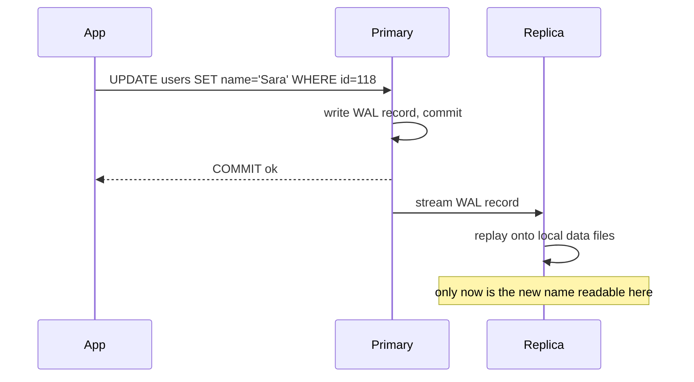
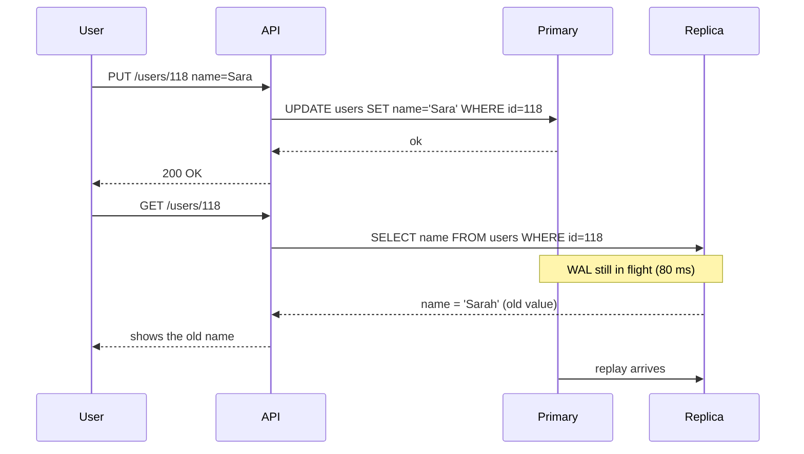
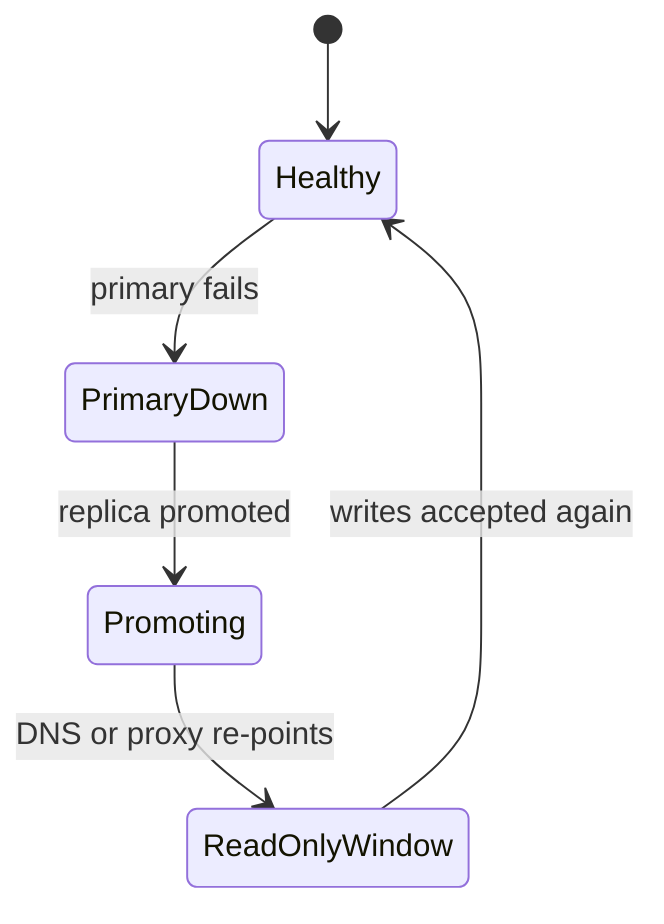

# Read Replicas and Replication Lag

Your primary database is at 80% CPU. Looking at where the time goes, most of it
is reports, exports, and search — reads that nobody would notice if they were a
few seconds out of date. A read replica moves those reads onto a second machine
that carries a copy of the data.

That much is easy. The hard part is the day a user saves their profile, the app
reads it back from a replica 30 milliseconds later, and gets the **old** value.
This file is mostly about that.

> **📌 In one line:** a replica is a copy that is always slightly behind, so the
> question is never "is it fast?" but "which reads can tolerate being a moment
> out of date?"

## Table of Contents

1. [What a Read Replica Is](#what-a-read-replica-is)
2. [Streaming Replication in One Section](#streaming-replication-in-one-section)
3. [Synchronous vs Asynchronous](#synchronous-vs-asynchronous)
4. [Replication Lag and How to Measure It](#replication-lag-and-how-to-measure-it)
5. [The Read-After-Write Problem](#the-read-after-write-problem)
6. [Fixing Read-After-Write](#fixing-read-after-write)
7. [Routing Rules in Practice](#routing-rules-in-practice)
8. [Long Queries on Replicas](#long-queries-on-replicas)
9. [Failover and What the Application Must Handle](#failover-and-what-the-application-must-handle)
10. [Advanced: Routing, Backups, and a Warning](#advanced-routing-backups-and-a-warning)
11. [Common Mistakes](#common-mistakes)
12. [Questions to Test Yourself](#questions-to-test-yourself)
13. [Related](#related)

---

## What a Read Replica Is

A read replica is a second PostgreSQL server that continuously copies everything
from the primary and accepts **read-only** queries.

It solves three problems:

- **Read capacity.** Reporting and analytics stop competing with user traffic.
- **Isolation of heavy work.** A 40-second export cannot slow down checkout.
- **Availability.** If the primary fails, a replica can be promoted to take over.

It does *not* solve write capacity — every write still goes to the one primary —
and it does not reduce the total amount of work done, it only moves some of it.

The topologies (primary-replica, cascading, multi-primary), the theory of
logical versus physical replication, and how replication relates to consistency
models are covered in
[../../system-design/foundational/database-replication.md](../../system-design/foundational/database-replication.md)
and
[../../system-design/foundational/cap-theorem-and-consistency-models.md](../../system-design/foundational/cap-theorem-and-consistency-models.md).
This file assumes one primary with one or more replicas and focuses on what your
application code has to do about it.

---

## Streaming Replication in One Section

PostgreSQL writes every change to the **WAL** (Write-Ahead Log) before it touches
the data files. Streaming replication reuses that log: the replica connects to
the primary, receives the WAL stream continuously, and **replays** it against its
own copy of the data.



Three stages happen on the replica, and each can fall behind separately:
**receive** the WAL, **write** it to disk, **replay** it into the data files.
Replay is the one users feel, because a record that has arrived but not been
replayed is not yet visible to queries.

```text
  primary  ──WAL──▶  replica
                     ├── received   (arrived over the network)
                     ├── written    (safely on the replica's disk)
                     └── replayed   (visible to queries)   ← this one matters
```

Because it ships the physical log, a streaming replica is a byte-level copy: same
tables, same indexes, same everything. You cannot have an extra index on the
replica, and you cannot write to it.

---

## Synchronous vs Asynchronous

The primary can either wait for a replica before confirming a commit, or not.
This one setting decides your durability and your latency.

| | Asynchronous (default) | Synchronous |
|---|---|---|
| Primary waits for the replica | No | Yes, until the replica confirms |
| Commit latency | Fast — local disk only | Slower — adds a network round trip |
| Data loss if the primary dies | Possible: recent commits may not have reached the replica | None for confirmed commits |
| Replication lag | Real, usually milliseconds | Effectively zero for confirmed commits |
| If the replica goes down | Primary continues normally | Commits can **block** until it returns or config changes |
| Typical use | Almost everything | Financial ledgers, regulated data |

> **⚠️ Warning:** synchronous replication with a single synchronous replica turns
> that replica into a point of failure for *writes*. If it stops responding,
> commits on the primary can hang. If you need synchronous, use a quorum of
> several candidates so one failure is survivable.

Most teams run asynchronous replication and manage the lag. The rest of this file
assumes that.

---

## Replication Lag and How to Measure It

**Replication lag** is how far behind the replica is. It is useful to think of it
two ways: in **bytes** (how much WAL is outstanding) and in **time** (how old the
newest visible data is). Time is what you explain to a product manager; bytes are
what you watch on a graph.

From the **primary**, one row per connected replica:

```sql
SELECT
    application_name,
    client_addr,
    state,
    pg_size_pretty(
        pg_wal_lsn_diff(pg_current_wal_lsn(), replay_lsn)
    )                     AS replay_bytes_behind,
    write_lag,
    flush_lag,
    replay_lag
FROM pg_stat_replication;
```

```text
 application_name | client_addr |   state   | replay_bytes_behind | replay_lag
------------------+-------------+-----------+---------------------+-------------
 replica-api      | 10.0.3.15   | streaming | 128 kB              | 00:00:00.041
 replica-reports  | 10.0.3.14   | streaming | 84 MB               | 00:00:12.882
```

`replica-api` is 41 milliseconds behind — normal. `replica-reports` is nearly 13
seconds behind, which is a problem if anything user-facing reads from it.

From the **replica** itself:

```sql
SELECT
    pg_is_in_recovery()                                   AS is_replica,
    pg_last_xact_replay_timestamp()                       AS last_replayed_at,
    now() - pg_last_xact_replay_timestamp()               AS lag_behind_primary;
```

```text
 is_replica |       last_replayed_at        | lag_behind_primary
------------+-------------------------------+--------------------
 t          | 2026-09-17 11:42:08.118+00    | 00:00:00.212
```

> **💡 Tip:** on an idle primary, `now() - pg_last_xact_replay_timestamp()` grows
> even though the replica is perfectly caught up — there is simply nothing new to
> replay. Compare with `pg_stat_replication` on the primary before declaring an
> incident.

What makes lag grow: a large bulk write on the primary, a `VACUUM FULL` or index
build producing huge WAL volume, slow disks on the replica, a long query on the
replica blocking replay, or a network limit between them.

---

## The Read-After-Write Problem

This is the bug that read replicas introduce, and it is worth understanding in
detail because it looks like an application bug, not a database one.

A user edits their name and presses Save. The write goes to the primary. The page
reloads and fetches the profile — and that read is routed to a replica which has
not replayed the change yet. The user sees the old name and concludes the save
failed. They press Save again. Now you have a support ticket and a duplicate
write.



The timeline makes the race explicit:

| Time | Primary | Replica | What the user sees |
|---|---|---|---|
| T1 | `UPDATE users SET name='Sara'` committed | still has `'Sarah'` | "Saved" |
| T2 | — | WAL record received, not replayed | — |
| T3 | — | `SELECT` returns `'Sarah'` | The old name. Confusion |
| T4 | — | replay applies the change | — |
| T5 | — | `SELECT` returns `'Sara'` | Correct, too late |

The window is usually 10–100 milliseconds. That is easily long enough for a
browser to issue its follow-up request, and it is exactly the case your tests
never cover — because in development there is no replica.

> **📌 Remember:** this is not an occasional glitch. It is the normal behaviour of
> asynchronous replication. Any design that reads from a replica immediately after
> a write **will** show stale data. Choose a fix deliberately.

---

## Fixing Read-After-Write

| Fix | How it works | Cost | Good for |
|---|---|---|---|
| **Read from the primary after a write** | For N seconds after this user writes, send their reads to the primary | Some load returns to the primary | The general default |
| **Pin the session to the primary** | This user's whole session reads from the primary | Loses most of the benefit for active users | Admin panels, write-heavy flows |
| **Wait for a WAL position** | Capture the primary's LSN after the write; make the replica confirm it has replayed that far | Complex; adds latency | Strict correctness on specific endpoints |
| **Use the value you already have** | The API returns the saved object; the UI renders that instead of re-fetching | Almost free | Most form-save flows |

**Start with the last one.** Most read-after-write bugs exist only because the
client re-fetches data it was just given. Returning the written row and using it
removes the race entirely, with no infrastructure.

```ts
// ❌ BROKEN — writes to the primary, then reads from a replica that may not
//            have replayed the change yet.
await db.from('users').where('id', userId).update({ name })
const user = await replicaDb.from('users').where('id', userId).first()
return response.ok(user)     // may still show the old name
```

```ts
// ✅ FIXED — RETURNING gives the committed row from the primary itself.
//           No second read, so no race at all.
const [user] = await db
  .from('users')
  .where('id', userId)
  .update({ name })
  .returning(['id', 'name', 'email'])

return response.ok(user)
```

When a later request genuinely has to read fresh data, use the **sticky primary
window**. Record when this user last wrote, and route their reads to the primary
for a short period afterwards:

```ts
const STICKY_MS = 5000   // comfortably longer than observed p99 replication lag

async function readConnection(userId: number) {
  const lastWrite = await cache.get<number>(`lw:${userId}`)
  const recentlyWrote = lastWrite !== null && Date.now() - lastWrite < STICKY_MS
  return recentlyWrote ? primaryDb : replicaDb
}

// Set the marker on every write path.
async function markWrite(userId: number) {
  await cache.set(`lw:${userId}`, Date.now(), STICKY_MS)
}
```

Choosing between them:

- Form save, then display → **return the written row**.
- A user's own data after any write → **sticky primary window**, 3–10 seconds.
- Admin or back-office tools → **pin the session to the primary**. Low traffic,
  high confusion cost.
- Money, compliance, anything auditable → **primary only**, or the WAL-position
  wait if you must offload reads.
- Reports, exports, search, other people's data → **replica**, no special
  handling.

---

## Routing Rules in Practice

| Query | Where | Why |
|---|---|---|
| Reports and analytics | Replica | Heavy, and a few seconds old is fine |
| CSV export | Replica | Long-running; keep it off the primary |
| Search and listings of other users' data | Replica | Nobody notices 100 ms of staleness |
| Anything inside a write transaction | Primary | A transaction lives on one connection; a replica cannot join it |
| Read-then-write (`SELECT` then `UPDATE` based on it) | Primary | Deciding from stale data corrupts the write |
| `SELECT ... FOR UPDATE` | Primary | Row locks require a writable server |
| A user's own data right after they wrote it | Primary (sticky window) | Read-after-write |
| Login and permission checks | Primary | A revoked permission must take effect immediately |

If a write reaches a replica, it fails clearly rather than silently:

```text
ERROR:  cannot execute UPDATE in a read-only transaction
```

That is a good error — it names the problem. Treat it as a routing bug, not
something to retry.

> **💡 Tip:** route by **intent**, not by SQL keyword. Sniffing for a leading
> `SELECT` sends `SELECT ... FOR UPDATE` to the replica and misses the read that
> feeds a later write. Mark the *operation* read-only in your service layer.

---

## Long Queries on Replicas

A replica has two jobs that can conflict: replaying WAL and answering queries. If
replay needs to remove a row version that a running query is reading, one of them
has to give way.

By default the query loses:

```text
ERROR:  canceling statement due to conflict with recovery
DETAIL:  User query might have needed to see row versions
         that must be removed.
```

Your options:

- **`max_standby_streaming_delay`** — let replay pause for up to N seconds so
  queries can finish. The price is that the replica falls behind by up to N
  seconds during that time.
- **`hot_standby_feedback = on`** — the replica tells the primary its oldest
  snapshot, so the primary does not clean up rows the replica still needs. Queries
  stop being cancelled.

The second option has a serious side effect: **it blocks vacuum on the primary**.
A 40-minute report on the replica holds the primary's cleanup horizon for 40
minutes, and the resulting bloat appears on tables that have nothing to do with
the report. This is blocker 2 in
[02-vacuum-and-autovacuum-part-2.md](02-vacuum-and-autovacuum-part-2.md#blocker-2-a-long-query-on-a-replica).

The balanced setup: turn feedback on, and cap how long any replica query may run.

```sql
-- On the replica: no reporting query may hold the horizon for over 15 minutes.
ALTER ROLE report SET statement_timeout = '15min';
```

---

## Failover and What the Application Must Handle

If the primary fails, a replica is **promoted**: it stops recovery, becomes
writable, and other replicas are re-pointed at it. Managed services do this
automatically; self-managed setups use tooling such as Patroni.



From the application's point of view, three things happen, and each needs
handling:

1. **Connection errors.** Every pooled connection to the old primary breaks at
   once. Expect a burst of `ECONNRESET` and `connection terminated unexpectedly`.
   The pool must discard dead connections and reconnect rather than reusing them.
2. **A brief read-only window.** Between the primary failing and the promotion
   completing, writes fail with `cannot execute INSERT in a read-only
   transaction`. This lasts seconds to a couple of minutes.
3. **Reconnection to a new address.** Whether via DNS, a proxy, or a virtual IP,
   your driver must re-resolve rather than caching the old address forever.

What to build: retry writes with exponential backoff and a cap; make write
endpoints **idempotent**, because a retry after an ambiguous failure must not
create two invoices; fail fast and return a clear 503 rather than hanging; and
never retry a non-idempotent write blindly. Classifying which errors are worth
retrying is covered in
[../../backend-fundamentals/07-error-handling/01-error-taxonomy.md](../../backend-fundamentals/07-error-handling/01-error-taxonomy.md).

---

## Advanced: Routing, Backups, and a Warning

**Connection-level versus statement-level routing.** Connection-level routing
gives your application two pools — one for the primary, one for the replicas —
and the code picks. It is explicit, easy to reason about, and easy to get wrong
only in one place. Statement-level routing puts a proxy in the middle that
inspects each statement and decides. It needs no application changes, but it
guesses: it cannot know that this `SELECT` feeds a later `UPDATE`, and it must
special-case transactions. Prefer connection-level routing chosen by your service
layer; it keeps the decision where the intent is known.

**Backups from a replica.** Running `pg_dump` or a physical base backup against a
replica keeps that I/O off the primary, which is a real win for a large database.
Watch for query cancellation during a long dump — this is exactly the conflict
case above, so either allow a standby delay or use feedback with a timeout.

**Replication is not a backup.** This deserves a plain statement:

> **⚠️ Warning:** a replica copies everything, including your mistakes. A
> `DELETE FROM invoices` with a wrong `WHERE` clause is replicated to every
> replica in under a second. A dropped table is dropped everywhere. Replication
> protects against **hardware failure**, not against **human error, bad
> migrations, or corruption**.

What actually protects you is backups you can restore: periodic base backups plus
WAL archiving for point-in-time recovery, retained long enough to cover the delay
before someone notices a mistake — and, above all, **restores you have actually
tested**. An untested backup is a hope, not a plan. There is more on this in
[05-monitoring-and-troubleshooting-part-2.md](05-monitoring-and-troubleshooting-part-2.md).

---

## Common Mistakes

| Mistake | Why it is wrong | Do this instead |
|---|---|---|
| Reading back from a replica right after writing | Replication lag makes the write look like it failed | Return the written row, or use a sticky primary window |
| Routing by SQL keyword | `SELECT ... FOR UPDATE` goes to a read-only server and fails | Route by operation intent in the service layer |
| Putting a read that feeds a write on a replica | The decision is made from stale data | Any read-then-write stays on the primary |
| Assuming replication is a backup | Deletions and drops replicate too | Base backups plus WAL archiving, with tested restores |
| Turning on `hot_standby_feedback` and forgetting it | Long replica queries block vacuum on the primary | Add `statement_timeout` on the replica's reporting role |
| No lag monitoring | Staleness bugs appear as unexplained "the app is wrong" tickets | Alert on `replay_lag` above your sticky window |
| Not handling the failover read-only window | Writes fail loudly for a minute with no retry | Idempotent writes plus bounded retries |
| One synchronous replica for durability | That replica becomes a single point of failure for writes | A quorum of synchronous candidates |

---

## Questions to Test Yourself

1. Name the three stages a WAL record passes through on a replica, and say which
   one decides whether a query can see the change.
2. Draw the read-after-write race as a timeline with times, and mark the exact
   window in which the user sees stale data.
3. Give four different fixes for read-after-write, and say which you would reach
   for first on a profile-save endpoint and why.
4. Your replica lag alert fires at 3 a.m. on an idle system. What is the likely
   false-positive cause, and which query confirms it?
5. Why must `SELECT ... FOR UPDATE` go to the primary, even though it starts with
   `SELECT`?
6. `hot_standby_feedback = on` stops your reports being cancelled. What new
   problem have you created on the primary, and how do you bound it?
7. List the three things an application must handle during a failover, with the
   error each produces.
8. A colleague says "we have three replicas, we do not need backups." Give the
   two-sentence answer.

---

## Related

- [../../system-design/foundational/database-replication.md](../../system-design/foundational/database-replication.md)
  — topologies, logical vs physical replication, and the theory behind this file.
- [../../system-design/foundational/cap-theorem-and-consistency-models.md](../../system-design/foundational/cap-theorem-and-consistency-models.md)
  — read-after-write is a named consistency model; this is where it is defined.
- [02-vacuum-and-autovacuum-part-2.md](02-vacuum-and-autovacuum-part-2.md) —
  `hot_standby_feedback` as a cause of bloat on the primary.
- [03-materialized-views.md](03-materialized-views.md) — the other way to take
  heavy reporting off the primary.
- [01-connection-pooling-part-1.md](01-connection-pooling-part-1.md) — you now
  have two pools to size, not one.
- [../../backend-fundamentals/07-error-handling/01-error-taxonomy.md](../../backend-fundamentals/07-error-handling/01-error-taxonomy.md)
  — deciding which failover errors are safe to retry.
