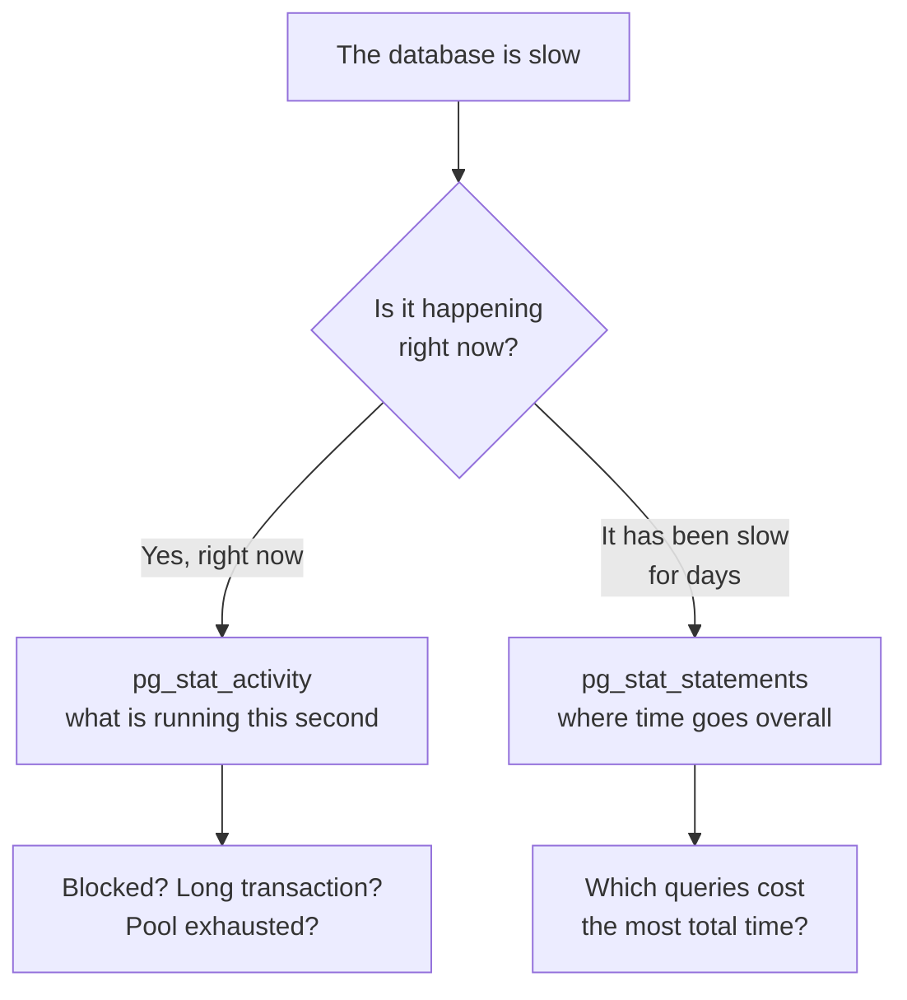

# Monitoring and Troubleshooting — Part 1: What Is Happening Right Now

The database is slow. Right now. Someone is asking in the incident channel and
you have a `psql` prompt open. What do you look at, and in what order?

This file is a runbook, not a theory lesson. Part 1 covers the two views that
answer almost every question — `pg_stat_statements` for "what has been expensive
over time" and `pg_stat_activity` for "what is happening this second" — plus how
to stop a query and how to find out who is blocking whom.
[Part 2](05-monitoring-and-troubleshooting-part-2.md) covers table statistics,
logging, the triage checklist, and what to alert on.

> **📌 In one line:** `pg_stat_statements` tells you where the time goes overall;
> `pg_stat_activity` tells you what is stuck right now. Nearly every incident is
> one of those two questions.

## Table of Contents

1. [Two Questions, Two Views](#two-questions-two-views)
2. [pg_stat_statements: Where the Time Really Goes](#pg_stat_statements-where-the-time-really-goes)
3. [The Query That Is Not the Slowest](#the-query-that-is-not-the-slowest)
4. [pg_stat_activity: What Is Running Now](#pg_stat_activity-what-is-running-now)
5. [Finding Long-Running and Idle-in-Transaction Sessions](#finding-long-running-and-idle-in-transaction-sessions)
6. [Cancelling and Terminating](#cancelling-and-terminating)
7. [Finding Blocked Queries](#finding-blocked-queries)
8. [Common Mistakes](#common-mistakes)
9. [Questions to Test Yourself](#questions-to-test-yourself)
10. [Related](#related)

---

## Two Questions, Two Views

Every database investigation starts as one of two questions, and each has its own
view.



Confusing the two wastes the first ten minutes of an incident. "The checkout
endpoint got slower last Tuesday" is a `pg_stat_statements` question. "Everything
has been hanging for the last four minutes" is a `pg_stat_activity` question.

---

## pg_stat_statements: Where the Time Really Goes

`pg_stat_statements` is an extension that records every query shape the database
has executed, with how many times it ran, how long it took in total, and how much
I/O it did. It is the single most valuable monitoring tool PostgreSQL has.

"Query shape" matters: it normalises literal values, so these two are recorded as
one entry:

```sql
SELECT * FROM invoices WHERE company_id = 42;
SELECT * FROM invoices WHERE company_id = 118;
-- both recorded as: SELECT * FROM invoices WHERE company_id = $1
```

Enabling it needs a restart, because it must be loaded at server start:

```sql
-- In postgresql.conf (or ALTER SYSTEM, then restart):
--   shared_preload_libraries = 'pg_stat_statements'
--   pg_stat_statements.max = 10000
--   pg_stat_statements.track = top
CREATE EXTENSION IF NOT EXISTS pg_stat_statements;
```

The query you will run most: **total time**, which is what actually consumes your
database.

```sql
SELECT
    calls,
    round(total_exec_time::numeric)                AS total_ms,
    round(mean_exec_time::numeric, 2)              AS mean_ms,
    round(100.0 * total_exec_time
          / sum(total_exec_time) OVER ())::numeric AS pct_of_total,
    rows,
    left(query, 70)                                AS query
FROM pg_stat_statements
ORDER BY total_exec_time DESC
LIMIT 10;
```

```text
  calls   | total_ms  | mean_ms | pct_of_total |  query
----------+-----------+---------+--------------+----------------------------------
  2841022 | 4820118   |    1.70 |           38 | SELECT * FROM users WHERE id = $1
     4102 | 2914882   |  710.60 |           23 | SELECT ... FROM invoices JOIN ...
  1204881 |  918204   |    0.76 |            7 | SELECT count(*) FROM tasks WHE...
       12 |  884201   | 73683.4 |            7 | REFRESH MATERIALIZED VIEW comp...
```

Column names differ slightly between PostgreSQL versions — older ones use
`total_time` and `mean_time` instead of `total_exec_time` and `mean_exec_time`.
Check yours if the query errors.

Reset the counters when you want to measure a specific window, such as before and
after a deploy:

```sql
SELECT pg_stat_statements_reset();
```

---

## The Query That Is Not the Slowest

Look at that output again. The top row takes 1.7 ms — it would never appear in a
slow query log — and it is **38% of your entire database load**, because it runs
2.8 million times.

The second row takes 710 ms per call, looks terrible in every dashboard, and
costs less.

> **📌 Remember:** the query that hurts you is usually not the slowest one. It is
> the fast one called an absurd number of times. Sort by **total** time, not by
> mean time.

A `SELECT * FROM users WHERE id = $1` called 2.8 million times in a few hours is
almost always an N+1 problem: code loading a list, then looping and loading each
related row one at a time. That is fixed in application code, not in the
database — see
[../query-optimization/n-plus-one-queries.md](../query-optimization/n-plus-one-queries.md).

Three sorts, three different questions:

| Sort by | Finds | Fix usually is |
|---|---|---|
| `total_exec_time` | The biggest consumer of database capacity | Reduce call count (N+1), or make it faster |
| `mean_exec_time` (with `calls > 100`) | Individually slow queries | An index, or a rewrite |
| `calls` | Chatty code paths | Batching, caching, or a join |

Filter out the noise when sorting by mean, or one-off migrations dominate:

```sql
SELECT calls, round(mean_exec_time::numeric, 1) AS mean_ms, left(query, 70)
FROM pg_stat_statements
WHERE calls > 100
ORDER BY mean_exec_time DESC
LIMIT 10;
```

Once you have the guilty query, take it to
[../query-optimization/slow-query-fixes.md](../query-optimization/slow-query-fixes.md)
and [../query-planner/reading-query-plans.md](../query-planner/reading-query-plans.md).

---

## pg_stat_activity: What Is Running Now

One row per connection, showing what that session is doing at this moment. The
`state` column is the part to learn properly.

| `state` | Meaning | Worrying when |
|---|---|---|
| `active` | Running a query right now | It has been active for minutes |
| `idle` | Connected, no transaction, doing nothing | Almost never — this is a healthy pooled connection |
| `idle in transaction` | Inside `BEGIN`, waiting on the application | Over a few seconds. Holds locks and blocks vacuum |
| `idle in transaction (aborted)` | A statement failed; the transaction was never rolled back | Always. Application code forgot to roll back |
| `fastpath function call` | Running an internal function call | Rare; usually ignorable |

The `wait_event_type` and `wait_event` columns say *why* an active session is not
progressing: `Lock` (waiting for another transaction), `IO` (reading from disk),
`Client` (waiting for your application to send something).

A good first look during an incident:

```sql
SELECT
    pid,
    usename,
    application_name,
    state,
    wait_event_type,
    wait_event,
    now() - query_start AS running_for,
    left(query, 60)     AS query
FROM pg_stat_activity
WHERE datname = current_database()
  AND pid <> pg_backend_pid()          -- exclude this session
  AND state <> 'idle'
ORDER BY query_start
LIMIT 20;
```

```text
  pid  | state               | wait_event_type | running_for | query
-------+---------------------+-----------------+-------------+--------------------------
 24817 | idle in transaction | Client          | 00:14:02    | SELECT id FROM invoices
 25902 | active              | Lock            | 00:03:41    | UPDATE invoices SET stat
 25903 | active              | Lock            | 00:03:38    | UPDATE invoices SET stat
 25911 | active              | IO              | 00:00:04    | SELECT count(*) FROM tas
```

That output tells a complete story already: one session has held a transaction
open for 14 minutes doing nothing, and two others are waiting on locks behind it.

---

## Finding Long-Running and Idle-in-Transaction Sessions

Two targeted queries worth saving somewhere you can paste them quickly.

Anything running longer than a minute:

```sql
SELECT pid, now() - query_start AS duration, state, left(query, 80) AS query
FROM pg_stat_activity
WHERE state = 'active'
  AND now() - query_start > interval '1 minute'
ORDER BY duration DESC;
```

Sessions holding a transaction open while doing nothing — the cause of blocked
vacuum ([02-vacuum-and-autovacuum-part-2.md](02-vacuum-and-autovacuum-part-2.md))
and of held locks:

```sql
SELECT
    pid,
    application_name,
    now() - xact_start  AS transaction_age,
    now() - state_change AS idle_for,
    left(query, 80)     AS last_query
FROM pg_stat_activity
WHERE state IN ('idle in transaction', 'idle in transaction (aborted)')
ORDER BY xact_start;
```

`last_query` here is the **last statement executed**, not what the session is
waiting for — it is still the best clue about which code path left the
transaction open.

> **💡 Tip:** set `application_name` in your connection string, per service:
> `?application_name=api-server` or `worker-billing`. Without it every row says
> the same thing and you cannot tell which deployment to blame.

The state `idle in transaction (aborted)` always points at the same code shape: a
statement failed, the error was caught, and nobody rolled back.

```ts
// ❌ BROKEN — the catch swallows the error and never rolls back, so this
//            session sits in "idle in transaction (aborted)" holding locks
//            until the connection is closed.
const client = await pool.connect()
await client.query('BEGIN')
try {
  await client.query('INSERT INTO invoices (company_id, amount_cents) VALUES ($1, $2)', [42, 9900])
  await client.query('COMMIT')
} catch (error) {
  logger.error({ error }, 'invoice insert failed')   // no ROLLBACK
} finally {
  client.release()      // returns a poisoned connection to the pool
}
```

```ts
// ✅ FIXED — roll back on failure, so the connection returns to the pool clean.
const client = await pool.connect()
try {
  await client.query('BEGIN')
  await client.query('INSERT INTO invoices (company_id, amount_cents) VALUES ($1, $2)', [42, 9900])
  await client.query('COMMIT')
} catch (error) {
  await client.query('ROLLBACK')
  throw error                                        // let the caller decide
} finally {
  client.release()
}
```

---

## Cancelling and Terminating

Two functions, and the difference matters.

| | `pg_cancel_backend(pid)` | `pg_terminate_backend(pid)` |
|---|---|---|
| Effect | Cancels the **current query** | Closes the whole **connection** |
| Transaction | Stays open (now in aborted state) | Rolled back entirely |
| Client sees | A query error | A dropped connection |
| Try it | **First** | When cancel does not work |
| Works on an idle session | No — there is nothing to cancel | Yes |

```sql
-- Polite: stop this query, leave the session connected.
SELECT pg_cancel_backend(25902);

-- Forceful: close the connection and roll back its transaction.
SELECT pg_terminate_backend(24817);
```

Cancel first, and wait a few seconds. Some operations do not check for
cancellation promptly, but most do.

`pg_terminate_backend` is the only option for an `idle in transaction` session,
because there is no running query to cancel. Its transaction is rolled back, so
everything that session did since `BEGIN` is undone.

> **⚠️ Warning:** terminating rolls back the transaction. If it was halfway
> through a batch of invoice updates, that work disappears. Usually that is what
> you want during an incident — but know it, and tell the team, rather than
> discovering it in a reconciliation report a week later.

To clear every idle-in-transaction session older than ten minutes at once:

```sql
SELECT pg_terminate_backend(pid)
FROM pg_stat_activity
WHERE state = 'idle in transaction'
  AND now() - state_change > interval '10 minutes'
  AND pid <> pg_backend_pid();
```

That is an incident tool. The permanent fix is a server-side timeout so this
never builds up:

```sql
ALTER ROLE api_user SET idle_in_transaction_session_timeout = '60s';
```

---

## Finding Blocked Queries

When several sessions are waiting on `Lock`, you need to know **who is blocking
whom**. `pg_blocking_pids()` gives you exactly that, and joining it back against
`pg_stat_activity` produces the single most useful incident query in this file.

```sql
SELECT
    blocked.pid                       AS blocked_pid,
    blocked.usename                   AS blocked_user,
    now() - blocked.query_start       AS blocked_for,
    left(blocked.query, 50)           AS blocked_query,
    blocking.pid                      AS blocking_pid,
    blocking.state                    AS blocking_state,
    now() - blocking.xact_start       AS blocking_txn_age,
    left(blocking.query, 50)          AS blocking_query
FROM pg_stat_activity AS blocked
JOIN LATERAL unnest(pg_blocking_pids(blocked.pid)) AS blocking_pid ON true
JOIN pg_stat_activity AS blocking ON blocking.pid = blocking_pid
WHERE cardinality(pg_blocking_pids(blocked.pid)) > 0
ORDER BY blocked_for DESC;
```

```text
 blocked_pid | blocked_for | blocked_query            | blocking_pid | blocking_state      | blocking_txn_age
-------------+-------------+--------------------------+--------------+---------------------+------------------
       25902 | 00:03:41    | UPDATE invoices SET sta.. |        24817 | idle in transaction | 00:14:02
       25903 | 00:03:38    | UPDATE invoices SET sta.. |        24817 | idle in transaction | 00:14:02
       25907 | 00:03:12    | SELECT * FROM invoices .. |        24817 | idle in transaction | 00:14:02
```

Read it right to left. Everything is blocked by **pid 24817**, which is not even
running a query — it is sitting in an open transaction holding locks. Terminating
that one session frees all three.

```text
   24817  idle in transaction (holds row lock on invoices)
      ▲
      ├── 25902 waiting  ──┐
      ├── 25903 waiting  ──┤  all clear the moment 24817 goes away
      └── 25907 waiting  ──┘
```

Two things to notice in that pattern:

- **Blocking chains.** A blocker can itself be blocked. Keep following the
  `blocking_pid` column until you reach a session that is blocked by nobody —
  that is the root, and it is the only one worth terminating.
- **The queue grows.** Each blocked query holds a connection from your pool. A
  single stuck session becomes pool exhaustion within a minute or two, which is
  why the whole application goes down rather than one feature. See
  [01-connection-pooling-part-1.md](01-connection-pooling-part-1.md).

The lock theory — which lock modes conflict, what each statement takes, and how
deadlocks form — is in
[../transactions-and-concurrency/04-locks-part-1.md](../transactions-and-concurrency/04-locks-part-1.md)
and
[../transactions-and-concurrency/05-deadlocks-part-1.md](../transactions-and-concurrency/05-deadlocks-part-1.md).

---

## Common Mistakes

| Mistake | Why it is wrong | Do this instead |
|---|---|---|
| Sorting `pg_stat_statements` by mean time | Hides the 1 ms query called three million times | Sort by `total_exec_time` first |
| Treating `idle` connections as a problem | That is a pool holding connections, which is correct | Watch `idle in transaction` instead |
| Terminating the first blocked pid you see | It is a victim, not the cause; the blocker keeps blocking | Follow the chain to the root blocker |
| Using `pg_terminate_backend` as the first tool | Rolls back the whole transaction, sometimes needlessly | Try `pg_cancel_backend` first |
| Not setting `application_name` | Every row looks identical; you cannot tell which service is at fault | Set it per service in the connection string |
| Reading `query` in an idle-in-transaction row as the current query | It is the last statement executed, not what it is doing | Use `state` and `xact_start` to judge |
| Investigating a week-old slowdown in `pg_stat_activity` | It only shows this instant | Use `pg_stat_statements` for history |

---

## Questions to Test Yourself

1. A query averaging 1.7 ms is 38% of your database load. Explain how, and say
   what kind of application bug usually causes it.
2. Which view answers "the export endpoint got slower after Tuesday's deploy",
   and which answers "everything is hanging right now"?
3. What does `idle in transaction` mean, and name two separate kinds of damage a
   session in that state causes.
4. You need to stop a runaway `UPDATE`. Which function do you try first, why, and
   what happens to its transaction in each case?
5. Write from memory the shape of the query that shows who is blocking whom, and
   say which column you act on.
6. Three sessions are blocked and one of the blockers is itself blocked. Which
   pid do you terminate, and how did you decide?
7. Why does one stuck session usually take down the entire application rather
   than one endpoint?

---

## Related

- [Monitoring and Troubleshooting — Part 2](05-monitoring-and-troubleshooting-part-2.md)
  — table statistics, cache hit ratio, slow query logging, the triage checklist,
  and what to alert on.
- [01-connection-pooling-part-1.md](01-connection-pooling-part-1.md) — why a
  blocked query becomes an application-wide outage.
- [02-vacuum-and-autovacuum-part-2.md](02-vacuum-and-autovacuum-part-2.md) — the
  long transaction you just found is also blocking vacuum everywhere.
- [../query-optimization/n-plus-one-queries.md](../query-optimization/n-plus-one-queries.md)
  — the usual cause of a cheap query with a huge call count.
- [../query-optimization/slow-query-fixes.md](../query-optimization/slow-query-fixes.md)
  — what to do once you have identified the query.
- [../transactions-and-concurrency/04-locks-part-1.md](../transactions-and-concurrency/04-locks-part-1.md)
  — the lock theory behind the blocking query.

---

Continued in [Part 2](05-monitoring-and-troubleshooting-part-2.md).
