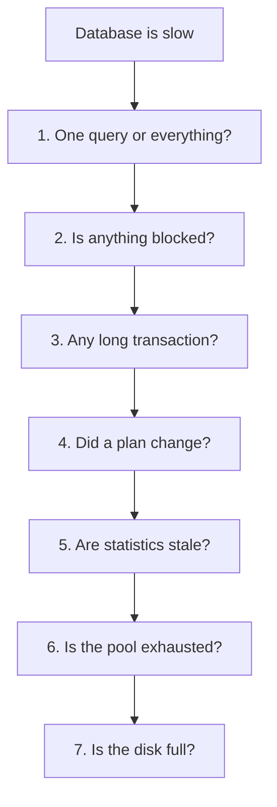

# Monitoring and Troubleshooting — Part 2: Statistics, Logging, and Triage

This continues [Part 1](05-monitoring-and-troubleshooting-part-1.md).

Part 1 gave you the two live views: `pg_stat_statements` for where time goes over
days, `pg_stat_activity` for what is stuck this second, plus how to cancel a
query and how to find the session blocking everyone else.

Part 2 is the rest of the runbook — the statistics that reveal a missing index,
what the logs can tell you, how to watch connections and disk, and finally the
ordered triage checklist you will come back to every time something breaks.

> **📌 In one line:** during an incident, work through a fixed checklist in a
> fixed order — guessing is what turns a ten-minute incident into an hour.

## Table of Contents

1. [Table and Index Statistics](#table-and-index-statistics)
2. [Spotting a Missing Index](#spotting-a-missing-index)
3. [Cache Hit Ratio](#cache-hit-ratio)
4. [Slow Query Logging](#slow-query-logging)
5. [Connections and Sizes](#connections-and-sizes)
6. [The Triage Checklist](#the-triage-checklist)
7. [What to Alert On](#what-to-alert-on)
8. [Advanced: Baselines and Backups](#advanced-baselines-and-backups)
9. [Common Mistakes](#common-mistakes)
10. [Questions to Test Yourself](#questions-to-test-yourself)
11. [Related](#related)

---

## Table and Index Statistics

`pg_stat_user_tables` records how each table has been accessed since statistics
were last reset. Four groups of columns matter.

| Columns | What they tell you |
|---|---|
| `seq_scan`, `seq_tup_read` | How often the whole table was scanned, and how many rows that read |
| `idx_scan`, `idx_tup_fetch` | How often an index was used instead |
| `n_live_tup`, `n_dead_tup` | Rough live and dead row counts |
| `last_autovacuum`, `last_autoanalyze` | When maintenance last ran |

```sql
SELECT
    relname,
    seq_scan,
    seq_tup_read,
    idx_scan,
    n_live_tup,
    CASE WHEN seq_scan > 0
         THEN seq_tup_read / seq_scan ELSE 0 END AS avg_rows_per_seq_scan
FROM pg_stat_user_tables
WHERE n_live_tup > 10000
ORDER BY seq_tup_read DESC
LIMIT 10;
```

```text
   relname    | seq_scan | seq_tup_read | idx_scan | n_live_tup | avg_rows_per_seq_scan
--------------+----------+--------------+----------+------------+-----------------------
 invoices     |    41882 |  336412008   |  2841022 |    8016161 |                  8032
 notifications|      118 |     942004   | 18820114 |    8412003 |                  7983
 companies    |   918204 |    4591020   |       12 |       5002 |                     5
```

And `pg_stat_user_indexes` shows which indexes are actually used:

```sql
SELECT
    relname AS table_name,
    indexrelname AS index_name,
    idx_scan,
    pg_size_pretty(pg_relation_size(indexrelid)) AS size
FROM pg_stat_user_indexes
WHERE idx_scan < 50
ORDER BY pg_relation_size(indexrelid) DESC
LIMIT 10;
```

An index with `idx_scan = 0` that has existed for months is costing you write
performance and disk for nothing. Confirm it is not a unique constraint or a
newly created index before dropping it.

---

## Spotting a Missing Index

Read the first output again. Two rows tell opposite stories.

`invoices` has been sequentially scanned 41,882 times, reading 336 million rows —
about 8,000 rows per scan on an 8-million-row table. That is a table being
scanned over and over for a small result. **That is a missing index**, and it is
the single clearest signal this view gives.

`companies` has 918,204 sequential scans but only 5 rows per scan, on a
5,000-row table. That is fine. PostgreSQL scans small tables on purpose because
reading one 8 KB page beats an index lookup plus a heap fetch. Adding an index
there would be ignored.

```text
  is a high seq_scan count a problem?

  large table  +  high seq_scan  +  few rows returned   →  missing index
  large table  +  high seq_scan  +  most rows returned  →  the scan is correct
  small table  +  high seq_scan                         →  normal, ignore
```

> **⚠️ Warning:** never add an index from this view alone. It tells you *where*
> to look, not *what* to create. Find the actual query in `pg_stat_statements`,
> run `EXPLAIN ANALYZE` on it, and let the plan decide the columns and their
> order.

Once you have the query, the index decision is covered in
[../query-optimization/composite-index-ordering.md](../query-optimization/composite-index-ordering.md),
[../query-optimization/partial-indexes.md](../query-optimization/partial-indexes.md)
and
[../query-optimization/covering-indexes.md](../query-optimization/covering-indexes.md).

---

## Cache Hit Ratio

PostgreSQL keeps recently used pages in shared memory. The cache hit ratio is the
share of page reads served from that memory instead of from disk.

```sql
SELECT
    sum(heap_blks_hit)                                        AS from_cache,
    sum(heap_blks_read)                                       AS from_disk,
    round(100.0 * sum(heap_blks_hit)
          / nullif(sum(heap_blks_hit) + sum(heap_blks_read), 0), 2) AS hit_pct
FROM pg_statio_user_tables;
```

```text
 from_cache  | from_disk | hit_pct
-------------+-----------+---------
 88412003122 | 412880114 |   99.54
```

A healthy OLTP (online transaction processing) database usually sits above 99%.
Below about 95% on a busy system, look at whether `shared_buffers` is too small
for the working set.

> **💡 Tip:** a high hit ratio is **not** proof of health. A query doing a
> sequential scan of a fully cached 8 GB table has a 100% hit ratio and is still
> ruinously slow. The ratio tells you about memory sizing, nothing else. Never
> report "cache hit ratio is 99.6%" as evidence the database is fine.

The number is also cumulative since the last statistics reset, so it is an
average over weeks. Sample it periodically and look at the change rather than the
absolute value.

---

## Slow Query Logging

The live views forget. Logging is how you find out what happened at 03:14 last
Tuesday. Three settings, each with a cost.

| Setting | What it gives you | The cost |
|---|---|---|
| `log_min_duration_statement` | Logs any statement slower than N ms, with its parameters | Set too low, it logs everything and fills the disk |
| `auto_explain` | Logs the actual execution plan of slow queries | Planning overhead; use sampling |
| `log_lock_waits` | Logs when a statement waits longer than `deadlock_timeout` for a lock | Low; almost always worth enabling |

```sql
-- ❌ BROKEN — logs every single statement. On a busy database this writes
--            gigabytes per hour, fills the disk, and slows the server down
--            by making it wait on log writes.
ALTER SYSTEM SET log_min_duration_statement = 0;
```

```sql
-- ✅ FIXED — log only genuinely slow statements, plus every lock wait.
ALTER SYSTEM SET log_min_duration_statement = '500ms';
ALTER SYSTEM SET log_lock_waits = on;
ALTER SYSTEM SET log_temp_files = '10MB';   -- catches work_mem spilling to disk
SELECT pg_reload_conf();
```

`auto_explain` is the one that answers "why was it slow?" rather than "what was
slow?". Load it and sample, rather than explaining every slow query:

```text
# postgresql.conf
shared_preload_libraries = 'pg_stat_statements,auto_explain'
auto_explain.log_min_duration = '2s'
auto_explain.log_analyze = on          # real timings, not estimates
auto_explain.log_buffers = on
auto_explain.sample_rate = 0.1         # only 10% of qualifying queries
```

`log_analyze = on` gives real row counts and timings, which is what you need to
spot a bad estimate — but it adds measurable overhead on every query it
instruments, which is why the sample rate matters. Reading those plans is covered
in
[../query-planner/reading-query-plans.md](../query-planner/reading-query-plans.md).

A `log_lock_waits` line is unusually informative, because it names both sides:

```text
LOG:  process 25902 still waiting for ShareLock on transaction 918241
      after 1000.118 ms
DETAIL:  Process holding the lock: 24817. Wait queue: 25902, 25903, 25907.
CONTEXT:  while updating tuple (41882,3) in relation "invoices"
STATEMENT:  UPDATE invoices SET status = 'paid' WHERE id = $1
```

---

## Connections and Sizes

Two things that cause outages quietly: running out of connections, and running
out of disk.

Connections against the limit:

```sql
SELECT
    count(*)                                      AS current,
    current_setting('max_connections')::int       AS max_allowed,
    round(100.0 * count(*)
          / current_setting('max_connections')::int, 1) AS pct_used,
    count(*) FILTER (WHERE state = 'active')      AS active,
    count(*) FILTER (WHERE state = 'idle in transaction') AS idle_in_txn
FROM pg_stat_activity;
```

Above roughly 80% of `max_connections`, act before it becomes
`FATAL: sorry, too many clients already`. The causes and the fix are in
[01-connection-pooling-part-1.md](01-connection-pooling-part-1.md).

Database and table sizes:

```sql
-- Whole database.
SELECT pg_size_pretty(pg_database_size(current_database()));

-- Largest tables, with and without their indexes.
SELECT
    relname,
    pg_size_pretty(pg_total_relation_size(relid)) AS total,
    pg_size_pretty(pg_relation_size(relid))       AS table_only,
    pg_size_pretty(pg_indexes_size(relid))        AS indexes
FROM pg_stat_user_tables
ORDER BY pg_total_relation_size(relid) DESC
LIMIT 10;
```

```text
   relname     |  total  | table_only | indexes
---------------+---------+------------+----------
 notifications | 9184 MB | 6102 MB    | 3082 MB
 tasks         | 3021 MB | 2104 MB    | 917 MB
 invoices      | 1204 MB | 918 MB     | 286 MB
```

Indexes at half the size of the table itself is worth a look — often several
overlapping indexes nobody has pruned. Cross-check with the unused-index query
above.

> **⚠️ Warning:** track **growth rate**, not just current size. "The disk is 71%
> full" is meaningless on its own. "It was 60% a week ago" tells you that you
> have roughly two weeks. A full disk stops writes completely, and recovering
> from one is far harder than preventing it.

---

## The Triage Checklist

When the database is slow and people are waiting, work through this in order.
Each step is one query you already have from Part 1 or above.



1. **Is it one query or everything?** Look at `pg_stat_activity`. If many
   different statements are slow, it is a system-wide problem — locks, pool,
   disk, CPU. If one statement is slow, it is a query problem.
2. **Is anything blocked?** Run the `pg_blocking_pids` query from Part 1. If
   there is a root blocker, everything else you find is a symptom. Deal with it
   first.
3. **Is a long transaction running?** Check `xact_start` and
   `idle in transaction`. A long transaction holds locks and blocks vacuum, so it
   both causes blocking and hides the evidence.
4. **Has a plan changed?** Compare this query's `mean_exec_time` in
   `pg_stat_statements` with what you remember or have graphed. A query that went
   from 2 ms to 900 ms without a code change means the planner switched plans.
   `EXPLAIN ANALYZE` it now.
5. **Are statistics stale?** Check `last_autoanalyze` and `n_mod_since_analyze`.
   A bulk load followed by bad plans is the classic case; `ANALYZE invoices;`
   takes seconds and is safe to run.
6. **Is the connection pool exhausted?** Check the application's `waiting` count
   and the connection count against `max_connections`. Slow application, calm
   database means the pool.
7. **Is the disk full, or nearly?** Check free space, and also WAL growth from
   an abandoned replication slot — see
   [02-vacuum-and-autovacuum-part-2.md](02-vacuum-and-autovacuum-part-2.md).

> **📌 Remember:** the order matters more than the individual queries. Steps 2
> and 3 find the single cause behind twenty symptoms. Jumping straight to step 4
> means optimising a query that was only ever waiting on a lock.

---

## What to Alert On

| Metric | Threshold | What it usually means |
|---|---|---|
| Connections used | > 80% of `max_connections` | Pool too large, instance count grew, or a leak |
| Oldest transaction age | > 5 min | A stuck session holding locks and blocking vacuum |
| Blocked sessions | Any, for > 30 s | A lock chain forming; find the root blocker |
| Replication lag | > your sticky-read window | Stale reads on replicas become user-visible |
| Dead tuple percentage | > 20% on a large table | Autovacuum too slow or blocked |
| `age(datfrozenxid)` | > 1 billion | Wraparound risk; find the vacuum blocker today |
| Disk used | > 75%, or growth implying < 14 days left | Plan now, not at 95% |
| Inactive replication slot | Any, > 1 h | WAL retention will fill the disk |
| p99 query latency | 2× the baseline | Plan change, contention, or a data-size cliff |
| Cache hit ratio | < 95% sustained | `shared_buffers` too small for the working set |

Two rules that keep this list useful. **Alert on causes, not only symptoms** —
oldest transaction age fires ten minutes before dead tuples do. And **every alert
needs an action**; if nobody knows what to do when it fires, it will be ignored,
and then so will the one that matters.

Application-side metrics and how these connect to structured logs and traces are
in
[../../backend-fundamentals/08-logging-and-observability/01-logging-basics.md](../../backend-fundamentals/08-logging-and-observability/01-logging-basics.md).

---

## Advanced: Baselines and Backups

**Baselining.** Every threshold above is a guess until you know your own normal.
"Query latency doubled" is only meaningful if you know what it was. Capture, once
a week and after every significant deploy: the top 20 entries from
`pg_stat_statements` by total time, connection counts at peak and trough, table
and index sizes, cache hit ratio, and replication lag at peak. Keep the snapshots
in a table or a dashboard.

The payoff arrives during an incident. "This query normally runs 40,000 times an
hour at 1.7 ms; right now it runs 40,000 times at 900 ms" is a diagnosis in one
sentence. Without a baseline, the same data is just numbers.

```sql
-- A simple weekly snapshot you can compare against later.
CREATE TABLE IF NOT EXISTS ops_query_baseline AS
SELECT now() AS captured_at, queryid, calls, total_exec_time, mean_exec_time, query
FROM pg_stat_statements
WHERE calls > 100
ORDER BY total_exec_time DESC
LIMIT 20;
```

(`ops_query_baseline` is an operational table added for this purpose; it is not
part of the shared schema.)

**Backups, and the part everyone postpones.** A PostgreSQL backup strategy has
two pieces: periodic **base backups** (a full copy) and **WAL archiving** (every
change since), which together give point-in-time recovery — the ability to
restore the database to 14:22 yesterday, just before someone ran the wrong
`DELETE`.

As [04-read-replicas-and-replication-lag.md](04-read-replicas-and-replication-lag.md)
says: replication is not a backup. It copies mistakes faithfully.

> **⚠️ Warning:** an untested backup is not a backup. The failure mode is
> universal — backups ran green for two years, and on the day they were needed
> the restore failed, or took eleven hours nobody had budgeted for, or turned out
> to exclude one critical table.

Make restore testing a scheduled task, at least quarterly, and record three
numbers each time: how long the restore took, whether the data was complete, and
how much data was lost between the last backup and the failure point. Those are
your real RTO (recovery time objective) and RPO (recovery point objective) — not
the ones in the plan document. Restoring into a staging environment also gives
you realistic data to test against, so the exercise pays for itself twice.

---

## Common Mistakes

| Mistake | Why it is wrong | Do this instead |
|---|---|---|
| Adding an index because `seq_scan` is high | Small tables are scanned on purpose; the count alone proves nothing | Find the query, then `EXPLAIN ANALYZE` it |
| Reporting a 99% cache hit ratio as proof of health | A cached sequential scan is still a slow query | Use it only to judge `shared_buffers` |
| `log_min_duration_statement = 0` on production | Logs every statement, fills the disk, slows the server | 200–1000 ms, and `log_lock_waits = on` |
| `auto_explain` with `log_analyze` on every query | Measurable overhead on all traffic | Set a duration floor and a sample rate |
| Alerting on disk used but not growth rate | 71% full tells you nothing about when you run out | Alert on projected days remaining |
| Skipping straight to query tuning in an incident | You optimise a query that was only waiting on a lock | Follow the checklist in order |
| Trusting backups that have never been restored | The failure appears on the worst possible day | Scheduled restore tests with recorded timings |
| Alerts nobody has an action for | They get muted, and the useful ones with them | Every alert names a first step |

---

## Questions to Test Yourself

1. `companies` shows 918,204 sequential scans. Is that a problem? What extra
   number do you need before answering?
2. Your cache hit ratio is 99.6% and the database is slow. Explain how both can
   be true.
3. Why is `log_min_duration_statement = 0` dangerous, and what does
   `log_lock_waits` give you that it does not?
4. What does `auto_explain` add over `pg_stat_statements`, and what does turning
   it on cost?
5. Recite the seven triage steps in order, and explain why step 2 comes before
   step 4.
6. Give three metrics you would alert on that are *causes* rather than symptoms,
   and say what each one predicts.
7. Define RTO and RPO in your own words, and say how you would find out what
   yours actually are.
8. Someone says "replication is our backup." Give the failure it does not cover.

---

## Related

- [Monitoring and Troubleshooting — Part 1](05-monitoring-and-troubleshooting-part-1.md)
  — `pg_stat_statements`, `pg_stat_activity`, cancelling queries, and finding the
  root blocker.
- [01-connection-pooling-part-1.md](01-connection-pooling-part-1.md) — the pool
  exhaustion check in step 6 of the checklist.
- [02-vacuum-and-autovacuum-part-2.md](02-vacuum-and-autovacuum-part-2.md) —
  dead tuple and wraparound alerting, and the disk-filling replication slot.
- [04-read-replicas-and-replication-lag.md](04-read-replicas-and-replication-lag.md)
  — replication lag alerting, and why a replica is not a backup.
- [../query-planner/reading-query-plans.md](../query-planner/reading-query-plans.md)
  — reading the plans `auto_explain` writes to your log.
- [../../backend-fundamentals/08-logging-and-observability/01-logging-basics.md](../../backend-fundamentals/08-logging-and-observability/01-logging-basics.md)
  — joining these database metrics to application logs and traces.
