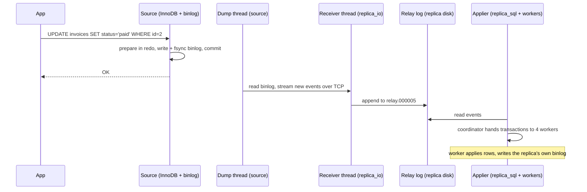

# MySQL Binlog Replication — Part 1

The question that started this folder: *"One mysql image, multiple containers, I
update data in different containers — will it sync?"* No. Each container has its
own writable layer, so its own `/var/lib/mysql`, so its own database. You can
see it before writing a single row. I started containers from `mysql:8` for this
lab and asked two of them for their transaction history:

```text
rpl-a-source    @@gtid_executed = fbfb063a-…:1-5
rpl-a-replica   @@gtid_executed = fc22dffb-…:1-5
```

Two identities, each with five transactions of its own (the entrypoint loading
time zone tables): two histories that nothing will ever reconcile. One shared
volume would not help, because InnoDB assumes one `mysqld` owns a datadir.

So sync has to be a **protocol**: one server is the source of truth, it writes
down every change it commits, and the others fetch that record and replay it
in order. In MySQL the record is the **binary log**. MySQL because the question
was; for PostgreSQL see
[../operations/04-read-replicas-and-replication-lag.md](../operations/04-read-replicas-and-replication-lag.md).

> **➡️ Continued in [Part 2](./01-mysql-binlog-replication-part-2.md).**

> **📌 In one line:** the source writes every committed change to the binary
> log; a replica copies it into its relay log and replays it, so "sync" means
> "replay the same ordered list of changes".

## Table of Contents

1. [The Lab](#the-lab)
2. [The Binary Log: What It Is and What It Isn't](#the-binary-log-what-it-is-and-what-it-isnt)
3. [Two Logs, One Commit](#two-logs-one-commit)
4. [Event Formats: ROW, STATEMENT, MIXED](#event-formats-row-statement-mixed)
5. [The Replication Pipeline](#the-replication-pipeline)
6. [Reading SHOW REPLICA STATUS](#reading-show-replica-status)
7. [A Decoded Row Event](#a-decoded-row-event)
8. [binlog_row_image](#binlog_row_image)
9. [Common Mistakes](#common-mistakes)
10. [Questions to Test Yourself](#questions-to-test-yourself)
11. [Related](#related)

> **📌 Remember:** 8.4 says **source**/**replica**; old posts say *master*/*slave*.
> The old statements are gone in 8.4, not deprecated: `SHOW MASTER STATUS`,
> `SHOW SLAVE STATUS`, `CHANGE MASTER TO`, `START SLAVE`, `RESET MASTER` all
> return `ERROR 1064` on the lab server. Leftovers: the `REPLICATION SLAVE`
> privilege and tables like `mysql.slave_master_info`.

---

## The Lab

Output is from MySQL 8.4.9 (`mysql:8`) on a private Docker network, no published
ports. UUIDs are shortened: `fbfb063a-…` is the source (`…-3668b3a779e3`) and
`fc22dffb-…` the replica (`…-3ad2d2e5ebce`).

```text
$ docker network create rpl-a-net
$ docker run -d --name rpl-a-source --network rpl-a-net \
    -e MYSQL_ROOT_PASSWORD=root-pass mysql:8 \
    --server-id=1 --log-bin=binlog --gtid-mode=ON --enforce-gtid-consistency=ON
$ docker run -d --name rpl-a-replica --network rpl-a-net \
    -e MYSQL_ROOT_PASSWORD=root-pass mysql:8 \
    --server-id=2 --log-bin=binlog --gtid-mode=ON --enforce-gtid-consistency=ON \
    --relay-log=relay
```

Every server needs a **distinct `server_id`**: each event is stamped with its
writer's id, and a server skips events carrying its own. GTIDs ("every
transaction gets a global name") are Part 2.

```sql
-- on the source: a user that may only read the binlog
CREATE USER 'repl'@'%' IDENTIFIED BY 'repl-pass';
GRANT REPLICATION SLAVE ON *.* TO 'repl'@'%';

-- on the replica: drop the entrypoint's history, then point at the source
RESET BINARY LOGS AND GTIDS;          -- the 8.4 name for RESET MASTER
CHANGE REPLICATION SOURCE TO
  SOURCE_HOST = 'rpl-a-source', SOURCE_PORT = 3306,
  SOURCE_USER = 'repl', SOURCE_PASSWORD = 'repl-pass',
  SOURCE_AUTO_POSITION = 1,           -- find the start point by GTID (Part 2)
  GET_SOURCE_PUBLIC_KEY = 1;          -- see the warning below
START REPLICA;
```

Without the reset, the replica's own `fc22dffb-…:1-5` stays in its history,
though the source never ran them: an *errant transaction* (Part 2).

> **⚠️ Warning:** `repl` uses `caching_sha2_password`, the 8.4 default. Without
> TLS, the replica needs the source's RSA public key, which
> `GET_SOURCE_PUBLIC_KEY = 1` fetches. Lab only; in production use TLS
> (`SOURCE_SSL = 1`). The server agrees: `Note 1759 Sending passwords in plain
> text without SSL/TLS is extremely insecure.`

```sql
-- data, on the source
CREATE DATABASE saas;
CREATE TABLE saas.invoices (id INT PRIMARY KEY AUTO_INCREMENT,
  company_id INT NOT NULL, amount_cents INT NOT NULL,
  status VARCHAR(16) NOT NULL DEFAULT 'open',
  created_at DATETIME NOT NULL DEFAULT CURRENT_TIMESTAMP);
INSERT INTO saas.invoices (company_id, amount_cents) VALUES (7, 25000), (7, 12000), (9, 99000);
UPDATE saas.invoices SET status = 'paid' WHERE id = 2;
```

Two seconds later, on the replica:

```text
mysql> SELECT id, company_id, amount_cents, status FROM saas.invoices;
| id | company_id | amount_cents | status |
|  1 |          7 |        25000 | open   |
|  2 |          7 |        12000 | paid   |
|  3 |          9 |        99000 | open   |
```

The rest of this file is what happened in those two seconds.

---

## The Binary Log: What It Is and What It Isn't

The **binary log** (binlog) is an append-only, numbered series of files. It
records every change that committed on this server, as **events**, in commit
order. It lives at the server level, above the storage engine, and it has two
jobs: **replication**, and **point-in-time recovery** (restore a backup, then
replay the binlog up to just before the mistake).

```text
mysql> SHOW BINARY LOGS;
| Log_name      | File_size | Encrypted |
+---------------+-----------+-----------+
| binlog.000001 |       181 | No        |
| binlog.000002 |   2997943 | No        |
| binlog.000003 |       775 | No        |
| binlog.000004 |      1457 | No        |

mysql> SHOW BINARY LOG STATUS;
| File          | Position | Binlog_Do_DB | Binlog_Ignore_DB | Executed_Gtid_Set   |
+---------------+----------+--------------+------------------+---------------------+
| binlog.000004 |     1457 |              |                  | fbfb063a-…:1-11     |
```

- **Many files, one log.** A new file starts on restart, on `FLUSH BINARY LOGS`
  (I ran one before creating `saas`), or past `max_binlog_size` (1 GiB).
- **`binlog.000002` is 3 MB**: the entrypoint's time zone tables, GTIDs 1–5.
- **`SHOW BINARY LOG STATUS`** is "where am I writing now": file, byte offset,
  and every transaction executed. Part 2 shows why the offset is fragile and
  the GTID set is not.

`SHOW BINLOG EVENTS IN 'binlog.000004'` lists the events (trimmed):

```text
| Pos  | Event_type | Server_id | End_log_pos | Info                                     |
|  760 | Gtid       |         1 |         839 | SET @@SESSION.GTID_NEXT= 'fbfb063a-…:10' |
|  839 | Query      |         1 |         918 | BEGIN                                    |
|  918 | Table_map  |         1 |         984 | table_id: 88 (saas.invoices)             |
|  984 | Write_rows |         1 |        1088 | table_id: 88 flags: STMT_END_F           |
| 1088 | Xid        |         1 |        1119 | COMMIT /* xid=38 */                      |
```

Every transaction has that shape: `Gtid` (its name), `BEGIN`, `Table_map`
(which table), row events, `Xid` (the commit). DDL is one `Query` event.

What the binlog is **not**: the InnoDB redo log (next section); the data files
(lose every binlog and you lose history, not tables); a backup (it reaches back
only to the oldest file kept, and files expire, Part 2); or per-database (one
stream per server).

---

## Two Logs, One Commit

InnoDB already has a log, the **redo log**, and the two are easy to mix up.

| | InnoDB redo log | Binary log |
|---|---|---|
| Owned by | The InnoDB engine | The MySQL server |
| Records | Physical page changes | Logical changes (rows or statements) |
| Shape | Fixed capacity, reused (`innodb_redo_log_capacity` = 100 MiB here) | Append-only numbered files, kept for days |
| On disk | `/var/lib/mysql/#innodb_redo/#ib_redo9` … | `/var/lib/mysql/binlog.000004` … |
| Used for | Crash recovery of *this* server's pages | Replication and point-in-time recovery |

A commit must land in **both**, or a crash between them leaves the source with
a row the replicas never get (or the reverse). MySQL uses an internal
**two-phase commit** with the binlog as coordinator:

```text
COMMIT
  1. prepare  — InnoDB writes the transaction to redo, marked "prepared"
  2. binlog   — the server writes the events to the binlog and fsyncs it
  3. commit   — InnoDB marks it committed

Crash recovery, for each "prepared" InnoDB transaction:
  Xid found in the binlog      → commit it    (replicas will get it too)
  Xid not in the binlog        → roll it back (nobody ever saw it)
```

The binlog has the deciding vote: a transaction exists if and only if it reached
the binlog, which is what makes it safe to replicate. The lab server has the
safe defaults, `sync_binlog = 1` and `innodb_flush_log_at_trx_commit = 1`.

> **⚠️ Warning:** tuning guides suggest `sync_binlog=0` or
> `innodb_flush_log_at_trx_commit=2` for speed. On a source, a power cut can
> then lose acknowledged commits or split binlog from data, and replicas diverge.

---

## Event Formats: ROW, STATEMENT, MIXED

There are two ways to describe a change: log the **SQL text** and run it again
(`STATEMENT`), or log the **rows that changed**, before and after (`ROW`).
`MIXED` uses statements until the server decides one is unsafe, then switches
to rows.

Statement format is compact, but only correct if the same SQL gives the same
result twice. One session switched to statement format:

```text
mysql> SET SESSION binlog_format = 'STATEMENT';
Warning 1287  '@@binlog_format' is deprecated and will be removed in a future release.

mysql> UPDATE saas.invoices SET status = 'overdue' WHERE status = 'open' LIMIT 1;
mysql> SHOW WARNINGS;
| Note | 1592 | Unsafe statement written to the binary log using statement format since
BINLOG_FORMAT = STATEMENT. The statement is unsafe because it uses a LIMIT clause. This is
unsafe because the set of rows included cannot be predicted. |
```

The binlog holds that SQL text verbatim. Without `ORDER BY`, "the first open
invoice" depends on physical row order, so the replica can update a *different*
invoice and never report an error. `UUID()`, `SYSDATE()`, and triggers that
read other tables have the same problem. ROW records the *result* instead.

| Format | Logs | Good | Bad |
|---|---|---|---|
| `ROW` (default) | Changed rows, before + after | Deterministic; change-data-capture tools can read it | Large for bulk updates: one row image per row |
| `STATEMENT` | SQL text | Small | Silent divergence on unsafe statements |
| `MIXED` | Statement, or row when unsafe | Smaller on average | Depends on the server spotting every unsafe case |

What 8.4 says: `binlog_format` still accepts all three values, but setting it
raises warning 1287 (deprecated, to be removed). ROW is the default; treat it
as the only format.

---

## The Replication Pipeline

Three kinds of thread, spread over two servers, do the work. Knowing which one
is stuck is most of the debugging.



- **Dump thread** (source): one per replica. Reads the binlog and pushes events.
  It does not wait for the replica unless semi-sync is on (Part 2).
- **Receiver thread** (old name "I/O thread"): logs in as `repl` and appends
  what it receives to the **relay log**. It only copies.
- **Applier** (old name "SQL thread"): a coordinator reads the relay log and
  hands transactions to `replica_parallel_workers` workers (4 by default). How
  it picks what runs in parallel is in [02](./02-replication-lag-in-mysql.md).

So a replica can be **received but not applied**: safe on disk, not yet
visible. PostgreSQL has the same receive/replay split.

All three are visible in the lab. On the source, the dump thread is a `repl`
connection whose `COMMAND` is `Binlog Dump GTID` and whose state reads
`Source has sent all binlog to replica; waiting for more updates`. On the
replica (`SHOW PROCESSLIST` lists the same threads as user `system user`):

```text
mysql> SELECT THREAD_ID, NAME, PROCESSLIST_STATE FROM performance_schema.threads
       WHERE NAME LIKE 'thread/sql/replica%';
| THREAD_ID | NAME                      | PROCESSLIST_STATE                                        |
+-----------+---------------------------+----------------------------------------------------------+
|        49 | thread/sql/replica_io     | Waiting for source to send event                         |
|        50 | thread/sql/replica_sql    | Replica has read all relay log; waiting for more updates |
|        51 | thread/sql/replica_worker | Waiting for an event from Coordinator                    |
|  …  52–54: three more replica_worker threads, same state                                     |
```

The relay log is ordinary files on the replica, holding the source's events:

```text
$ docker exec rpl-a-replica ls -l /var/lib/mysql | grep relay
-rw-r----- 1 mysql mysql      285 Nov  6 17:37 relay.000004
-rw-r----- 1 mysql mysql     2319 Nov  6 17:38 relay.000005
-rw-r----- 1 mysql mysql       30 Nov  6 17:37 relay.index

mysql> SHOW RELAYLOG EVENTS IN 'relay.000005';     -- trimmed
| Pos  | Event_type  | Server_id | End_log_pos | Info                                     |
|  198 | Rotate      |         1 |           0 | binlog.000004;pos=4                      |
| 1330 | Gtid        |         1 |        1198 | SET @@SESSION.GTID_NEXT= 'fbfb063a-…:11' |
| 1555 | Update_rows |         1 |        1426 | table_id: 88 flags: STMT_END_F           |
| 1637 | Xid         |         1 |        1457 | COMMIT /* xid=39 */                      |
```

Older relay files are gone (`relay_log_purge=ON`). `Pos` (1330) is an offset in
the *relay* file; `End_log_pos` (1198) is still the *source's* binlog offset.
With `log_replica_updates=ON` (the 8.4 default) the applier also writes each
transaction into the **replica's own binlog**, which makes a replica
promotable and lets other replicas chain from it.

---

## Reading SHOW REPLICA STATUS

The command you run when something is wrong. The healthy lab replica, trimmed:

```text
mysql> SHOW REPLICA STATUS\G
             Replica_IO_State: Waiting for source to send event
                  Source_Host: rpl-a-source
              Source_Log_File: binlog.000003
          Read_Source_Log_Pos: 731
               Relay_Log_File: relay.000003
                Relay_Log_Pos: 942
        Relay_Source_Log_File: binlog.000003
           Replica_IO_Running: Yes
          Replica_SQL_Running: Yes
          Exec_Source_Log_Pos: 731
        Seconds_Behind_Source: 0
                Last_IO_Error:
               Last_SQL_Error:
                  Source_UUID: fbfb063a-da07-11f1-8e5a-3668b3a779e3
             Source_Info_File: mysql.slave_master_info
           Retrieved_Gtid_Set: fbfb063a-da07-11f1-8e5a-3668b3a779e3:1-7
            Executed_Gtid_Set: fbfb063a-da07-11f1-8e5a-3668b3a779e3:1-7
                Auto_Position: 1
```

| Field | Thread | Meaning |
|---|---|---|
| `Replica_IO_Running` | Receiver | `Yes` = receiving. `Connecting` = cannot reach or log in to the source |
| `Read_Source_Log_Pos`, `Retrieved_Gtid_Set` | Receiver | How far into the **source's** binlog it has *copied* |
| `Last_IO_Error` | Receiver | Network, auth, or "source no longer has the binlog I need" |
| `Replica_SQL_Running` | Applier | `Yes` = applying. `No` = stopped on an error |
| `Relay_Log_File` / `Relay_Log_Pos` | Applier | Where it is in the *relay* log |
| `Exec_Source_Log_Pos`, `Executed_Gtid_Set` | Applier | What has been *applied*, in source coordinates / all GTIDs executed here |
| `Last_SQL_Error` | Applier | Why apply stopped (duplicate key, missing row, …) |
| `Seconds_Behind_Source` | Verdict | Lag estimate, `NULL` if a thread is stopped. Quirks in [02](./02-replication-lag-in-mysql.md) |
| `Auto_Position` | Config | `1` = GTID auto-positioning, `0` = file + offset |

Quick diagnoses: **read ahead of exec** means data arrived and the applier is
behind (lag, not network). **`Connecting`** means host, credentials, TLS/key or
firewall. **`SQL_Running: No`** means read `Last_SQL_Error`, then
`performance_schema.replication_applier_status_by_worker` (done in Part 2).

> **💡 Tip:** `Executed_Gtid_Set` should only contain UUIDs of servers that have
> been the source. If the replica's **own** UUID appears, someone wrote directly
> to the replica. That is the single most useful check in this output.

---

## A Decoded Row Event

Row events are binary; `mysqlbinlog` decodes them into commented pseudo-SQL.
Surprise: **the `mysql:8` image does not ship `mysqlbinlog`** (it has `mysql`,
`mysqldump`, `mysqladmin`, `mysqlsh`). For the lab I took it from the matching
`mysql-community-client-8.4.9` RPM on repo.mysql.com (signature checked) and
copied it in. In real life, run it from a tools container.

The `UPDATE … SET status='paid' WHERE id=2`, with session `SET` lines trimmed:

```text
$ docker exec rpl-a-source mysqlbinlog --base64-output=DECODE-ROWS -vv \
    --start-position=1119 /var/lib/mysql/binlog.000004
#261106 17:37:06 server id 1  end_log_pos 1198 CRC32 0x18101d09  GTID  last_committed=3
  sequence_number=4  rbr_only=yes  original_committed_timestamp=1793986626493484 …
SET @@SESSION.GTID_NEXT= 'fbfb063a-da07-11f1-8e5a-3668b3a779e3:11'/*!*/;
BEGIN
#261106 17:37:06 server id 1  end_log_pos 1344 CRC32 0x99f3a73d  Table_map: `saas`.`invoices` mapped to number 88
#261106 17:37:06 server id 1  end_log_pos 1426 CRC32 0xdae3ec47  Update_rows: table id 88 flags: STMT_END_F
### UPDATE `saas`.`invoices`
### WHERE
###   @1=2 /* INT meta=0 nullable=0 is_null=0 */
###   @2=7 /* INT meta=0 nullable=0 is_null=0 */
###   @3=12000 /* INT meta=0 nullable=0 is_null=0 */
###   @4='open' /* VARSTRING(64) meta=64 nullable=0 is_null=0 */
###   @5='2026-11-06 17:37:06' /* DATETIME(0) meta=0 nullable=0 is_null=0 */
### SET
###   @1=2 /* INT meta=0 nullable=0 is_null=0 */
###   @2=7 /* INT meta=0 nullable=0 is_null=0 */
###   @3=12000 /* INT meta=0 nullable=0 is_null=0 */
###   @4='paid' /* VARSTRING(64) meta=64 nullable=0 is_null=0 */
###   @5='2026-11-06 17:37:06' /* DATETIME(0) meta=0 nullable=0 is_null=0 */
#261106 17:37:06 server id 1  end_log_pos 1457 CRC32 0x68e6f325  Xid = 39
COMMIT/*!*/;
```

- **`GTID`**: the transaction's name. `last_committed`/`sequence_number` tell
  the parallel applier what may run together.
- **`Table_map`**: table 88 is `saas.invoices`. Columns are by **position**
  (`@1` … `@5`); names are not in the event.
- **`WHERE`** is the **before image** (every column as it was), **`SET`** the
  **after image**. Only `@4` changed, `'open'` → `'paid'`.
- **`Xid`** is the commit (the Xid crash recovery matches); **`CRC32`** lets the
  replica detect a corrupted event.

The `###` lines are comments for humans. The replica runs no SQL: it finds the
row from the before image (by primary key, if there is one) and writes the
after image.

> **⚠️ Warning:** that "find the row" step is why every replicated table needs a
> **primary key**. Without one, the applier may scan the table once per changed
> row, and one 100,000-row `UPDATE` can stall a replica for a very long time.

---

## binlog_row_image

`binlog_row_image` controls how much of each row goes into those images:

| Value | Before image | After image |
|---|---|---|
| `FULL` (default) | All columns | All columns |
| `MINIMAL` | Only what identifies the row (the primary key) | Only the changed columns |
| `NOBLOB` | All except `BLOB`/`TEXT` columns that are not needed | Same rule |

The same kind of update under `MINIMAL`, from the lab:

```text
mysql> SET SESSION binlog_row_image = 'MINIMAL';
mysql> UPDATE saas.invoices SET status = 'void' WHERE id = 3;

### UPDATE `saas`.`invoices`
### WHERE
###   @1=3 /* INT meta=0 nullable=0 is_null=0 */
### SET
###   @4='void' /* VARSTRING(64) meta=64 nullable=0 is_null=0 */
```

Much smaller on wide tables, but the old `status` is gone from the log, so
change-data-capture tools (binlog → Kafka or a search index) and anyone undoing
a bad update lose the "before" value. Stay on `FULL` unless volume hurts.

---

## Common Mistakes

| Mistake | Why it is wrong | Do this instead |
|---|---|---|
| Expecting containers from one image to sync | Each has its own datadir and its own history | Set up replication: one source, replicas, a binlog |
| Mounting one datadir into two `mysqld` containers | InnoDB assumes a single owner, so the files get corrupted | One datadir per server; share data through replication |
| Same `server_id` on two servers | Events get skipped as "my own", or connections clash | A unique `--server-id` everywhere |
| `STATEMENT` or `MIXED` "to save space" | `LIMIT`, `UUID()` and friends diverge silently, and the variable is deprecated | Leave `binlog_format` at `ROW` |
| Relaxing `sync_binlog` / `innodb_flush_log_at_trx_commit` on a source | A crash can lose acknowledged commits or split binlog from data | Keep both at `1` on a source |
| Tables without a primary key | The applier cannot find rows cheaply, so lag explodes | Give every replicated table a primary key |
| Looking only at `Seconds_Behind_Source` | It is `NULL` when stopped and does not say which thread | Check both `…_Running` and both `Last_…_Error` fields first |

---

## Questions to Test Yourself

1. Three `mysql:8` containers sit behind a load balancer; a row inserted through
   one is missing from the others. Explain why, and why one shared volume is worse.
2. Crash after InnoDB "prepare" but before the binlog fsync: committed after
   restart? Seen by the replica? And if the crash is just after the fsync?
3. `Read_Source_Log_Pos` is far ahead of `Exec_Source_Log_Pos`, both threads
   `Yes`. Network problem? Which thread is behind?
4. Why is `UPDATE … WHERE status='open' LIMIT 1` unsafe only under `STATEMENT`?
5. In the decoded event, which lines *find* the row and which *change* it? How
   do they look under `MINIMAL`?
6. A CDC pipeline needs the old `amount_cents` on every change. Which
   `binlog_row_image` value breaks it?
7. A replica's `Executed_Gtid_Set` contains its own UUID. What happened, and why
   does it matter before the next failover?

---

## Related

- [Part 2](./01-mysql-binlog-replication-part-2.md) — positions vs GTIDs, errant
  transactions, semi-sync, binlog retention, seeding a new replica.
- [02-replication-lag-in-mysql.md](./02-replication-lag-in-mysql.md) — why
  replicas fall behind, `Seconds_Behind_Source`, the parallel applier.
- [03-group-replication-part-1.md](./03-group-replication-part-1.md) — when one
  async source is not enough.
- [../operations/04-read-replicas-and-replication-lag.md](../operations/04-read-replicas-and-replication-lag.md)
  — the PostgreSQL equivalent, and read-after-write in application code.
- [../../system-design/foundational/database-replication.md](../../system-design/foundational/database-replication.md)
  — topologies and sync vs async at the concept level.
- [../../cloud-devops/docker/stateful-containers.md](../../cloud-devops/docker/stateful-containers.md)
  — running databases in containers without losing or corrupting data.
