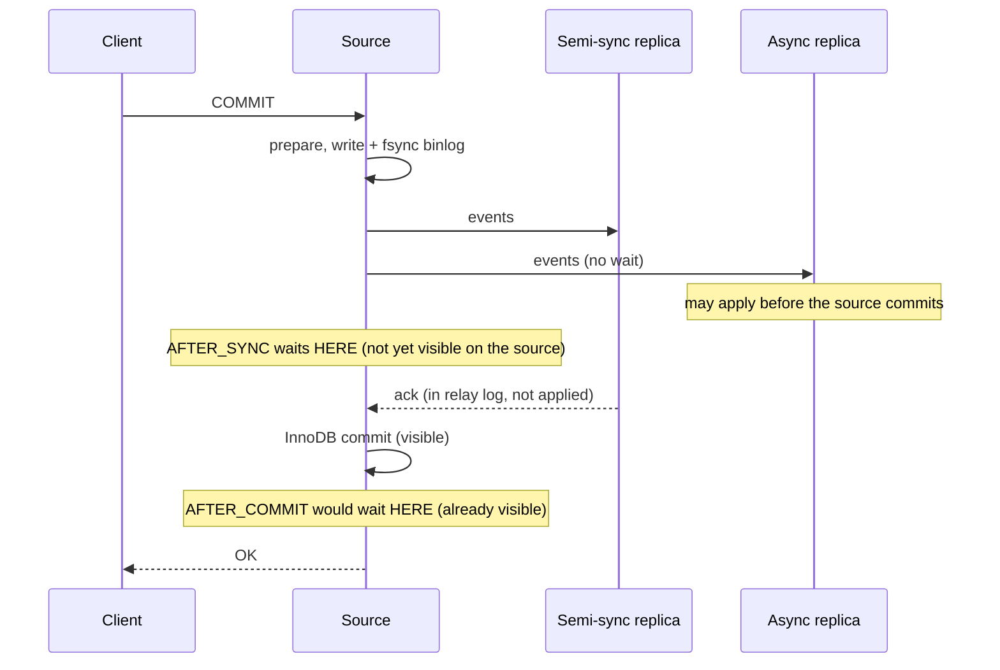

# MySQL Binlog Replication — Part 2

Part 1 answered "will my containers sync?" with a replica that copies the
source's binary log. The follow-up: what happens when the source dies? A
replica is promoted, the others must follow it, and each needs to know exactly
**where it was**, and that the new source has not picked up writes of its own.

This part covers how a replica names its place in the stream, how one stray
write on a replica poisons a failover, what semi-sync really guarantees, and
what happens when the source deletes logs a replica still needs.

> **⬅️ This continues [Part 1](./01-mysql-binlog-replication-part-1.md).**

> **📌 In one line:** a file + offset only means something on one server, a GTID
> means the same thing everywhere, and the GTID sets tell you instantly when a
> replica has history the source does not.

## Table of Contents

1. [Positions: File + Offset](#positions-file--offset)
2. [GTIDs](#gtids)
3. [Errant Transactions](#errant-transactions)
4. [Async vs Semi-Synchronous](#async-vs-semi-synchronous)
5. [Binlog Retention and the Purged-Log Failure](#binlog-retention-and-the-purged-log-failure)
6. [Seeding a New Replica](#seeding-a-new-replica)
7. [Compared with PostgreSQL](#compared-with-postgresql)
8. [Common Mistakes](#common-mistakes)
9. [Questions to Test Yourself](#questions-to-test-yourself)
10. [Related](#related)

Lab: Part 1's (MySQL 8.4.9), plus `rpl-a-replica2` (server id 3) and
`rpl-a-replica3` (id 4). UUIDs shortened: `fbfb063a-…` = source, `fc22dffb-…` =
`rpl-a-replica`. Old docs say *master*/*slave*; 8.4 only accepts the new syntax.

---

## Positions: File + Offset

The original way to say "where I am" is a **binlog coordinate**: file name plus
byte offset. `rpl-a-replica2` was set up that way, from the file where `saas`
was created:

```sql
CHANGE REPLICATION SOURCE TO SOURCE_HOST = 'rpl-a-source',
  SOURCE_USER = 'repl', SOURCE_PASSWORD = 'repl-pass', GET_SOURCE_PUBLIC_KEY = 1,
  SOURCE_AUTO_POSITION = 0, SOURCE_LOG_FILE = 'binlog.000004', SOURCE_LOG_POS = 4;
START REPLICA;
-- SHOW REPLICA STATUS: both threads Yes, Exec_Source_Log_Pos 1457,
--                      Retrieved_Gtid_Set fbfb063a-…:8-11, Auto_Position 0
```

It works only because I picked the start point right by hand. Too late and the
replica silently skips transactions; too early and it re-applies them and hits
duplicate keys.

The deeper problem: **a coordinate only means something on the server that
wrote it**. Each server writes its *own* binlog, with its own file numbers and
offsets. One transaction, GTID `…:11` (the `UPDATE` to `paid`), in two binlogs:

| Server | Binlog file | Offset of the `Gtid` event |
|---|---|---|
| `rpl-a-source` | `binlog.000004` | 1119 |
| `rpl-a-replica` | `binlog.000001` | 2999430 |

Now the failover drill: the source is "gone", `rpl-a-replica` is promoted, and
`replica2` must follow it, knowing only its old coordinate (`binlog.000004`,
`Exec_Source_Log_Pos: 2641`):

```text
-- ❌ BROKEN - the old source's coordinate means nothing on the new source
mysql> STOP REPLICA;
mysql> CHANGE REPLICATION SOURCE TO SOURCE_HOST = 'rpl-a-replica',
         SOURCE_LOG_FILE = 'binlog.000004', SOURCE_LOG_POS = 2641;
mysql> START REPLICA;
mysql> SHOW REPLICA STATUS\G
           Replica_IO_Running: No
                Last_IO_Errno: 13114
                Last_IO_Error: Got fatal error 1236 from source when reading data from
                               binary log: 'Could not find first log file name in binary log index file'
```

That is the lucky case: it fails loudly. Had `rpl-a-replica` owned a
`binlog.000004`, offset 2641 would point into some unrelated transaction.
Finding the matching coordinate means lining up events from two binlogs, by
hand, during an outage. Older failover tools existed largely to do that.

---

## GTIDs

A **GTID** (global transaction identifier) names a transaction by its origin,
not its location:

```text
fbfb063a-da07-11f1-8e5a-3668b3a779e3:11
└──────────── source_uuid ──────────┘ └ N: the 11th transaction that server originated
```

The UUID is the `@@server_uuid` (from `auto.cnf`) of the server where the
transaction was *first* committed; `N` counts up from 1. The GTID travels with
the transaction (the `Gtid` event in Part 1), so it is the same everywhere.

| Variable | Meaning |
|---|---|
| `gtid_executed` | Every GTID this server has committed, as a compact set: `fbfb063a-…:1-14` |
| `gtid_purged` | The subset whose binlog files are deleted. This server can no longer *send* them |
| `gtid_mode` / `enforce_gtid_consistency` | Both `ON` in the lab. The second rejects statements that cannot be logged as one GTID |

**Auto-positioning** (`SOURCE_AUTO_POSITION = 1`) replaces the coordinate with a
question: the replica sends its `gtid_executed`, and the source sends back
everything it has that is *not* in that set. The same failover, with GTIDs:

```text
-- ✅ FIXED - the replica asks for "everything I have not executed"
mysql> STOP REPLICA;
mysql> CHANGE REPLICATION SOURCE TO SOURCE_HOST = 'rpl-a-replica', SOURCE_AUTO_POSITION = 1;
mysql> START REPLICA;
mysql> SHOW REPLICA STATUS\G                        -- both threads: Yes
           Retrieved_Gtid_Set: fbfb063a-…:1-7,
                               fc22dffb-…:2
            Executed_Gtid_Set: fbfb063a-…:1-14,
                               fc22dffb-…:1-2
                Auto_Position: 1
```

The new source sent exactly what was missing: `fbfb063a-…:1-7` (time zone load
and `repl` user, skipped when `replica2` started at `binlog.000004`) and
`fc22dffb-…:2`. That last one never came from the old source. It was **written
on `rpl-a-replica` itself**, and the failover just copied it to `replica2`.

> **💡 Tip:** compare GTID sets in SQL: `GTID_SUBSET(a, b)` ("is all of `a` in
> `b`?") and `GTID_SUBTRACT(a, b)` ("what is in `a` but not `b`?").

---

## Errant Transactions

An **errant transaction** is a GTID in a replica's `gtid_executed` that the
source does not have: a "quick fix", a migration run on the wrong host, a
report that creates a scratch table.

```sql
-- ❌ BROKEN - a write on the replica (rpl-a-replica, super_read_only OFF)
INSERT INTO saas.invoices (company_id, amount_cents) VALUES (11, 5000);   -- gets id 4
```

```text
replica  @@gtid_executed: fbfb063a-…:1-13, fc22dffb-…:1     ← its own UUID appears
source   @@gtid_executed: fbfb063a-…:1-13
```

The source knows nothing about id 4, so its next insert also gets id 4:

```text
source> INSERT INTO saas.invoices (company_id, amount_cents) VALUES (7, 31000);
source> SELECT LAST_INSERT_ID();          -- 4

replica> SHOW REPLICA STATUS\G      -- Replica_SQL_Running: No, Last_SQL_Errno: 1062
replica> SELECT LAST_ERROR_MESSAGE FROM performance_schema.replication_applier_status_by_worker
         WHERE LAST_ERROR_NUMBER <> 0;
Worker 1 failed executing transaction 'fbfb063a-…:14' at source log binlog.000004,
end_log_pos 2390; Could not execute Write_rows event on table saas.invoices;
Duplicate entry '4' for key 'invoices.PRIMARY', Error_code: 1062; …
```

The applier stops and lag grows without limit. The replica's `id 4` must go
(the source is the truth), and the errant GTID must be neutralised:

```sql
-- on the replica: remove the stray row WITHOUT logging that as another errant GTID
SET SESSION sql_log_bin = 0;
DELETE FROM saas.invoices WHERE id = 4;
SET SESSION sql_log_bin = 1;
START REPLICA SQL_THREAD;                 -- applies :14, row 4 is now (7, 31000)

-- on the source: commit an EMPTY transaction under the errant GTID, so the
-- source's set contains it and nobody will ever try to ship it again
SET GTID_NEXT = 'fc22dffb-da07-11f1-a479-3ad2d2e5ebce:1';
BEGIN; COMMIT;
SET GTID_NEXT = 'AUTOMATIC';
```

The source then reported `fbfb063a-…:1-14, fc22dffb-…:1`, and the empty
transaction replicated everywhere (or rebuild the replica, see
[seeding](#seeding-a-new-replica)). The quiet version is worse:

```sql
CREATE TABLE saas.tmp_report AS
  SELECT company_id, SUM(amount_cents) AS total FROM saas.invoices GROUP BY company_id;
```

Nothing broke. Only the GTID sets show it:

```text
mysql> SELECT GTID_SUBTRACT('fbfb063a-…:1-14, fc22dffb-…:1-2',   -- replica's gtid_executed
                            'fbfb063a-…:1-14, fc22dffb-…:1')     -- source's gtid_executed
       AS errant_on_replica;
| fc22dffb-da07-11f1-a479-3ad2d2e5ebce:2 |
```

That is the `fc22dffb-…:2` the failover drill copied onto `replica2`. Promote a
replica with errant transactions and every other replica auto-positions onto it
and receives them. If one conflicts with real data (the `id 4` case), replicas
break *during the failover*, the worst possible moment. So make replicas refuse
writes in the first place:

```sql
-- ✅ FIXED - on every replica (PERSIST survives restarts)
SET PERSIST super_read_only = ON;         -- also turns read_only ON
```

```text
mysql> SELECT @@read_only, @@super_read_only;
|           1 |                 1 |
mysql> INSERT INTO saas.invoices (company_id, amount_cents) VALUES (11, 5000);
ERROR 1290 (HY000): The MySQL server is running with the --super-read-only option so it cannot execute this statement
mysql> DROP TABLE saas.tmp_report;
ERROR 1290 (HY000): The MySQL server is running with the --super-read-only option so it cannot execute this statement
```

The applier is not blocked: the source's next row (`id 5`) arrived normally.
`read_only` alone is not enough, since `SUPER`/`CONNECTION_ADMIN` accounts
(`root`) bypass it.

> **⚠️ Warning:** `super_read_only` also blocks `INSTALL PLUGIN` (it writes to a
> table): installing semi-sync on the replica failed with the same `ERROR 1290`.
> Load plugins at startup (`--plugin-load-add`). Failover tooling must turn the
> flag **off** on the server it promotes.

---

## Async vs Semi-Synchronous

By default replication is **asynchronous**: the source commits, says OK, and
ships events afterwards. If it dies in between, those transactions are lost.

**Semi-synchronous** replication adds one wait: before the client gets OK, at
least one replica must confirm it has **received** the transaction (in its
relay log, not applied). The image ships new and old plugin files:
`semisync_source.so`/`semisync_replica.so` and `semisync_master.so`/`semisync_slave.so`.

```sql
-- source
INSTALL PLUGIN rpl_semi_sync_source SONAME 'semisync_source.so';
SET GLOBAL rpl_semi_sync_source_enabled = ON;
SET GLOBAL rpl_semi_sync_source_timeout = 3000;      -- ms; default 10000
-- replica (then restart its receiver: STOP/START REPLICA IO_THREAD)
INSTALL PLUGIN rpl_semi_sync_replica SONAME 'semisync_replica.so';
SET GLOBAL rpl_semi_sync_replica_enabled = ON;
```

Use the new names. Installing `rpl_semi_sync_master` next to the new one fails
with `ERROR 4045 … Cannot install the rpl_semi_sync_master plugin when the
rpl_semi_sync_source plugin is installed.` The defaults, right after install:

```text
mysql> SHOW VARIABLES LIKE 'rpl_semi_sync_source%';
| rpl_semi_sync_source_enabled                | OFF        |
| rpl_semi_sync_source_timeout                | 10000      |
| rpl_semi_sync_source_wait_for_replica_count | 1          |
| rpl_semi_sync_source_wait_no_replica        | ON         |
| rpl_semi_sync_source_wait_point             | AFTER_SYNC |
```

An insert with the replica healthy, then one with its receiver stopped:

```text
mysql> INSERT INTO saas.invoices (company_id, amount_cents) VALUES (7, 1500);
Query OK, 1 row affected (0.01 sec)                 -- ack came back at once

replica> STOP REPLICA IO_THREAD;
mysql> INSERT INTO saas.invoices (company_id, amount_cents) VALUES (7, 1600);
Query OK, 1 row affected (3.02 sec)                 -- waited the full timeout

mysql> SHOW STATUS LIKE 'Rpl_semi_sync_source_%';  -- trimmed
| Rpl_semi_sync_source_no_tx     | 1   |
| Rpl_semi_sync_source_status    | OFF |
| Rpl_semi_sync_source_yes_tx    | 1   |

[Warning] [MY-011153] [Repl] Timeout waiting for reply of binlog (file: binlog.000004,
pos: 3800), semi-sync up to file binlog.000004, position 3487.
```

The most important fact about semi-sync: **on timeout the source does not fail
the commit, it falls back to async** (`status OFF`) and carries on. When the
replica reconnected, status went back to `ON` by itself.

**Where it waits** (`wait_point`): before the InnoDB commit (`AFTER_SYNC`, the
default) or after it (`AFTER_COMMIT`). With the timeout at 8 s and the
receiver stopped, I inserted rows and looked around during the wait:

```text
-- source PROCESSLIST during the wait (first run, id 100):
| 39 | 2 | Waiting for semi-sync ACK from replica | INSERT INTO saas.invoices (id, …) VALUES (100, …) |

-- three servers queried during the wait (second run, id 101):
source                      id101_visible = 0     ← not committed in InnoDB yet
rpl-a-replica  (semi-sync)  id101_visible = 0     ← receiver stopped
rpl-a-replica2 (async)      id101_visible = 1     ← already applied!
Query OK, 1 row affected (8.00 sec)               ← the INSERT, after the timeout
```



With `AFTER_SYNC`, nobody *on the source* reads a row no replica has received,
so its clients never see data a failover then loses. With `AFTER_COMMIT`, they
see the row during the wait, and it can vanish if the source dies then. Async
replicas follow neither rule: `replica2` applied `id 101` before the source did.

What a failover can lose, promoting the most up-to-date replica:

| Mode | Client got OK, then source died | Can be lost |
|---|---|---|
| Async | Transaction may not have left the source | Any recently acknowledged commits |
| Semi-sync, `AFTER_SYNC`, status `ON` | At least one replica has it in its relay log | Nothing acknowledged, provided you promote that replica and let it apply its relay log first |
| Semi-sync, `AFTER_COMMIT` | Same ack, but others may have *read* it earlier | Nothing acknowledged, but reads of unacked data are possible |
| Semi-sync after timeout (`OFF`) | Behaves as async until replicas catch up | Same as async |

A transaction binlogged but never acked may survive only on the old source (or
on an async replica, as above). Compare GTID sets before anything rejoins.

---

## Binlog Retention and the Purged-Log Failure

Binlogs are deleted after `binlog_expire_logs_seconds` (default `2592000` = 30
days, with `binlog_expire_logs_auto_purge = ON`), or by `PURGE BINARY LOGS`. A
replica away longer than that finds its files gone. I stopped `replica2`, wrote
a row on the source, and purged:

```text
source> FLUSH BINARY LOGS;
source> PURGE BINARY LOGS TO 'binlog.000005';
source> SHOW BINARY LOGS;
| binlog.000005 |       238 | No        |
source> SELECT @@gtid_purged;
fbfb063a-…:1-20, fc22dffb-…:1-2

replica2> START REPLICA;
replica2> SELECT LAST_ERROR_MESSAGE FROM performance_schema.replication_connection_status;
Got fatal error 1236 from source when reading data from binary log: 'Cannot replicate because
the source purged required binary logs. Replicate the missing transactions from elsewhere, or
provision a new replica from backup. Consider increasing the source's binary log expiration
period. The GTID set sent by the replica is 'fbfb063a-…:1-19, fc22dffb-…:1-2', and the missing
transactions are 'fbfb063a-…:20''
```

The error names the missing transaction (`:20`) and the first way out: **get
it elsewhere**. `rpl-a-replica` still had `:20` in its own binlog, so I pointed
`replica2` at it, let it catch up, and pointed it back: two plain
`CHANGE REPLICATION SOURCE TO SOURCE_HOST = …` thanks to auto-positioning. If
no server has the missing GTIDs, re-seed the replica.

Size retention to cover your **longest plausible replica outage** plus time to
notice (a long weekend needs more than 2 days), and your **point-in-time
recovery** window back to the oldest backup you would restore. Then check disk:
binlog volume tracks write volume, and `FULL` images double every `UPDATE`.

> **⚠️ Warning:** `PURGE BINARY LOGS` does not check whether a replica still
> needs a file. A manual purge "to free disk" is the fastest way to this error.

---

## Seeding a New Replica

A new replica needs a **consistent copy** plus **the exact point in the stream
it corresponds to**; replaying years of binlog is impossible once files are
purged. **The clone plugin** copies a running server's InnoDB data over the
network, GTID state included. With a fresh `rpl-a-replica3`:

```sql
-- donor (source): plugin + a user with BACKUP_ADMIN
INSTALL PLUGIN clone SONAME 'mysql_clone.so';
CREATE USER 'clone'@'%' IDENTIFIED BY 'clone-pass';
GRANT BACKUP_ADMIN ON *.* TO 'clone'@'%';
-- recipient (replica3): wipes ITS OWN data and replaces it with the donor's
INSTALL PLUGIN clone SONAME 'mysql_clone.so';
SET GLOBAL clone_valid_donor_list = 'rpl-a-source:3306';
CLONE INSTANCE FROM 'clone'@'rpl-a-source':3306 IDENTIFIED BY 'clone-pass';
```

```text
ERROR 3707 (HY000): Restart server failed (mysqld is not managed by supervisor process).
[ERROR] [MY-013462] [Server] Clone shutting down server as RESTART failed. Please start server to complete clone operation.

$ docker start rpl-a-replica3
mysql> SELECT STATE, BINLOG_FILE, BINLOG_POSITION, GTID_EXECUTED FROM performance_schema.clone_status\G
          STATE: Completed
    BINLOG_FILE: binlog.000005
BINLOG_POSITION: 768
  GTID_EXECUTED: fbfb063a-…:1-22, fc22dffb-…:1-2
```

`ERROR 3707` is a Docker quirk, not a failure: clone must restart `mysqld`,
nothing in the container can, so it exits and you start it. Replica3's own
history (`48ac96c1-…:1-5`) was gone, replaced by the donor's set, and an
auto-position `CHANGE REPLICATION SOURCE TO` + `START REPLICA` fetched only
`fbfb063a-…:23`, the one transaction committed after the clone.

**mysqldump** works anywhere but restores slowly (every row replayed as SQL).
Take a consistent snapshot and record the GTID set:

```text
$ mysqldump --single-transaction --source-data=2 --set-gtid-purged=ON --databases saas
SET @@GLOBAL.GTID_PURGED=/*!80000 '+'*/ 'fbfb063a-…:1-23, …';
-- CHANGE REPLICATION SOURCE TO SOURCE_LOG_FILE='binlog.000005', SOURCE_LOG_POS=1081;
```

Loading it into an empty replica says "you already have these GTIDs", and
auto-positioning continues from there. (I generated this dump but did not
restore it.) Physical backup tools (Percona XtraBackup, MySQL Enterprise
Backup) are the usual choice for large databases.

---

## Compared with PostgreSQL

PostgreSQL streaming replication is in
[../operations/04-read-replicas-and-replication-lag.md](../operations/04-read-replicas-and-replication-lag.md):

| | MySQL binlog replication | PostgreSQL streaming replication |
|---|---|---|
| What is shipped | Logical row events, from a log separate from InnoDB's redo | Physical WAL, the same log used for crash recovery |
| Replica's copy | Logically equal; can have extra indexes or tables | Byte-for-byte identical cluster |
| Position | GTID set (or file + offset) | One LSN, e.g. `0/3000148` |
| Writes on a replica | Allowed unless `super_read_only=ON`, so errant GTIDs are possible | Impossible: a standby is read-only by design |
| Processes | Dump thread → receiver → relay log → applier | walsender → walreceiver → startup (replay) process |
| Synchronous option | Semi-sync plugin: ack once in the relay log | `synchronous_standby_names` + `synchronous_commit` (`remote_write`, `on`, `remote_apply`) |
| Retention | `binlog_expire_logs_seconds`; replicas can fall off the end | `wal_keep_size`, or replication slots, which keep WAL until consumed (and can fill the disk) |
| Seeding | Clone plugin, mysqldump, physical backup tools | `pg_basebackup` |
| Logical / row-level equivalent | This *is* logical | Logical replication (publications / subscriptions) |

---

## Common Mistakes

| Mistake | Why it is wrong | Do this instead |
|---|---|---|
| Position-based replication in a topology that can fail over | Coordinates do not carry across servers; re-pointing becomes guesswork | `gtid_mode=ON` + `SOURCE_AUTO_POSITION=1` |
| Leaving replicas writable | Every stray write is an errant GTID that breaks apply or rides along on failover | `SET PERSIST super_read_only = ON` on every replica |
| Relying on `read_only` alone | `SUPER` / `CONNECTION_ADMIN` accounts bypass it | `super_read_only` |
| Fixing a replica write by deleting with binlogging on | Creates a second errant GTID | `SET sql_log_bin = 0` for the repair, then inject an empty transaction on the source |
| Believing semi-sync means "never lose data" | It degrades to async after `rpl_semi_sync_source_timeout`, silently | Alert on `Rpl_semi_sync_source_status = OFF` |
| Promoting a semi-sync replica before it applies its relay log | The ack meant "received", not "applied" | Wait until `Retrieved_Gtid_Set` ⊆ `Executed_Gtid_Set`, then promote |
| Short binlog retention or manual `PURGE` | A replica that was away comes back to error 1236 | Retain longer than the worst outage; never purge past what replicas need |
| Re-pointing a dead old source as a replica | It may hold binlogged, unacknowledged GTIDs | Compare GTID sets; rebuild it if it has extras |

---

## Questions to Test Yourself

1. A position-based replica was at `binlog.000187:4411` when the source died.
   Why can it not use that coordinate on the promoted replica?
2. On a replica, `gtid_executed` is `fbfb063a-…:1-14, fc22dffb-…:1-2`. Which part worries you?
3. A teammate inserted a row on a replica to "fix" a report. Walk through the
   two ways this can hurt you: now, and during the next failover.
4. You have to delete a stray row on a replica. What two things must you do so
   the repair does not create a new problem?
5. The only semi-sync replica's network drops; one commit takes 10 s, then all
   are fast again. What happened, and what can you now lose?
6. Under `AFTER_SYNC`, an async replica showed a row the source could not yet
   see. Why is that possible?
7. A replica was off for six weeks and fails with error 1236 and a list of
   missing GTIDs. Give two ways to recover, and say when each is available.
8. Why is `ERROR 3707` after `CLONE INSTANCE` in Docker not a real failure?
9. Name two things a PostgreSQL standby cannot do that a MySQL replica can,
   and one problem each one causes in MySQL.

---

## Related

- [Part 1](./01-mysql-binlog-replication-part-1.md) — the binlog, event formats,
  the replication threads, and reading `SHOW REPLICA STATUS`.
- [02-replication-lag-in-mysql.md](./02-replication-lag-in-mysql.md) — why a
  healthy replica still falls behind, and the parallel applier.
- [03-group-replication-part-1.md](./03-group-replication-part-1.md) — consensus
  and automatic failover, beyond semi-sync.
- [../operations/04-read-replicas-and-replication-lag.md](../operations/04-read-replicas-and-replication-lag.md)
  — PostgreSQL streaming replication and read-after-write.
- [../../system-design/foundational/database-replication.md](../../system-design/foundational/database-replication.md)
  — failover, split-brain and fencing at the concept level.
- [../../cloud-devops/docker/stateful-containers.md](../../cloud-devops/docker/stateful-containers.md)
  — running replicated databases in containers.
