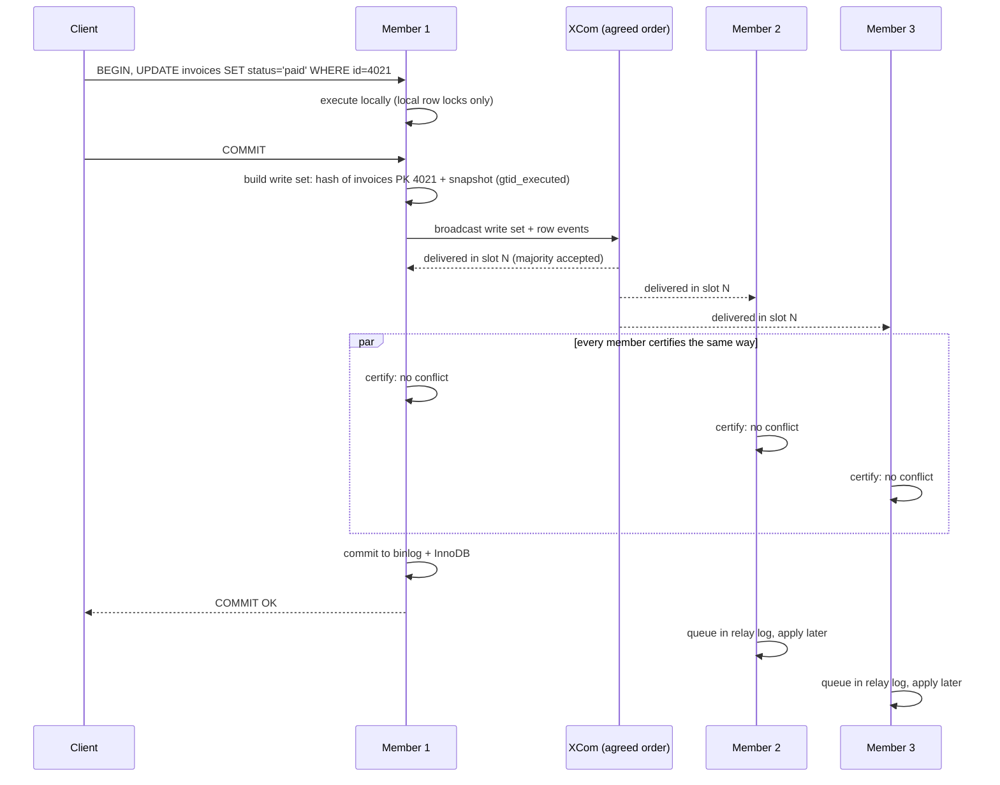

# Group Replication — Part 1

Every replica so far has had exactly one source. One server decides the order of
transactions, the others copy it. The natural next question: can two or three
MySQL servers *all* accept writes and stay identical?

The first idea people try is the shortcut: "why not just point two `mysqld` at
the same disk?" [stateful-containers.md](../../cloud-devops/docker/stateful-containers.md#why-innodb-refuses-a-second-server)
runs that experiment. The second server refuses to start, and it is right to:
each `mysqld` keeps dirty pages, the redo position, row locks and auto-increment
counters **in its own memory**, so two of them on one datadir would overwrite
each other's pages and hand out the same `id`. Sharing a disk shares bytes, not
agreement. Servers that want to stay identical have to **talk**, and agree on one
order of writes before anyone commits.

Group Replication (GR) is MySQL's built-in way to do that. It is a plugin that
ships in the `mysql:8` image. Part 1 is the mechanism: how members agree, what
happens to one transaction, how conflicts are detected, and which mode to run.
[Part 2](./03-group-replication-part-2.md) is what happens when the network breaks.

> **➡️ Continued in [Part 2](./03-group-replication-part-2.md).**

> **📌 In one line:** every member receives every transaction in the same agreed
> order, and each member independently applies the same deterministic rule to
> decide commit or abort, so they stay identical without asking each other twice.

## Table of Contents

1. [Why Agreement Is the Hard Part](#why-agreement-is-the-hard-part)
2. [Group Communication: XCom in Plain English](#group-communication-xcom-in-plain-english)
3. [The Life of a Transaction](#the-life-of-a-transaction)
4. [Certification: First Committer Wins](#certification-first-committer-wins)
5. [Single-Primary vs Multi-Primary](#single-primary-vs-multi-primary)
6. [Requirements and What They Protect](#requirements-and-what-they-protect)
7. [Lab: A Three-Node Group](#lab-a-three-node-group)
8. [Common Mistakes](#common-mistakes)
9. [Questions to Test Yourself](#questions-to-test-yourself)
10. [Related](#related)

> **📌 Remember:** GR calls its roles **primary** and **secondary**. Older blog
> posts about asynchronous replication say *master*/*slave*; MySQL 8.4 uses
> *source*/*replica* for that, and `SHOW SLAVE STATUS`-style commands are gone.

---

## Why Agreement Is the Hard Part

With asynchronous replication
([Part 1](./01-mysql-binlog-replication-part-1.md),
[Part 2](./01-mysql-binlog-replication-part-2.md)) the order of transactions is
whatever order the source committed them in. Nobody else is asked. That has two
consequences:

- **One writer only.** A second writer would produce its own order, and the two
  orders would conflict with no referee.
- **Failover can lose the tail.** If the source dies, transactions it committed
  but had not yet shipped exist nowhere else. Semi-sync narrows that gap
  ([Part 2, semi-sync](./01-mysql-binlog-replication-part-2.md#async-vs-semi-synchronous)),
  but the source still decides alone.

Two servers both accepting writes is the multi-leader problem from
[database-replication.md](../../system-design/foundational/database-replication.md#multi-leader-replication):
invoice 4021 updated on A and on B before either hears about the other. Which
wins? To answer that the same way on every server, the servers first need to
agree on **one sequence** of transactions. Once every member sees the same
transactions in the same order, a deterministic rule ("the earlier one wins")
gives the same answer everywhere.

So Group Replication has two layers:

| Layer | Job |
|---|---|
| **Group communication** | Deliver every message to every member, in the same order, and track who is in the group |
| **Certification** | Given that agreed order, decide which transactions commit and which abort |

---

## Group Communication: XCom in Plain English

GR's group communication engine is called **XCom**, MySQL's implementation of a
**Paxos**-based protocol. You do not need the proofs. You need the intuition.

Picture a shared logbook with numbered slots. A member that wants to send a
message proposes it for the next slot. The message is **decided** for that slot
only once a **majority** of members have accepted it. Every member then delivers
slot 1, slot 2, slot 3 … in order. Because any two majorities overlap in at least
one member, two different messages can never both be decided for the same slot.

| Property | What it buys you |
|---|---|
| **Total order** | Every member delivers the same messages in the same sequence |
| **Majority rule** | A decision survives the loss of a minority of members |
| **Membership view** | Every member agrees on who is currently in the group, and changes are agreed like messages |
| **Failure detector** | Members that stop responding are marked `UNREACHABLE`, then expelled by agreement |

Practical facts, checked on 8.4.9:

- XCom uses its own port, separate from 3306. The lab uses `33061`
  (`group_replication_local_address`).
- `group_replication_communication_stack` is `XCOM` by default. The alternative,
  `MYSQL`, runs the same protocol over MySQL's own connection layer and security.
- `group_replication_paxos_single_leader` is `OFF` by default: every member can
  propose. In single-primary mode it can be turned on so that one consensus
  leader does the proposing.

> **💡 Tip:** "agreed by a majority" is the whole trick, and it is also the whole
> cost. Every commit waits for a network round trip to a majority, and if no
> majority can be reached, nothing commits. Part 2 is about that second sentence.

---

## The Life of a Transaction

A client updates an invoice on member 1 of a three-member group.



Step by step:

1. **Execute locally.** Until `COMMIT`, nothing leaves member 1. Its row locks
   exist only on member 1.
2. **Extract the write set.** At commit, member 1 records which rows the
   transaction changed (hashes of their primary key and unique key values) and
   which transactions it had already seen when it ran (its `gtid_executed`).
3. **Broadcast.** The write set and the row events go through XCom.
4. **Certify.** Every member, including member 1, receives the transaction in the
   same agreed slot and runs certification (next section). Same input, same
   order, same rule, so every member reaches the same verdict without a vote.
5. **Commit or roll back.** Member 1 commits and returns OK, or rolls back and
   returns an error. Members 2 and 3 put a passing transaction in the
   `group_replication_applier` relay log and apply it.

> **⚠️ Warning:** the agreement is synchronous, the apply is not. When member 1
> says OK, members 2 and 3 have **agreed** to the transaction but may not have
> **applied** it yet. A read on a secondary can still be stale, exactly like the
> lag in [02-replication-lag-in-mysql.md](./02-replication-lag-in-mysql.md).
> `group_replication_consistency` controls how much to wait. 8.4 ships with
> `BEFORE_ON_PRIMARY_FAILOVER` (checked), which only holds back new transactions
> on a newly elected primary until it has applied its backlog. `BEFORE`, `AFTER`
> and `BEFORE_AND_AFTER` buy fresher reads with extra latency per transaction.

---

## Certification: First Committer Wins

Every member keeps a table of row hashes, each with the GTID set that last
changed that row. When transaction T arrives in the agreed order, certification
asks one question for each row in T's write set:

> Had T's member already seen the latest change to this row when T ran?

If yes for every row, T passes. If any row was changed by a transaction that T's
member had **not** seen, then T was computed on stale data, concurrently with
that change. Since that change is earlier in the agreed order, it wins and T is
rolled back. That is **first committer wins**: not first to start, not first to
lock, first to be **ordered**.

It is optimistic concurrency, the same idea as a version column in
[06-optimistic-vs-pessimistic-locking-part-1.md](../transactions-and-concurrency/06-optimistic-vs-pessimistic-locking-part-1.md#optimistic-locking),
done by the database across servers.

The lab produced this live. The group was switched to multi-primary mode (all
members writable, next section), then two members updated invoice 1 and committed
at the same instant:

```text
$ ./race.sh 1      # gr1 and gr2: BEGIN; UPDATE saas.invoices SET status='nodeN' WHERE id=1; … COMMIT;
[gr2] ERROR 3101 (40000) at line 1: Plugin instructed the server to rollback the current transaction.

$ … SELECT @@hostname, status FROM saas.invoices WHERE id = 1     # on gr1 and on gr2
rpl-b-gr1   node1
rpl-b-gr2   node1
```

gr1's transaction was ordered first, gr2's was certified against it and failed.
Both members agree on `node1`. An earlier batch of four races gave gr2 two more
`ERROR 3101`s (the other two races did not overlap in time, so both commits
simply ran one after the other). The statistics after that batch, read on gr1:

```text
mysql> SELECT MEMBER_ID, COUNT_TRANSACTIONS_CHECKED, COUNT_CONFLICTS_DETECTED,
    ->        COUNT_TRANSACTIONS_LOCAL_ROLLBACK
    -> FROM performance_schema.replication_group_member_stats;
| MEMBER_ID   | COUNT_TRANSACTIONS_CHECKED | COUNT_CONFLICTS_DETECTED | COUNT_TRANSACTIONS_LOCAL_ROLLBACK |
| 11ece9cd-…  |                         13 |                        2 |                                 0 |
| 12309880-…  |                          9 |                        2 |                                 2 |   ← gr2
| 126984a4-…  |                          9 |                        2 |                                 0 |
```

Every member detected the same 2 conflicts; only gr2, whose transactions they
were, rolled anything back.

There is a second way to lose. In another run, gr2 committed while gr1's
transaction was still open and holding the row lock **locally**. When gr2's
already-certified change reached gr1, the applier needed that row, so gr1's local
transaction was aborted:

```text
[gr1] ERROR 1180 (HY000) at line 1: Got error 149 - 'Lock deadlock; Retry transaction' during COMMIT
```

Both errors mean the same thing to the application: **the transaction did not
happen, retry it**. This is why multi-writer setups need retry logic on every
write, covered in
[03-transactions-part-2.md](../../backend-fundamentals/10-database-integration/03-transactions-part-2.md#retrying-deadlocks-and-serialization-failures).

> **⚠️ Warning:** in multi-primary mode, `SELECT … FOR UPDATE` locks the row on
> **your member only**. Another member can update the same row at the same time;
> one of you finds out at commit. Pessimistic locking patterns do not give
> cluster-wide mutual exclusion.

```sql
-- ❌ BROKEN - multi-primary: two members both "lock" invoice 4021 and both decide to charge it
BEGIN;
SELECT status FROM invoices WHERE id = 4021 FOR UPDATE;    -- local lock only
-- app sees 'open', calls the payment provider …
UPDATE invoices SET status = 'paid' WHERE id = 4021;
COMMIT;                                                    -- one member gets ERROR 3101, after charging

-- ✅ FIXED - single-primary: one writer, so FOR UPDATE is a real lock again
-- (and the external charge carries an idempotency key, so a retry cannot double-charge)
```

---

## Single-Primary vs Multi-Primary

| | Single-primary (default) | Multi-primary |
|---|---|---|
| Who accepts writes | One elected primary | Every member |
| Secondaries | `super_read_only = ON`, set by GR | All writable |
| Certification conflicts from the app | Practically none: one writer | Any two members writing the same row |
| `SELECT … FOR UPDATE` | A real lock (one writer) | Local to one member |
| Restrictions | Few | Checked by `group_replication_enforce_update_everywhere_checks`: no `SERIALIZABLE`, no cascading foreign keys |
| Concurrent DDL | Normal, on the primary | Dangerous if run on two members at once |
| `auto_increment_increment` | Unchanged (`1`, checked) | Set to `group_replication_auto_increment_increment` (`7`) so members do not collide |
| Write throughput | One server's worth | Still about one server's worth: every member applies every write |

The last row is the one people miss. Multi-primary does **not** scale writes:
each member still has to apply every transaction from every other member. What
it adds is conflicts, retries and restrictions.

**Single-primary is the default (`group_replication_single_primary_mode = ON`,
checked) and the mode MySQL recommends**, for those reasons. You still get what
GR is good at: every committed transaction is already on a majority, and a
secondary can take over automatically with nothing lost (Part 2). Switching mode
is online, from any member:

```text
mysql> SELECT group_replication_switch_to_multi_primary_mode();
Mode switched to multi-primary successfully.

mysql> SELECT group_replication_switch_to_single_primary_mode('11ece9cd-…');
Mode switched to single-primary successfully.
```

> **💡 Tip:** multi-primary left a trace in the lab: the group's
> `gtid_executed` became `1af620ec-…:1-12:1000004-1000006`. Each member reserves
> GTID numbers in blocks (`group_replication_gtid_assignment_block_size` =
> 1,000,000) so writers do not collide on numbers either.

---

## Requirements and What They Protect

| Requirement | Why GR needs it | What happens without it |
|---|---|---|
| **InnoDB** for every table | Rollback after a failed certification needs a transactional engine | Lab, with `disabled_storage_engines` set (recommended): `ERROR 3161 … Storage engine MyISAM is disabled` |
| **A primary key** on every table | Write sets are built from key hashes; no key, no conflict detection | Lab: `CREATE TABLE` succeeds; the first `INSERT` fails with `ERROR 3098 … The table does not comply with the requirements by an external plugin.` |
| **GTIDs** (`gtid_mode = ON`, `enforce_gtid_consistency = ON`) | Certification compares GTID sets; recovery fetches "what am I missing" by GTID | GR refuses to start (not tried in the lab) |
| ROW binlog format, binlog on | Members exchange row events | 8.4 defaults already (see [Part 1](./01-mysql-binlog-replication-part-1.md#event-formats-row-statement-mixed)) |
| Unique `server_id`, reachable XCom port | Identity and group communication | Members cannot join |
| Transactions under `group_replication_transaction_size_limit` | Every transaction is one message to every member | 8.4 default `150000000` bytes; larger transactions roll back. The 1.5M-row `UPDATE` from [02](./02-replication-lag-in-mysql.md#watching-lag-happen) would be a risk |

GTIDs in a group carry the **group name** as their UUID (`1af620ec-…`), not the
member's `server_uuid`: the group behaves as one logical source.

---

## Lab: A Three-Node Group

Three `mysql:8` (8.4.9) containers on a private network, no published ports.
Output is real and trimmed. UUIDs are cut to their first block: `1af620ec-…` is
the group name, `11ece9cd-…`, `12309880-…`, `126984a4-…` are gr1, gr2, gr3.

First, the plugin is in the image:

```text
mysql> SELECT PLUGIN_NAME, PLUGIN_STATUS FROM information_schema.PLUGINS WHERE PLUGIN_NAME = 'group_replication';
| group_replication | ACTIVE |
```

```text
$ docker network create rpl-b-gr-net
$ docker run -d --name rpl-b-gr1 --hostname rpl-b-gr1 --network rpl-b-gr-net \
    -e MYSQL_ROOT_PASSWORD=root-pass mysql:8 \
    --server-id=1 --gtid-mode=ON --enforce-gtid-consistency=ON \
    --disabled-storage-engines="MyISAM,BLACKHOLE,FEDERATED,ARCHIVE,MEMORY" \
    --plugin-load-add=group_replication.so \
    --loose-group-replication-group-name=1af620ec-… \
    --loose-group-replication-start-on-boot=OFF \
    --loose-group-replication-local-address=rpl-b-gr1:33061 \
    --loose-group-replication-group-seeds=rpl-b-gr1:33061,rpl-b-gr2:33061,rpl-b-gr3:33061 \
    --loose-group-replication-recovery-get-public-key=ON
# gr2 and gr3: same, with their own --server-id, --hostname and local address
```

> **⚠️ Warning:** the `--loose-` prefix is required with this image. The first
> attempt without it died during first-boot initialisation:
> `[ERROR] [MY-000067] [Server] unknown variable 'group-replication-group-name=…'`.
> The entrypoint runs `mysqld --initialize`, which ignores `--plugin-load-add`, so
> GR options are unknown at that moment. `--loose-` means "ignore if unknown".

On **each** member: wipe the GTIDs that the image's first-boot scripts created
(otherwise each member has transactions the others lack and a joiner is refused),
then create the user that distributed recovery uses, without logging it.

```sql
RESET BINARY LOGS AND GTIDS;            -- 8.4 name; RESET MASTER is gone
SET SQL_LOG_BIN = 0;
CREATE USER 'rpl_user'@'%' IDENTIFIED BY 'rpl-pass';
GRANT REPLICATION SLAVE, CONNECTION_ADMIN, BACKUP_ADMIN, GROUP_REPLICATION_STREAM ON *.* TO 'rpl_user'@'%';
SET SQL_LOG_BIN = 1;
CHANGE REPLICATION SOURCE TO SOURCE_USER = 'rpl_user', SOURCE_PASSWORD = 'rpl-pass'
  FOR CHANNEL 'group_replication_recovery';
```

Bootstrap the group on gr1 **once**, then join the others:

```text
mysql> SET GLOBAL group_replication_bootstrap_group = ON;      -- gr1 only
mysql> START GROUP_REPLICATION;
mysql> SET GLOBAL group_replication_bootstrap_group = OFF;
mysql> CREATE DATABASE saas;  CREATE TABLE saas.invoices (…);  INSERT … 2 rows;

mysql> START GROUP_REPLICATION;                                  -- on gr2, then gr3

mysql> SELECT MEMBER_HOST, MEMBER_STATE, MEMBER_ROLE, MEMBER_VERSION, MEMBER_COMMUNICATION_STACK
    -> FROM performance_schema.replication_group_members ORDER BY MEMBER_HOST;
| rpl-b-gr1 | ONLINE | PRIMARY   | 8.4.9 | XCom |
| rpl-b-gr2 | ONLINE | SECONDARY | 8.4.9 | XCom |
| rpl-b-gr3 | ONLINE | SECONDARY | 8.4.9 | XCom |
```

gr2 and gr3 joined after the table and rows existed; distributed recovery copied
them from a donor before they went `ONLINE`. On gr3:

```text
mysql> SELECT * FROM saas.invoices;
| 1 | 1 | open | 25000 |
| 2 | 2 | open |  9900 |
mysql> SELECT @@gtid_executed, @@super_read_only;
| 1af620ec-…:1-3 | 1 |
```

A write on the primary appears on a secondary; a write on a secondary is refused:

```text
-- gr1 (primary)
mysql> INSERT INTO saas.invoices (company_id, amount_cents) VALUES (3, 12000);
mysql> SELECT @@gtid_executed;                     -- 1af620ec-…:1-4

-- gr2 (secondary)
mysql> SELECT id, company_id, amount_cents FROM saas.invoices WHERE company_id = 3;
| 3 | 3 | 12000 |
mysql> INSERT INTO saas.invoices (company_id, amount_cents) VALUES (4, 500);
ERROR 1290 (HY000): The MySQL server is running with the --super-read-only option so it cannot execute this statement
```

> **📌 Remember:** a secondary's `super_read_only` is set and cleared by GR
> itself, at election time. You do not manage it, and your application must not
> assume which host is the primary. That is MySQL Router's job (Part 2).

Lab settings worth knowing, all defaults on 8.4.9, most of them used in Part 2:

```text
group_replication_member_expel_timeout          5
group_replication_autorejoin_tries              3
group_replication_exit_state_action             OFFLINE_MODE
group_replication_unreachable_majority_timeout  0
group_replication_member_weight                 50
group_replication_message_cache_size            1073741824
```

---

## Common Mistakes

| Mistake | Why it is wrong | Do this instead |
|---|---|---|
| Two `mysqld` on one shared datadir "for HA" | Each keeps state in memory; they corrupt each other's pages | One datadir per server; agree over the network |
| Expecting multi-primary to scale writes | Every member applies every write anyway | Single-primary; scale writes by other means |
| No retry around writes in multi-primary | `ERROR 3101` and `ERROR 1180` are normal outcomes, not bugs | Retry the whole transaction with backoff |
| `SELECT … FOR UPDATE` as a cluster lock | It only locks rows on your own member | Single-primary, or a version column checked at commit |
| A table without a primary key | Inserts fail with `ERROR 3098` once GR is running | Add a primary key before joining the group |
| Reading from a secondary right after a write | Members agree synchronously but apply asynchronously | Read from the primary, or raise `group_replication_consistency` for that session |
| Bootstrapping with `bootstrap_group = ON` left set | A restart would bootstrap a **second** group of one | Turn it off immediately after the first `START GROUP_REPLICATION` |
| Huge batch updates | One transaction above the size limit rolls back | Batch by primary-key range |

---

## Questions to Test Yourself

1. A colleague proposes two MySQL containers on one NFS volume as a cheap HA
   pair. Explain, in terms of memory and files, why it cannot work.
2. Why must the group agree on an *order* before it can decide conflicts? What
   would go wrong if each member certified transactions in arrival order?
3. Walk invoice 4021's update through the five steps from client `COMMIT` to
   `OK`. At which step could it fail, and with what error?
4. Two members update the same row at the same instant. Who wins, and why does
   every member reach the same answer without voting?
5. In multi-primary mode your code uses `SELECT … FOR UPDATE` before charging a
   card. Describe the double-charge scenario and two fixes.
6. Your manager wants multi-primary "so writes are three times faster". What do
   you answer?
7. A member returns `OK` for a commit. Is the row guaranteed readable on the
   other members at that moment? Which setting changes the answer?
8. List the requirements a schema must meet before joining a group, and the
   error you get for a missing primary key.
9. Why did the lab need `RESET BINARY LOGS AND GTIDS` on each node before
   bootstrapping?

---

## Related

- [Part 2](./03-group-replication-part-2.md) — quorum, partitions, split-brain,
  failover, InnoDB Cluster, Galera, and what a small SaaS should run.
- [stateful-containers.md](../../cloud-devops/docker/stateful-containers.md) —
  the shared-datadir failure, demonstrated.
- [01-mysql-binlog-replication-part-2.md](./01-mysql-binlog-replication-part-2.md)
  — GTIDs, errant transactions and semi-sync, which GR builds on.
- [02-replication-lag-in-mysql.md](./02-replication-lag-in-mysql.md) — why an
  agreed transaction can still be unapplied on a secondary.
- [../../system-design/foundational/database-replication.md](../../system-design/foundational/database-replication.md)
  — multi-leader conflicts and quorums as general concepts.
- [06-optimistic-vs-pessimistic-locking-part-1.md](../transactions-and-concurrency/06-optimistic-vs-pessimistic-locking-part-1.md)
  — certification is optimistic locking done between servers.
- [03-transactions-part-2.md](../../backend-fundamentals/10-database-integration/03-transactions-part-2.md)
  — retrying failed transactions safely.
