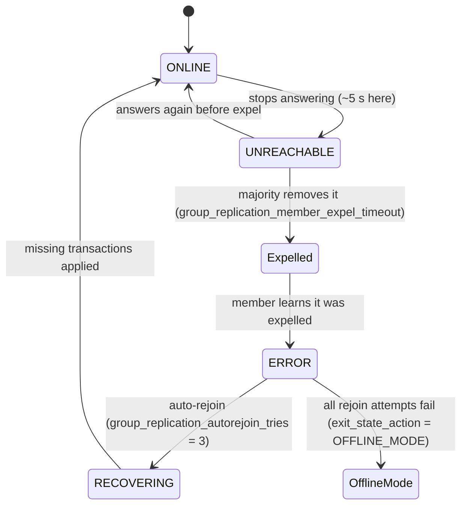
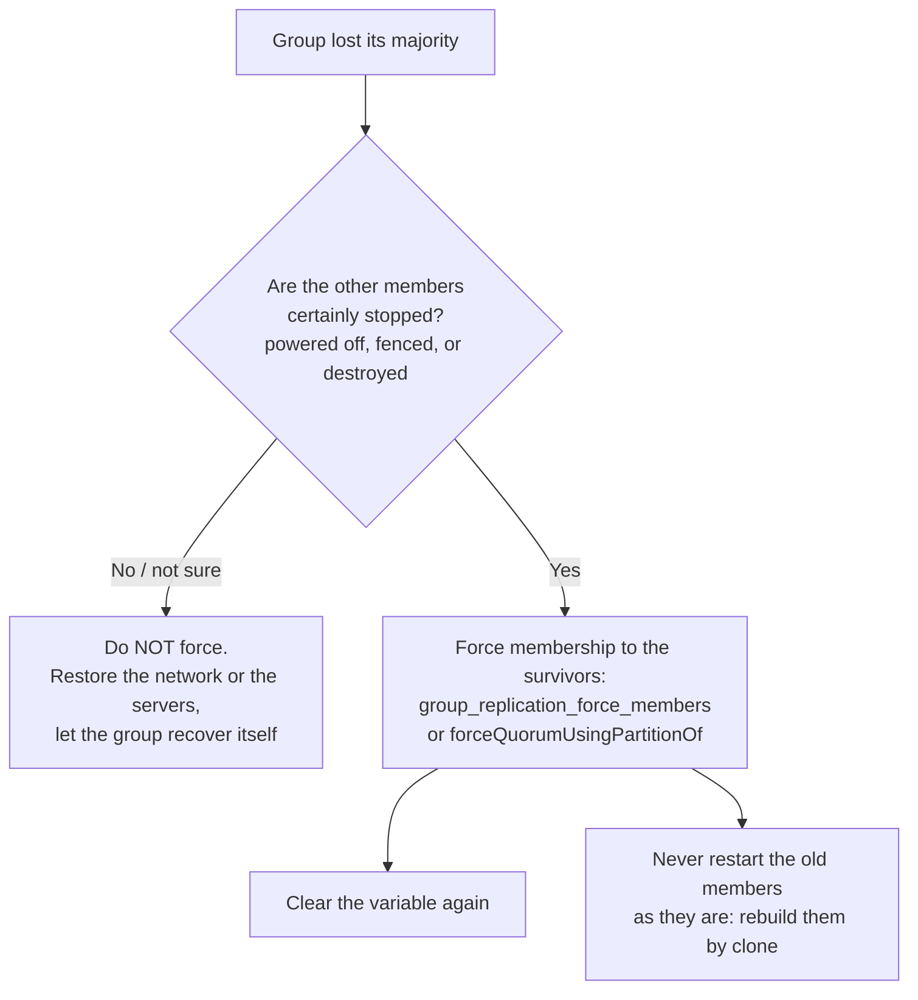

# Group Replication — Part 2

Part 1 ended with three healthy members agreeing on every write. Now unplug a
cable. In the lab, `docker network disconnect` cut the **primary** off from the
other two. Within 22 seconds the other two had elected a new primary and were
taking writes. The old primary still listed itself as `PRIMARY`, still answered
`SELECT`s with old data, and held an `INSERT` open for as long as we let it,
neither committing it nor failing it.

That frozen `INSERT` is the system working correctly. This part explains why,
what the application sees during a failover, the one command that breaks the
safety rule (shown live, with the damage it does), and then the practical
question: should a small SaaS run any of this itself?

> **⬅️ This continues [Part 1](./03-group-replication-part-1.md).**

> **📌 In one line:** a group acts only when a majority agrees, so the minority
> side of a partition freezes instead of diverging; you can only get split-brain
> by overriding that rule yourself.

## Table of Contents

1. [Majority and Why Odd Numbers](#majority-and-why-odd-numbers)
2. [Lab: One Secondary Partitioned](#lab-one-secondary-partitioned)
3. [Lab: The Primary Loses Its Majority](#lab-the-primary-loses-its-majority)
4. [Split-Brain and the Command That Causes It](#split-brain-and-the-command-that-causes-it)
5. [Primary Election and Failover](#primary-election-and-failover)
6. [What the Application Must Handle](#what-the-application-must-handle)
7. [InnoDB Cluster: GR + Shell + Router](#innodb-cluster-gr--shell--router)
8. [Group Replication vs Galera](#group-replication-vs-galera)
9. [What a Small SaaS Should Actually Run](#what-a-small-saas-should-actually-run)
10. [Common Mistakes](#common-mistakes)
11. [Questions to Test Yourself](#questions-to-test-yourself)
12. [Related](#related)

> **📌 Remember:** GR says **primary**/**secondary**; asynchronous replication
> in 8.4 says **source**/**replica**. Older posts use *master*/*slave* for both.

---

## Majority and Why Odd Numbers

XCom decides a message only when a **majority** of the current members accept it
([Part 1](./03-group-replication-part-1.md#group-communication-xcom-in-plain-english)).
A majority of N is `floor(N/2) + 1`.

| Members | Majority | Failures survived | Note |
|---|---|---|---|
| 1 | 1 | 0 | No redundancy |
| 2 | 2 | **0** | Worse than 1: either failure freezes the group |
| 3 | 2 | 1 | The usual minimum |
| 4 | 3 | 1 | Same tolerance as 3, one more server, and a 2–2 split freezes **both** halves |
| 5 | 3 | 2 | Survives a failure during maintenance of another |
| 6 | 4 | 2 | Same tolerance as 5 |
| 7 | 4 | 3 | Rarely worth the write latency |

Odd numbers, because adding a fourth member buys nothing and adds a way to split
evenly. GR allows at most 9 members. Spread 3 members across 3 availability
zones, so losing one zone leaves a majority.

Why a majority and not "whoever is still up"? Because a member cannot tell the
difference between "the others crashed" and "my cable is cut and they are fine".
If both sides of a cut kept accepting writes, you would have two databases. The
majority rule makes the decision without knowing which happened: only one side
can have a majority, so only one side continues.

---

## Lab: One Secondary Partitioned

The three-member group from Part 1, single-primary, gr1 primary. Output is real
and trimmed; a small script prints `performance_schema.replication_group_members`
as seen from one member. UUIDs are cut to their first block.

```text
$ docker network disconnect rpl-b-gr-net rpl-b-gr3            # 17:49:10

17:49:15 seen from gr1: gr1=ONLINE(P)  gr2=ONLINE  gr3=ONLINE
17:49:17 seen from gr1: gr1=ONLINE(P)  gr2=ONLINE  gr3=UNREACHABLE
17:49:17 seen from gr3: gr1=UNREACHABLE(P)  gr2=UNREACHABLE  gr3=ONLINE
…
17:49:32 seen from gr1: gr1=ONLINE(P)  gr2=ONLINE                 ← gr3 expelled
17:49:34 seen from gr3: gr1=UNREACHABLE(P)  gr2=UNREACHABLE  gr3=ONLINE
```

The two sides tell different stories. gr1's log, the majority side:

```text
17:49:16 [Warning] … 'Member with address rpl-b-gr3:3306 has become unreachable.'
17:49:32 [Warning] … 'Members removed from the group: rpl-b-gr3:3306'
17:49:32 [System]  … 'Group membership changed to rpl-b-gr1:3306, rpl-b-gr2:3306 on view …:4.'
```

gr3's log, the minority side of one:

```text
17:49:16 [ERROR] … 'This server is not able to reach a majority of members in the group.
                    This server will now block all updates. The server will remain blocked
                    until contact with the majo…'
```

Meanwhile the majority carried on: `INSERT INTO saas.invoices … VALUES (5, 777)`
on gr1 succeeded. And gr3 still answered reads, **with stale data**:

```text
mysql> SELECT COUNT(*) FROM saas.invoices WHERE company_id = 5;    -- on gr3
| 0 |
mysql> SELECT COUNT(*) FROM saas.invoices WHERE company_id = 5;    -- on gr1
| 1 |
```

> **⚠️ Warning:** a partitioned member keeps serving reads. Its own
> `replication_group_members` even says `gr3=ONLINE`. Anything that routes reads
> to a member must check that the member is `ONLINE` **in a majority view**,
> which is exactly what MySQL Router does from the cluster's metadata.

Reconnecting the cable (17:49:43) showed recovery with the 8.4 defaults:

```text
17:49:57 [ERROR]  … 'Member was expelled from the group due to network failures, changing member status to ERROR.'
17:49:57 [System] … 'Started auto-rejoin procedure attempt 1 of 3'
17:50:04 [System] … 'Auto-rejoin procedure attempt 1 of 3 finished. Member was able to join the group.'
17:50:04 [System] … 'Distributed recovery will transfer data using: Incremental recovery from a group donor'
17:50:05 seen from gr3: gr1=ONLINE(P)  gr2=ONLINE  gr3=ONLINE
```

gr3 learned it had been expelled, rejoined on its own, fetched the missed
transaction from a donor, and then had `company_id = 5`.



`OFFLINE_MODE`, the 8.4 default exit action, disconnects ordinary clients and
refuses new ones, so a broken member stops serving stale reads instead of
lingering as a read-only server.

---

## Lab: The Primary Loses Its Majority

Now the harder case: cut off the **primary**.

```text
$ docker network disconnect rpl-b-gr-net rpl-b-gr1            # 17:50:56

17:51:02 seen from gr1: gr1=ONLINE(P)  gr2=UNREACHABLE  gr3=UNREACHABLE
17:51:03 seen from gr2: gr1=UNREACHABLE(P)  gr2=ONLINE  gr3=ONLINE
17:51:18 seen from gr2: gr2=ONLINE(P)  gr3=ONLINE                  ← new primary
17:51:25 seen from gr1: gr1=ONLINE(P)  gr2=UNREACHABLE  gr3=UNREACHABLE
```

The majority side (gr2, gr3) expelled gr1 and elected gr2. gr1, alone, still
calls itself `PRIMARY`. Its `super_read_only` is still `OFF`, so an `INSERT`
there is accepted, executed, and then **waits for an agreement that cannot
happen**:

```text
-- gr1, sent at 17:51:34
mysql> INSERT INTO saas.invoices (company_id, amount_cents) VALUES (6, 1111);
… no reply …

-- gr1, second session at 17:51:45
mysql> SELECT ID, TIME, STATE, INFO FROM information_schema.PROCESSLIST WHERE INFO LIKE 'INSERT%';
| 115 | 11 | waiting for handler commit | INSERT INTO saas.invoices (company_id, amount_cents) VALUES (6, 1111) |

-- gr2, the new primary, same moment
mysql> SELECT @@super_read_only;                                   -- 0
mysql> INSERT INTO saas.invoices (company_id, amount_cents) VALUES (7, 2222);
mysql> SELECT LAST_INSERT_ID(), @@gtid_executed;
| 5 | 1af620ec-…:1-13:1000004-1000006 |
```

Note what did **not** happen: gr1 did not commit invoice 6 locally and tell the
client "OK". If it had, that invoice would exist on gr1 and nowhere else. Writes
block, and with `group_replication_unreachable_majority_timeout = 0` (the default,
checked) they block until the partition heals. Set that timeout to a number of
seconds and the isolated member gives up after it: pending transactions roll back
and the member leaves the group, so clients get errors instead of hanging.

> **📌 Remember:** losing the majority makes writes **hang**, not fail. Without a
> client-side query timeout, your request threads pile up behind the old
> primary until the pool is exhausted.

---

## Split-Brain and the Command That Causes It

**Split-brain** is two servers both accepting writes for the same data, each
believing it is the primary. Majority quorum prevents it by construction: two
disjoint majorities cannot exist.

There is one deliberate override. `group_replication_force_members` tells a
member "forget the old membership; the group is now exactly these addresses".
It exists for the case where the majority is truly **dead** (two of three
servers burned down), so the survivor can be made writable without waiting
forever. It does not check whether the others are dead. In the lab they were
alive, serving writes on gr2. Forcing anyway:

```text
-- gr1, isolated, INSERT of invoice 6 still hanging
mysql> SET GLOBAL group_replication_force_members = 'rpl-b-gr1:33061';
```

Within about 30 seconds the hanging `INSERT` returned (`LAST_INSERT_ID() = 5`).
Now the lab had two primaries:

```text
17:52:51 seen from gr1: gr1=ONLINE(P)
17:52:52 seen from gr2: gr2=ONLINE(P)  gr3=ONLINE

-- gr1
| node      | super_read_only | gtid_executed                       |
| rpl-b-gr1 | 0               | 1af620ec-…:1-13:1000004-1000006     |
| id 5 | company_id 6 | amount_cents 1111 |

-- gr2
| rpl-b-gr2 | 0               | 1af620ec-…:1-13:1000004-1000006     |
| id 5 | company_id 7 | amount_cents 2222 |
```

The same GTID set on both sides, and the same invoice `id 5`, but they are
**different transactions** with different rows. GTIDs cannot detect this,
because both sides minted `:13` independently. Both logs even report the same
view number (`…:6`) for two different groups. There is no merge. One side's
writes have to be thrown away, or copied over by hand, and the discarded server
rebuilt from a clone.



> **⚠️ Warning:** `group_replication_force_members` turns a frozen minority into
> a writable primary. If the "dead" majority is alive behind a partition, you
> have created split-brain yourself. Prove the others are stopped first, and
> clear the variable afterwards (`SET GLOBAL group_replication_force_members = ''`).

---

## Primary Election and Failover

When the primary leaves the group (crash, shutdown or expel), the remaining
majority elects a new one automatically, using, in order:

1. the **lowest MySQL version** among members (keeps a mixed-version group safe
   during a rolling upgrade),
2. the highest `group_replication_member_weight` (default `50`, checked),
3. the lowest `server_uuid`, as a tie-break.

In the lab gr2 (`12309880-…`) beat gr3 (`126984a4-…`) on UUID alone. gr2's log
for that moment:

```text
17:51:01.9 [Warning] … 'Member with address rpl-b-gr1:3306 has become unreachable.'
17:51:17.9 [System]  … 'Primary server with address rpl-b-gr1:3306 left the group. Electing new Primary.'
17:51:17.9 [System]  … 'A new primary with address rpl-b-gr2:3306 was elected. The new primary will
                        execute all previous group transactions before allowing writ…'
17:51:17.9 [System]  … 'Setting super_read_only=OFF.'
17:51:17.9 [System]  … 'This server is working as primary member.'
```

Timeline with the 8.4 defaults: about 6 seconds from the cable cut until the
old primary was suspected, 16 more until it was expelled and gr2 elected. Roughly
22 seconds in this lab with no tuning; your network and settings will differ. Because every
committed transaction was already agreed by a majority, **nothing committed was
lost**, which is the main thing GR buys over async replication.

A **planned** switchover is one function call, from any member:

```text
mysql> SELECT group_replication_set_as_primary('126984a4-…');
Primary server switched to: 126984a4-…
17:53:07 seen from gr2: gr2=ONLINE  gr3=ONLINE(P)
```

---

## What the Application Must Handle

The general failover playbook is in
[../operations/04-read-replicas-and-replication-lag.md](../operations/04-read-replicas-and-replication-lag.md#failover-and-what-the-application-must-handle).
What GR adds, from the lab:

| Situation | What the app sees | Response |
|---|---|---|
| Connected to a primary that lost its majority | A write that **hangs** | Client-side query timeout; then reconnect |
| Certification conflict (multi-primary) | `ERROR 3101 … rollback the current transaction` | Retry the whole transaction |
| Local transaction killed by a remote one | `ERROR 1180 … 'Lock deadlock; Retry transaction' during COMMIT` | Retry the whole transaction |
| Write reaches a secondary | `ERROR 1290 … --super-read-only` | Routing bug or stale primary address: reconnect through the router, then retry |
| Member leaves, `OFFLINE_MODE` | Connection dropped | Reconnect; the pool must discard dead connections |
| Connection lost **during** `COMMIT` | Unknown outcome | Retry only if the write is idempotent |

```ts
// ❌ BROKEN - no timeout, no retry: a frozen primary hangs the request forever,
//            and a certification failure becomes a 500
await db.query('INSERT INTO invoices (company_id, amount_cents) VALUES (?, ?)', [id, cents])

// ✅ FIXED - bounded wait, retry only what is known to be safe, idempotency key on the row
const RETRYABLE = new Set([3101, 1180, 1213, 1290])   // conflict, killed, deadlock, read-only
async function insertInvoice(key: string, companyId: number, cents: number) {
  for (let attempt = 1; ; attempt++) {
    try {
      return await pool.query({
        sql: `INSERT INTO invoices (idempotency_key, company_id, amount_cents) VALUES (?, ?, ?)
              ON DUPLICATE KEY UPDATE id = id`,   // a retried success is a no-op
        values: [key, companyId, cents],
        timeout: 5000,                          // mysql2: fail instead of hanging
      })
    } catch (err: any) {
      const retry = RETRYABLE.has(err.errno) || err.code === 'PROTOCOL_CONNECTION_LOST'
      if (!retry || attempt === 4) throw err
      await sleep(100 * 2 ** attempt + Math.random() * 100)   // backoff with jitter
    }
  }
}
```

The connection-lost retry is safe only because of the unique `idempotency_key`:
if the first `COMMIT` did land, the retry inserts nothing. Why and how are in
[03-transactions-part-2.md](../../backend-fundamentals/10-database-integration/03-transactions-part-2.md#making-a-retry-safe-idempotency)
and [idempotency.md](../../system-design/reliability/idempotency.md).

---

## InnoDB Cluster: GR + Shell + Router

Part 1's lab was GR by hand: options, users, bootstrap flags. Nobody should
operate it that way. **InnoDB Cluster** is Oracle's packaging of three pieces:

| Piece | What it does |
|---|---|
| **Group Replication** | The replication and agreement described in these two files |
| **MySQL Shell** (`mysqlsh`, AdminAPI) | Sets up and operates the group: `dba.configureInstance()`, `dba.createCluster()`, `cluster.addInstance()` (provisioning a new member with the clone plugin), `cluster.status()`, `cluster.setPrimaryInstance()`, `cluster.forceQuorumUsingPartitionOf()` (the AdminAPI wrapper around force-members), `dba.rebootClusterFromCompleteOutage()`. It stores the cluster's topology in a metadata schema on the members |
| **MySQL Router** | A lightweight proxy next to the application. It reads that metadata, follows membership and primary changes, and gives the app fixed endpoints: by default port 6446 for read-write (always the current primary) and 6447 for read-only (secondaries) |

The application connects to Router, never to a member's address, so a failover
looks like a dropped connection and a reconnect to the same host and port.

`mysqlsh` 8.4.9 is inside the `mysql:8` image (`mysqlsh --version`, checked), and
the lab used it to see `session_track_gtids` output in
[02](./02-replication-lag-in-mysql.md#read-your-writes-with-gtids). MySQL Router
is not in the image, and these notes did not run the AdminAPI against the group:
the table above is a description, not a transcript. The same AdminAPI also
manages **InnoDB ReplicaSet**, the async-replication equivalent with manual
failover, for when you want the tooling without GR.

---

## Group Replication vs Galera

Galera is the other well-known certification-based cluster for MySQL-family
databases. It comes from Codership and ships in MariaDB (MariaDB Galera Cluster)
and Percona XtraDB Cluster, not in Oracle's MySQL.

| | Group Replication | Galera |
|---|---|---|
| Idea | Write-set certification over an agreed total order | The same family: write-set replication with certification |
| Group communication | XCom (Paxos-based) | Its own group communication layer |
| Default writing style | Single-primary | Commonly run with every node writable; many teams still send writes to one node |
| Quorum | Majority of members | Majority of the "primary component"; a vote-only arbitrator (`garbd`) can make two data nodes viable |
| New-node provisioning | Clone plugin, or incremental recovery from a donor's binlog | SST (full state transfer) or IST (incremental) |
| Slow-node protection | Flow control | Flow control |
| Typical routing | MySQL Router | ProxySQL, HAProxy or MaxScale |
| Requirements | InnoDB, primary keys, GTIDs | InnoDB, primary keys strongly advised |

The same lessons apply to both: multi-writer does not scale writes, conflicts
surface as errors at commit, and the minority side must stop.

---

## What a Small SaaS Should Actually Run

The honest answer for the stack in this repo (one product, a small team, no
DBA): **one primary, a managed service's replicas, and the managed service's
failover.** Amazon RDS, Aurora, Cloud SQL and similar services give you
automated backups, a standby in another zone with automatic failover, read
replicas, and a stable endpoint that follows the primary. Someone else wakes up
when a disk dies.

What self-running GR or InnoDB Cluster would add to your week: three servers to
patch and upgrade in order, Router instances to deploy and monitor, member state
and flow control to alert on, clone-based rebuilds after every expel that does
not heal, and a written procedure for the day you are tempted to force quorum.
In return you get no loss of committed data on failover and automatic
promotion in tens of seconds. That is a real benefit, but it does not justify the work until you
have reasons such as:

- running on your own hardware or in a region with no managed MySQL,
- data-residency or contract rules that rule out a managed service,
- a scale where managed-service cost is a line item worth an engineer's time,
- a team with someone whose job is databases.

Multi-primary mode almost never belongs on that list. And this repo's primary
database is PostgreSQL, where the same advice holds: managed PostgreSQL with a
high-availability standby, plus the read-replica discipline from
[../operations/04-read-replicas-and-replication-lag.md](../operations/04-read-replicas-and-replication-lag.md).

> **💡 Tip:** whatever you run, the application-side work is the same: query
> timeouts, bounded retries, idempotent writes, and reads that tolerate lag. That
> code is what actually decides whether a failover is an incident or a blip.

---

## Common Mistakes

| Mistake | Why it is wrong | Do this instead |
|---|---|---|
| A 2-member or 4-member group | 2 survives no failure; 4 survives one, like 3, and can split 2–2 | 3 or 5 members, across zones |
| Treating a member that reports itself `ONLINE` as healthy | A partitioned member says `ONLINE` about itself and serves stale reads | Route through Router or check membership from a majority member |
| No client-side query timeout | Writes to a primary without a majority hang indefinitely | A timeout on every query, then reconnect |
| `group_replication_force_members` while unsure | If the majority is alive you create two primaries | Prove the others are stopped; otherwise wait or fix the network |
| Leaving `force_members` set | It is a one-off unblocking tool; MySQL's documentation says to clear it immediately after use | `SET GLOBAL group_replication_force_members = ''` once the group is running |
| Retrying non-idempotent writes after a lost connection | The first attempt may have committed | Idempotency key with a unique constraint |
| Hard-coding the primary's host name | After election writes hit a `super_read_only` secondary | Connect through Router's read-write port |
| Self-hosting GR "for scale" | GR is for availability; writes do not scale | A managed primary with replicas until a real reason appears |

---

## Questions to Test Yourself

1. Why does a 4-member group tolerate no more failures than a 3-member group?
   What extra failure mode does it add?
2. A secondary is cut off. What does its own `replication_group_members` show,
   what does the majority's show, and can it still serve reads?
3. The primary loses contact with both secondaries. What happens to an `INSERT`
   sent to it, and which setting changes that behaviour?
4. Describe exactly how `group_replication_force_members` created two primaries
   in the lab, and why the GTID sets did not reveal the divergence.
5. The group elected gr2 rather than gr3. Which three rules decide election, and
   which one decided this case?
6. Your API pool connects directly to the old primary's host name. List what
   users see for the first minute after a failover, and how Router changes it.
7. Write the retry policy for `ERROR 3101`, `ERROR 1290`, and a connection lost
   during `COMMIT`. Which needs an idempotency key, and why?
8. Name the three parts of InnoDB Cluster and one job each does.
9. Your CTO asks for a self-hosted 3-node InnoDB Cluster for a 4-person SaaS team.
   Make the case for and against in five sentences.

---

## Related

- [Part 1](./03-group-replication-part-1.md) — agreement, the life of a
  transaction, certification, single- vs multi-primary, and the lab setup.
- [02-replication-lag-in-mysql.md](./02-replication-lag-in-mysql.md) — stale
  reads on members that have agreed but not applied.
- [01-mysql-binlog-replication-part-2.md](./01-mysql-binlog-replication-part-2.md)
  — async failover, errant transactions and semi-sync, for comparison.
- [../operations/04-read-replicas-and-replication-lag.md](../operations/04-read-replicas-and-replication-lag.md)
  — failover handling and routing for the PostgreSQL primary this repo uses.
- [../../system-design/foundational/database-replication.md](../../system-design/foundational/database-replication.md)
  — quorum, split-brain and fencing as general concepts.
- [../../system-design/foundational/cap-theorem-and-consistency-models.md](../../system-design/foundational/cap-theorem-and-consistency-models.md)
  — the minority freezing is GR choosing consistency over availability.
- [03-transactions-part-2.md](../../backend-fundamentals/10-database-integration/03-transactions-part-2.md)
  — retrying transactions and making retries safe.
- [../../system-design/reliability/circuit-breakers-and-retries.md](../../system-design/reliability/circuit-breakers-and-retries.md)
  — backoff, jitter and when to stop retrying.
- [stateful-containers.md](../../cloud-devops/docker/stateful-containers.md) —
  where this whole folder's question started.
