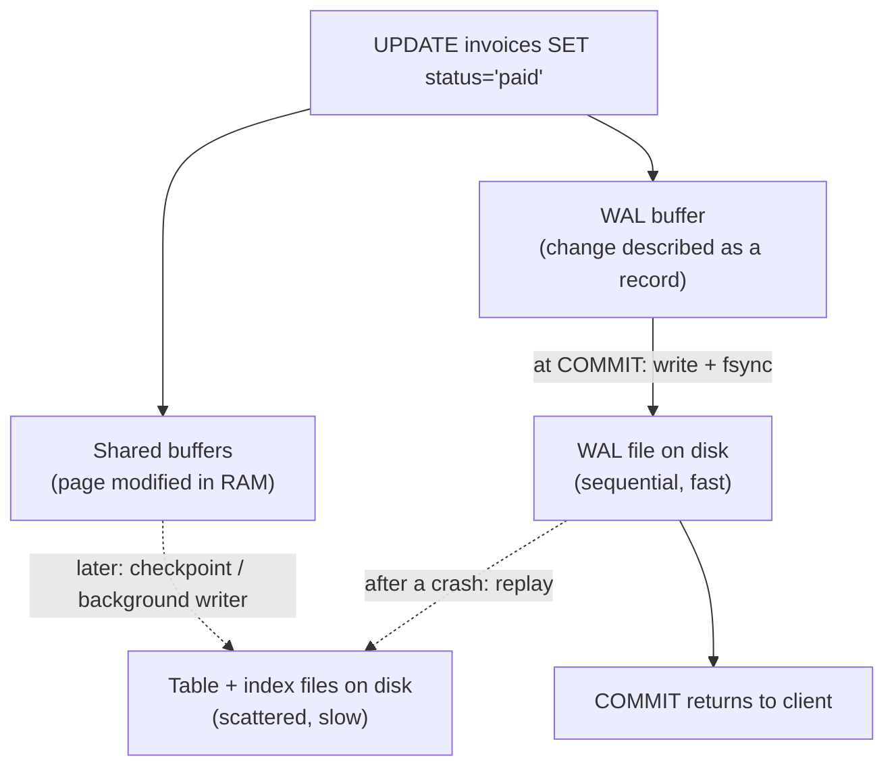
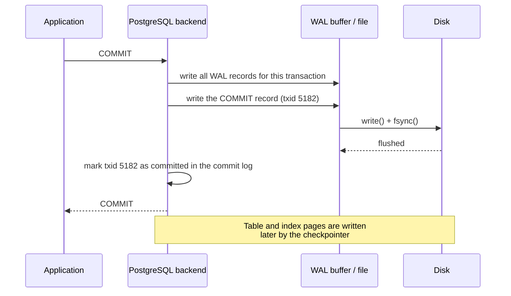

# Transactions and ACID — Part 1

A customer pays invoice #4021. Your code does two things:

```sql
UPDATE invoices SET status = 'paid', paid_at = now() WHERE id = 4021;
INSERT INTO payments (invoice_id, amount_cents, provider_ref) VALUES (4021, 25000, 'pi_3Nx...');
```

Now imagine the process dies between those two lines. The database is not
broken, the disk is fine, no error was logged anywhere. But your books are
wrong: an invoice is marked paid with no payment behind it. Run the reverse
order instead and you get the mirror image — money recorded against an invoice
that still looks unpaid, so the customer gets a dunning email for an invoice
they already paid.

There is no clever ordering that fixes this. Whichever statement you put first,
there is a gap after it. What you need is a way to tell the database: *these
two statements are one indivisible change.* That is a transaction.

> **📌 In one line:** a transaction is a group of statements the database
> promises to apply **completely or not at all**, keeping your rules intact,
> hidden from other sessions until it is done, and safe once it says "done".

**Schema note:** this folder adds one table to the shared SaaS schema —
`payments (id, invoice_id, amount_cents, provider_ref, created_at)` — because
almost every realistic transaction example involves money moving.

This part covers the statements themselves and the four letters of ACID. Part 2
is about using transactions well: savepoints, scope, side effects, and the ways
an open transaction hurts a production database.

## Table of Contents

1. [Two Writes That Must Happen Together](#two-writes-that-must-happen-together)
2. [BEGIN, COMMIT, ROLLBACK](#begin-commit-rollback)
3. [Autocommit: You Were Already Using Transactions](#autocommit-you-were-already-using-transactions)
4. [A — Atomicity](#a--atomicity)
5. [C — Consistency](#c--consistency)
6. [I — Isolation](#i--isolation)
7. [D — Durability and the Write-Ahead Log](#d--durability-and-the-write-ahead-log)
8. [What Actually Happens During COMMIT](#what-actually-happens-during-commit)
9. [Common Mistakes](#common-mistakes)
10. [Questions to Test Yourself](#questions-to-test-yourself)
11. [Related](#related)

---

## Two Writes That Must Happen Together

Here is the failure written out step by step, so the gap is visible.

| Time | Session A (payment webhook) | What the database holds |
|---|---|---|
| T1 | `UPDATE invoices SET status='paid' WHERE id=4021;` | invoice 4021 = paid, **no payment row** |
| T2 | *process is killed / pod evicted / network dies* | invoice 4021 = paid, **no payment row** |
| T3 | — | Books are wrong. Nothing errored. |

Wrap the same two statements in a transaction and T2 has no effect:

| Time | Session A (payment webhook) | What the database holds |
|---|---|---|
| T1 | `BEGIN;` | unchanged |
| T2 | `UPDATE invoices SET status='paid' WHERE id=4021;` | unchanged *for everyone else* |
| T3 | *process is killed* | unchanged — the change is discarded |

The second version is not "safer by luck". The change genuinely does not exist
for anyone outside session A until `COMMIT` returns. A killed connection is
rolled back by the server automatically.

---

## BEGIN, COMMIT, ROLLBACK

Three keywords. Everything else in this file is detail about what they mean.

```sql
BEGIN;                                    -- start the transaction

UPDATE invoices
SET    status  = 'paid',
       paid_at = now()
WHERE  id = 4021;

INSERT INTO payments (invoice_id, amount_cents, provider_ref)
VALUES (4021, 25000, 'pi_3Nx...');

COMMIT;                                   -- make both changes permanent
```

If anything goes wrong, `ROLLBACK;` throws away every change since `BEGIN`.

In `psql` you can watch the prompt change, which is the clearest way to see
that a transaction is open:

```text
saas=#  BEGIN;
BEGIN
saas=*# UPDATE invoices SET status = 'paid' WHERE id = 4021;
UPDATE 1
saas=*# ROLLBACK;
ROLLBACK
saas=#  SELECT status FROM invoices WHERE id = 4021;
 status
--------
 open
(1 row)
```

The `*` in `saas=*#` means "a transaction is open". Losing track of that `*` is
the source of a lot of confusion — and of the idle-in-transaction problem later
in this file.

**Two sessions, so you can see the isolation:**

| Time | Session A | Session B |
|---|---|---|
| T1 | `BEGIN;` | |
| T2 | `UPDATE invoices SET status='paid' WHERE id=4021;` | |
| T3 | | `SELECT status FROM invoices WHERE id=4021;` → `open` |
| T4 | `COMMIT;` | |
| T5 | | `SELECT status FROM invoices WHERE id=4021;` → `paid` |

At T3, session A has already run its `UPDATE`. Session B still sees `open`.
Session B is not blocked and it is not reading stale garbage — it is reading
the last **committed** state, which is the only honest answer available.

> **📌 Remember:** `PostgreSQL` also accepts `START TRANSACTION` (SQL standard)
> and `END` (an alias for `COMMIT`). They are the same thing. `BEGIN` /
> `COMMIT` / `ROLLBACK` is the spelling you will see everywhere.

---

## Autocommit: You Were Already Using Transactions

This surprises almost everyone the first time:

> **📌 Every standalone statement is already a transaction.**

When you type a bare `UPDATE` with no `BEGIN`, PostgreSQL wraps it in an
implicit transaction, runs it, and commits it. There is no such thing as a
statement outside a transaction.

```sql
-- These two are exactly equivalent:
UPDATE tasks SET status = 'done' WHERE id = 91;

BEGIN;
UPDATE tasks SET status = 'done' WHERE id = 91;
COMMIT;
```

Three consequences worth carrying with you:

**1. A multi-row `UPDATE` is atomic even without `BEGIN`.**

```sql
UPDATE tasks SET status = 'archived' WHERE project_id = 31;   -- 5,000 rows
```

If row 4,999 violates a constraint, all 5,000 changes are discarded. You never
get "half the rows updated". People write defensive batching code to avoid a
problem that does not exist.

**2. A loop of statements is *not* atomic.** Ten separate `INSERT`s in
application code are ten transactions. The eleventh failing does not undo the
first ten. This is the single most common cause of half-written data.

**3. Autocommit is a *client* setting, not a server one.** `psql` and most
drivers default to autocommit on. Some libraries (JDBC used with certain
frameworks, `psycopg` in its classic mode) open a transaction on your first
statement and leave it open until you commit — which means a `SELECT` you
thought was harmless has now pinned a transaction open. See
[Idle in Transaction](#idle-in-transaction-a-production-problem).

---

## A — Atomicity

**All or nothing.** Every statement inside the transaction happens, or none of
them do.

**Without it:** the invoice/payment split at the top of this file. A crash, an
exception, a deploy that restarts the pod mid-request — any of these leaves a
half-applied change that no code path ever expected to see.

What happens on a crash mid-transaction is worth being precise about, because
"the database undoes it" is not quite how PostgreSQL works:

1. Your uncommitted changes may already be sitting in shared memory, and may
   even have been written to the data files on disk. PostgreSQL does **not**
   keep them in a private area.
2. What is *not* written is a commit record for your transaction id.
3. On restart, PostgreSQL replays the write-ahead log. Your transaction has no
   commit record, so it is marked aborted.
4. The rows you wrote are still physically there, but every other transaction
   now sees them as created by an aborted transaction, so they are invisible —
   dead. `VACUUM` reclaims the space later.

> **📌 Rollback in PostgreSQL is cheap and commit is expensive** — the opposite
> of what people assume. Aborting is mostly "do not write a commit record".
> This is a direct consequence of MVCC, covered in [03-mvcc-part-1.md](03-mvcc-part-1.md).

**A failed statement aborts the whole transaction.** PostgreSQL is stricter
than MySQL here:

```text
saas=#  BEGIN;
BEGIN
saas=*# INSERT INTO users (company_id, email) VALUES (1, 'ana@acme.com');
ERROR:  duplicate key value violates unique constraint "users_email_key"
saas=!# SELECT count(*) FROM users;
ERROR:  current transaction is aborted, commands ignored until end of transaction block
```

The `!` in the prompt means "aborted transaction". Every further statement is
refused until you `ROLLBACK` — or roll back to a savepoint.

---

## C — Consistency

**Your rules hold before the transaction and after it.** If `invoices.status`
must be one of three values, and `tasks.project_id` must point at a real
project, those facts are true at every commit boundary.

Be honest about this letter:

> **📌 C is the least precisely defined letter in ACID.** It is mostly a
> statement that *your* constraints are enforced. The database does not know
> what "consistent" means for your business — you tell it, with constraints.

The database enforces what you declared:

```sql
ALTER TABLE invoices ADD CONSTRAINT invoices_amount_positive
  CHECK (amount_cents > 0);

ALTER TABLE tasks ADD CONSTRAINT tasks_project_fk
  FOREIGN KEY (project_id) REFERENCES projects(id);

ALTER TABLE users ADD CONSTRAINT users_email_unique UNIQUE (email);
```

**Without it:** a transaction that leaves `amount_cents = -500`, or a task
pointing at a project deleted three weeks ago, and every report built on that
data is quietly wrong.

The rule that catches people out: *consistency is checked at the boundary, not
in the middle.* A `DEFERRABLE INITIALLY DEFERRED` foreign key is only verified
at `COMMIT`, which is exactly what you want when two rows reference each other
and one of them has to be inserted first.

```sql
BEGIN;
SET CONSTRAINTS ALL DEFERRED;
-- insert rows that temporarily reference each other
COMMIT;                       -- constraints checked here
```

---

## I — Isolation

**Concurrent transactions do not see each other's half-finished work.**

**Without it:** session B reads an invoice that session A marked paid, acts on
it, and then session A rolls back. Session B made a decision based on something
that never happened.

This is the letter with **settings**. The other three are on or off; isolation
is a dial:

| Level | Roughly means |
|---|---|
| Read Committed | You see whatever was committed when each statement started |
| Repeatable Read | You see one consistent snapshot for the whole transaction |
| Serializable | The result must match *some* serial order of the transactions |

Stronger isolation costs concurrency, and in PostgreSQL's case costs you
serialization failures you have to retry. Which anomaly each level prevents,
what PostgreSQL actually does versus the SQL standard, and how to write the
retry loop — all of that is [02-isolation-levels-and-anomalies-part-1.md](02-isolation-levels-and-anomalies-part-1.md).

---

## D — Durability and the Write-Ahead Log

**Once `COMMIT` returns, the change survives a crash.** Pull the power cable
one microsecond after the client receives "COMMIT" and the change is still
there when the server comes back.

**Without it:** you tell the customer their payment succeeded, the server
reboots, and the payment is gone — but the money left their bank.

The obvious implementation — write the changed rows to their data files and
`fsync` those files before returning — would be far too slow. Those rows are
scattered across the table and its indexes, so committing one small change
would mean many random writes to disk.

PostgreSQL uses a **write-ahead log (WAL)** instead:

> **📌 The rule:** describe the change in a sequential log and flush **that**
> to disk before acknowledging the commit. Update the actual data files later,
> at leisure.

Sequential writes to one file are dramatically faster than scattered writes to
many. And the log is enough: if the server crashes before the data files are
updated, replaying the log rebuilds them.



Two knobs trade durability for speed:

| Setting | What it does | The trade |
|---|---|---|
| `fsync = off` | Stops asking the OS to force data to physical disk at all | Much faster; a crash or power loss can **corrupt the whole cluster**. Never on real data |
| `synchronous_commit = off` | `COMMIT` returns before the WAL is flushed | Much faster; a crash loses the last fraction of a second of *committed* transactions, but the database stays consistent |

`synchronous_commit` is the interesting one because it is genuinely useful and
can be set **per transaction**:

```sql
BEGIN;
SET LOCAL synchronous_commit = off;      -- this transaction only
INSERT INTO notifications (user_id, type) VALUES (77, 'task_assigned');
COMMIT;
```

That is a reasonable trade for a notification row. It is not a reasonable trade
for a payment. Being able to choose per transaction means you do not have to
pick one durability level for the whole system.

> **📌 Remember the difference:** `fsync = off` risks *corruption* — the
> database may not start. `synchronous_commit = off` risks *losing the last few
> transactions* — the database is fine, some recent commits are gone.

---

## What Actually Happens During COMMIT



Read that order carefully, because it explains a lot:

1. **The WAL is flushed before the acknowledgement.** That flush is why commit
   costs a disk round trip, and why committing in a tight loop is slow.
2. **Marking the transaction committed is what makes it visible.** Other
   sessions do not learn about your rows one at a time — a single flag flip
   makes the whole transaction appear at once. That is atomicity, physically.
3. **The data files lag behind.** They catch up at the next checkpoint. A
   PostgreSQL server that has just crashed and restarted spends its first
   moments replaying WAL to catch the data files up.

This also explains why **10,000 single-row inserts each in their own
transaction** are so much slower than one transaction with 10,000 inserts: the
first pays 10,000 WAL flushes, the second pays one. See
[bulk-write-performance](../query-patterns/bulk-write-performance.md).

---

## Common Mistakes

| Mistake | Why it is wrong | Do this instead |
|---|---|---|
| A loop of `INSERT`s with no `BEGIN` | Ten statements are ten transactions; failure leaves nine written | One transaction, or one multi-row statement |
| Batching a big `UPDATE` "so it is not all-or-nothing" | A single statement is already atomic | Batch for lock duration and WAL size, not for atomicity |
| Assuming `ROLLBACK` frees disk space immediately | Rolled-back rows are dead tuples until vacuum | Understand MVCC ([03-mvcc-part-1.md](03-mvcc-part-1.md)) |
| Trusting `synchronous_commit = off` for payments | You can lose acknowledged commits | Leave it on globally; relax it per transaction for low-value writes |

---

## Questions to Test Yourself

1. Give a concrete example of two statements that must be atomic, and describe
   exactly what the data looks like if the process dies between them.
2. You run a bare `UPDATE` with no `BEGIN`. Is it a transaction? What does that
   mean for an update that touches 5,000 rows and fails on the last one?
3. State each ACID letter in one sentence, and give one concrete failure that
   happens if it is missing.
4. Why is `C` the weakest letter? What does the database actually enforce?
5. Explain the write-ahead log to someone who has never heard of it, in three
   sentences, and say why sequential writes make it faster.
6. What is the difference in risk between `fsync = off` and
   `synchronous_commit = off`?
7. List the exact steps PostgreSQL performs during `COMMIT`, in order.

---

> **➡️ Continued in [Part 2](./01-transactions-and-acid-part-2.md)**

---

## Related

- [Part 2](01-transactions-and-acid-part-2.md) — savepoints, transaction scope,
  external side effects, `idle in transaction`, DDL in a transaction, and
  two-phase commit.
- [Isolation Levels and Anomalies](02-isolation-levels-and-anomalies-part-1.md)
  — the next file: what "I" actually means, and the anomalies each level
  allows.
- [MVCC](03-mvcc-part-1.md) — why rollback is cheap.
- [Locks](04-locks-part-1.md) — what a transaction holds until it commits.
- [bulk-write-performance](../query-patterns/bulk-write-performance.md) — why
  10,000 commits are slower than one.
