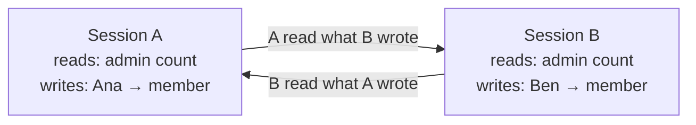
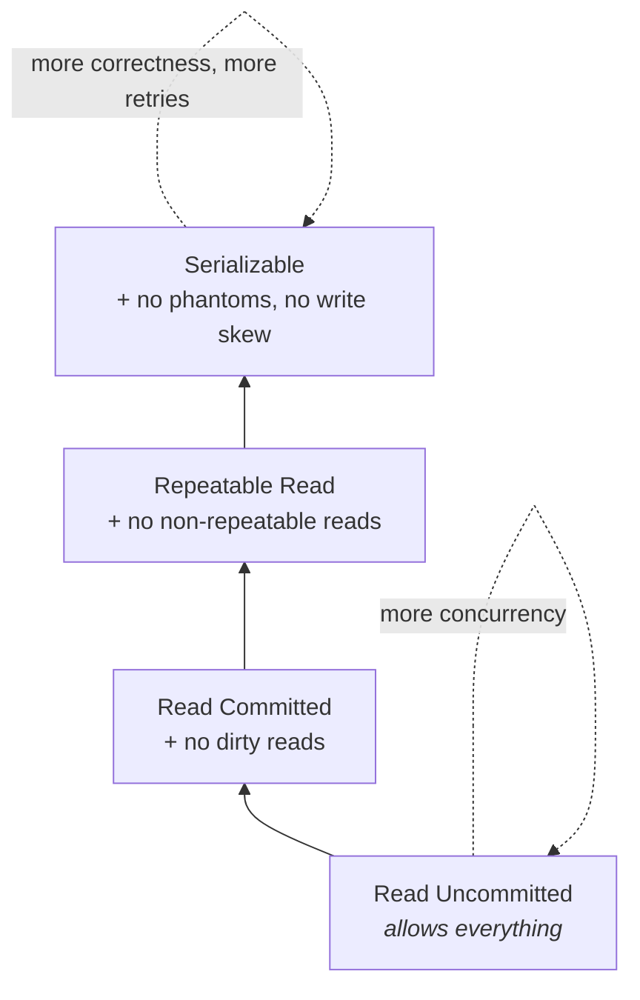

# Isolation Levels and Anomalies — Part 1

Two requests arrive at the same millisecond. Both read invoice 4021. Both
decide what to do. Both write. What comes out the other side?

Without rules, the answer is "it depends on the interleaving", and some
interleavings produce results that could never happen if the two requests had
run one after the other. Those wrong results have names — dirty read,
non-repeatable read, phantom, lost update, write skew — and an **isolation
level** is the dial that decides which of them the database will let happen.

> **📌 In one line:** an isolation level trades correctness guarantees against
> concurrency. Weaker levels let more transactions run at once and allow more
> anomalies; stronger levels forbid the anomalies and make you pay in waiting
> or in retries.

Start from the anomalies, not the levels. The levels only make sense once you
can picture the damage they prevent.

This part is the catalogue of damage: the five anomalies as interleaving
timelines, followed by the four levels the SQL standard defines against them.
Part 2 is what PostgreSQL actually does with those definitions.

## Table of Contents

1. [Dirty Read](#dirty-read)
2. [Non-Repeatable Read](#non-repeatable-read)
3. [Phantom Read](#phantom-read)
4. [Lost Update](#lost-update)
5. [Write Skew](#write-skew)
6. [The Four SQL Levels](#the-four-sql-levels)
7. [Common Mistakes](#common-mistakes)
8. [Questions to Test Yourself](#questions-to-test-yourself)
9. [Related](#related)

---

## Dirty Read

**Reading data another transaction has written but not committed.**

| Time | Session A (refund) | Session B (report) |
|---|---|---|
| T1 | `BEGIN;` | |
| T2 | `UPDATE invoices SET status='void' WHERE id=4021;` | |
| T3 | | `BEGIN;` |
| T4 | | `SELECT status FROM invoices WHERE id=4021;` → **`void`** |
| T5 | | emails the customer "your invoice was cancelled" |
| T6 | `ROLLBACK;` *(refund declined)* | |
| T7 | | `COMMIT;` |

**The wrong result:** session B read `void`, but the invoice is still `open` —
that value never existed in any committed state of the database.

**Why it is wrong:** session B acted on a fact that was never true. The email
is already sent. There is no interleaving of A and B running one-at-a-time that
produces this outcome.

> **📌 Good news:** dirty reads **cannot happen in PostgreSQL at any isolation
> level.** You will not meet this one in production on Postgres. It is here
> because it defines the bottom of the scale and it appears in every interview.

---

## Non-Repeatable Read

**The same row, read twice in one transaction, gives different values.**

| Time | Session A (billing summary) | Session B (payment webhook) |
|---|---|---|
| T1 | `BEGIN;` | |
| T2 | `SELECT amount_cents FROM invoices WHERE id=4021;` → `25000` | |
| T3 | | `UPDATE invoices SET amount_cents=30000 WHERE id=4021;` *(committed)* |
| T4 | `SELECT amount_cents FROM invoices WHERE id=4021;` → **`30000`** | |
| T5 | `COMMIT;` | |

**The wrong result:** one transaction saw the invoice as both 25000 and 30000.
If T2 fed the line-item display and T4 fed the total, the PDF you just
generated does not add up.

**Why it is wrong:** a transaction is supposed to be one unit of work. A report
built from two disagreeing reads is internally inconsistent — and the
inconsistency is invisible, because neither query was wrong on its own.

This is allowed at Read Committed and prevented at Repeatable Read.

---

## Phantom Read

**The same query, run twice, returns a different *set of rows*.** Not a changed
value — a changed population.

| Time | Session A (seat audit) | Session B (invite accepted) |
|---|---|---|
| T1 | `BEGIN;` | |
| T2 | `SELECT count(*) FROM users WHERE company_id=1;` → `9` | |
| T3 | | `INSERT INTO users (company_id, email) VALUES (1,'zoe@acme.com');` *(committed)* |
| T4 | `SELECT id FROM users WHERE company_id=1;` → **10 rows** | |
| T5 | `COMMIT;` | |

**The wrong result:** the count said 9 seats, the list has 10. If session A was
about to bill 9 seats, the company gets a free one.

**Why it is wrong:** same query, same transaction, different answer. The
difference from a non-repeatable read is that no row A already saw was
modified — a *new* row appeared that matches A's search condition. That
distinction matters because preventing it requires locking rows that do not
exist yet, which is harder than locking rows that do.

---

## Lost Update

**Two read-modify-write cycles overlap, and one of the two updates vanishes
without any error.**

This is the anomaly you will actually hit. Two support agents each add a late
fee to the same invoice:

| Time | Session A (agent 1, +5000) | Session B (agent 2, +2000) |
|---|---|---|
| T1 | `BEGIN;` | |
| T2 | `SELECT amount_cents FROM invoices WHERE id=4021;` → `25000` | |
| T3 | | `BEGIN;` |
| T4 | | `SELECT amount_cents FROM invoices WHERE id=4021;` → `25000` |
| T5 | `UPDATE invoices SET amount_cents=30000 WHERE id=4021;` | |
| T6 | `COMMIT;` | |
| T7 | | `UPDATE invoices SET amount_cents=27000 WHERE id=4021;` |
| T8 | | `COMMIT;` |
| T9 | final value: **27000** | |

**The wrong result:** the invoice should be 25000 + 5000 + 2000 = **32000**. It
is 27000. Agent 1's 5000 fee is gone.

**Why it is wrong:** both sessions computed their new value from a `25000` that
was already stale by the time they wrote. Nobody got an error. Both agents saw
a success message. The books are short by 5000 and nothing anywhere records
that.

At T7, session B's `UPDATE` does briefly wait for session A's row lock (see
[04-locks-part-1.md](04-locks-part-1.md)) — but once A commits, B happily overwrites with a
value computed from the old read. The lock ordered the writes; it did not make
them correct.

There are four ways out, and all four appear later:

| Fix | Where |
|---|---|
| Do the arithmetic in the database: `SET amount_cents = amount_cents + 5000` | [06](06-optimistic-vs-pessimistic-locking-part-2.md) — usually the best answer |
| `SELECT ... FOR UPDATE` before the read | [04-locks-part-1.md](04-locks-part-1.md) |
| Optimistic locking with a `version` column | [06](06-optimistic-vs-pessimistic-locking-part-1.md) |
| Repeatable Read or Serializable, plus a retry | this file |

---

## Write Skew

The subtlest one, and the one most worth understanding. **Both transactions
read, both check a condition, both find it satisfied, both write different
rows — and together they break an invariant that neither broke alone.**

The invariant: *a company must always have at least one admin.* Two admins,
Ana and Ben, each decide to step down at the same moment.

| Time | Session A (Ana resigns) | Session B (Ben resigns) |
|---|---|---|
| T1 | `BEGIN;` | |
| T2 | | `BEGIN;` |
| T3 | `SELECT count(*) FROM users WHERE company_id=1 AND role='admin';` → `2` | |
| T4 | | `SELECT count(*) FROM users WHERE company_id=1 AND role='admin';` → `2` |
| T5 | check passes: 2 > 1, safe to resign | |
| T6 | | check passes: 2 > 1, safe to resign |
| T7 | `UPDATE users SET role='member' WHERE id=101;` *(Ana)* | |
| T8 | | `UPDATE users SET role='member' WHERE id=102;` *(Ben)* |
| T9 | `COMMIT;` | |
| T10 | | `COMMIT;` |
| T11 | admins remaining: **0** | |

**The wrong result:** the company has zero admins. Nobody can invite anyone,
change the plan, or recover the account. Support has to fix it by hand.

**Why it is wrong:** run A then B and B's check sees 1 admin and refuses. Run B
then A and A's check refuses. There is *no* serial order that produces zero
admins — so this result is not a valid outcome of any ordering, which is the
precise definition of a serialization violation.

The dependency cycle, which is what Serializable actually looks for:



Neither transaction wrote a row the other *wrote*, so no lock conflicted. But
each read something the other invalidated — and those two read/write
dependencies form a cycle.

**Why the usual fixes do not help:**

- They updated **different rows**, so no row lock ever conflicted.
- `SELECT ... FOR UPDATE` on the row you are about to change does not help
  either — A locks Ana's row, B locks Ben's row, no conflict.
- Repeatable Read does not catch it: neither transaction wrote a row the other
  read.

The conflict is not between rows. It is between *what each read* and *what the
other wrote*. Catching that needs the database to track predicates — which is
exactly what Serializable does.

Three real fixes:

```sql
-- 1. Serializable: PostgreSQL detects the read/write dependency cycle and
--    aborts one transaction with a serialization failure. Retry required.
BEGIN ISOLATION LEVEL SERIALIZABLE;
  SELECT count(*) FROM users WHERE company_id = 1 AND role = 'admin';
  UPDATE users SET role = 'member' WHERE id = 101;
COMMIT;

-- 2. Materialise the conflict: lock the parent row, so both sessions must
--    queue on the same object.
BEGIN;
  SELECT id FROM companies WHERE id = 1 FOR UPDATE;   -- forced serialisation
  SELECT count(*) FROM users WHERE company_id = 1 AND role = 'admin';
  UPDATE users SET role = 'member' WHERE id = 101;
COMMIT;

-- 3. Make it a constraint the database can enforce by itself — best when
--    possible, because it needs no cooperation from any caller.
CREATE UNIQUE INDEX one_admin_minimum
  ON users (company_id) WHERE role = 'admin';          -- only if "exactly one"
```

> **📌 Write skew is the reason "we use transactions" is not the same as "our
> data is correct".** Everything above ran inside perfectly correct
> transactions.

Other write skews you will meet: two people booking the last meeting room, two
withdrawals from linked accounts whose *combined* balance must stay positive,
and two schedulers each assigning the only on-call engineer to a different
shift.

---

## The Four SQL Levels

The SQL standard defines four levels by which anomalies they permit. Picture
them as a ladder: every step up forbids one more anomaly and costs you more
concurrency.




| Level | Dirty read | Non-repeatable read | Phantom | Lost update | Write skew |
|---|---|---|---|---|---|
| Read Uncommitted | possible | possible | possible | possible | possible |
| Read Committed | prevented | possible | possible | possible | possible |
| Repeatable Read | prevented | prevented | possible* | prevented* | possible |
| Serializable | prevented | prevented | prevented | prevented | prevented |

\* The standard says Repeatable Read allows phantoms and says nothing useful
about lost update. PostgreSQL's implementation is stronger — see the next
section. This is exactly why you should never reason about PostgreSQL from the
standard's table alone.

---

## Common Mistakes

| Mistake | Why it is wrong | Do this instead |
|---|---|---|
| Assuming a transaction makes concurrent code correct | Write skew happens inside perfectly valid transactions | Identify the invariant, then pick the tool |
| Read-modify-write in application code | Lost update, silently | `SET x = x + n`, `FOR UPDATE`, or a version column |
| Carrying MySQL intuition over | MySQL defaults to Repeatable Read and blocks with next-key locks | Check the engine's actual behaviour |

---

## Questions to Test Yourself

1. Describe a dirty read with a timeline, then say why you will never see one
   in PostgreSQL.
2. What is the difference between a non-repeatable read and a phantom read, and
   why is the phantom harder to prevent?
3. Draw the lost update timeline from memory. Give four different fixes.
4. Explain write skew to a colleague using the two-admins example. Why do row
   locks on the updated rows not help?
5. Why does "there is no serial order that produces this result" make write
   skew a serialization violation rather than just bad luck?
6. Name the four SQL isolation levels in order, and say which anomaly each one
   is defined to rule out.

---

> **➡️ Continued in [Part 2](./02-isolation-levels-and-anomalies-part-2.md)**

---

## Related

- [Part 2](02-isolation-levels-and-anomalies-part-2.md) — what PostgreSQL
  actually does with these levels, how to set them, Serializable and the retry
  loop, and which level to choose.
- [Transactions and ACID](01-transactions-and-acid-part-1.md) — what the "I"
  belongs to.
- [MVCC](03-mvcc-part-1.md) — the mechanism that makes snapshots possible, and
  why dirty reads cannot occur.
- [Locks](04-locks-part-1.md) — `SELECT ... FOR UPDATE`, the Read Committed fix
  for lost update.
- [Optimistic vs Pessimistic Locking](06-optimistic-vs-pessimistic-locking-part-1.md)
  — the application-level answer to lost update.
