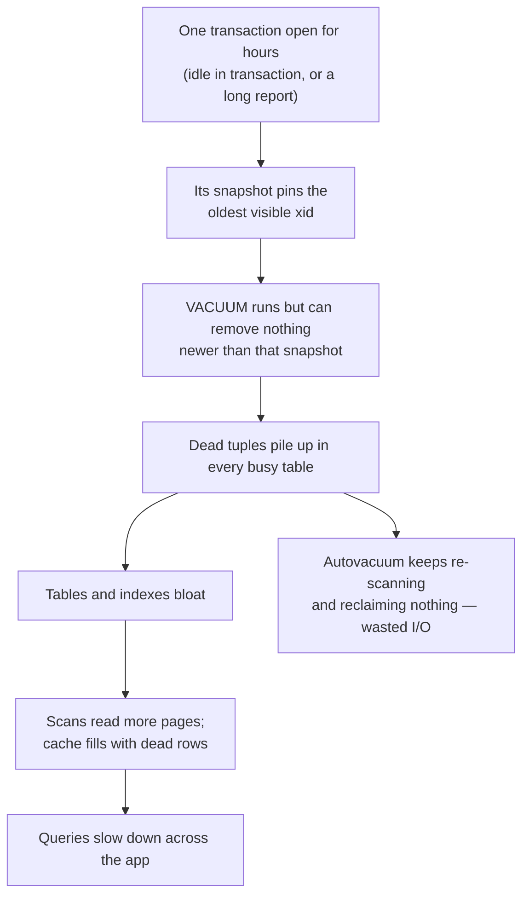

# MVCC — Multi-Version Concurrency Control — Part 2

Part 1 showed how PostgreSQL lets readers and writers pass each other: every
write leaves an old version behind, and a snapshot decides which version you
see. Those old versions are the bill for that promise. This part is about
paying it — `VACUUM`, HOT updates, the transactions that stop cleanup from
happening at all, and the wraparound the whole scheme depends on.

> **⬅️ This continues [Part 1](./03-mvcc-part-1.md).**

> **📌 In one line:** MVCC's cost is garbage, `VACUUM` is the collector, and
> anything that holds an old snapshot open — one idle transaction is enough —
> stops the collector database-wide.

## Table of Contents

1. [VACUUM: The Cleanup](#vacuum-the-cleanup)
2. [HOT Updates and fillfactor](#hot-updates-and-fillfactor)
3. [Why COUNT(*) Cannot Be Instant](#why-count-cannot-be-instant)
4. [Long-Running Transactions Are the Enemy](#long-running-transactions-are-the-enemy)
5. [Transaction Id Wraparound](#transaction-id-wraparound)
6. [Advanced: How Other Engines Do It](#advanced-how-other-engines-do-it)
7. [Common Mistakes](#common-mistakes)
8. [Questions to Test Yourself](#questions-to-test-yourself)
9. [Related](#related)

---

## VACUUM: The Cleanup

Dead tuples do not disappear on their own. `VACUUM` is the process that scans a
table, finds tuples no snapshot can see, and marks their space reusable.

```sql
VACUUM (VERBOSE, ANALYZE) invoices;
```

The essentials, with the full treatment in
[../operations/02-vacuum-and-autovacuum-part-1.md](../operations/02-vacuum-and-autovacuum-part-1.md):

| | `VACUUM` | `VACUUM FULL` |
|---|---|---|
| What it does | Marks dead space reusable **inside** the table | Rewrites the table into a new, compact file |
| Does the file shrink? | Usually no — space is reused by future writes | Yes |
| Lock taken | Light; concurrent reads and writes continue | `ACCESS EXCLUSIVE` — **blocks everything** |
| Extra disk needed | No | Yes, roughly a second copy of the table |
| Use it | Constantly, via autovacuum | Rarely, in a maintenance window |

> **📌 Plain `VACUUM` does not usually give disk back to the operating
> system.** It makes the space available for this table's future rows. That is
> the right outcome for a table with steady write traffic, and a surprise if
> you were watching disk usage expecting a drop.

Autovacuum runs this for you in the background. Your job is mostly to **not
block it** — which brings us to the two sections after next.

---

## HOT Updates and fillfactor

One optimisation makes the "an update is an insert" cost far less painful, and
it is genuinely useful to understand because it changes how you index.

**HOT** stands for *heap-only tuple*. When an `UPDATE` satisfies two
conditions:

1. **No indexed column changed**, and
2. **The new version fits on the same 8 KB page** as the old one,

then PostgreSQL writes the new version on that same page and chains it from the
old one. The indexes are **not touched at all** — they keep pointing at the old
`ctid`, and the lookup follows the chain to the live version.

```text
Normal update                          HOT update
─────────────────────────────          ─────────────────────────────
 page 0: old tuple (dead)               page 0: old tuple ──► new tuple
 page 9: new tuple                              (same page, chained)

 every index gets a new entry           no index touched
 8 indexes = 8 index writes             8 indexes = 0 index writes
```

The practical consequences are the useful part:

**Indexing a frequently updated column makes every update on that table more
expensive.** Not because the index lookup is slow — because it disqualifies
HOT. Before you add an index on a hot counter or a `last_seen_at`, ask whether
the read it speeds up is worth the writes it slows down.

**`fillfactor` deliberately leaves free space on each page** so new versions
have somewhere to land on the same page:

```sql
-- Leave 15% of each page free on a heavily-updated table
ALTER TABLE notifications SET (fillfactor = 85);
VACUUM FULL notifications;      -- rewrite needed for existing pages
```

The default is 100 (pack pages full), which is right for append-mostly tables
and wrong for update-heavy ones. Lowering it trades some disk and some
sequential-scan efficiency for a much higher HOT rate.

Measure whether you are getting HOT updates:

```sql
SELECT relname,
       n_tup_upd,
       n_tup_hot_upd,
       round(100.0 * n_tup_hot_upd / NULLIF(n_tup_upd, 0), 1) AS hot_pct
FROM   pg_stat_user_tables
WHERE  n_tup_upd > 0
ORDER  BY n_tup_upd DESC;
```

```text
    relname    | n_tup_upd | n_tup_hot_upd | hot_pct
---------------+-----------+---------------+---------
 notifications |  18442091 |        992144 |     5.4
 tasks         |   1204338 |       1081900 |    89.8
```

`notifications` at 5.4% is doing nearly 18 million full index updates. Either an
indexed column is being changed, or its pages are too full — both are fixable,
and both are invisible without this query.

---

## Why COUNT(*) Cannot Be Instant

Back in [aggregations-and-grouping](../fundamentals/05-aggregations-and-grouping-part-2.md)
you saw that `SELECT count(*) FROM tasks` is slow on a big table. MVCC is why.

There is no single true row count to store. **Each transaction has a different
count**, because each has a different snapshot. A row inserted by an
uncommitted transaction counts for that transaction and for nobody else.

So `count(*)` must visit tuples and apply the visibility rule to each. With a
covering index PostgreSQL can use an index-only scan — but only where the
*visibility map* marks a page as all-visible; otherwise it must go back to the
heap to check anyway.

```text
EXPLAIN ANALYZE SELECT count(*) FROM tasks;

 Finalize Aggregate  (cost=48211.4..48211.5 rows=1) (actual time=412.7..418.2 rows=1 loops=1)
   ->  Gather  (cost=48211.2..48211.3 rows=2 width=8) (actual time=410.1..418.1 rows=3)
         Workers Launched: 2
         ->  Partial Aggregate (actual time=401.9..401.9 rows=1 loops=3)
               ->  Parallel Seq Scan on tasks (actual time=0.03..330.6 rows=294707 loops=3)
 Execution Time: 418.9 ms
```

Nearly half a second to answer "how many rows". When you need a fast approximate
count:

```sql
-- Planner's estimate: instant, approximate, refreshed by ANALYZE
SELECT reltuples::bigint AS approx_rows
FROM   pg_class
WHERE  relname = 'tasks';
```

**MySQL/InnoDB behaves the same way** for the same reason. MyISAM, which had no
MVCC, kept an exact counter and could answer instantly — that is where the
"`count(*)` should be free" intuition comes from.

---

## Long-Running Transactions Are the Enemy

Everything so far leads here. If you take one operational lesson from this
file, take this one:

> **📌 One open transaction — even an idle, read-only one — prevents cleanup of
> every row version newer than its snapshot, across the whole database.**

Not just its tables. The whole database. Vacuum cannot remove a dead tuple if
any snapshot might still need it, and it has no way to know that your session
will never look at `notifications`.

The cascade:



The cruel part is the timing. Nothing breaks while the transaction is open. The
damage shows up as a gradual slowdown, and when someone finally kills the
session, autovacuum has hours of accumulated garbage to work through — so
performance gets *worse* before it gets better.

**Find the offender:**

```sql
SELECT pid,
       usename,
       state,
       now() - xact_start  AS txn_age,
       now() - query_start AS query_age,
       wait_event_type,
       left(query, 70)     AS query
FROM   pg_stat_activity
WHERE  state <> 'idle'
   AND xact_start IS NOT NULL
ORDER  BY xact_start
LIMIT  10;
```

```text
  pid  | usename  |        state        |    txn_age     |   query_age    | wait_event_type |   query
-------+----------+---------------------+----------------+----------------+-----------------+-----------
 28841 | analytics| idle in transaction | 04:17:22.10    | 04:17:19.66    | Client          | SELECT * FROM invoices WH
 31902 | app      | active              | 00:00:00.31    | 00:00:00.31    |                 | UPDATE tasks SET status =
```

Then, if you must:

```sql
SELECT pg_cancel_backend(28841);      -- cancel the query, politely
SELECT pg_terminate_backend(28841);   -- kill the connection, if that fails
```

Prevention beats cure: `idle_in_transaction_session_timeout` and
`statement_timeout` (see
[01-transactions-and-acid-part-2.md](01-transactions-and-acid-part-2.md)), plus an alert on
`txn_age` over a few minutes. Two-hour analytics queries belong on a replica.

---

## Transaction Id Wraparound

Calmly, because this gets written about in alarming tones and the reality is
manageable.

Transaction ids are 32-bit, so there are about 4 billion of them, and they wrap
around. PostgreSQL compares xids *circularly*: roughly 2 billion ids ahead of
you are "future", 2 billion behind are "past". If an xid ever became more than
2 billion old, it would flip to looking like the future — and rows would
vanish.

PostgreSQL prevents this with **freezing**. Vacuum marks tuples old enough that
everyone can see them as *frozen*, meaning "visible to all, no xid comparison
needed". A frozen tuple can never be affected by wraparound.

Autovacuum does this automatically. It launches anti-wraparound vacuums as a
table's oldest unfrozen xid ages, and those run **even on tables that get no
writes** — which is why you sometimes see autovacuum working on a table nobody
has touched in months.

It only becomes a problem when something blocks vacuum for a very long time: a
transaction open for days, a stuck prepared transaction, an abandoned
replication slot, or autovacuum disabled "temporarily" and forgotten. Then:

```text
WARNING:  database "saas" must be vacuumed within 10609758 transactions
HINT:  To avoid a database shutdown, execute a database-wide VACUUM in that database.
```

Ignore that long enough and PostgreSQL refuses new write transactions to
protect your data. It is a protective stop, not corruption — but recovering
means a vacuum on a database that is not accepting writes, which is an
unpleasant afternoon.

Monitor it with one query:

```sql
SELECT datname,
       age(datfrozenxid) AS xid_age,
       round(100.0 * age(datfrozenxid) / 2000000000, 1) AS pct_to_limit
FROM   pg_database
ORDER  BY xid_age DESC;
```

```text
 datname  |  xid_age  | pct_to_limit
----------+-----------+--------------
 saas     | 213448201 |         10.7
 postgres |   1204338 |          0.1
```

> **📌 The takeaway is not "wraparound is coming for you". It is: do not ignore
> vacuum warnings, and do not leave transactions or replication slots open for
> days.** Autovacuum handles the rest.

---

## Advanced: How Other Engines Do It

PostgreSQL keeps old versions **in the table itself**. MySQL/InnoDB and Oracle
keep them in a separate **undo log**: the table always holds the newest version,
and a reader that needs an older one reconstructs it by walking undo records
backwards.

| | PostgreSQL (in-heap versions) | InnoDB / Oracle (undo log) |
|---|---|---|
| Where old versions live | In the table's own pages | In a separate undo/rollback segment |
| `UPDATE` cost | New tuple + index entries (unless HOT) | Update in place + write an undo record |
| `ROLLBACK` cost | Nearly free — do not mark committed | Expensive — apply undo records to restore |
| Reading an old version | Just read the tuple; no reconstruction | Walk the undo chain; slower the older it is |
| Main cleanup problem | Table and index **bloat**; vacuum must keep up | Undo space **growth** and purge lag |
| Long transaction hurts by | Blocking vacuum, causing bloat | Growing undo, slowing old-version reads |
| Index handling | Indexes point at physical tuples; HOT avoids updates | Secondary indexes store the primary key; extra lookup |

Neither design is free — they just move the cost:

> **📌 PostgreSQL pays for MVCC with bloat and vacuum. Undo-log systems pay for
> it with expensive rollbacks and undo-space contention.** PostgreSQL makes
> commit cheap and cleanup a background job; InnoDB makes cleanup implicit and
> rollback expensive.

And both share the sentence at the top of this file: readers do not block
writers. That property is worth all of this machinery.

---

## Common Mistakes

| Mistake | Why it is wrong | Do this instead |
|---|---|---|
| Running `VACUUM FULL` on a live table | It takes `ACCESS EXCLUSIVE` and blocks everything | Fix autovacuum tuning; use `pg_repack` |
| Indexing a hot counter column "for speed" | Disqualifies HOT; every update rewrites every index | Weigh read gain against write cost |
| Leaving a session `idle in transaction` | Blocks cleanup database-wide | `idle_in_transaction_session_timeout` |
| Running a two-hour report on the primary | Same snapshot problem, blocks vacuum for two hours | Run it on a replica |
| Caching `count(*)` results without realising why it is slow | The slowness is visibility checking, not I/O alone | Use `reltuples` for approximations |
| Disabling autovacuum to "reduce load" | Bloat grows without limit; wraparound risk becomes real | Tune its thresholds instead |

---

## Questions to Test Yourself

1. What does `VACUUM` actually do to a dead tuple, and why does the table file
   not get smaller afterwards?
2. Explain HOT updates in two sentences. What two conditions must hold?
3. Why does adding an index to a frequently updated column slow down writes
   more than the index write itself would suggest?
4. Why can `count(*)` not read a stored number? Why could MyISAM?
5. Explain how a single idle transaction can slow down a table it never
   touched. Give the query you would run to find it.
6. What is transaction id wraparound, what prevents it, and what does a
   protective shutdown actually mean?
7. Compare PostgreSQL's in-heap versions with InnoDB's undo log across update
   cost, rollback cost, and the main cleanup problem.

---

## Related

- [Part 1](03-mvcc-part-1.md) — row versions, `xmin` and `xmax`, snapshots and
  the visibility rule, and where dead tuples come from.
- [Transactions and ACID](01-transactions-and-acid-part-2.md) — transaction
  scope, and why an open transaction is the expensive thing.
- [Isolation Levels and Anomalies](02-isolation-levels-and-anomalies-part-2.md)
  — why a long Repeatable Read snapshot has the same effect.
- [Locks](04-locks-part-2.md) — the `ACCESS EXCLUSIVE` lock `VACUUM FULL`
  takes, and how to see who holds it.
- [../operations/02-vacuum-and-autovacuum-part-1.md](../operations/02-vacuum-and-autovacuum-part-1.md)
  — tuning the cleanup this file depends on.
- [../operations/01-connection-pooling-part-2.md](../operations/01-connection-pooling-part-2.md)
  — the other resource a long transaction holds.
- [aggregations-and-grouping](../fundamentals/05-aggregations-and-grouping-part-2.md)
  — where the slow `count(*)` was first raised.
- [covering-indexes](../query-optimization/covering-indexes.md) — index-only
  scans and the visibility map.
