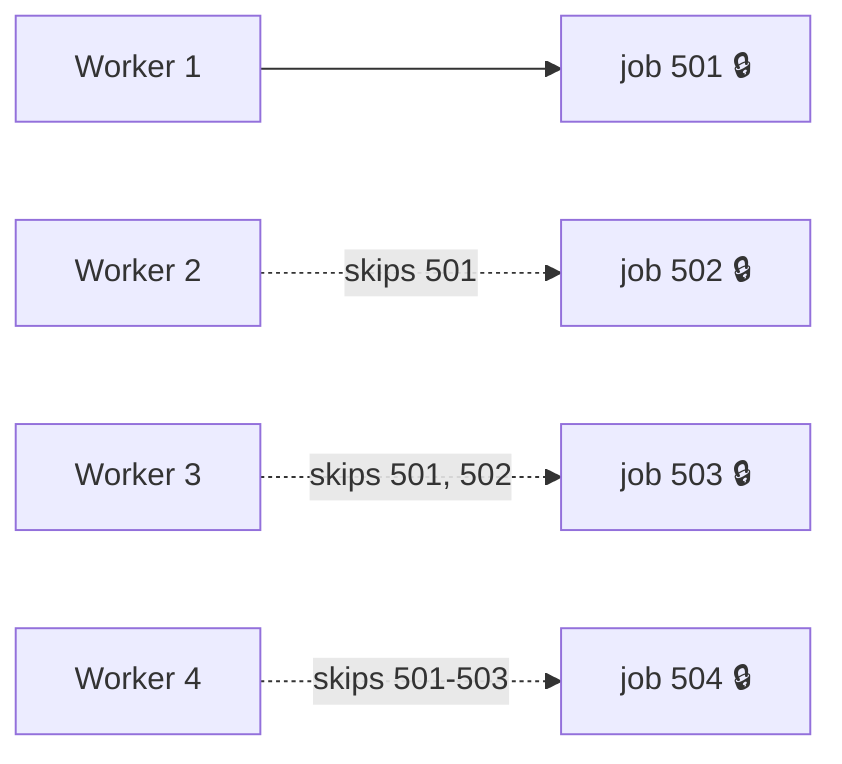
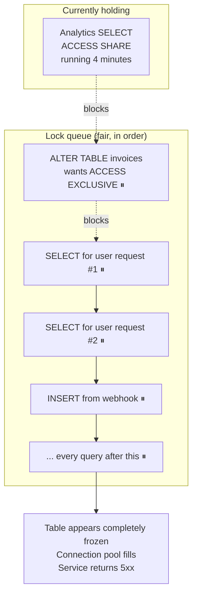

# Locks — Part 1

[MVCC](03-mvcc-part-1.md) removed most of the waiting: a reader never blocks a
writer, and a writer never blocks a reader. But it left one case untouched. Two
sessions both want to change invoice 4021. There is only one current version of
that row, and one of them has to go second.

Locks are how the database enforces that order. They are not a performance
feature you enable — PostgreSQL takes them automatically on every statement you
run. The skill is knowing **which** lock a statement takes, **how long** it
holds it, and **what** else that blocks.

> **📌 In one line:** every lock is held until the transaction ends. So "how
> long does this lock block others?" is always the same question as "how long
> is this transaction?"

This part covers the locks PostgreSQL takes for you: row locks, the explicit
`FOR UPDATE` family, table locks, and the `ALTER TABLE` queue that turns a
"one-second migration" into an outage. Part 2 covers the locks you take on
purpose and how to survive an incident caused by any of them.

## Table of Contents

1. [Row-Level Locks](#row-level-locks)
2. [SELECT ... FOR UPDATE: Fixing the Lost Update](#select--for-update-fixing-the-lost-update)
3. [SKIP LOCKED and NOWAIT](#skip-locked-and-nowait)
4. [Table-Level Locks](#table-level-locks)
5. [Which Lock Does This DDL Take?](#which-lock-does-this-ddl-take)
6. [The Queue Behind a Blocked DDL](#the-queue-behind-a-blocked-ddl)
7. [Common Mistakes](#common-mistakes)
8. [Questions to Test Yourself](#questions-to-test-yourself)
9. [Related](#related)

---

## Row-Level Locks

PostgreSQL has four row lock modes, strongest first:

| Mode | Taken by | Blocks |
|---|---|---|
| `FOR UPDATE` | `UPDATE`, `DELETE`, `SELECT ... FOR UPDATE` | All four modes |
| `FOR NO KEY UPDATE` | `UPDATE` that changes no key column | All but `FOR KEY SHARE` |
| `FOR SHARE` | `SELECT ... FOR SHARE` | `FOR UPDATE`, `FOR NO KEY UPDATE` |
| `FOR KEY SHARE` | Inserting a child row (foreign key check) | `FOR UPDATE` only |

The conflict matrix — ✅ means the two can be held on the same row at once:

| Held ↓ / Wanted → | KEY SHARE | SHARE | NO KEY UPDATE | UPDATE |
|---|---|---|---|---|
| **FOR KEY SHARE** | ✅ | ✅ | ✅ | ❌ |
| **FOR SHARE** | ✅ | ✅ | ❌ | ❌ |
| **FOR NO KEY UPDATE** | ✅ | ❌ | ❌ | ❌ |
| **FOR UPDATE** | ❌ | ❌ | ❌ | ❌ |

The two "key" variants exist entirely to make foreign keys cheaper — see
[Foreign Key Locking](#foreign-key-locking). For everyday reasoning you mostly
care about the corners: `FOR UPDATE` conflicts with everything, `FOR KEY SHARE`
conflicts with almost nothing.

A plain `UPDATE` blocking another `UPDATE`:

| Time | Session A | Session B |
|---|---|---|
| T1 | `BEGIN;` | |
| T2 | `UPDATE invoices SET status='paid' WHERE id=4021;` → `UPDATE 1` | |
| T3 | | `BEGIN;` |
| T4 | | `UPDATE invoices SET amount_cents=30000 WHERE id=4021;` ⏸ **blocked** |
| T5 | *(does some other work for 8 seconds)* | ⏸ still blocked |
| T6 | `COMMIT;` | |
| T7 | | unblocks → `UPDATE 1` |
| T8 | | `COMMIT;` |

Session B waited from T4 to T6 — for the whole remaining life of A's
transaction, not just for A's statement. That is the sentence at the top of
this file, made concrete.

> **📌 Note what did *not* block.** A third session running
> `SELECT * FROM invoices WHERE id=4021` at T5 returns immediately with the old
> value. MVCC, not locks, serves plain reads.

---

## SELECT ... FOR UPDATE: Fixing the Lost Update

[File 02](02-isolation-levels-and-anomalies-part-1.md) showed two agents each adding a
late fee and one fee vanishing. The cause was that the `SELECT` took no lock,
so both read `25000`.

`SELECT ... FOR UPDATE` takes the same row lock an `UPDATE` would, at read
time:

```sql
BEGIN;

SELECT amount_cents
FROM   invoices
WHERE  id = 4021
FOR    UPDATE;              -- ← the row is now locked for this transaction

-- application computes 25000 + 5000 = 30000

UPDATE invoices
SET    amount_cents = 30000
WHERE  id = 4021;

COMMIT;
```

The same two agents, now correct:

| Time | Session A (agent 1, +5000) | Session B (agent 2, +2000) |
|---|---|---|
| T1 | `BEGIN;` | |
| T2 | `SELECT amount_cents ... FOR UPDATE;` → `25000` | |
| T3 | | `BEGIN;` |
| T4 | | `SELECT amount_cents ... FOR UPDATE;` ⏸ **blocked** |
| T5 | `UPDATE invoices SET amount_cents=30000 WHERE id=4021;` | ⏸ blocked |
| T6 | `COMMIT;` | |
| T7 | | unblocks, reads the **new** value → `30000` |
| T8 | | `UPDATE invoices SET amount_cents=32000 WHERE id=4021;` |
| T9 | | `COMMIT;` → final value **32000** ✅ |

The critical detail is T7: when B unblocks, it reads the *committed* value,
not the one from before the wait. Under Read Committed, a locking `SELECT` that
waits re-reads the latest row version after the lock is granted. That is what
turns two racing reads into a correct sequence.

> **⚠️ `FOR UPDATE` is pointless if you do not keep the transaction open.**
> Locking, committing, computing, and updating in a second transaction is the
> original race with extra steps. The lock must be held across the whole
> read-modify-write.

And the simpler answer, whenever the arithmetic can be expressed in SQL:

```sql
UPDATE invoices SET amount_cents = amount_cents + 5000 WHERE id = 4021;
```

One statement, the row lock taken and released inside it, no race possible.
Compared properly in
[06-optimistic-vs-pessimistic-locking-part-1.md](06-optimistic-vs-pessimistic-locking-part-1.md).

---

## SKIP LOCKED and NOWAIT

Two modifiers change what happens when the row you want is already locked:

| Modifier | Behaviour when the row is locked |
|---|---|
| *(default)* | Wait until the lock is released |
| `NOWAIT` | Fail immediately with `ERROR: could not obtain lock on row` |
| `SKIP LOCKED` | Silently skip that row and return the rest |

`NOWAIT` is for "fail fast rather than pile up" — an interactive request that
should return an error in 5 ms instead of hanging for 30 seconds.

`SKIP LOCKED` is one of the most useful patterns in this whole folder. It is
how you build a **job queue inside PostgreSQL** where two workers can never
grab the same job.

We add a `jobs (id, type, payload, status, locked_at, attempts, created_at)`
table for this example.

```sql
-- One worker claiming one job. Run inside a transaction.
BEGIN;

WITH next_job AS (
  SELECT id
  FROM   jobs
  WHERE  status = 'queued'
  ORDER  BY created_at
  FOR    UPDATE SKIP LOCKED        -- ← the whole trick
  LIMIT  1
)
UPDATE jobs j
SET    status    = 'running',
       locked_at = now(),
       attempts  = attempts + 1
FROM   next_job
WHERE  j.id = next_job.id
RETURNING j.id, j.type, j.payload;

-- ... worker does the job ...

COMMIT;
```

Why this works with twenty workers running the identical query:

| Time | Worker 1 | Worker 2 |
|---|---|---|
| T1 | `BEGIN;` | |
| T2 | locks job 501 (oldest queued) | |
| T3 | | `BEGIN;` |
| T4 | | sees 501 is locked → **skips it**, locks 502 |
| T5 | processes job 501 | processes job 502 |
| T6 | `COMMIT;` | `COMMIT;` |

Without `SKIP LOCKED`, worker 2 would block at T4 waiting for job 501 — and
twenty workers would become a single-file queue behind the slowest job.



Practical notes:

- `ORDER BY` with `SKIP LOCKED` is best-effort. Jobs are processed roughly in
  order, not strictly — fine for almost every queue.
- Keep the transaction open only as long as the job runs. A 10-minute job means
  a 10-minute transaction, with all the costs from
  [01](01-transactions-and-acid-part-2.md). For long jobs, mark the row `running` and
  commit, then work outside the transaction and update the status at the end,
  with a reaper for rows stuck in `running`.
- A database queue is a genuinely good choice up to thousands of jobs per
  second, and it gets you transactional enqueue for free — the job row and your
  data commit together. Beyond that, or for fan-out and multiple consumers, see
  [message-queues/overview](../../system-design/foundational/message-queues/overview.md).

---

## Table-Level Locks

Every statement also takes a lock on the **table**. Eight modes, weakest to
strongest, with what takes them:

| Mode | Taken by |
|---|---|
| `ACCESS SHARE` | `SELECT` |
| `ROW SHARE` | `SELECT ... FOR UPDATE / FOR SHARE` |
| `ROW EXCLUSIVE` | `INSERT`, `UPDATE`, `DELETE`, `MERGE` |
| `SHARE UPDATE EXCLUSIVE` | `VACUUM`, `ANALYZE`, `CREATE INDEX CONCURRENTLY`, some `ALTER TABLE` |
| `SHARE` | `CREATE INDEX` (non-concurrent) |
| `SHARE ROW EXCLUSIVE` | `CREATE TRIGGER`, some `ALTER TABLE` |
| `EXCLUSIVE` | `REFRESH MATERIALIZED VIEW CONCURRENTLY` |
| `ACCESS EXCLUSIVE` | Most `ALTER TABLE`, `DROP TABLE`, `TRUNCATE`, `VACUUM FULL`, `REINDEX` |

The conflict matrix — ✅ means compatible, ❌ means the second one waits:

| Held ↓ / Wanted → | ACC SHARE | ROW SHARE | ROW EXCL | SHARE UPD EXCL | SHARE | SHARE ROW EXCL | EXCL | ACC EXCL |
|---|---|---|---|---|---|---|---|---|
| **ACCESS SHARE** | ✅ | ✅ | ✅ | ✅ | ✅ | ✅ | ✅ | ❌ |
| **ROW SHARE** | ✅ | ✅ | ✅ | ✅ | ✅ | ✅ | ❌ | ❌ |
| **ROW EXCLUSIVE** | ✅ | ✅ | ✅ | ✅ | ❌ | ❌ | ❌ | ❌ |
| **SHARE UPDATE EXCL** | ✅ | ✅ | ✅ | ❌ | ❌ | ❌ | ❌ | ❌ |
| **SHARE** | ✅ | ✅ | ❌ | ❌ | ✅ | ❌ | ❌ | ❌ |
| **SHARE ROW EXCL** | ✅ | ✅ | ❌ | ❌ | ❌ | ❌ | ❌ | ❌ |
| **EXCLUSIVE** | ✅ | ❌ | ❌ | ❌ | ❌ | ❌ | ❌ | ❌ |
| **ACCESS EXCLUSIVE** | ❌ | ❌ | ❌ | ❌ | ❌ | ❌ | ❌ | ❌ |

You do not need to memorise this. You need to know the two edges:

- **`ACCESS SHARE` (a plain `SELECT`) conflicts with exactly one mode:**
  `ACCESS EXCLUSIVE`. So only one class of operation can block reads.
- **`ACCESS EXCLUSIVE` conflicts with everything, including `SELECT`.** While
  it is held, the table is completely unavailable.

> **📌 That is the whole story of PostgreSQL DDL safety: which statements take
> `ACCESS EXCLUSIVE`, and for how long.**

---

## Which Lock Does This DDL Take?

The most practically valuable table in this file. Behaviour has improved across
PostgreSQL versions, so **check your version** for anything marginal — but the
shape below has been stable for a long time.

| Operation | Lock | Blocks reads? | Duration |
|---|---|---|---|
| `ALTER TABLE ... ADD COLUMN` (nullable, no default) | `ACCESS EXCLUSIVE` | Yes | Instant — metadata only |
| `ALTER TABLE ... ADD COLUMN ... DEFAULT <constant>` | `ACCESS EXCLUSIVE` | Yes | Instant in recent versions — no table rewrite |
| `ALTER TABLE ... ADD COLUMN ... DEFAULT <volatile fn>` | `ACCESS EXCLUSIVE` | Yes | **Full table rewrite** |
| `ALTER TABLE ... DROP COLUMN` | `ACCESS EXCLUSIVE` | Yes | Instant — column marked dropped |
| `ALTER TABLE ... ALTER COLUMN TYPE` | `ACCESS EXCLUSIVE` | Yes | **Full rewrite**, plus index rebuilds |
| `ALTER TABLE ... SET NOT NULL` | `ACCESS EXCLUSIVE` | Yes | Full scan to verify (avoidable via a `CHECK ... NOT VALID` then `VALIDATE`) |
| `ALTER TABLE ... ADD CONSTRAINT ... CHECK` | `ACCESS EXCLUSIVE` | Yes | Full scan to verify |
| `ALTER TABLE ... ADD CONSTRAINT ... NOT VALID` | `ACCESS EXCLUSIVE` | Yes | Instant — verification deferred |
| `ALTER TABLE ... VALIDATE CONSTRAINT` | `SHARE UPDATE EXCLUSIVE` | **No** | Full scan, but concurrent |
| `ALTER TABLE ... ADD FOREIGN KEY` | `SHARE ROW EXCLUSIVE` on both tables | No | Scan to verify; blocks writes |
| `ALTER TABLE ... SET DEFAULT` / `DROP DEFAULT` | `ACCESS EXCLUSIVE` | Yes | Instant |
| `CREATE INDEX` | `SHARE` | No | Full build — **blocks all writes** |
| `CREATE INDEX CONCURRENTLY` | `SHARE UPDATE EXCLUSIVE` | No | Two passes, slower, **does not block writes** |
| `DROP INDEX` | `ACCESS EXCLUSIVE` | Yes | Instant |
| `DROP INDEX CONCURRENTLY` | `SHARE UPDATE EXCLUSIVE` | No | Brief |
| `REINDEX` | `ACCESS EXCLUSIVE` | Yes | Full rebuild |
| `REINDEX CONCURRENTLY` | `SHARE UPDATE EXCLUSIVE` | No | Full rebuild, concurrent |
| `VACUUM` | `SHARE UPDATE EXCLUSIVE` | No | Long, concurrent |
| `VACUUM FULL` | `ACCESS EXCLUSIVE` | Yes | **Full rewrite** — the table is offline throughout |
| `TRUNCATE` | `ACCESS EXCLUSIVE` | Yes | Instant, but blocks everything meanwhile |
| `DELETE FROM t` (no `WHERE`) | `ROW EXCLUSIVE` | No | Slow, leaves dead tuples |
| `CLUSTER` | `ACCESS EXCLUSIVE` | Yes | Full rewrite |

Three habits fall straight out of this table:

1. **Always `CREATE INDEX CONCURRENTLY`** on a table that takes live traffic.
   It costs a slower build and can leave an invalid index if it fails (drop it
   and retry), and it cannot run inside a transaction block.
2. **`TRUNCATE` is instant but exclusive; `DELETE` is slow but concurrent.**
   Choose by whether you can afford a brief total block.
3. **Add constraints as `NOT VALID`, then `VALIDATE` separately.** The
   exclusive lock becomes instant and the expensive scan runs concurrently.

---

## The Queue Behind a Blocked DDL

A classic production outage, and it is worth being able to draw from memory.

You deploy a migration during business hours:

```sql
ALTER TABLE invoices ADD COLUMN currency text;   -- "instant, metadata only"
```

It is instant — *once it gets the lock*. But an analytics query has been
scanning `invoices` for four minutes, holding `ACCESS SHARE`. The `ALTER TABLE`
needs `ACCESS EXCLUSIVE`, which conflicts, so it waits.

Here is the part nobody expects. PostgreSQL's lock queue is essentially
**fair**: a new request that conflicts with something already *waiting* queues
behind it rather than jumping ahead. So every `SELECT` that arrives after the
`ALTER TABLE` also waits — even though those `SELECT`s are perfectly compatible
with the analytics query that actually holds the lock.



One "instant" migration plus one slow read has taken the table fully offline.
The migration log shows a statement that ran in 3 milliseconds. The incident
lasted four minutes.

**The mitigations, in order of value:**

**1. Set `lock_timeout` before DDL, and retry.** This is the single most
important habit. Instead of waiting forever and dragging the queue along, the
`ALTER TABLE` gives up quickly and everyone behind it proceeds.

```sql
SET lock_timeout = '3s';

ALTER TABLE invoices ADD COLUMN currency text;
-- ERROR: canceling statement due to lock timeout
-- Fine. Sleep, retry. Damage was bounded to 3 seconds.
```

Migration tools let you set this per migration; some set it globally for the
migration session. Do it.

**2. Retry in a loop with backoff.** A migration that fails on lock timeout is
not a failed deploy — it is a deploy that needs to try again in 30 seconds when
the long query has finished.

**3. Run DDL when the table is quiet**, and make sure no long analytics query
is running against it. Check `pg_stat_activity` first.

**4. Keep `statement_timeout` in place for application queries** so a runaway
`SELECT` cannot hold `ACCESS SHARE` for four minutes in the first place.

The migration-writing side — expand/contract, backfilling in batches, safe
column renames — is in
[orm-vs-query-builder](../../backend-fundamentals/10-database-integration/01-orm-vs-query-builder.md)
and the migrations file alongside it.

---

## Common Mistakes

| Mistake | Why it is wrong | Do this instead |
|---|---|---|
| Believing PostgreSQL "locks on read" | Plain `SELECT` takes only `ACCESS SHARE`; MVCC serves reads | Only worry about `ACCESS EXCLUSIVE` |
| `SELECT ... FOR UPDATE`, commit, then update in a new transaction | The lock is gone before the write; the race is back | Hold one transaction across the whole read-modify-write |
| A job queue without `SKIP LOCKED` | Workers serialise behind the first locked row | `FOR UPDATE SKIP LOCKED` |
| Running `CREATE INDEX` on a live table | Takes `SHARE` — blocks all writes for the whole build | `CREATE INDEX CONCURRENTLY` |
| Running a migration with no `lock_timeout` | One slow query turns "instant DDL" into a full outage | `SET lock_timeout` and retry |

---

## Questions to Test Yourself

1. MVCC means readers do not block writers. Which case still needs a lock?
2. When is a row lock released? What does that imply about transaction length?
3. Name the four row lock modes and say which conflicts with everything.
4. Write the `SELECT ... FOR UPDATE` fix for a lost update, and explain what
   happens at the moment the blocked session unblocks.
5. Write the `FOR UPDATE SKIP LOCKED` job-claim query from memory and explain
   why twenty workers do not collide.
6. Which single table lock mode blocks a plain `SELECT`?
7. List four everyday operations that take `ACCESS EXCLUSIVE`.
8. Explain, with a diagram, how one `ALTER TABLE` freezes an entire table.
   What is the first mitigation you would apply?
9. What is the difference between `CREATE INDEX` and
   `CREATE INDEX CONCURRENTLY` in lock terms?

---

> **➡️ Continued in [Part 2](./04-locks-part-2.md)**

---

## Related

- [Part 2](04-locks-part-2.md) — advisory locks, foreign key locking, finding
  who blocks whom during an incident, `lock_timeout`, and hot rows.
- [MVCC](03-mvcc-part-1.md) — why reads do not need locks at all.
- [Isolation Levels and Anomalies](02-isolation-levels-and-anomalies-part-1.md)
  — the lost update that `FOR UPDATE` fixes.
- [Deadlocks](05-deadlocks-part-1.md) — what happens when two sessions take
  these locks in opposite orders.
- [Optimistic vs Pessimistic Locking](06-optimistic-vs-pessimistic-locking-part-1.md)
  — when *not* to take a lock at all.
- [Transactions and ACID](01-transactions-and-acid-part-2.md) — why short
  transactions are the root fix.
- [message-queues/overview](../../system-design/foundational/message-queues/overview.md)
  — when to outgrow a database-backed queue.
- [orm-vs-query-builder](../../backend-fundamentals/10-database-integration/01-orm-vs-query-builder.md)
  — running migrations safely from application code.
