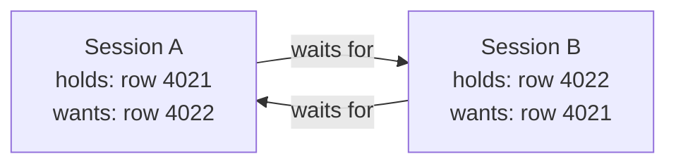

# Deadlocks — Part 1

Two people meet in a narrow corridor. Each steps left to let the other pass. Now
they are face to face again. Each steps right. Face to face again. Neither is
being rude, neither is stuck on their own — they are stuck *because of each
other*, and no amount of politeness resolves it. Someone has to stop and wait.

A database deadlock is exactly that, with locks:

> **📌 A deadlock is a cycle of waiting. Transaction A holds something B needs,
> and B holds something A needs. Neither can proceed, and neither will ever
> give up on its own, because a lock is only released at `COMMIT` or
> `ROLLBACK`.**

The good news is that PostgreSQL detects the cycle and breaks it by killing one
of the transactions. The bad news is that the killed transaction is *your*
request, and if your code does not retry, your user sees a 500.

This part is diagnosis at the source: one deadlock worked through step by step,
what the server does about it, how to read its report, and the five ways
ordinary application code produces one. Part 2 is what you do about it.

## Table of Contents

1. [A Deadlock, Step by Step](#a-deadlock-step-by-step)
2. [How PostgreSQL Responds](#how-postgresql-responds)
3. [Reading the Deadlock Report](#reading-the-deadlock-report)
4. [Cause 1: Inconsistent Ordering](#cause-1-inconsistent-ordering)
5. [Cause 2: Batch Updates in Arbitrary Order](#cause-2-batch-updates-in-arbitrary-order)
6. [Cause 3: Foreign Key Lock Upgrades](#cause-3-foreign-key-lock-upgrades)
7. [Cause 4: Indexes and Constraints You Forgot About](#cause-4-indexes-and-constraints-you-forgot-about)
8. [Cause 5: Lock Upgrades](#cause-5-lock-upgrades)
9. [Common Mistakes](#common-mistakes)
10. [Questions to Test Yourself](#questions-to-test-yourself)
11. [Related](#related)

---

## A Deadlock, Step by Step

Two support agents each merge two invoices. Agent 1 processes invoice 4021 then
4022. Agent 2, working from a different screen, processes 4022 then 4021.

| Time | Session A (agent 1) | Session B (agent 2) |
|---|---|---|
| T1 | `BEGIN;` | `BEGIN;` |
| T2 | `UPDATE invoices SET status='void' WHERE id=4021;` → `UPDATE 1` 🔒 holds 4021 | |
| T3 | | `UPDATE invoices SET status='void' WHERE id=4022;` → `UPDATE 1` 🔒 holds 4022 |
| T4 | `UPDATE invoices SET amount_cents=0 WHERE id=4022;` ⏸ **waits for B** | |
| T5 | | `UPDATE invoices SET amount_cents=0 WHERE id=4021;` ⏸ **waits for A** |
| T6 | ⏸ *(deadlock — neither can move)* | ⏸ |
| T7 | | `ERROR: deadlock detected` — B is killed and rolled back |
| T8 | unblocks → `UPDATE 1` | |
| T9 | `COMMIT;` ✅ | |

Nothing here is a bug in the ordinary sense. Both sessions wrote correct SQL.
Both locked rows they legitimately needed. The problem is only the **order**.

The wait-for graph makes the cycle obvious:



Any cycle in that graph is a deadlock. Two participants is the common case;
three or more is possible and is detected the same way.

---

## How PostgreSQL Responds

PostgreSQL does not check for deadlocks on every lock wait — that would cost
more than it saves, since almost every wait is a normal one that resolves in
milliseconds. Instead:

1. A transaction waits for a lock.
2. After `deadlock_timeout` (default **1 second**), it checks whether it is
   part of a cycle.
3. If there is no cycle, it goes back to waiting — no harm done.
4. If there is a cycle, PostgreSQL picks a **victim** and aborts it with
   SQLSTATE `40P01`. The rest of the cycle proceeds immediately.

> **📌 The victim is chosen by the engine, not by you.** It is typically the
> transaction whose deadlock check ran, not "the newer one" or "the cheaper
> one". Never design around which transaction will survive — assume yours is
> the one that dies, and retry.

There is a real consequence to that 1-second default: **every deadlock costs at
least one second of latency** for the victim, on top of the retry. If a
workload deadlocks frequently, that latency is visible in your p99 long before
anyone notices the error rate.

`deadlock_timeout` also controls when `log_lock_waits` reports a long wait, so
lowering it makes detection faster but makes every lock wait pay a cycle check.
Leave it at the default unless you have measured a reason.

---

## Reading the Deadlock Report

The error the client receives:

```text
ERROR:  deadlock detected
DETAIL:  Process 31902 waits for ShareLock on transaction 5187; blocked by process 29144.
         Process 29144 waits for ShareLock on transaction 5188; blocked by process 31902.
HINT:  See server log for query details.
CONTEXT:  while updating tuple (0,7) in relation "invoices"
SQLSTATE: 40P01
```

That `HINT` is the important line. The client error does **not** include the
statements. The server log does:

```text
2026-09-17 11:42:08.117 UTC [31902] ERROR:  deadlock detected
2026-09-17 11:42:08.117 UTC [31902] DETAIL:  Process 31902 waits for ShareLock on transaction 5187; blocked by process 29144.
        Process 29144 waits for ShareLock on transaction 5188; blocked by process 31902.
        Process 31902: UPDATE invoices SET amount_cents = 0 WHERE id = 4022
        Process 29144: UPDATE invoices SET amount_cents = 0 WHERE id = 4021
2026-09-17 11:42:08.117 UTC [31902] HINT:  See server log for query details.
2026-09-17 11:42:08.117 UTC [31902] STATEMENT:  UPDATE invoices SET amount_cents = 0 WHERE id = 4022
```

How to read it:

| Line | What it tells you |
|---|---|
| `Process 31902: UPDATE ... id = 4022` | The statement the victim was **waiting on** |
| `Process 29144: UPDATE ... id = 4021` | The statement the other side was waiting on |
| `while updating tuple (0,7) in relation "invoices"` | The table, and the physical tuple, involved |

Both statements together are the whole story: **two updates to `invoices`, in
opposite id order.** That is your bug report, and it names the fix.

> **⚠️ The log shows the statement each session was *blocked on*, not the one it
> already succeeded with.** Session A's *first* update (id 4021) is not in the
> log, because it never waited. To reconstruct the full ordering you usually
> need to look at the code paths those two statements come from.

Make sure this reaches you. Deadlocks are logged by default, but check that
`log_lock_waits = on` is set too, so you also see the long waits that did not
quite become deadlocks — they are the early warning.

---

## Cause 1: Inconsistent Ordering

**The most common cause by far.** Two code paths lock the same set of rows in
different orders.

**❌ BROKEN — order depends on the caller's input:**

```ts
// Merging two invoices. Whatever order the UI passed them in is the lock order.
async function mergeInvoices(fromId: number, toId: number) {
  await db.transaction(async (tx) => {
    await tx.query('UPDATE invoices SET status = $1 WHERE id = $2', ['merged', fromId])
    await tx.query('UPDATE invoices SET amount_cents = amount_cents + $1 WHERE id = $2', [amount, toId])
  })
}

mergeInvoices(4021, 4022)   // agent 1: locks 4021 then 4022
mergeInvoices(4022, 4021)   // agent 2: locks 4022 then 4021   ← deadlock
```

**✅ FIXED — impose a canonical order, always ascending id:**

```ts
async function mergeInvoices(fromId: number, toId: number) {
  const lockOrder = [fromId, toId].sort((a, b) => a - b)

  await db.transaction(async (tx) => {
    // Take every lock we will need, up front, in a fixed order.
    await tx.query('SELECT id FROM invoices WHERE id = ANY($1::int[]) ORDER BY id FOR UPDATE', [lockOrder])

    await tx.query('UPDATE invoices SET status = $1 WHERE id = $2', ['merged', fromId])
    await tx.query('UPDATE invoices SET amount_cents = amount_cents + $1 WHERE id = $2', [amount, toId])
  })
}
```

Now both agents lock 4021 first, then 4022. The second one simply waits for the
first — a normal lock wait, resolved in milliseconds, no error.

> **📌 The rule: if two transactions can ever touch the same set of rows, they
> must acquire those rows in the same order.** Ascending primary key is the
> conventional choice because every code path can compute it without
> coordination. Any deterministic order works, as long as everyone agrees.

This rule also has to span *different* operations. "Update user then company"
in one endpoint and "update company then user" in another deadlocks just as
reliably as two copies of the same function.

---

## Cause 2: Batch Updates in Arbitrary Order

A batch update locks rows in whatever order the executor produces them — which
depends on the plan, and can differ between two runs of the same query.

**❌ BROKEN:**

```ts
// Two jobs marking overlapping sets of tasks. Row order is up to the planner.
for (const id of taskIds) {
  await tx.query('UPDATE tasks SET status = $1 WHERE id = $2', ['archived', id])
}
```

If job 1 has `[91, 44, 78]` and job 2 has `[78, 91]`, job 1 locks 91 then 44
then wants 78; job 2 locks 78 then wants 91. Deadlock.

**✅ FIXED — sort the batch:**

```ts
for (const id of [...taskIds].sort((a, b) => a - b)) {
  await tx.query('UPDATE tasks SET status = $1 WHERE id = $2', ['archived', id])
}
```

Better still, do it in one statement with an explicit order:

```sql
UPDATE tasks
SET    status = 'archived'
WHERE  id IN (
  SELECT id FROM tasks
  WHERE  id = ANY($1::int[])
  ORDER  BY id
  FOR    UPDATE
);
```

The inner `ORDER BY id FOR UPDATE` locks rows in ascending order deterministically.
A bare `UPDATE ... WHERE id = ANY(...)` gives you no such guarantee.

Two extra notes:

- Smaller batches deadlock less, because each transaction holds fewer locks for
  less time. See
  [bulk-write-performance](../query-patterns/bulk-write-performance.md).
- A batch that touches thousands of rows is also holding thousands of locks;
  past `max_locks_per_transaction` worth of *table* locks you get a different
  error entirely, but row locks are stored in the tuples themselves and do not
  have that limit.

---

## Cause 3: Foreign Key Lock Upgrades

From [04-locks-part-2.md](04-locks-part-2.md): inserting a child row takes `FOR KEY SHARE` on
the parent. That lock is weak, so it rarely conflicts — until a transaction
that already holds it wants something stronger on the same row.

| Time | Session A | Session B |
|---|---|---|
| T1 | `BEGIN;` | `BEGIN;` |
| T2 | `INSERT INTO users (company_id, email) VALUES (1,'zoe@acme.com');` 🔒 `FOR KEY SHARE` on company 1 | |
| T3 | | `INSERT INTO projects (company_id, name) VALUES (1,'Q4');` 🔒 `FOR KEY SHARE` on company 1 |
| T4 | `UPDATE companies SET plan='enterprise' WHERE id=1;` ⏸ waits for B's key share | |
| T5 | | `UPDATE companies SET seats=50 WHERE id=1;` ⏸ waits for A's key share |
| T6 | | `ERROR: deadlock detected` |

Both sessions held a compatible weak lock on the *same parent row*, then both
tried to upgrade. Neither can, because each is waiting for the other to release
the weak one.

**The fix is the general one: take the strong lock first.**

```sql
BEGIN;
SELECT id FROM companies WHERE id = 1 FOR UPDATE;   -- strongest lock, up front
INSERT INTO users (company_id, email) VALUES (1, 'zoe@acme.com');
UPDATE companies SET plan = 'enterprise' WHERE id = 1;
COMMIT;
```

Now the second session queues at the very first statement instead of deadlocking
half way through. You have traded a deadlock for a lock wait, which is exactly
the trade you want.

The better fix, where you can arrange it: **do not update the parent row in
transactions that insert children.** A `companies` row touched by every signup
is a contention magnet regardless of deadlocks
([04-locks-part-2.md](04-locks-part-2.md#advanced-hot-rows-and-contention)).

---

## Cause 4: Indexes and Constraints You Forgot About

Deadlocks can come from locks you never asked for, on objects you did not name
in your query.

**Unique indexes.** Two concurrent inserts of the same unique value make one
wait on the other's index entry until that transaction commits or rolls back.
Two transactions each inserting `('a','b')` and `('b','a')` into a table unique
on that column can deadlock on index entries alone — no row of yours is
involved.

```sql
-- Both sessions run this, with the two emails swapped
INSERT INTO users (company_id, email) VALUES (1, 'ana@acme.com'), (1, 'ben@acme.com');
```

Session A inserts `ana` then `ben`; session B inserts `ben` then `ana`. Deadlock
on the unique index. **Fix:** sort the values inside the batch, the same rule as
cause 2.

**Unindexed foreign keys.** A `DELETE` on a parent must check every child table.
Without an index on the child's FK column, that check is a sequential scan
holding locks for much longer than you expect, widening the window for a cycle.
**Fix:** index every foreign key column. (It is also the right call for query
performance — see
[composite-index-ordering](../query-optimization/composite-index-ordering.md).)

**Triggers.** A trigger can write to a table your statement never mentions, in
an order you never chose. If deadlock reports name a table your code does not
touch, look for a trigger.

**`ON CONFLICT`.** An upsert takes locks in its conflict-detection path too; two
upserts on overlapping key sets in different orders deadlock like any other pair.

---

## Cause 5: Lock Upgrades

A generalisation of cause 3, and worth naming on its own: a transaction that
takes a **weak** lock and later wants a **strong** lock on the same row is a
deadlock waiting to happen.

**❌ BROKEN — read with a share lock, then upgrade:**

```sql
BEGIN;
SELECT amount_cents FROM invoices WHERE id = 4021 FOR SHARE;   -- weak
-- ... application logic ...
UPDATE invoices SET amount_cents = 30000 WHERE id = 4021;      -- wants strong
COMMIT;
```

Two sessions can both hold `FOR SHARE` on invoice 4021 simultaneously — that is
what "share" means. Then both want `FOR UPDATE`, and each is blocked by the
other's share lock. Guaranteed deadlock under concurrency.

**✅ FIXED — take the lock you will eventually need, immediately:**

```sql
BEGIN;
SELECT amount_cents FROM invoices WHERE id = 4021 FOR UPDATE;  -- strong, up front
-- ... application logic ...
UPDATE invoices SET amount_cents = 30000 WHERE id = 4021;
COMMIT;
```

> **📌 The general principle behind causes 1, 3 and 5: acquire locks **up
> front** and in a **fixed order**, rather than progressively as the code
> discovers it needs them. Progressive acquisition is what creates cycles.**

---

## Common Mistakes

| Mistake | Why it is wrong | Do this instead |
|---|---|---|
| Assuming your transaction wins | The victim is chosen by the engine | Assume you lose; retry |
| Lowering `deadlock_timeout` to "fix" deadlocks | It only detects them sooner, and costs checks on every wait | Fix the lock ordering |
| `FOR SHARE` then `UPDATE` | A guaranteed upgrade deadlock | `FOR UPDATE` up front |
| Batch updates in caller order | Non-deterministic lock order | `ORDER BY id` before locking |

---

## Questions to Test Yourself

1. Define a deadlock in one sentence, and say why the participants cannot
   resolve it themselves.
2. Draw the two-session timeline for a classic two-row deadlock, and the
   wait-for graph.
3. How does PostgreSQL detect a deadlock, and how long does it take by default?
   What latency cost does that imply?
4. Which two lines of the server log tell you the cause? Why is the *first*
   statement of each transaction missing?
5. Name the five common causes from this file, and give the fix for each.
6. Why does "always lock rows in ascending id order" work? What makes ascending
   id a good choice specifically?
7. Explain a lock-upgrade deadlock. Why is `FOR SHARE` followed by `UPDATE`
   dangerous?

---

> **➡️ Continued in [Part 2](./05-deadlocks-part-2.md)**

---

## Related

- [Part 2](05-deadlocks-part-2.md) — the retry loop, making a retry safe,
  reducing deadlock frequency, and the after-the-fact runbook.
- [Locks](04-locks-part-1.md) — the row and table locks that form the cycle.
- [Locks, Part 2](04-locks-part-2.md) — foreign key locking and hot rows, the
  mechanisms behind causes 3 and 5.
- [Optimistic vs Pessimistic Locking](06-optimistic-vs-pessimistic-locking-part-1.md)
  — how avoiding locks changes the deadlock picture.
- [bulk-write-performance](../query-patterns/bulk-write-performance.md) — batch
  sizing, which is also a deadlock lever.
