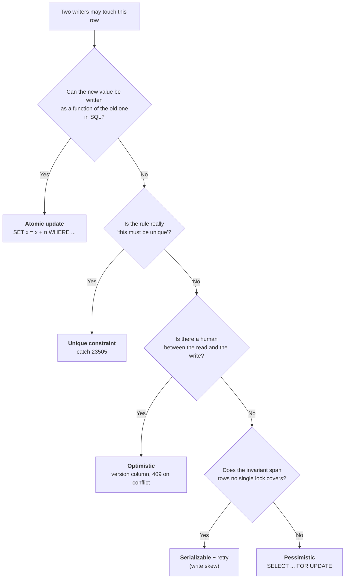

# Optimistic vs Pessimistic Locking — Part 2

Part 1 compared the two strategies that assume a conflict must be prevented or
detected. This part is about the third answer — writing the change so that no
conflict is possible — and about what you can do with a real conflict besides
telling the user "no": unique constraints, `ON CONFLICT`, merge strategies, and
the HTTP form of the same pattern.

> **⬅️ This continues [Part 1](./06-optimistic-vs-pessimistic-locking-part-1.md).**

> **📌 In one line:** the cheapest concurrency control is the one you never
> write — let a single SQL statement or a constraint express the rule, and
> reserve versions and locks for the cases where the user's intent really can
> collide.

## Table of Contents

1. [The Middle Ground: Atomic In-Place Updates](#the-middle-ground-atomic-in-place-updates)
2. [Unique Constraints as Concurrency Control](#unique-constraints-as-concurrency-control)
3. [INSERT ... ON CONFLICT for Idempotent Upserts](#insert--on-conflict-for-idempotent-upserts)
4. [Conflict Resolution Beyond Rejecting](#conflict-resolution-beyond-rejecting)
5. [Applying This to Real SaaS Cases](#applying-this-to-real-saas-cases)
6. [Advanced: ETags, If-Match, and ORM Version Columns](#advanced-etags-if-match-and-orm-version-columns)
7. [Common Mistakes](#common-mistakes)
8. [Questions to Test Yourself](#questions-to-test-yourself)
9. [Related](#related)

---

## The Middle Ground: Atomic In-Place Updates

Before choosing between optimistic and pessimistic, ask whether you need either.

> **📌 If the new value can be expressed as a function of the old value in SQL,
> the whole race disappears.** A single statement reads and writes the row
> under one lock, taken and released inside the statement. Nothing can
> interleave.

```sql
-- ❌ BROKEN: read-modify-write in application code
-- SELECT amount_cents FROM invoices WHERE id = 4021;   → 25000
-- UPDATE invoices SET amount_cents = 30000 WHERE id = 4021;

-- ✅ FIXED: the arithmetic happens in the database
UPDATE invoices
SET    amount_cents = amount_cents + 5000
WHERE  id = 4021;
```

The pattern extends to guarded decrements, which is how you handle stock, seats
and balances:

```sql
-- Take a seat, but only if one is available. Atomic.
UPDATE companies
SET    seats_used = seats_used + 1
WHERE  id = 1
  AND  seats_used < seats_total
RETURNING seats_used, seats_total;
```

If no seat is free, the `WHERE` fails and you get `UPDATE 0` — which your code
checks, and turns into "no seats available". Two simultaneous requests can never
both succeed on the last seat, because the second one evaluates its `WHERE`
against the row the first one already wrote.

A balance withdrawal, same shape:

```sql
UPDATE accounts
SET    balance_cents = balance_cents - 10000
WHERE  id = 55
  AND  balance_cents >= 10000
RETURNING balance_cents;
```

**No `SELECT` first.** The check and the change are one statement, so there is
no window between them. Attempting the check separately —
`SELECT balance` then `if (balance >= 10000) UPDATE` — is the lost update all
over again.

Why this is the preferred solution whenever it applies:

| | Atomic update | Pessimistic | Optimistic |
|---|---|---|---|
| Round trips | 1 | 2+ inside a transaction | 2, plus retries |
| Extra schema | None | None | A `version` column |
| Can conflict? | No | No (it waits) | Yes (it retries) |
| Code complexity | One statement | Transaction management | Version plumbing + conflict UI |

Its limit is expressiveness. `balance = balance - 100` is expressible.
"Recalculate the invoice total by re-running the pricing engine over every line
item, applying the customer's contract rules" is not. When the new value cannot
be computed in SQL, you are back to choosing optimistic or pessimistic.

---

## Unique Constraints as Concurrency Control

The other way to make the database do the work: let it **reject** the duplicate
instead of checking first.

**❌ BROKEN — check-then-insert, a race in two statements:**

```ts
const existing = await db.maybeOne('SELECT id FROM users WHERE email = $1', [email])
if (existing) throw new ConflictError('email already registered')
await db.query('INSERT INTO users (company_id, email, name) VALUES ($1,$2,$3)', [companyId, email, name])
```

Two signups with the same email, one millisecond apart: both `SELECT`s find
nothing, both `INSERT`s succeed, and you have two accounts with the same email.
Every login, password reset and billing lookup is now ambiguous.

**✅ FIXED — let the constraint decide:**

```sql
CREATE UNIQUE INDEX users_email_key ON users (lower(email));
```

```ts
try {
  await db.query('INSERT INTO users (company_id, email, name) VALUES ($1,$2,$3)', [companyId, email, name])
} catch (err: any) {
  if (err.code === '23505') throw new ConflictError('email already registered')   // unique_violation
  throw err
}
```

The constraint is checked inside the insert, atomically, with no window. It is
also enforced against **every** writer — a migration, a script, a second
service, a developer in `psql`. Application-level checks protect only the code
paths that remember to call them.

> **📌 A constraint is the cheapest concurrency control there is.** It needs no
> lock, no version column, no retry loop, and no cooperation from callers. Reach
> for it before anything else in this file.

Partial unique indexes let you express surprisingly specific invariants:

```sql
-- At most one active project per name, per company (archived ones may repeat)
CREATE UNIQUE INDEX projects_active_name_key
  ON projects (company_id, lower(name))
  WHERE archived_at IS NULL;

-- Exactly one primary payment method per company
CREATE UNIQUE INDEX one_primary_payment_method
  ON payment_methods (company_id)
  WHERE is_primary;
```

See [partial-indexes](../query-optimization/partial-indexes.md) for the indexing
side of this.

---

## INSERT ... ON CONFLICT for Idempotent Upserts

When a duplicate is *expected* rather than an error — a webhook delivered twice,
a retried request, a sync job re-running — `ON CONFLICT` turns it into a no-op:

```sql
-- Ignore the duplicate entirely
INSERT INTO payments (invoice_id, amount_cents, provider_ref)
VALUES (4021, 25000, 'pi_3Nx...')
ON CONFLICT (provider_ref) DO NOTHING;

-- Or merge into the existing row
INSERT INTO notifications (user_id, type, read_at)
VALUES (77, 'task_assigned', NULL)
ON CONFLICT (user_id, type) DO UPDATE
SET    created_at = EXCLUDED.created_at;
```

Two things to know:

**`DO NOTHING` reports `INSERT 0 0`.** If you need to know whether the row was
new, use `RETURNING` — which returns no rows when nothing was inserted:

```sql
INSERT INTO payments (invoice_id, amount_cents, provider_ref)
VALUES (4021, 25000, 'pi_3Nx...')
ON CONFLICT (provider_ref) DO NOTHING
RETURNING id;          -- zero rows = it was already there
```

**`ON CONFLICT` needs a unique index to conflict on.** There is no way to upsert
on a non-unique predicate. If the constraint does not exist, create it — and
notice that this makes the unique constraint the real mechanism again.

This is the database half of
[idempotency](../../system-design/reliability/idempotency.md). Combined with the
retry loops in [05-deadlocks-part-2.md](05-deadlocks-part-2.md), it is what makes "at least
once" delivery behave like "exactly once".

---

## Conflict Resolution Beyond Rejecting

Optimistic locking detects a conflict. It does not say what to do about it.
Three strategies:

**1. Last-write-wins.** Ignore the version entirely; the later save overwrites.
Simple, and *sometimes correct* — for a `last_seen_at` timestamp or a cached
counter, the newest value is genuinely the right one. For anything a human
typed, it is data loss with extra steps.

**2. Field-level merge.** Ana changed `amount_cents`, Ben changed `due_date`.
They do not overlap, so apply both. You can do this in the database by updating
only the fields the user actually changed:

```sql
UPDATE invoices
SET    due_date = $1,          -- only the field Ben edited
       version  = version + 1
WHERE  id = 4021
  AND  version = 7;
```

Then the conflict only fires when two users edited the *same field* — which is
much rarer and much more clearly a real conflict. This needs the client to send
a patch rather than the whole object, which fits `PATCH` semantics well.

**3. Show the user a diff.** Re-fetch the current row, display "Ana changed the
amount from 25000 to 30000 while you were editing", and let the human choose.
This is the most honest and by far the most work.

Be honest about how far to take this:

> **⚠️ Automatic merging of conflicting edits is hard, and usually not worth
> it.** Real merge — operational transforms, CRDTs, three-way merge — is a large
> engineering investment that makes sense for a collaborative editor and almost
> nowhere else. For a business CRUD app, a clear 409 with a re-fetch is the
> right answer, and field-level merge is a good cheap improvement on it.

A practical middle path most apps land on:

| Field type | Strategy |
|---|---|
| Free text a human typed | Reject with 409, show the diff |
| A status or enum | Reject — the two choices genuinely conflict |
| A timestamp like `last_seen_at` | Last-write-wins |
| A counter | Atomic update, never optimistic |
| Independent fields on the same row | Field-level merge via `PATCH` |

---

## Applying This to Real SaaS Cases

The decision, as a flowchart you can run in your head:



The table that makes this concrete:

| Case | Approach | Why |
|---|---|---|
| **Editing a task description** | Optimistic (`version`) | Long human gap between read and write; conflicts rare; a 409 is understandable |
| **Decrementing seats on a plan** | Atomic update with a guard | `SET seats_used = seats_used + 1 WHERE seats_used < seats_total` — no lock, no retry, cannot oversell |
| **Processing a payment** | Pessimistic (`FOR UPDATE`) + idempotency key | Short server-side critical section; high correctness bar; the key makes webhook retries safe |
| **Assigning the next job from a queue** | `FOR UPDATE SKIP LOCKED` | Workers must not collide, and must not queue behind each other ([04-locks-part-1.md](04-locks-part-1.md#skip-locked-and-nowait)) |
| **Registering a user email** | Unique constraint | The database rejects duplicates with no check-then-insert race |
| **Marking a notification read** | Atomic update, or last-write-wins | `SET read_at = coalesce(read_at, now())`; no conflict possible |
| **Two admins both resigning** | Serializable + retry | Write skew — no single row lock covers it ([02](02-isolation-levels-and-anomalies-part-1.md#write-skew)) |
| **Bulk importing rows** | `ON CONFLICT DO NOTHING` | Re-running the import is a no-op |
| **Updating a company plan from the admin UI** | Optimistic | Rare, human-driven, and you want a visible conflict |

Notice how few rows say "pessimistic". That is representative: `FOR UPDATE` is
the right tool for short server-side critical sections, and in a typical
application most conflicts are better handled by a constraint, an atomic update,
or a version column.

---

## Advanced: ETags, If-Match, and ORM Version Columns

**Optimistic locking over HTTP.** The version-column pattern has an exact
equivalent at the HTTP layer, and it is the same idea wearing different names.

```text
GET /invoices/4021
200 OK
ETag: "7"
Content-Type: application/json

{ "id": 4021, "amount_cents": 25000, "status": "open" }
```

```text
PATCH /invoices/4021
If-Match: "7"
Content-Type: application/json

{ "amount_cents": 30000 }
```

| Outcome | Response |
|---|---|
| The resource is still at version 7 | `200 OK`, new `ETag: "8"` |
| Someone else saved first | `412 Precondition Failed` |
| No `If-Match` header sent at all | `428 Precondition Required`, if you want to require it |

Map it straight onto the database:

| HTTP | Database |
|---|---|
| `ETag: "7"` | `SELECT ... version` → 7 |
| `If-Match: "7"` | `WHERE id = 4021 AND version = 7` |
| `412 Precondition Failed` | `UPDATE 0` |

The elegance is that the client never has to know about your `version` column —
it just echoes back the `ETag` it was given. And it works perfectly across a
stateless API, which is exactly where pessimistic locking cannot go.

Header details, cache semantics, and weak versus strong ETags are in
[headers](../../backend-fundamentals/01-http-foundations/05-headers.md).

**ORMs usually have this built in.** Most mature ORMs provide a version column
that they manage for you:

```ts
// The ORM adds `AND version = 7` to the UPDATE and bumps the column itself.
// A mismatch throws, rather than returning rowCount 0.
@Entity()
class Invoice {
  @PrimaryGeneratedColumn() id!: number
  @Column() amountCents!: number
  @VersionColumn() version!: number     // ← managed automatically
}
```

Three things to check before relying on it:

1. **It must throw, not return zero rows.** Confirm your ORM raises an
   optimistic-lock exception; some query builders quietly return a row count.
2. **Bulk updates usually bypass it.** An ORM's `updateMany` or a raw query
   often skips version handling entirely.
3. **It only protects writes that go through the ORM.** A migration, a
   background script or a second service writing raw SQL will not bump the
   version — and then the check silently stops meaning anything.

That last point is the general lesson of this whole file:

> **📌 A constraint is enforced by the database against every writer. A version
> column is enforced by whoever remembers to check it.** Prefer the constraint
> or the atomic update when you can express the rule that way, and use
> optimistic locking for the cases — human-edited records across a stateless
> API — where nothing else fits.

The application-architecture side of this, including where the version travels
through your layers, is in
[orm-vs-query-builder](../../backend-fundamentals/10-database-integration/01-orm-vs-query-builder.md).

---

## Common Mistakes

| Mistake | Why it is wrong | Do this instead |
|---|---|---|
| Read-modify-write when SQL arithmetic would do | Reintroduces the lost update for no reason | `SET x = x + n WHERE ...` |
| `SELECT balance` then `if (ok) UPDATE` | A race window between the check and the change | Put the check in the `UPDATE`'s `WHERE` |
| Check-then-insert for uniqueness | Two concurrent requests both pass the check | A unique index and catching `23505` |
| Returning `500` on an optimistic conflict | It is an expected outcome, not a server fault | `409 Conflict`, or `412` with `If-Match` |
| Building automatic merge for a CRUD app | Large investment, rarely worth it | A clear 409 with a diff; field-level merge if cheap |
| Trusting an ORM version column while scripts write raw SQL | Those writes do not bump the version | Constraints for rules that must hold for every writer |

---

## Questions to Test Yourself

1. Rewrite "read the balance, check it is at least 10000, subtract 10000" as a
   single safe statement.
2. Why is a unique constraint better than a check-then-insert? Name two
   properties an application-level check does not have.
3. What does `ON CONFLICT DO NOTHING` return, and how do you find out whether
   the row was actually inserted?
4. Name three conflict-resolution strategies beyond rejecting, and say when
   each is appropriate.
5. Choose a strategy, with a reason, for: editing a task description,
   decrementing seats, processing a payment, and assigning a queued job.
6. Map `ETag` and `If-Match` onto the database-level optimistic locking
   pattern. What HTTP status corresponds to `UPDATE 0`?

---

## Related

- [Part 1](06-optimistic-vs-pessimistic-locking-part-1.md) — the pessimistic
  and optimistic patterns themselves, the affected row count, and how the two
  compare.
- [Locks](04-locks-part-1.md) — `SELECT ... FOR UPDATE`, `SKIP LOCKED`, and
  what pessimistic locking actually costs.
- [Isolation Levels and Anomalies](02-isolation-levels-and-anomalies-part-1.md)
  — the lost update and the write skew these patterns answer.
- [Deadlocks](05-deadlocks-part-2.md) — the retry loop an optimistic conflict
  shares with a deadlock.
- [Transactions and ACID](01-transactions-and-acid-part-2.md) — why the
  pessimistic transaction must stay short.
- [idempotency](../../system-design/reliability/idempotency.md) — the
  idempotency key that pairs with pessimistic payment handling.
- [partial-indexes](../query-optimization/partial-indexes.md) — unique
  constraints that apply to only some rows.
- [headers](../../backend-fundamentals/01-http-foundations/05-headers.md) —
  `ETag`, `If-Match` and conditional requests in full.
- [orm-vs-query-builder](../../backend-fundamentals/10-database-integration/01-orm-vs-query-builder.md)
  — built-in version columns and where the transaction boundary belongs.
