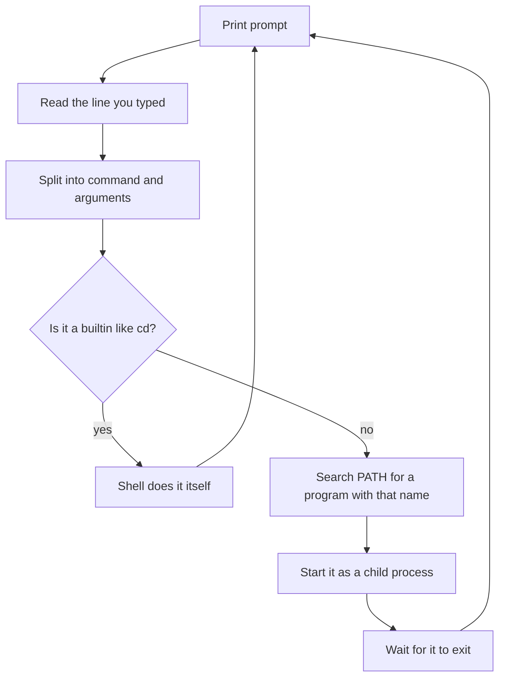

# The Shell and the Filesystem — Part 1

You have written backend code for a year and a half. Every line of it ran on a
Linux machine, and you have probably never looked at that machine. This file is
the first look. It covers the two things every other file in this track assumes:
the **shell** (the program that runs your commands) and the **filesystem**
(where everything lives). Open a terminal and type along — reading about `ls`
teaches you nothing, and reading its output is the whole skill.

> **➡️ Continued in [Part 2](01-the-shell-and-filesystem-part-2.md).**

> **📌 In one line:** a shell is a program that reads a line of text and runs
> other programs, and a Linux filesystem is one single tree starting at `/` — so
> every command you will ever run is "find this program, give it these paths".

## Table of Contents

1. [What a Shell Actually Is](#what-a-shell-actually-is)
2. [One Tree, No Drive Letters](#one-tree-no-drive-letters)
3. [The Directories a Backend Developer Meets](#the-directories-a-backend-developer-meets)
4. [Paths: Absolute, Relative, and Why `./script.sh` Needs the `./`](#paths-absolute-relative-and-why-scriptsh-needs-the-)
5. [Moving Around: `pwd`, `cd`, `ls`](#moving-around-pwd-cd-ls)
6. [Reading `ls -lah` Column by Column](#reading-ls-lah-column-by-column)
7. [Seeing Structure: `tree`](#seeing-structure-tree)
8. [Reading Files Without an Editor](#reading-files-without-an-editor)
9. [`tail -f`: The One You Will Use Most](#tail-f-the-one-you-will-use-most)
10. [Finding Things: `find`, `grep -r`, `which`](#finding-things-find-grep-r-which)
11. [BROKEN vs FIXED: The Path That Only Works On Your Laptop](#broken-vs-fixed-the-path-that-only-works-on-your-laptop)
12. [Common Mistakes](#common-mistakes)
13. [Questions to Test Yourself](#questions-to-test-yourself)
14. [Related](#related)

---

## What a Shell Actually Is

A **shell** is just a program. In a loop it prints a prompt, reads the line you
type, splits it into a command name and arguments, then finds a program with
that name and runs it. That is all. `bash` and `zsh` are ordinary programs
sitting in a directory, exactly like `node` is.



**Why this framing matters.** Beginners treat shell commands as magic words the
terminal understands. They are not. `ls` is a file on disk at `/usr/bin/ls`.
When you type `ls`, the shell searches a list of directories called `PATH`,
finds that file, and runs it as a **child process** — the same mechanism your
Node app uses to start a child process.

Three consequences follow, and they explain most beginner confusion:

- **"command not found" is not a spelling complaint.** It means the shell looked
  through every directory in `PATH` and found no file with that name.
- **A command's output is just text the program printed.** Nothing is
  structured. That is why the tools in Part 2 are all about filtering text.
- **`cd` is special.** It is a *builtin*: the shell does it itself rather than
  running a program. It has to be, because a child process cannot change its
  parent's directory. You meet this again in file 05, when a variable you
  `export` in your shell turns out to be invisible to a systemd service.

```text
$ echo $PATH
/usr/local/sbin:/usr/local/bin:/usr/sbin:/usr/bin:/sbin:/bin
```

`PATH` is a list of directories separated by `:`. The shell searches them left to
right and runs the **first** match. That ordering is why a Node version manager
can put its own `node` ahead of the system one.

---

## One Tree, No Drive Letters

On Windows you have `C:\`, `D:\` and so on — several separate trees. Linux has
exactly **one** tree, starting at `/`, the **root directory**. A second hard
disk does not become `D:`. It gets *attached* ("mounted") at a directory inside
that one tree, for example `/mnt/data`, and from then on its files are reached
through ordinary paths. Code never needs to know which disk a path is on.

```text
/
├── etc                  system and service configuration
├── home/deploy          your user's own files
├── opt                  software you installed by hand (your app)
├── proc                 live kernel and process information, not real files
├── tmp                  scratch space, wiped on reboot
├── usr/bin              nearly every command you type
└── var
    ├── lib              data that programs own (Postgres data lives here)
    └── log              log files
```

> **📌 Remember:** everything is a path from `/`. That is why a path in a Docker
> container, on your laptop and on the server all look the same, and why
> `/var/log/saas-api/app.log` is portable in a way `C:\logs\app.log` never was.

---

## The Directories a Backend Developer Meets

You will not touch most of the tree. These are the ones that come up in real
work.

| Directory | What it holds | Why you will go there |
|---|---|---|
| `/etc` | Configuration files for the system and installed services | nginx config, Postgres config, `/etc/hosts`, systemd unit files |
| `/var/log` | Log files written by the system and by services | The first place you look when something broke |
| `/home/<user>` | One directory per normal user | Your SSH keys (`~/.ssh`), your shell config |
| `/opt` | Software installed outside the package manager | Where a hand-deployed Node app usually lives |
| `/tmp` | Scratch files, world-writable, cleared on reboot | Upload staging. Never store anything you need |
| `/usr/bin` | Nearly every command you type | `node`, `git`, `ls`, `grep` |
| `/usr/local/bin` | Programs installed by you or a script, not the package manager | Often where a manually installed `node` ends up |
| `/var/lib` | Data owned by services | `/var/lib/postgresql` is the actual database |
| `/proc` | A fake filesystem showing live kernel state | `/proc/<pid>/` describes a running process |
| `/dev` | Devices represented as files | `/dev/null`, where you throw output away |

Two deserve a note. **`/proc` is not real** — its files do not exist on disk,
and the kernel invents their contents when you read them. That is how `ps` and
`top` work internally. **`/tmp` is shared and temporary** — every user can write
there, and files are gone after a reboot. An app that writes uploads to `/tmp`
loses them on the next restart. That is a real bug people ship.

```text
$ cat /proc/loadavg
0.42 0.31 0.28 2/412 18234
```

---

## Paths: Absolute, Relative, and Why `./script.sh` Needs the `./`

An **absolute path** starts with `/` and means the same thing no matter where
you are standing: `/var/log/saas-api/app.log`. A **relative path** does not, and
is interpreted from your **current working directory**: `logs/app.log` means
"the `logs` directory inside wherever I am right now". Four shortcuts appear
everywhere:

| Symbol | Means | Example |
|---|---|---|
| `.` | The current directory | `./deploy.sh` |
| `..` | The parent directory | `cd ../..` goes up two levels |
| `~` | Your home directory, e.g. `/home/deploy` | `cd ~/projects` |
| `-` | The directory you were in before | `cd -` jumps back |

Now the question that confuses everyone.

**Why does running a script need `./script.sh` instead of `script.sh`?**

Because when a command has no `/` in it, the shell treats it as a *name* and
searches `PATH`. Your current directory is **not** in `PATH`, deliberately. If
`.` were in `PATH`, then changing into a directory someone else can write to and
typing `ls` could run *their* program called `ls`. That is a classic attack.

Adding `./` turns the name into a path, and a path containing `/` is used
directly with no searching.

```text
$ deploy.sh
bash: deploy.sh: command not found

$ ./deploy.sh
bash: ./deploy.sh: Permission denied

$ chmod +x deploy.sh
$ ./deploy.sh
Deploying saas-api...
```

The two errors are different. "command not found" means the shell could not find
it. "Permission denied" means it found it but the file is not marked executable
— see [03-users-permissions-and-ssh-part-1.md](03-users-permissions-and-ssh-part-1.md).

---

## Moving Around: `pwd`, `cd`, `ls`

`pwd` prints the working directory. When you are lost, this is the first thing
to run.

```text
$ pwd
/home/deploy

$ cd ~/projects/saas-api
$ pwd
/home/deploy/projects/saas-api

$ cd ..
$ pwd
/home/deploy/projects

$ cd -
/home/deploy/projects/saas-api
```

`ls` lists a directory. On its own it prints names and nothing else, which hides
the information you actually need. Use `ls -lah`: `-l` is long format (one file
per line with all the details), `-a` shows hidden files (anything starting with
`.`, like `.env`), and `-h` gives human-readable sizes (`1.4M` rather than
`1468006`).

> **💡 Tip:** make `ls -lah` muscle memory. The `-a` is what shows you the
> `.env` file you forgot existed, and the `.git` directory making your deploy
> artifact 400 MB.

---

## Reading `ls -lah` Column by Column

This is the first real "read the output" exercise. Everything later in this
track depends on doing it without thinking.

```text
$ ls -lah /var/log/saas-api
total 48M
drwxr-xr-x  2 deploy deploy 4.0K Oct  4 09:14 .
-rw-r--r--  1 deploy deploy  47M Oct  4 09:21 app.log
-rw-r--r--  1 deploy deploy 1.2M Oct  3 00:00 app.log.1
-rw-r-----  1 deploy adm     18K Oct  4 09:20 error.log
lrwxrwxrwx  1 root   root      9 Oct  1 03:12 current -> app.log
```

Take the `app.log` line apart, field by field:

```text
-rw-r--r--   1   deploy  deploy   47M   Oct  4 09:21   app.log
│││ │  │     │   │       │        │     │              │
│││ │  │     │   │       │        │     │              └─ name
│││ │  │     │   │       │        │     └─ last modified time
│││ │  │     │   │       │        └─ size (with -h)
│││ │  │     │   │       └─ group that owns it
│││ │  │     │   └─ user that owns it
│││ │  │     └─ number of hard links (ignore it for now)
│││ │  └─ permissions for everyone else
│││ └─ permissions for the group
││└─ permissions for the owner
│└─ (part of the owner block)
└─ file type
```

**The first character is the file type**, and it is the one people skip: `-` is
an ordinary file, `d` a directory, `l` a symbolic link (a pointer to another
path), `c` or `b` a device. So above, `app.log` is a file, `.` is a directory,
and `current` is a symlink pointing at `app.log`.

**The next nine characters are three groups of three**: owner, group, everyone
else, each read/write/execute. `-rw-r--r--` means the owner can read and write,
and everyone else can only read. The full explanation — and the `640` style
numbers — is in
[03-users-permissions-and-ssh-part-1.md](03-users-permissions-and-ssh-part-1.md).

**What this listing tells you, without running anything else:**

- `app.log` is 47 MB and was written 7 minutes ago, so the service is alive.
- `app.log.1` exists, so log rotation is configured. Good.
- `error.log` is readable only by the `adm` group, not by a normal user.
- The total is 48 MB, so if the disk is full this is not the culprit.

Two more flags are worth knowing: `-S` sorts biggest first, `-t` sorts newest
first. `ls -laht` is the one you want during an incident, because the file that
just changed goes to the top.

---

## Seeing Structure: `tree`

`tree` draws a directory as a tree. It is not installed by default on most
servers, so install it or fall back to `find`.

```text
$ tree -L 2 -I node_modules /opt/saas-api
/opt/saas-api
├── build
│   └── bin
├── node_modules  [error opening dir]
├── package.json
└── storage
    └── uploads

4 directories, 1 file
```

`-L 2` limits the depth and `-I node_modules` ignores a pattern. Both matter:
without them, `tree` on a Node project prints tens of thousands of lines.

---

## Reading Files Without an Editor

On a server you often just want to *look* at a file. Opening an editor risks
changing it by accident.

**`cat`** prints the whole file and exits. Perfect for `/etc/hostname`, terrible
for a 47 MB log — it will flood your terminal. **`head`** prints the first lines
and **`tail`** the last. Both default to 10.

```text
$ head -n 2 /var/log/saas-api/app.log
{"level":30,"time":"2026-10-04T06:00:01.112Z","msg":"server listening on 3333"}
{"level":30,"time":"2026-10-04T06:00:01.340Z","msg":"database pool ready"}

$ tail -n 2 /var/log/saas-api/app.log
{"level":50,"time":"2026-10-04T09:21:44.002Z","msg":"invoice send failed","invoiceId":8812}
{"level":30,"time":"2026-10-04T09:21:45.118Z","msg":"request completed","status":200}
```

`head` answers "did this service start cleanly?". `tail` answers "what was it
doing when it died?". **`less`** is a pager: `less /var/log/saas-api/app.log`
shows one screen at a time and lets you scroll and search. Use it on big files.

**How to get out of `less`.** This genuinely traps people, so here it is
plainly: press **`q`**. Not `Ctrl+C`, not `Esc`, not closing the terminal.

| Key | Does |
|---|---|
| `q` | Quit. This is the one you need |
| `Space` / `b` | Next page / previous page |
| `/text` then `Enter`, then `n` | Search forward, then jump to the next match |
| `G` / `g` | Jump to the end / start of the file |
| `F` | Follow the file as it grows, like `tail -f`. `Ctrl+C` stops it |

> **💡 Tip:** `less +G /var/log/saas-api/app.log` opens at the end of the file,
> which is almost always where you want to be in a log.

---

## `tail -f`: The One You Will Use Most

`tail -f` prints the end of a file and then **keeps printing new lines as they
are written**. Leave it running in one terminal, trigger a request in another,
and watch your own log appear.

```text
$ tail -f /var/log/saas-api/app.log
{"level":30,"time":"2026-10-04T09:30:11.004Z","msg":"request started","url":"/api/invoices"}
{"level":30,"time":"2026-10-04T09:30:11.182Z","msg":"invoice created","invoiceId":8813}
{"level":30,"time":"2026-10-04T09:30:11.201Z","msg":"request completed","status":201}
^C
```

Press `Ctrl+C` to stop following. Two variants worth knowing:

```text
$ tail -n 100 -f /var/log/saas-api/app.log   # last 100 lines, then follow
$ tail -F /var/log/saas-api/app.log          # keep following across rotation
```

`-F` (capital) matters more than it looks. When `logrotate` renames `app.log` to
`app.log.1` and creates a fresh one, plain `tail -f` keeps following the *old,
renamed* file and goes silent forever. `-F` notices and reopens — see
[05-logs-disks-and-debugging-part-1.md](05-logs-disks-and-debugging-part-1.md).

> **📌 Remember:** for a systemd-managed service the equivalent is
> `journalctl -u saas-api -f`. Same idea, different source.

---

## Finding Things: `find`, `grep -r`, `which`

Three different questions, three different tools.

**`find` — "where is the file with this name?"**

```text
$ find /home/deploy/projects/saas-api -name ".env*" -not -path "*/node_modules/*"
/home/deploy/projects/saas-api/.env
/home/deploy/projects/saas-api/.env.example
```

The shape is always `find <where> <test>`. The tests you will actually use:

| Test | Finds |
|---|---|
| `-name "*.log"` / `-iname "*.LOG"` | By name; `-i` ignores case |
| `-type f` / `-type d` | Only files / only directories |
| `-mtime -1` | Modified in the last 24 hours |
| `-size +100M` | Larger than 100 MB |
| `-not -path "*/node_modules/*"` | Skip a subtree |

The disk-full hunt in file 05 is mostly `find / -size +500M -type f`.

> **⚠️ Warning:** quote the pattern. `find . -name *.log` lets the **shell**
> expand `*.log` before `find` ever sees it, giving confusing errors.
> `find . -name "*.log"` passes it through. Globs versus tool patterns are
> covered in [Part 2](01-the-shell-and-filesystem-part-2.md).

**`grep -r` — "which file contains this text?"**

```text
$ grep -rn "DB_HOST" /home/deploy/projects/saas-api --include="*.ts"
config/database.ts:12:  host: env.get('DB_HOST'),
config/database.ts:41:  host: env.get('DB_HOST'),
```

`-r` is recursive, `-n` adds line numbers (always use it), `-i` ignores case,
and `--include="*.ts"` restricts which files are searched. On a Node project
that last flag is the difference between 0.2 and 40 seconds.

**`which` / `command -v` — "where does this program come from?"**

```text
$ which -a node
/home/deploy/.nvm/versions/node/v22.14.0/bin/node
/usr/bin/node
```

This solves "it works when I run it, but the systemd service says
`node: command not found`". Your interactive shell loads a version manager that
puts a different `node` first in `PATH`; a systemd service does not load your
shell config, so it sees only `/usr/bin/node` — or nothing. The fix is the
absolute path in the unit file, in
[02-processes-and-services-part-2.md](02-processes-and-services-part-2.md).
`command -v` is the more portable of the two and belongs in scripts, while
`which -a` shows every match in `PATH` order and is how you prove shadowing.

---

## BROKEN vs FIXED: The Path That Only Works On Your Laptop

```bash
# ❌ BROKEN - relative path, so it depends on where the process was started from
node ./build/bin/server.js --log=logs/app.log
```

Started from the project directory this works. Started by systemd, whose working
directory is `/`, it tries `/logs/app.log` and fails with a permission error —
or worse, silently writes somewhere you never thought to look.

```bash
# ✅ FIXED - absolute paths, so the working directory stops mattering
/usr/bin/node /opt/saas-api/build/bin/server.js --log=/var/log/saas-api/app.log
```

> **📌 Remember:** anything run by a machine rather than by you — cron jobs,
> systemd units, deploy scripts — should use absolute paths. Relative paths are
> a convenience for humans standing in a known directory.

---

## Common Mistakes

| Mistake | Why it is wrong | Do this instead |
|---|---|---|
| Typing `script.sh` and expecting it to run | The shell searches `PATH`, and `.` is deliberately not in `PATH` | `./script.sh`, after `chmod +x` |
| `cat` on a 47 MB log file | Floods the terminal and tells you nothing | `less +G file`, or `tail -n 200 file` |
| Being stuck in `less` and killing the terminal | `Ctrl+C` does not exit a pager | Press `q` |
| `ls` with no flags | Hides ownership, size, dates and every dotfile | `ls -lah`, and `ls -laht` during an incident |
| `find . -name *.log` unquoted | The shell expands the glob first, so `find` gets the wrong arguments | `find . -name "*.log"` |
| `grep -r` over a Node project without `--include` | Searches `node_modules`, takes minutes, buries the real match | `grep -rn "text" . --include="*.ts"` |
| Assuming `tail -f` survives rotation | It follows the renamed old file and goes silent | `tail -F` |
| Storing anything that matters in `/tmp` | World-writable and wiped on reboot | `/var/lib/<app>` or `/opt/<app>/storage` |

---

## Questions to Test Yourself

1. Explain in one sentence what the shell does when you press Enter. Why is
   `cd` unable to be an ordinary program?
2. You run `which -a node` and get two paths. What does that tell you, and what
   production failure does it predict?
3. Why is the current directory deliberately absent from `PATH`? Describe the
   attack that design prevents.
4. "command not found" and "Permission denied" both come from running
   `./deploy.sh`. What is different about the cause of each?
5. Read this line and say everything you can about it:
   `drwxr-x--- 3 postgres postgres 4.0K Oct 4 09:14 pgdata`
6. Why does `cat /proc/loadavg` produce different output each time, even though
   nothing wrote to that file?
7. A deploy script writes to `logs/app.log` and works when you run it by hand,
   but writes nothing under systemd. What is the cause, and what is the fix?
8. When would you use `tail -F` rather than `tail -f`, and what breaks if you
   choose wrong?

---

## Related

- [The Shell and the Filesystem — Part 2](01-the-shell-and-filesystem-part-2.md)
  — pipes, redirection, exit codes, editing in place, globs versus regex and
  quoting.
- [Processes and Services — Part 1](02-processes-and-services-part-1.md) — what
  happens when the shell starts a program as a child process.
- [Users, Permissions and SSH — Part 1](03-users-permissions-and-ssh-part-1.md)
  — the nine permission characters in `ls -lah`, read properly.
- [Logs, Disks and Debugging — Part 1](05-logs-disks-and-debugging-part-1.md) —
  where logs live and how to follow them in an incident.
- [Anatomy of a Backend App](../../backend-fundamentals/03-request-lifecycle/01-anatomy-of-a-backend-app.md)
  — the Node process whose files you are now learning to navigate.
