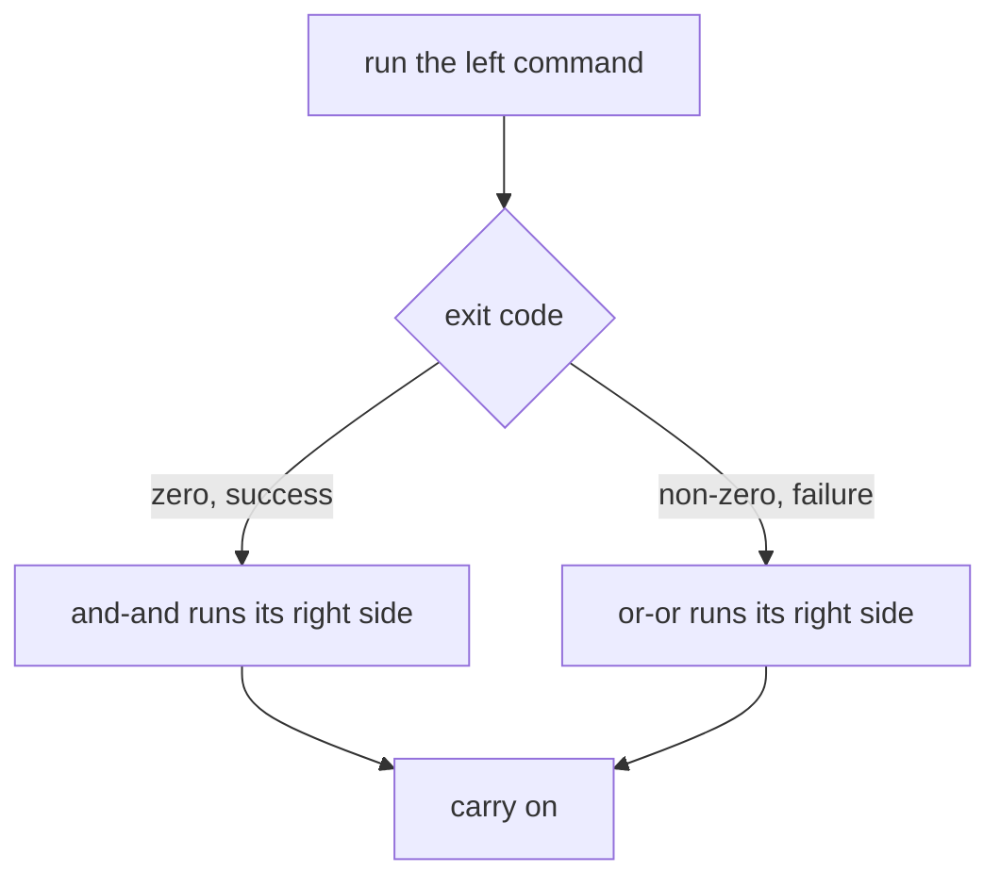

# The Shell and the Filesystem — Part 2

Part 1 gave you the tools. This part gives you the thing that makes Unix tools
worth more than the sum of their parts: the ability to **join them together**.
A single command rarely answers a real question. "How many errors did we have
per hour last night?" is not a flag on any program. It is four small programs in
a row, each doing one job and passing its text to the next. Once that clicks,
the terminal starts being something an IDE cannot replace.

> **⬅️ This continues [Part 1](01-the-shell-and-filesystem-part-1.md).**

> **📌 In one line:** every program reads text on standard input and writes to
> standard output and standard error — pipes and redirection only re-route those
> three streams, and every clever one-liner you will see is just that.

## Table of Contents

1. [Three Streams: stdin, stdout, stderr](#three-streams-stdin-stdout-stderr)
2. [Redirection: `>`, `>>`, `2>`, `2>&1`](#redirection------21)
3. [`/dev/null`, the Bin](#devnull-the-bin)
4. [Pipes: `|`](#pipes-)
5. [Building a Real Pipeline, Step by Step](#building-a-real-pipeline-step-by-step)
6. [Exit Codes and `$?`](#exit-codes-and-)
7. [`&&` and `||`](#-and-)
8. [Editing a File When There Is No GUI](#editing-a-file-when-there-is-no-gui)
9. [Globs Are Not Regex](#globs-are-not-regex)
10. [Advanced: Quoting, and Why `"$VAR"` Not `$VAR`](#advanced-quoting-and-why-var-not-var)
11. [Advanced: Command Substitution `$(...)`](#advanced-command-substitution-)
12. [Common Mistakes](#common-mistakes)
13. [Questions to Test Yourself](#questions-to-test-yourself)
14. [Related](#related)

---

## Three Streams: stdin, stdout, stderr

Every process on Linux starts with three channels already open. They are
numbered.

| Number | Name | Default | What goes there |
|---|---|---|---|
| `0` | standard input (stdin) | Your keyboard | Data flowing *into* the program |
| `1` | standard output (stdout) | Your terminal | The program's normal results |
| `2` | standard error (stderr) | Your terminal | Errors and warnings |

```text
         ┌──────────────────────┐
  0 ───▶ │      a program       │ ───▶ 1   normal output
 stdin   │                      │ ───▶ 2   errors
         └──────────────────────┘
```

**Why two output streams?** So you can separate results from complaints: `find`
prints matches on stdout and "permission denied" on stderr, so you can keep the
matches and throw away the noise. Same split as `console.log` vs
`console.error`.

```text
$ find /etc -name "shadow" -type f
/etc/shadow
find: ‘/etc/ssl/private’: Permission denied
```

Both lines appear on screen, but the first came from stream 1 and the second
from stream 2. The next section proves it.

---

## Redirection: `>`, `>>`, `2>`, `2>&1`

Redirection changes where a stream points. The **shell** handles it, not the
program — the program never knows.

| Syntax | Means |
|---|---|
| `> file` | Send stdout to `file`, **replacing** its contents |
| `>> file` | Send stdout to `file`, **appending** |
| `2> file` | Send stderr to `file` |
| `2>&1` | Send stderr to wherever stdout currently goes |
| `&> file` | Both streams to `file` (bash shorthand); `< file` reads stdin |

```text
$ find /etc -name "shadow" -type f > found.txt
find: ‘/etc/ssl/private’: Permission denied
```

The match went into the file, but the error still printed to the screen, because
`>` only redirects stream 1. Adding `2> errors.txt` captures that too.

> **⚠️ Warning:** `>` truncates the file to zero bytes *before* the command
> runs, so `node server.js > app.log` run twice loses the first run entirely.
> Use `>>` for logs. It bites hardest as `sort file.txt > file.txt`, which
> empties the file before `sort` can read it.

**`2>&1` is the one people get wrong.** Read it as "make stream 2 go wherever
stream 1 is pointing *right now*". Order matters:

```bash
# ✅ FIXED - stdout goes to the file first, then stderr joins it there
node server.js >> app.log 2>&1

# ❌ BROKEN - stderr is pointed at the terminal, then stdout moves away
node server.js 2>&1 >> app.log
```

In the broken version your errors still go to the terminal and vanish when the
SSH session closes — exactly the errors you needed.

---

## `/dev/null`, the Bin

`/dev/null` discards everything written to it and is always empty when read —
how you throw output away.

```text
$ find / -name "app.log" 2>/dev/null
/var/log/saas-api/app.log

$ noisy-script.sh > /dev/null 2>&1     # discard everything
$ cat /dev/null > app.log              # empty a file without deleting it
```

`2>/dev/null` silences the hundreds of "Permission denied" lines that searching
`/` as a normal user produces, leaving only the answers.

> **⚠️ Warning:** never send your application's output to `/dev/null` in
> production "to keep things quiet" — that deletes the evidence you need at 2
> AM. If logs are too noisy, fix the levels: see
> [Structured Logging](../../backend-fundamentals/08-logging-and-observability/02-structured-logging.md).

---

## Pipes: `|`

A pipe connects the **stdout of the left command to the stdin of the right
command**. No temporary file, no disk — the two programs run at the same time,
with the shell carrying bytes between them.

```text
   ┌─────────┐ stdout ┌─────────┐ stdout ┌─────────┐
   │ cat     ├───────▶│ grep    ├───────▶│ wc -l   ├──▶ 42
   │ app.log │  stdin │ "error" │  stdin └─────────┘
   └─────────┘        └─────────┘

$ cat /var/log/saas-api/app.log | grep "error" | wc -l
42
```

> **📌 Remember:** a pipe only carries **stdout**. Errors from the left command
> go straight to your terminal and are *not* passed along. To pipe them too,
> write `command 2>&1 | grep ...`.

The small programs that show up in almost every pipeline:

| Program | Does |
|---|---|
| `grep PATTERN` | Keep only matching lines (`-v` inverts it) |
| `wc -l` / `sort` | Count lines / sort them (`-n` numeric, `-r` reverse) |
| `uniq -c` | Collapse adjacent duplicate lines and count them |
| `cut -c1-13` / `awk '{print $2}'` | Take part of each line, by character or column |
| `jq '.msg'` | Parse JSON — the one that matters for modern app logs |

> **💡 Tip:** `uniq -c` only merges lines that are **next to each other**. That
> is why the idiom is always `sort | uniq -c` and never `uniq -c` alone.

---

## Building a Real Pipeline, Step by Step

The question: **how many errors did the API log, broken down by hour?** This
tells you whether a problem is ongoing, or was a spike at 03:00 that has already
resolved. Build it one step at a time, checking the output at each step.

**Step 1 — look at the raw material.** Always start here.

```text
$ tail -n 2 /var/log/saas-api/app.log
{"level":50,"time":"2026-10-04T03:14:02.771Z","msg":"invoice send failed","invoiceId":8812}
{"level":30,"time":"2026-10-04T09:21:45.118Z","msg":"request completed","status":200}
```

Pino-style JSON logs. `level: 50` is `error`, `level: 30` is `info`.

**Step 2 — keep only the error lines, and only their timestamp.** `jq` parses
JSON properly; `grep "error"` would also match the word inside a message string
and give a wrong count. `-r` prints raw strings without the quotes.

```text
$ jq -r 'select(.level >= 50) | .time' /var/log/saas-api/app.log | head -n 3
2026-10-04T03:14:02.771Z
2026-10-04T03:14:09.330Z
2026-10-04T03:15:41.002Z
```

**Step 3 — cut the timestamp down to the hour.** `cut -c1-13` keeps the first 13
characters, which is `2026-10-04T03`.

```text
$ jq -r 'select(.level >= 50) | .time' /var/log/saas-api/app.log | cut -c1-13 | head -n 2
2026-10-04T03
2026-10-04T03
```

**Step 4 — count each distinct hour.**

```text
$ jq -r 'select(.level >= 50) | .time' /var/log/saas-api/app.log \
    | cut -c1-13 | sort | uniq -c
      4 2026-10-04T01
    311 2026-10-04T03
      2 2026-10-04T08
      1 2026-10-04T09
```

The `\` continues the command on the next line, keeping a long pipeline
readable. Now you can read the incident off the screen: something broke at
03:00, produced 311 errors in one hour, and stopped. The current hour has 1
error, so it is over, and your next move is the messages around 03:00. Adding
`| sort -rn` puts the worst hour first when there are many.

> **💡 Tip:** the same shape answers most log questions —
> `filter → extract one field → sort → uniq -c → sort -rn`. Swap `.time` for
> `.msg` to see the most common error, or `.userId` for the worst-hit customer.

---

## Exit Codes and `$?`

Every program returns a number when it finishes. This is the **exit code** (also
called exit status).

**`0` means success** — exactly one way to succeed. **Anything from 1 to 255
means failure** — many ways to fail, so many numbers. This is the opposite of a
boolean in TypeScript, and it is inverted so the non-zero values can carry
*which* failure it was. `$?` holds the exit code of the last command.

```text
$ grep "invoice send failed" /var/log/saas-api/app.log > /dev/null
$ echo $?
0

$ grep "payment captured" /var/log/saas-api/app.log > /dev/null
$ echo $?
1

$ grep "anything" /var/log/does-not-exist.log
grep: /var/log/does-not-exist.log: No such file or directory
$ echo $?
2
```

`grep` uses three codes deliberately: 0 found something, 1 found nothing, 2 went
wrong. Exit codes you will see on a server:

| Code | Usually means |
|---|---|
| `0` | Success |
| `1` | General failure |
| `2` | Misuse of the command, or a missing file |
| `126` / `127` | Found but not executable / command not found |
| `130` | Killed by `Ctrl+C` (`SIGINT`) |
| `137` | Killed by `SIGKILL` — very often the out-of-memory killer |
| `143` | Killed by `SIGTERM` — usually a normal shutdown |

`137` and `143` come up constantly with Docker and systemd, and are explained in
[02-processes-and-services-part-2.md](02-processes-and-services-part-2.md). In
Node, `process.exit(1)` sets this value, and a test runner exiting non-zero is
how CI knows a build failed.

---

## `&&` and `||`

These operators read `$?` and decide whether to run the next command.



| Operator | Runs the right side when |
|---|---|
| `a && b` | `a` exited `0` (succeeded) |
| `a \|\| b` | `a` exited non-zero (failed) |
| `a ; b` | Always — no condition at all |

```text
$ npm run build && node build/bin/server.js
$ systemctl is-active --quiet saas-api || systemctl start saas-api
```

In the first, a failed build means the server never starts. With `;` instead you
would start the *old* build and wonder why your change is missing. The second
starts the service only if it is not running. A deploy script is mostly this:

```bash
#!/bin/bash
set -e   # stop the whole script at the first command that fails

cd /opt/saas-api
npm ci && npm run build
node ace migration:run --force
systemctl restart saas-api
```

> **📌 Remember:** `set -e` makes a script stop on the first failure. Without
> it, a script keeps going after `npm run build` fails and happily restarts the
> service with a broken build. Add `set -u` too, which makes an undefined
> variable an error rather than an empty string.

---

## Editing a File When There Is No GUI

Sooner or later you must change a config file on a server over SSH, and there is
no VS Code there. **`nano` is the beginner's answer.** Run
`nano /etc/nginx/nginx.conf` and it shows its own shortcuts at the bottom of the
screen, where `^` means `Ctrl`.

| Key | Does |
|---|---|
| `Ctrl+O` then `Enter` | Save ("write Out") |
| `Ctrl+X` | Exit |
| `Ctrl+W` / `Ctrl+K` | Search / cut the current line |

**`vim` is on every server, including the minimal ones where `nano` is missing.**
You do not need to learn vim. You need three things so you never get stuck:

| Situation | Keys |
|---|---|
| Start typing text | `i` (insert mode) |
| Stop typing text | `Esc` (back to normal mode) |
| Save and quit | `Esc` then `:wq` then `Enter` |
| Quit and throw away changes | `Esc` then `:q!` then `Enter` |

That last row matters most: if you opened a file by accident or made a mess,
`Esc :q!` gets you out with the file untouched.

> **💡 Tip:** on a production server, `sudo cp nginx.conf nginx.conf.bak` before
> editing. Then a mistake is one `cp` away from being undone. For nginx
> specifically, `sudo nginx -t` checks the config before you reload it.

---

## Globs Are Not Regex

Both use `*` and they mean different things. A **glob** is expanded by the
*shell*, against filenames, before the command runs. A **regex** (regular
expression) is interpreted by a *program* such as `grep`, against the content of
lines.

| Pattern | As a glob (filenames) | As a regex (text) |
|---|---|---|
| `*` | Any characters, including none | Zero or more of the **previous** character |
| `?` | Exactly one character | Zero or one of the previous character |
| `.` | A literal dot | Any single character |
| `a*` | Files starting with `a` | Zero or more `a` characters |
| `.*` | Hidden files | Any characters — this is the regex `*` you meant |

```text
$ ls *.log
app.log  error.log

$ grep "error.*timeout" app.log
{"level":50,"msg":"error connecting to redis: timeout after 5000ms"}
```

In the first, the shell turned `*.log` into two filenames before `ls` started.
In the second, the shell passed `error.*timeout` through untouched because it
was quoted, and `grep` read it as "the word error, then anything, then timeout".

> **📌 Remember:** a pattern meant for a *program* (`grep`, `find -name`,
> `rsync --exclude`) gets quoted so the shell leaves it alone. A pattern meant
> for *filenames* stays unquoted so the shell expands it.

---

## Advanced: Quoting, and Why `"$VAR"` Not `$VAR`

The shell splits a line into words on spaces, and after substituting a
variable's value it splits **again** — unless you quoted it.

```text
$ BACKUP_DIR="/var/backups/saas api"
$ ls $BACKUP_DIR
ls: cannot access '/var/backups/saas': No such file or directory
ls: cannot access 'api': No such file or directory

$ ls "$BACKUP_DIR"
2026-10-03.dump  2026-10-04.dump
```

Unquoted, the shell replaced one word with `/var/backups/saas api` and then
split *that* into two arguments. `ls` got two paths, both wrong.

```bash
# ❌ BROKEN - any space, tab or newline in the value silently splits it apart,
#            and any * in the value gets expanded against the filesystem
rm -rf $BUILD_DIR/*

# ✅ FIXED - the value is passed as exactly one argument, whatever it contains
rm -rf "$BUILD_DIR"/*
```

With an **empty** `BUILD_DIR`, the broken line becomes `rm -rf /*`. This is not
a theoretical example; it has deleted real servers.

The three quoting forms:

| Form | Variables expanded? | Use it for |
|---|---|---|
| `"double quotes"` | Yes | Almost always. This is your default |
| `'single quotes'` | No, everything is literal | Patterns, passwords, anything with `$` |
| no quotes | Yes, then split and glob-expanded | Only when you *want* splitting |

So `echo "Deploying to $NODE_ENV"` prints `Deploying to production`, while
`echo 'Deploying to $NODE_ENV'` prints the variable name itself. The rule is
short enough to memorise: **quote every variable unless you have a specific
reason not to.**

---

## Advanced: Command Substitution `$(...)`

`$(command)` runs the command and replaces itself with that command's output —
how you use one command's result as another command's argument.

```text
$ TAG="saas-api:$(git rev-parse --short HEAD)"
$ echo "$TAG"
saas-api:a3f91c2

$ kill $(cat /var/run/saas-api.pid)

$ pg_dump saas_production > "/var/backups/saas-$(date +%F-%H%M).dump"
```

> **⚠️ Warning:** always quote the whole thing — `"$(command)"` — for the same
> reason you quote variables. Output containing spaces is otherwise split into
> several arguments.

You may see backticks (`` `command` ``) in older scripts. They do the same
thing, but cannot be nested and have confusing escaping rules. Use `$( )`.

---

## Common Mistakes

| Mistake | Why it is wrong | Do this instead |
|---|---|---|
| `node server.js > app.log` on every restart | `>` truncates, so the previous run's log is gone | `>> app.log 2>&1` |
| `2>&1 > file` | Order is wrong; stderr is bound to the terminal before stdout moves | `> file 2>&1` |
| `command \| grep error` not catching errors | A pipe carries stdout only | `command 2>&1 \| grep error` |
| `uniq -c` without `sort` first | `uniq` only collapses *adjacent* duplicates | `sort \| uniq -c` |
| `$VAR` unquoted in a script | Spaces split it, `*` expands it, empty becomes nothing | `"$VAR"` |
| `rm -rf $DIR/*` with `DIR` unset | Becomes `rm -rf /*` | Quote it, and `set -u` at the top |
| Writing a 5-stage pipeline in one go | You cannot tell which stage is wrong | Add one stage at a time |
| Shell script without `set -e` | Keeps running after a failed build and deploys it | `set -euo pipefail` at the top |

---

## Questions to Test Yourself

1. Why does Linux give every process two output streams rather than one? Give a
   case where merging them loses you something.
2. Explain why `command 2>&1 > file` does not do what it looks like it does.
3. You run `sort data.txt > data.txt` and the file is now empty. Explain why,
   step by step.
4. Why is the idiom always `sort | uniq -c` and never `uniq -c` on its own?
5. `grep` can exit `0`, `1` or `2`. What does each mean, and why is that more
   useful than plain success/failure?
6. A deploy script runs `npm run build; systemctl restart saas-api`. Describe
   the outage this causes and give the one-character fix.
7. `BUILD_DIR` is accidentally empty and the script runs `rm -rf $BUILD_DIR/*`.
   What command actually executes? Name two defences.
8. `ls *.log` and `grep "error.*timeout"` both contain `*`. Explain who expands
   each one, and when.
9. Write a pipeline that reports the five most frequent error messages in a JSON
   log file, and explain what each stage does.

---

## Related

- [The Shell and the Filesystem — Part 1](01-the-shell-and-filesystem-part-1.md)
  — the filesystem tree, paths, and the commands these pipelines are built from.
- [Processes and Services — Part 1](02-processes-and-services-part-1.md) — exit
  codes `137` and `143`, and the signals that produce them.
- [Logs, Disks and Debugging — Part 1](05-logs-disks-and-debugging-part-1.md) —
  the same pipelines applied to `journalctl` output during a real incident.
- [Structured Logging](../../backend-fundamentals/08-logging-and-observability/02-structured-logging.md)
  — why your logs are JSON, which is what makes `jq` pipelines possible.
- [Secrets and Configuration — Part 1](../../backend-fundamentals/11-api-security/05-secrets-and-configuration-part-1.md)
  — the environment variables you are quoting here, and where they come from.
