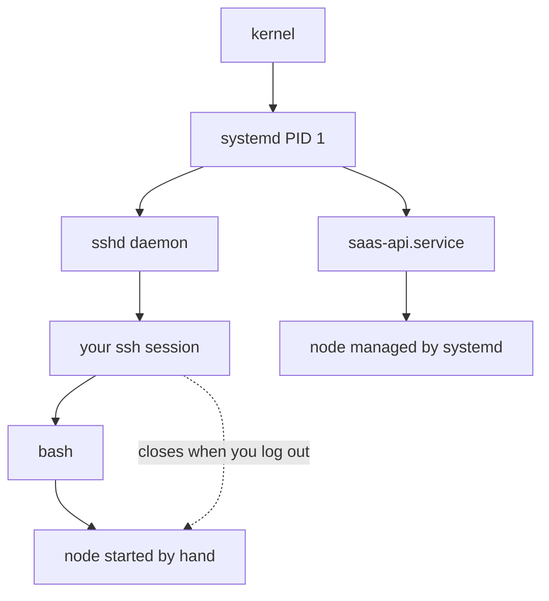
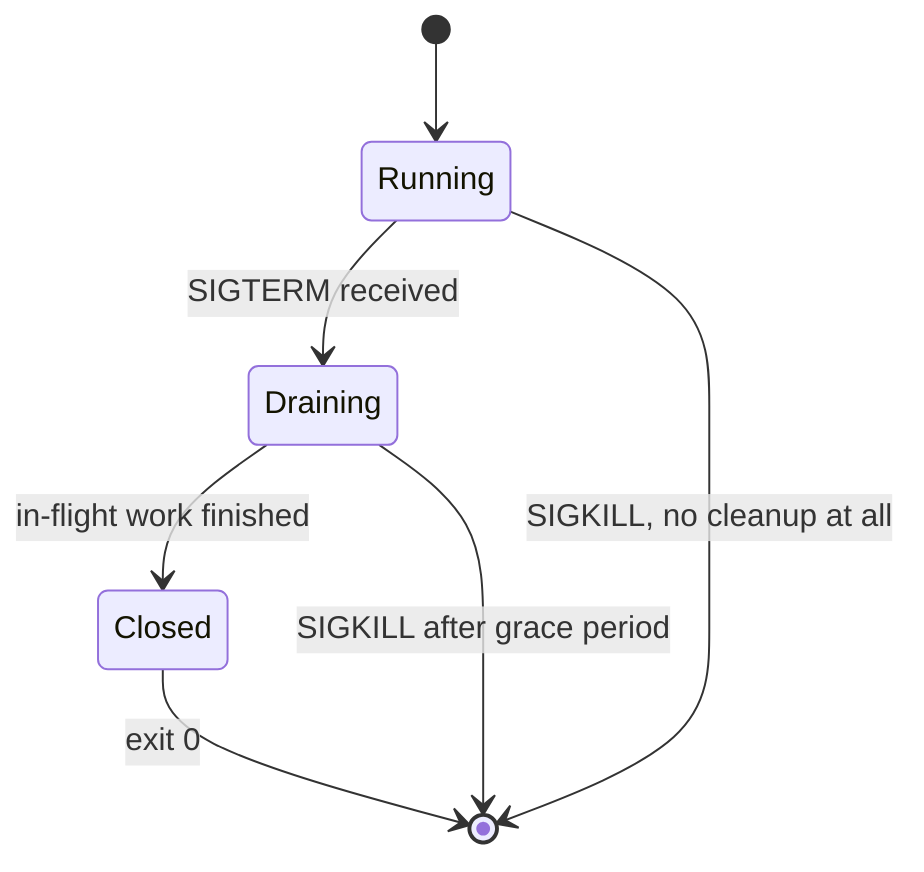

# Processes and Services — Part 1

You SSH into the server, run `node build/bin/server.js`, see "listening on 3333",
close your laptop, and go home. An hour later the site is down.

That story is a rite of passage, and almost nobody explains it properly. The
answer involves processes, parents and children, terminals, and signals. This
part covers all four, so that by the end you can say exactly why your server
died and what the real fix is.

> **➡️ Continued in [Part 2](02-processes-and-services-part-2.md).**

> **📌 In one line:** a process is a running program with a number, it belongs to
> a parent, and it dies when it is told to — so "keeping a server running" is
> really "giving it a parent that outlives your SSH session".

## Table of Contents

1. [What a Process Is](#what-a-process-is)
2. [PIDs, Parents and Children](#pids-parents-and-children)
3. [Seeing What Is Running: `ps aux`](#seeing-what-is-running-ps-aux)
4. [`ps -ef` and Finding Your Own Process](#ps--ef-and-finding-your-own-process)
5. [`top` and `htop`, Column by Column](#top-and-htop-column-by-column)
6. [Why Your Server Died When You Closed SSH](#why-your-server-died-when-you-closed-ssh)
7. [`&`, `Ctrl+Z`, `jobs`, `fg`, `nohup`](#-ctrlz-jobs-fg-nohup)
8. [Signals](#signals)
9. [`kill`, `kill -9` and `pkill`](#kill-kill--9-and-pkill)
10. [BROKEN vs FIXED: Shutting Down a Node Server](#broken-vs-fixed-shutting-down-a-node-server)
11. [Common Mistakes](#common-mistakes)
12. [Questions to Test Yourself](#questions-to-test-yourself)
13. [Related](#related)

---

## What a Process Is

A **program** is a file on disk — `/usr/bin/node` is a program. A **process** is
that program while it is running: the code in memory, plus its own memory, open
files, environment variables and current directory. The same program can be many
processes at once: running your API and your background worker gives you two
`node` processes, sharing no memory, each with its own copy of everything.

> **📌 Remember:** the thing that crashes, the thing that eats memory and the
> thing you restart is always a *process*, never a program. Precision here makes
> the rest of this file easy.

Every process has a **PID** (a number identifying it while it runs), a **PPID**
(the process that started it), a **user** whose permissions it runs with, a
**working directory** that relative paths resolve against, its own copy of the
**environment** variables, and a **state** — running, sleeping, stopped or
zombie.

---

## PIDs, Parents and Children

Every process except one is started by another process. The starter is the
**parent**, the started one is the **child**. This makes a tree.

At the root is **PID 1**, started by the kernel at boot. On a modern Linux
server PID 1 is `systemd`. Everything else descends from it.

```text
systemd (PID 1)
├── sshd (PID 812)
│   └── sshd: deploy (PID 18102)
│       └── bash (PID 18103)          ← your shell when you SSH in
│           └── node server.js (PID 18240)   ← what you just started
├── nginx (PID 940)
│   ├── nginx worker (PID 941)
│   └── nginx worker (PID 942)
├── postgres (PID 1021)
└── saas-api.service
    └── node server.js (PID 2210)     ← the real production process
```

Look carefully. There are two `node` processes: one is a grandchild of your SSH
session, the other a child of a systemd service. That single difference is the
whole answer to "why did my server die?"



`ps -ef --forest` or `pstree` draws this on a real machine.

```text
$ pstree -p 18102
sshd(18102)───bash(18103)───node(18240)───{node}(18241)
```

The entries in `{braces}` are **threads**, not processes. Node is
single-threaded for your JavaScript but uses a small thread pool for file and
crypto work, so a healthy Node process shows several.

---

## Seeing What Is Running: `ps aux`

`ps` prints a snapshot. `ps aux` is the form to memorise: `a` is all users, `u`
is user-friendly columns, `x` includes processes with no terminal — which is
every service on the machine.

```text
$ ps aux | head -n 4
USER   PID  %CPU %MEM     VSZ    RSS TTY   STAT START   TIME COMMAND
root     1   0.0  0.1  168404  12320 ?     Ss   Oct01   0:14 /sbin/init
deploy 2210  2.3  6.4 1204880 523104 ?     Ssl  Oct03  41:02 node /opt/saas-api/build/bin/server.js
deploy 2298  0.7  4.1 1105220 334012 ?     Ssl  Oct03  12:44 node /opt/saas-api/build/bin/worker.js
```

Column by column:

| Column | What it tells you |
|---|---|
| `USER` | Which user owns the process. `deploy`, not `root` — good |
| `PID` | The number you pass to `kill`, `strace` or `/proc/<pid>` |
| `%CPU` | Percent of **one** core, averaged since start. Can exceed 100 on multi-core |
| `%MEM` | Percent of total physical RAM this process is using |
| `VSZ` | Virtual size in KB — address space it *could* touch. Usually meaningless |
| `RSS` | Resident Set Size in KB — **actual RAM in use.** This is the one |
| `TTY` | The terminal it is attached to. `?` means none, which is normal for a service |
| `STAT` | Process state. See below |
| `START` | When it started. `Oct03` here, so it has been up for a day |
| `TIME` | Total CPU time consumed, not wall-clock time |
| `COMMAND` | The command line, which is how you tell two `node` processes apart |

**`RSS` versus `VSZ`.** `RSS` is in kilobytes, so `523104` is about 511 MB.
`VSZ` is almost always huge and almost always irrelevant, because Node reserves
address space it never touches. "How much memory is the app using?" means `RSS`.

**`STAT`** is two or more characters. The first is the state:

| Letter | State |
|---|---|
| `R` | Running, or ready to run |
| `S` | Sleeping — waiting for something, which is normal and healthy |
| `D` | Uninterruptible sleep, almost always waiting on disk. Many `D` is a disk problem |
| `Z` | Zombie — finished but not cleaned up by its parent |
| `T` | Stopped, usually by `Ctrl+Z` |

The extra letters are flags: `s` is session leader, `l` is multi-threaded, `+`
means foreground of a terminal, `<` means high priority. So `Ssl` on the `node`
line reads "sleeping, session leader, multi-threaded" — exactly what a healthy
idle Node server looks like. A busy one shows `Rsl`.

---

## `ps -ef` and Finding Your Own Process

`ps -ef` is the other common form. Same information, different column names, and
it shows `PPID` — the parent — which `ps aux` does not.

```text
$ ps -ef | grep node
UID     PID   PPID  C STIME TTY     TIME CMD
deploy 2210      1  2 Oct03 ?    41:02:11 node /opt/saas-api/build/bin/server.js
deploy 2298      1  0 Oct03 ?    12:44:03 node /opt/saas-api/build/bin/worker.js
deploy 18240 18103  0 09:31 pts/0 0:02:10 node build/bin/server.js
deploy 18256 18103  0 09:40 pts/0 0:00:00 grep --color=auto node
```

Read the `PPID` column and the story is there. PIDs 2210 and 2298 have `PPID 1`,
so systemd owns them and they survive anything. PID 18240 has `PPID 18103` —
your bash shell on `pts/0` — so it dies with your session. PID 18256 is the
`grep` itself, which always appears; use `pgrep` to avoid it.

```text
$ pgrep -af node
2210 node /opt/saas-api/build/bin/server.js
2298 node /opt/saas-api/build/bin/worker.js
18240 node build/bin/server.js
```

> **💡 Tip:** `pgrep -af <name>` is cleaner than `ps aux | grep <name>`. The `-a`
> shows the full command line and `-f` matches against it, so you can tell your
> API apart from your worker.

---

## `top` and `htop`, Column by Column

`ps` is a snapshot. `top` updates live, which is what you want when the server
is slow *right now*.

```text
$ top
top - 09:42:11 up 3 days,  2:14,  1 user,  load average: 2.41, 1.98, 1.20
Tasks: 142 total,   2 running, 140 sleeping,   0 stopped,   0 zombie
%Cpu(s): 48.2 us,  6.1 sy,  0.0 ni, 44.1 id,  1.2 wa,  0.0 hi,  0.4 si
MiB Mem :   7976.0 total,    412.3 free,   5102.8 used,   2460.9 buff/cache
MiB Swap:      0.0 total,      0.0 free,      0.0 used.   2501.4 avail Mem

  PID USER    PR  NI    VIRT    RES    SHR S  %CPU  %MEM     TIME+ COMMAND
 2210 deploy  20   0 1204880 523104  31204 S  96.3   6.4  41:02.11 node
 1021 postgres 20  0  412880 184220 171004 S  12.0   2.3  08:14.02 postgres
 2298 deploy  20   0 1105220 334012  29880 S   4.7   4.1  12:44.03 node
```

The header lines matter as much as the list:

- **`load average: 2.41, 1.98, 1.20`** — processes wanting the CPU, averaged
  over 1, 5 and 15 minutes. Compare against core count: on a 2-core box 2.41 is
  fully loaded, on an 8-core box it is idle. Rising left to right means it is
  getting worse. Full treatment in
  [05-logs-disks-and-debugging-part-2.md](05-logs-disks-and-debugging-part-2.md).
- **`%Cpu(s)`** — `us` is your code, `sy` the kernel, `id` idle, and **`wa` is
  waiting for disk**. High `wa` with low `us` means the disk is the bottleneck.
- **`Tasks: ... 0 zombie`** — a growing zombie count points at a
  process-spawning bug, covered in Part 2.

In the process list, `RES` is the same thing as `RSS` in `ps` — real memory.
`%CPU` above 100 means the process is using more than one core.

> **💡 Tip:** inside `top`, press `M` to sort by memory, `P` to sort by CPU, `1`
> to show each core separately, and `q` to quit. `htop` does the same with
> colours, arrow-key scrolling and a `F9` kill menu. Install `htop` if you can.

---

## Why Your Server Died When You Closed SSH

Now the question from the top of this file. The chain is short.

1. You SSH in. `sshd` starts a login shell (`bash`) for your session.
2. You run `node server.js`. Bash starts it as a **child** of your shell, in the
   foreground of your terminal.
3. You close the laptop or the connection drops.
4. The kernel notices the terminal is gone and sends **`SIGHUP`** ("hang up") to
   the processes attached to it.
5. The default action for `SIGHUP` is to terminate. Node has no handler for it,
   so Node exits.
6. Your site is down.

```text
# after reconnecting
$ pgrep -af node
$ curl -s -o /dev/null -w "%{http_code}" http://localhost:3333
000
```

`pgrep` printed nothing and `curl` could not connect. The name `SIGHUP` is
historical: it meant a modem had hung up the phone line. The behaviour survived.

> **📌 Remember:** this is not a Node, cloud or firewall problem. It is a parent
> problem — your process was attached to a terminal, and the terminal went away.

---

## `&`, `Ctrl+Z`, `jobs`, `fg`, `nohup`

The shell gives you tools for this. Learn them, because you will use them for
one-off tasks — and then learn why none of them is the production answer.

| Thing | Does |
|---|---|
| `command &` | Start in the **background**; the prompt comes back at once |
| `Ctrl+C` | Send `SIGINT` to the foreground process — "stop now" |
| `Ctrl+Z` | Send `SIGTSTP` — **suspend** it. It is paused, not stopped |
| `jobs` | List background and suspended jobs of this shell |
| `fg %1` | Bring job 1 back to the foreground |
| `bg %1` | Resume a suspended job, in the background |
| `nohup cmd &` | Run ignoring `SIGHUP`, so it survives logout |
| `disown -h %1` | Detach an already-running job from the shell |

A full cycle:

```text
$ node build/bin/server.js
info: server listening on 3333
^Z
[1]+  Stopped                 node build/bin/server.js

$ bg %1
[1]+ node build/bin/server.js &

$ jobs
[1]+  Running                 node build/bin/server.js &

$ fg %1
node build/bin/server.js
^C
```

> **⚠️ Warning:** `Ctrl+Z` does **not** stop a server. It suspends it. The
> process still holds port 3333, so your next start fails with
> `EADDRINUSE`, and the process still holds its database connections. People
> hit `Ctrl+Z`, see their prompt return, assume they stopped the app, and then
> spend twenty minutes confused. `Ctrl+C` is stop.

`nohup` is the usual next discovery:

```text
$ nohup node build/bin/server.js > /var/log/saas-api/app.log 2>&1 &
[1] 18411
nohup: ignoring input and redirecting stderr to stdout
```

That genuinely survives logout, and is fine for a long migration you want to
leave running. **It is not how you run a production service**: nothing restarts
it when it crashes, nothing starts it after a reboot, `systemctl status` does
not know it exists, its output has no rotation, and the next engineer has no way
to discover it. The real answer is systemd, and that is where Part 2 starts.

---

## Signals

A **signal** is a small message the kernel delivers to a process. It is the only
way one process politely tells another to do something. For a Node developer
these matter directly, because your app can listen for them.

| Signal | Number | Default action | Can be caught? | When you see it |
|---|---|---|---|---|
| `SIGINT` | 2 | Terminate | Yes | You pressed `Ctrl+C` |
| `SIGTERM` | 15 | Terminate | Yes | `kill`, `systemctl stop`, `docker stop` |
| `SIGKILL` | 9 | Terminate immediately | **No** | `kill -9`, or the out-of-memory killer |
| `SIGHUP` | 1 | Terminate | Yes | Terminal closed; also "reload config" by convention |
| `SIGSTOP` | 19 | Suspend | **No** | Rare, manual |
| `SIGTSTP` | 20 | Suspend | Yes | You pressed `Ctrl+Z` |
| `SIGCHLD` | 17 | Ignore | Yes | A child process exited |

Two of these carry all the weight.

**`SIGTERM` is the polite one.** It says "please finish and exit". Your process
receives it and decides what to do: stop accepting new requests, finish the ones
in flight, flush logs, close the database pool, then exit. Every well-behaved
service handles `SIGTERM`.

**`SIGKILL` cannot be caught.** The kernel removes the process immediately. No
handler runs, no cleanup happens, no `finally` block executes. In-flight HTTP
requests are cut off mid-response, a half-written file stays half-written, and
database connections are left for the server to time out.



This is why **graceful shutdown** exists in your Node code:

```ts
// Handle the polite signal. There is no way to handle SIGKILL.
async function shutdown(signal: NodeJS.Signals): Promise<void> {
  logger.info({ signal }, 'shutdown started')
  server.close()               // stop accepting new connections
  await queue.close()          // let in-flight jobs finish
  await db.destroy()           // return pooled connections cleanly
  process.exit(0)
}

process.on('SIGTERM', shutdown)  // systemctl stop, docker stop, Kubernetes
process.on('SIGINT', shutdown)   // Ctrl+C in local development
```

The worker side of this — finishing a job rather than losing it — is covered in
[Writing Reliable Workers — Part 2](../../caching-and-background-jobs/03-background-jobs/03-writing-reliable-workers-part-2.md).
Where this code sits in a Node app is in
[Anatomy of a Backend App](../../backend-fundamentals/03-request-lifecycle/01-anatomy-of-a-backend-app.md).

> **📌 Remember:** `SIGTERM` then wait then `SIGKILL` is the pattern every
> supervisor uses. systemd waits `TimeoutStopSec` (90 seconds by default),
> `docker stop` waits 10 seconds, Kubernetes waits
> `terminationGracePeriodSeconds` (30 by default). Your shutdown must finish
> inside that window or it gets killed anyway.

---

## `kill`, `kill -9` and `pkill`

`kill` does not mean "kill". It means "send a signal". With no flag it sends
`SIGTERM`.

```text
$ kill 18411                 # SIGTERM — polite, the default
$ kill -TERM 18411           # identical, written explicitly
$ kill -HUP 940              # ask nginx to reload its config
$ kill -9 18411              # SIGKILL — immediate, no cleanup
```

By name instead of PID:

```text
$ pkill -f "build/bin/worker.js"     # signal every process matching
$ pkill -u deploy node               # every node process owned by deploy
$ killall node                       # every process named exactly "node"
```

**Why reaching for `-9` first is a bad habit.** It feels decisive. What it
actually does: your shutdown handler never runs, in-flight requests are cut off
so users see broken responses, background jobs stop mid-work and get redelivered
so non-idempotent work runs twice, lock and PID files are left behind so the
next start may refuse, and you learn nothing about *why* it would not stop,
because you destroyed the evidence.

The correct sequence is `kill 2210`, wait ten seconds, check with `ps -p 2210`,
and only use `kill -9 2210` if it is still there.

> **⚠️ Warning:** if a process survives `SIGTERM`, that is information. Either
> your app has no `SIGTERM` handler, or its handler is hanging on something — an
> open database connection, a job that never finishes, a `setInterval` keeping
> the event loop alive. `kill -9` hides the bug. Check the logs first.

A process stuck in state `D` (uninterruptible sleep) will not even die from
`SIGKILL`, because it is blocked in the kernel waiting on storage. If `kill -9`
does nothing, look at the disk.

---

## BROKEN vs FIXED: Shutting Down a Node Server

```ts
// ❌ BROKEN - exits instantly, so in-flight requests are cut off mid-response
process.on('SIGTERM', () => {
  process.exit(0)
})
```

`process.exit()` is immediate. Open sockets are dropped, pending writes are
lost, and the connection pool is never closed, so Postgres keeps those
connections until they time out.

```ts
// ✅ FIXED - stop taking new work, drain what is in flight, then exit
process.on('SIGTERM', async () => {
  server.close()                                  // no new connections
  await new Promise((r) => setTimeout(r, 5_000))  // let load balancer notice
  await db.destroy()
  process.exit(0)
})
```

> **💡 Tip:** the `setTimeout` is deliberate. A load balancer needs a few seconds
> to stop routing new requests to this instance. Closing instantly means some
> requests are still arriving at a server that has stopped listening.

---

## Common Mistakes

| Mistake | Why it is wrong | Do this instead |
|---|---|---|
| `node server.js` over SSH for production | Dies on `SIGHUP` when the session ends | A systemd service (Part 2) |
| `Ctrl+Z` to stop a server | Suspends it; it still holds the port and its connections | `Ctrl+C` |
| `kill -9` as the first attempt | Skips cleanup, corrupts state, hides the real bug | `kill`, wait, then `-9` |
| Reading `VSZ` as memory usage | It is reserved address space, not real RAM | Read `RSS` or `RES` |
| `ps aux \| grep node` | Matches its own `grep`, and cannot tell API from worker | `pgrep -af node` |
| No `SIGTERM` handler in the app | Every deploy drops in-flight requests | Handle `SIGTERM` and drain |
| Reading `load average: 4.0` as "overloaded" | It is only meaningful against the core count | Compare with `nproc` |
| `nohup ... &` as the deployment strategy | No restart, no boot start, nobody knows it exists | systemd, pm2 or a container |

---

## Questions to Test Yourself

1. Explain the difference between a program and a process, and why the
   distinction matters when you say "restart the app".
2. Two `node` processes appear in `ps -ef`. One has `PPID 1`, the other
   `PPID 18103`. What does that tell you about how each was started?
3. Walk through, step by step, what happens between closing your SSH session and
   your server being down.
4. Why can `SIGKILL` not be caught? Name three concrete bad outcomes of using it
   on a healthy app.
5. A process shows `RSS 523104` and `VSZ 1204880`. How much RAM is it really
   using, and why is the other number so much bigger?
6. `STAT` shows `D` for several processes. What is the likely cause, and why
   does `kill -9` not help?
7. Your app's `SIGTERM` handler takes 120 seconds. What happens under systemd's
   default `TimeoutStopSec`, and what does the exit code become?
8. Why does a graceful shutdown wait a few seconds before closing the server
   when there is a load balancer in front?

---

## Related

- [Processes and Services — Part 2](02-processes-and-services-part-2.md) —
  systemd unit files, restart policies, OOM kills and PID 1 in a container.
- [The Shell and the Filesystem — Part 2](01-the-shell-and-filesystem-part-2.md)
  — exit codes `130`, `137` and `143`, which name the signal that killed a
  process.
- [Logs, Disks and Debugging — Part 2](05-logs-disks-and-debugging-part-2.md) —
  load average, memory and the triage runbook.
- [Writing Reliable Workers — Part 2](../../caching-and-background-jobs/03-background-jobs/03-writing-reliable-workers-part-2.md)
  — graceful shutdown for a queue worker, and what a lost job costs.
- [Anatomy of a Backend App](../../backend-fundamentals/03-request-lifecycle/01-anatomy-of-a-backend-app.md)
  — where the signal handlers belong in a Node application.
