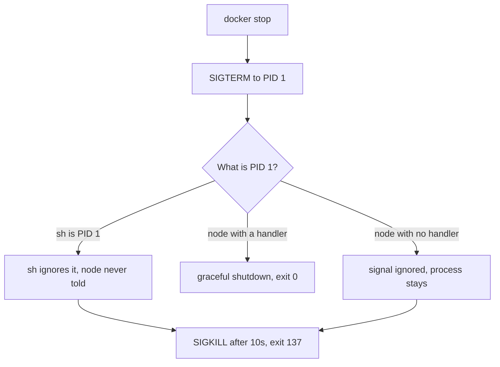

# Processes and Services — Part 2

Part 1 ended with a problem: `nohup node server.js &` survives your logout, but
nothing restarts it when it crashes, nothing starts it after a reboot, and
nobody else knows it exists. This part is the real answer. You describe your app
once, in a small text file, and the operating system takes responsibility for
it: starting it at boot, restarting it on failure, capturing its logs, running
it as the right user. Then come the two production failures that confuse people
most — the crash loop and the out-of-memory kill.

> **⬅️ This continues [Part 1](02-processes-and-services-part-1.md).**

> **📌 In one line:** a systemd unit file is a contract that says "run this
> command, as this user, with this environment, and bring it back when it dies"
> — and `systemctl status` is where you find out why it did not.

## Table of Contents

1. [What systemd Is, and What a Unit File Is](#what-systemd-is-and-what-a-unit-file-is)
2. [A Complete Unit File for a Node App](#a-complete-unit-file-for-a-node-app)
3. [`systemctl`: The Five Commands](#systemctl-the-five-commands)
4. [Reading `systemctl status`](#reading-systemctl-status)
5. [The Crash Loop Trap](#the-crash-loop-trap)
6. [pm2 vs systemd vs Container Restart Policies](#pm2-vs-systemd-vs-container-restart-policies)
7. [OOM: Exit Code 137 and `dmesg`](#oom-exit-code-137-and-dmesg)
8. [Advanced: Zombies and Orphans](#advanced-zombies-and-orphans)
9. [Advanced: PID 1 in a Container](#advanced-pid-1-in-a-container)
10. [Common Mistakes](#common-mistakes)
11. [Questions to Test Yourself](#questions-to-test-yourself)
12. [Related](#related)

---

## What systemd Is, and What a Unit File Is

**systemd** is the program with PID 1 on nearly every modern Linux server. It
starts at boot, and its job is to start, stop and supervise everything else.

A **unit** is one thing systemd manages. A unit of type `.service` is a
long-running program — your API, Postgres, nginx. A **unit file** is a plain
text file describing it. Nothing more: no daemon to install, no agent, no
dependency on Node.

Unit files for software you install live in `/lib/systemd/system/`. Unit files
**you** write go in `/etc/systemd/system/`. Keep that separation — a package
upgrade can overwrite the first directory, never the second.

```text
$ ls /etc/systemd/system/*.service
/etc/systemd/system/saas-api.service
/etc/systemd/system/saas-worker.service
```

A unit file is to a service what a `Dockerfile` is to an image: a declaration of
how to run something, kept in version control and applied to a machine — not a
command you type.

---

## A Complete Unit File for a Node App

This is a real, working unit for an AdonisJS API. Every line is explained.

```ini
# /etc/systemd/system/saas-api.service

[Unit]
Description=SaaS API (AdonisJS)
# Do not start until the network and Postgres are up.
After=network.target postgresql.service
Wants=postgresql.service

[Service]
Type=simple

# Never run an application as root. If the app is compromised,
# the attacker gets only what "deploy" can reach.
User=deploy
Group=deploy

# Relative paths in the app resolve against this. Set it explicitly.
WorkingDirectory=/opt/saas-api

# Absolute path to node. systemd does not load your shell config,
# so a version-manager node on your PATH is invisible here.
ExecStart=/usr/bin/node /opt/saas-api/build/bin/server.js

# Secrets live in a file owned by root, mode 600. Not in this unit.
EnvironmentFile=/etc/saas-api/env
Environment=NODE_ENV=production

# Bring it back if it exits non-zero. See the crash loop section below.
Restart=on-failure
RestartSec=5

# How long to wait after SIGTERM before sending SIGKILL.
# Must be longer than your graceful shutdown takes.
TimeoutStopSec=30

# Send stdout and stderr to the journal, readable with journalctl.
StandardOutput=journal
StandardError=journal
SyslogIdentifier=saas-api

[Install]
# "systemctl enable" creates the link that starts this at boot.
WantedBy=multi-user.target
```

The five directives that matter most:

| Directive | Why it matters |
|---|---|
| `ExecStart` | Must be an **absolute** path. `node` alone fails with status 203/EXEC |
| `User` | Running as `root` turns an app bug into a root compromise |
| `WorkingDirectory` | Without it the working directory is `/`, and relative paths break |
| `EnvironmentFile` | Keeps secrets out of the unit file, which is world-readable |
| `Restart=on-failure` | The difference between a blip and an outage |

The `EnvironmentFile` is a plain `KEY=value` file with no `export` and no
quotes:

```text
$ sudo cat /etc/saas-api/env
PORT=3333
DB_HOST=10.0.1.20
DB_PASSWORD=redacted
APP_KEY=redacted

$ ls -l /etc/saas-api/env
-rw------- 1 root root 184 Oct  1 03:12 /etc/saas-api/env
```

Mode `600` and owner `root` means only root can read it. How secrets should be
managed beyond this is in
[Secrets and Configuration — Part 1](../../backend-fundamentals/11-api-security/05-secrets-and-configuration-part-1.md).

> **⚠️ Warning:** after editing any unit file you must run
> `sudo systemctl daemon-reload`. systemd caches unit files, so without it your
> change is simply ignored and you will debug the old version for ten minutes.

---

## `systemctl`: The Five Commands

```text
$ sudo systemctl daemon-reload          # after editing a unit file
$ sudo systemctl start saas-api         # start it now
$ sudo systemctl stop saas-api          # SIGTERM, then SIGKILL after TimeoutStopSec
$ sudo systemctl restart saas-api       # stop then start
$ sudo systemctl enable saas-api        # also start it at every boot
$ systemctl status saas-api             # what is it doing, and why
```

**`start` and `enable` are different, and this catches everyone.** `start` runs
it now and does nothing about the next reboot. `enable` arranges for it to start
at boot and does nothing right now. A service that works perfectly until the
server is rebooted, and then never comes back, was started but never enabled.
`sudo systemctl enable --now saas-api` does both.

Two more worth knowing: `systemctl reload <unit>` asks the service to reload its
config (`SIGHUP`), and `systemctl is-active <unit>` prints `active` or
`inactive` for use in scripts.

---

## Reading `systemctl status`

This output is the single most useful thing in this file. Read it carefully.

```text
$ systemctl status saas-api
● saas-api.service - SaaS API (AdonisJS)
     Loaded: loaded (/etc/systemd/system/saas-api.service; enabled; preset: enabled)
     Active: active (running) since Fri 2026-10-03 06:00:01 UTC; 1 day 3h ago
   Main PID: 2210 (node)
      Tasks: 11 (limit: 9389)
     Memory: 511.2M (peak: 602.1M)
        CPU: 41min 2.110s
     CGroup: /system.slice/saas-api.service
             └─2210 /usr/bin/node /opt/saas-api/build/bin/server.js

Oct 04 09:21:44 app-01 saas-api[2210]: {"level":50,"msg":"invoice send failed","invoiceId":8812}
Oct 04 09:21:45 app-01 saas-api[2210]: {"level":30,"msg":"request completed","status":200}
```

| Line | What to read from it |
|---|---|
| `●` colour | Green dot = running, red = failed, white = stopped |
| `Loaded:` | Where the unit file is, and **`enabled`** — will it start at boot? |
| `Active:` | The state, and **how long**. "2s ago" on a service you did not restart means it is crash-looping |
| `Main PID:` | The PID, for `ps`, `kill` or `/proc` |
| `Memory:` | Current and peak. Compare peak against `MemoryMax` if you set one |
| `CGroup:` | Every process in this service, so you can see forked children |
| Last lines | The most recent journal entries — often the whole answer |

Now a failing one:

```text
$ systemctl status saas-api
× saas-api.service - SaaS API (AdonisJS)
     Loaded: loaded (/etc/systemd/system/saas-api.service; enabled; preset: enabled)
     Active: failed (Result: exit-code) since Sat 2026-10-04 09:44:02 UTC; 6s ago
    Process: 19022 ExecStart=/usr/bin/node /opt/saas-api/build/bin/server.js (code=exited, status=1/FAILURE)
   Main PID: 19022 (code=exited, status=1/FAILURE)

Oct 04 09:44:02 app-01 saas-api[19022]: Error: connect ECONNREFUSED 10.0.1.20:5432
Oct 04 09:44:02 app-01 systemd[1]: saas-api.service: Failed with result 'exit-code'.
```

`status=1/FAILURE` plus `ECONNREFUSED ...:5432` is a complete diagnosis: the app
started, could not reach Postgres, and exited. The problem is not the unit file.

The status codes you will actually meet:

| Status | Means |
|---|---|
| `0/SUCCESS` | Exited cleanly |
| `1/FAILURE` | Your app exited non-zero. Read the log lines above it |
| `203/EXEC` | systemd could not run `ExecStart` — wrong path, or not executable |
| `200/CHDIR` | `WorkingDirectory` does not exist |
| `signal=TERM` | Stopped normally by `systemctl stop` |
| `signal=KILL` | Killed hard — out of memory, or it ignored `SIGTERM` |

> **💡 Tip:** `systemctl status` shows only the last ten log lines. For the full
> story use `journalctl -u saas-api -n 100`, covered in
> [05-logs-disks-and-debugging-part-1.md](05-logs-disks-and-debugging-part-1.md).

---

## The Crash Loop Trap

`Restart=on-failure` is correct and you should use it. It also hides problems,
and you need to recognise that.

Suppose a deploy ships a bad `DB_PASSWORD`. The app starts, fails to connect,
exits 1. systemd waits `RestartSec=5` and starts it again. Same failure. Forever.

```text
$ systemctl status saas-api
× saas-api.service - SaaS API (AdonisJS)
     Active: activating (auto-restart) (Result: exit-code) since Sat 09:51:14 UTC; 3s ago
```

Two tells, both visible above:

- **`auto-restart`** in the `Active:` line — systemd is in the middle of a
  restart cycle, not running.
- **The uptime is always a few seconds**, no matter when you look. A healthy
  service says `1 day 3h ago`.

systemd has a brake for this. By default, if a unit restarts more than
`StartLimitBurst` (5) times within `StartLimitIntervalSec` (10 seconds), it
gives up entirely:

```text
$ systemctl status saas-api
× saas-api.service - SaaS API (AdonisJS)
     Active: failed (Result: start-limit-hit) since Sat 09:51:44 UTC; 2s ago
```

`start-limit-hit` means systemd has stopped trying. Fixing the cause is not
enough on its own — you must also clear the failed state:

```text
$ sudo systemctl reset-failed saas-api
$ sudo systemctl start saas-api
```

> **⚠️ Warning:** a crash loop with a longer `RestartSec` is worse, not better,
> because the service looks "sometimes up". Health checks flap, the load
> balancer sends real traffic to an instance that is about to die, and your
> alerts fire and clear every minute. Fix the crash; do not tune the delay.

| Restart setting | Behaviour | Use for |
|---|---|---|
| `no` | Never restart (the default) | One-shot tasks |
| `on-failure` | Restart on non-zero exit or a fatal signal | **Almost every service** |
| `always` | Restart even after a clean exit | Something that should never stop |
| `on-abnormal` | Restart on signal or timeout, not on exit code | Rare |

`always` is the trap: a service that exits 0 because configuration told it to
will be restarted forever, and you lose the ability to stop it cleanly from
inside the app.

---

## pm2 vs systemd vs Container Restart Policies

Three ways to keep a Node process alive. They are not equivalent.

| | systemd | pm2 | Container restart policy |
|---|---|---|---|
| What it is | The OS init system | A Node process manager, itself a Node app | Docker or Kubernetes supervising a container |
| Starts at boot | Yes, with `enable` | Only if **you** install a systemd unit for pm2 | Yes, with `restart: unless-stopped` |
| Restart on crash | Yes | Yes | Yes |
| Who supervises the supervisor | The kernel — it is PID 1 | Nothing, unless systemd does | The container runtime, which systemd supervises |
| Logs | journald, rotated and queryable | Its own files in `~/.pm2/logs` | Runtime log driver |
| Cluster mode | Run several units, or use `SO_REUSEPORT` | Built in, one line | Several replicas |
| Memory limits | `MemoryMax=` | `--max-memory-restart` | `--memory`, or K8s limits |
| Extra dependency | None | Yes, and it must match your Node version | The runtime you already have |
| Language-agnostic | Yes | Node only | Yes |

**The recommendation.** For a single server running your own app, use
**systemd**. It is already there, it has no version to manage, it is what every
other service on the machine uses, and its logs go where every other log goes.
Learning it transfers to Postgres, nginx and Redis; learning pm2 transfers to
nothing else.

Use **pm2** if you genuinely want its cluster mode — but still run pm2 itself
from a systemd unit, or you have only moved the "what restarts the restarter?"
problem one level up.

Once you containerise, the **container restart policy** replaces pm2 entirely.
Running pm2 inside a container is a common mistake: it adds a process between
the runtime and your app and breaks signal delivery, which is the next two
sections. See [../02-docker-in-practice/](../02-docker-in-practice/).

---

## OOM: Exit Code 137 and `dmesg`

Your app disappears. No error in the log, no stack trace, no shutdown message —
`systemctl status` just says it was killed by a signal.

This is the **OOM killer**. When the machine runs out of memory the kernel picks
a process and sends it `SIGKILL` to save the system, usually the one using the
most memory, which is usually your app. Because it is `SIGKILL`, nothing in your
code runs: no handler, no log line. That silence is what makes it confusing.

**How to confirm it in three ways.**

1. The exit code. `128 + signal number`, and `SIGKILL` is 9, so **137**.

```text
$ docker inspect --format '{{.State.ExitCode}}' saas-api
137
```

2. `systemctl status`:

```text
     Active: failed (Result: signal) since Sat 2026-10-04 11:02:51 UTC; 20s ago
   Main PID: 2210 (code=killed, signal=KILL)
```

3. `dmesg`, the kernel's own log. This is the definitive evidence:

```text
$ sudo dmesg -T | grep -i "killed process"
[Sat Oct  4 11:02:51 2026] Out of memory: Killed process 2210 (node)
  total-vm:4102880kB, anon-rss:3894120kB, file-rss:0kB, shmem-rss:0kB, UID:1001
```

`anon-rss:3894120kB` is about 3.7 GB — enough on an 8 GB box that also runs
Postgres and Redis.

> **💡 Tip:** `dmesg -T` prints human-readable timestamps instead of seconds
> since boot. Without `-T` the output is nearly unusable. On systemd machines,
> `journalctl -k --since "1 hour ago"` shows the same kernel messages.

What to do about it, in order. First find out *why* memory grew — a leak, an
unbounded cache, or a query loading a million rows into an array; `top` sorted
by memory during the growth shows it. Then cap the app so it fails predictably:
`NODE_OPTIONS=--max-old-space-size=1024` makes V8 throw a heap error you can see
in the log instead of dying silently. Then set `MemoryMax=1200M` in the unit so
systemd kills only your service and never lets it starve Postgres. Only after
all three, add RAM.

---

## Advanced: Zombies and Orphans

Two states with alarming names and a simple explanation.

A **zombie** is a process that has finished but whose parent has not collected
its exit code. The process is gone — no memory, no CPU — but its table entry
stays so the parent can read the result. It shows as `Z` in `ps`. One or two for
a moment is normal; hundreds means a parent spawns children and never calls
`wait()`, usually a Node `child_process` whose `exit` event is unhandled. The
fix is in the parent, and killing the zombie does nothing: it is already dead.

An **orphan** is the opposite — the parent died first. The kernel reassigns the
child to PID 1, which does collect exit codes properly. Orphans are harmless,
and useful: `nohup` relies on exactly this.

```text
$ ps aux | awk '$8 ~ /Z/ { print }'
deploy  19440  0.0  0.0      0     0 ?  Z  09:58  0:00 [node] <defunct>
```

`<defunct>` is the zombie marker, and the zero `RSS` confirms it holds no
memory.

---

## Advanced: PID 1 in a Container

This matters now, before Docker, because it is the same signal mechanism.

Inside a container, the first process you start is **PID 1**. The kernel treats
PID 1 specially: **it does not apply default signal actions to it.** For any
other process, "no handler for `SIGTERM`" means "terminate". For PID 1, it means
"ignore".

So:

```dockerfile
# ❌ BROKEN - shell form. /bin/sh is PID 1, node is its child.
# sh does not forward SIGTERM, so docker stop waits 10s then SIGKILLs node.
CMD node build/bin/server.js
```

```dockerfile
# ✅ FIXED - exec form. node is PID 1 and receives SIGTERM directly.
CMD ["node", "build/bin/server.js"]
```

The broken version has two problems at once: `/bin/sh` is PID 1 rather than
`node`, and `sh` does not pass signals to its child. `docker stop` sends
`SIGTERM` to PID 1, `sh` ignores it, `node` never hears, and ten seconds later
everything is `SIGKILL`ed. Every deploy drops in-flight requests, and the
container exits 137 — which you will misread as an OOM kill.

Even with the exec form, there is a second trap: now `node` *is* PID 1, so if
your app has no `SIGTERM` handler at all, the signal is ignored rather than
terminating the process. Locally it looks fine, because locally `node` is not
PID 1. In a container it hangs until the grace period expires.



> **📌 Remember:** two rules for containerised Node. Use the **exec form** of
> `CMD` so `node` is PID 1, and **always register a `SIGTERM` handler**, because
> PID 1 has no default one. The full treatment is in
> [../02-docker-in-practice/](../02-docker-in-practice/).

---

## Common Mistakes

| Mistake | Why it is wrong | Do this instead |
|---|---|---|
| Editing a unit file without `daemon-reload` | systemd uses its cached copy and ignores your change | `sudo systemctl daemon-reload` |
| `systemctl start` but never `enable` | Works until the first reboot, then never comes back | `systemctl enable --now <unit>` |
| `ExecStart=node server.js` | systemd has no shell `PATH`; fails with 203/EXEC | Absolute path: `/usr/bin/node /opt/...` |
| `User=root` in the unit | Turns any app bug into a root compromise | A dedicated unprivileged user |
| Secrets written into the unit file | Unit files are world-readable | `EnvironmentFile=` with mode `600` |
| Raising `RestartSec` to hide a crash loop | The service flaps and takes real traffic between crashes | Fix the crash, read the journal |
| Reading 137 as "mystery crash" | 137 is `128 + 9`, meaning `SIGKILL` | Check `dmesg -T` for the OOM killer |
| `CMD node server.js` in a Dockerfile | `sh` becomes PID 1 and swallows `SIGTERM` | `CMD ["node", "server.js"]` |
| pm2 inside a container | Duplicates the restart policy and breaks signals | Let the runtime supervise |

---

## Questions to Test Yourself

1. Explain the difference between `systemctl start` and `systemctl enable`, and
   describe the outage caused by using only the first.
2. Why must `ExecStart` use an absolute path? What status code appears when it
   does not?
3. You change a unit file and restart the service, and nothing changes. Why, and
   what did you forget?
4. Looking only at `systemctl status`, give two signs that a service is
   crash-looping rather than running.
5. What does `start-limit-hit` mean, and why is fixing the underlying bug not
   enough to get the service running again?
6. A container exits with code 137. What signal was that, what are the two
   common causes, and how do you tell them apart?
7. Why do zombie processes use no memory, and why does killing one not help?
8. Explain why `CMD node server.js` breaks graceful shutdown, and why the exec
   form alone is still not sufficient.
9. Make the case for systemd over pm2 on a single server, and name one situation
   where pm2 is still a reasonable choice.

---

## Related

- [Processes and Services — Part 1](02-processes-and-services-part-1.md) — PIDs,
  signals, and why a process started over SSH dies with the session.
- [Logs, Disks and Debugging — Part 1](05-logs-disks-and-debugging-part-1.md) —
  `journalctl`, where everything a systemd service prints ends up.
- [Networking, Ports and Firewalls — Part 1](04-networking-ports-and-firewalls-part-1.md)
  — proving the service you just started is actually listening.
- [Docker in Practice](../02-docker-in-practice/) — the next folder, where PID 1
  and signal handling decide whether your deploys drop requests.
- [Secrets and Configuration — Part 1](../../backend-fundamentals/11-api-security/05-secrets-and-configuration-part-1.md)
  — what belongs in `EnvironmentFile` and what belongs in a secret manager.
- [Writing Reliable Workers — Part 2](../../caching-and-background-jobs/03-background-jobs/03-writing-reliable-workers-part-2.md)
  — the shutdown window `TimeoutStopSec` has to accommodate.
