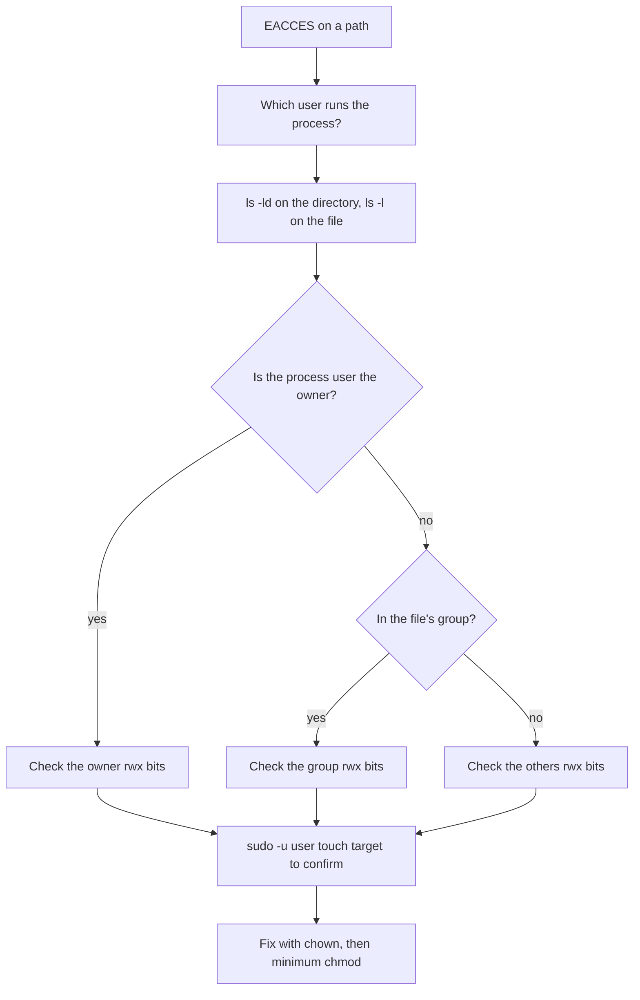

# Users, Permissions and SSH — Part 1

`EACCES: permission denied, open '/var/log/saas-api/app.log'`

That error will block you more often than any other Linux problem. The usual
response is `sudo chmod -R 777` and a promise to fix it later. This part is the
alternative: ten minutes of understanding that makes the error obvious every
time afterwards.

> **➡️ Continued in [Part 2](03-users-permissions-and-ssh-part-2.md).**

> **📌 In one line:** every file has an owner, a group and nine permission bits,
> every process runs as some user — and "permission denied" is always those two
> facts failing to line up.

## Table of Contents

1. [Users, Groups and root](#users-groups-and-root)
2. [What `sudo` Actually Does](#what-sudo-actually-does)
3. [Reading `-rw-r--r--` Character by Character](#reading--rw-r--r---character-by-character)
4. [Numeric Modes: 644, 755, 600](#numeric-modes-644-755-600)
5. [`chmod` and `chown`](#chmod-and-chown)
6. [`+x`: Why a Script Will Not Run](#x-why-a-script-will-not-run)
7. [Directory Permissions Are Different](#directory-permissions-are-different)
8. [`umask`](#umask)
9. [Why Your App Cannot Write to Its Own Log Directory](#why-your-app-cannot-write-to-its-own-log-directory)
10. [BROKEN vs FIXED: The 777 Reflex](#broken-vs-fixed-the-777-reflex)
11. [Common Mistakes](#common-mistakes)
12. [Questions to Test Yourself](#questions-to-test-yourself)
13. [Related](#related)

---

## Users, Groups and root

A **user** on Linux is an account with a numeric ID (UID) and a name. Every
process runs as exactly one user, and that user decides what it may touch. There
are three kinds:

| Kind | UID | Example | Purpose |
|---|---|---|---|
| root | `0` | `root` | The superuser. Every permission check is skipped |
| System users | 1–999 | `postgres`, `www-data`, `redis` | One per service, no login, no home |
| Normal users | 1000+ | `deploy`, `afsar` | People, and the account your app runs as |

A **group** is a named set of users. Every user has one *primary* group and may
belong to extra ones. Groups exist so several users or services can share access
to files without making those files readable by everyone.

```text
$ id
uid=1000(deploy) gid=1000(deploy) groups=1000(deploy),27(sudo),999(docker)

$ id postgres
uid=114(postgres) gid=120(postgres) groups=120(postgres),119(ssl-cert)
```

The `deploy` user is in `sudo` (may run commands as root) and `docker` (may talk
to the Docker daemon). Both are significant privileges.

**Why not run everything as root?** Because root skips all permission checks,
and there is no second line of defence. If your API runs as root and an attacker
finds a file-upload bug, they can write to `/etc/passwd`, install a service, and
read every secret on the machine. If it runs as `deploy`, they get whatever
`deploy` can reach, which should be your app directory and nothing else.

This is the **principle of least privilege**, and the reason the unit file in
[02-processes-and-services-part-2.md](02-processes-and-services-part-2.md) sets
`User=deploy`.

```text
$ grep -E "^(deploy|postgres):" /etc/passwd
deploy:x:1000:1000:Deploy User:/home/deploy:/bin/bash
postgres:x:114:120::/var/lib/postgresql:/usr/sbin/nologin
```

Note `/usr/sbin/nologin` for `postgres` — a service account cannot log in at
all, which is another layer of the same idea. Passwords are not in
`/etc/passwd`; they are hashed in `/etc/shadow`, readable only by root.

---

## What `sudo` Actually Does

`sudo` runs one command as another user, by default root. It is not a mode you
enter: each `sudo` elevates exactly one command.

```text
$ whoami
deploy
$ sudo whoami
root
$ whoami
deploy
```

Three things `sudo` gives you that "logging in as root" does not:

- **An audit trail.** Every `sudo` is logged with the user and command, so you
  can answer "who restarted the service at 3 AM?".
- **Per-command control.** `/etc/sudoers` can allow `deploy` to run exactly
  `systemctl restart saas-api` and nothing else.
- **Fewer accidents.** Typing `sudo` is a small pause that catches some mistakes.

```text
$ sudo -u postgres psql       # run as postgres, not root
$ sudo -l                     # what am I allowed to run?
$ sudo -i                     # a full root shell — avoid this habit
```

> **⚠️ Warning:** `sudo` applies to the command, not the whole line. In
> `sudo echo "x" > /root/file.txt` the **shell** opens the redirect as `deploy`,
> before `sudo` runs, so it fails with "Permission denied". Use
> `echo "x" | sudo tee /root/file.txt` instead.

---

## Reading `-rw-r--r--` Character by Character

Ten characters. The first is the file type from
[01-the-shell-and-filesystem-part-1.md](01-the-shell-and-filesystem-part-1.md).
The remaining nine are three groups of three.

```text
-  rw-   r--   r--
│   │     │     │
│   │     │     └─ others:  anyone else on the machine
│   │     └─────── group:   members of the file's group
│   └───────────── owner:   the user who owns the file
└───────────────── type:    - file, d directory, l symlink
```

Within each group of three, the positions are always `r`, `w`, `x` in that
order, and a `-` means "not granted".

| Letter | On a file | On a directory |
|---|---|---|
| `r` | Read the contents | List the names inside |
| `w` | Change the contents | Create, rename or delete entries inside |
| `x` | Run it as a program | **Enter it**, and access things through it |

So `-rw-r--r--` is: owner may read and write, group may read, others may read,
and nobody may execute. That is the normal mode for a config file or a document.

```text
$ ls -l /opt/saas-api
-rw-r--r-- 1 deploy deploy  1842 Oct  1 03:12 package.json
-rwxr-xr-x 1 deploy deploy   412 Oct  1 03:12 deploy.sh
drwxr-xr-x 4 deploy deploy  4096 Oct  3 06:00 build
-rw------- 1 deploy deploy   184 Oct  1 03:12 .env
drwx------ 2 deploy deploy  4096 Oct  3 06:00 storage
```

Read each line as a sentence: `package.json` is readable by all and writable by
`deploy`; `deploy.sh` is also executable by all; `.env` is readable only by
`deploy`, correct for secrets; `storage` can only be entered by `deploy`.

**Which group applies to you?** The check stops at the first match: if you are
the owner, the owner bits apply — *even if the group bits are more generous*.
A file `-r--rw-r--` owned by you is one you cannot write, although the group can.

---

## Numeric Modes: 644, 755, 600

Each permission has a value: `r` = 4, `w` = 2, `x` = 1. Add them per group and
you get one digit from 0 to 7.

| Digit | Letters | Means |
|---|---|---|
| 0 | `---` | Nothing |
| 1 | `--x` | Execute only |
| 2 | `-w-` | Write only |
| 3 | `-wx` | Write and execute |
| 4 | `r--` | Read only |
| 5 | `r-x` | Read and execute |
| 6 | `rw-` | Read and write |
| 7 | `rwx` | Everything |

Three digits, one per group: owner, group, others.

| Mode | Letters | Use it for |
|---|---|---|
| `644` | `rw-r--r--` | Normal files: source, config, documents |
| `755` | `rwxr-xr-x` | Scripts, binaries, and **most directories** |
| `600` | `rw-------` | Secrets: `.env`, private keys, `EnvironmentFile` |
| `700` | `rwx------` | Private directories: `~/.ssh` |
| `664` | `rw-rw-r--` | A file a whole group edits |
| `775` | `rwxrwxr-x` | A directory a whole group writes into |
| `777` | `rwxrwxrwx` | **Nothing.** See the BROKEN vs FIXED section |

> **💡 Tip:** you only need four of these in practice — `644` for files, `755`
> for directories and scripts, `600` for secrets, `700` for secret directories.
> Everything else is a variation you can derive from the digit table.

---

## `chmod` and `chown`

**`chmod` changes permissions.** Two syntaxes; both are common.

```text
$ chmod 755 deploy.sh              # numeric: set exactly this
$ chmod +x deploy.sh               # symbolic: add execute for everyone
$ chmod u+x deploy.sh              # add execute for the owner only
$ chmod g-w config.json            # remove write from the group
$ chmod o= .env                    # remove everything from others
$ chmod -R 755 /opt/saas-api/build # recursive, for a whole tree
```

Numeric sets the mode absolutely. Symbolic adjusts what is already there. Use
numeric when you know the target state, symbolic for a single change.

**`chown` changes the owner, and optionally the group.**

```text
$ sudo chown deploy /var/log/saas-api/app.log          # owner only
$ sudo chown deploy:deploy /var/log/saas-api/app.log   # owner and group
$ sudo chown -R deploy:deploy /opt/saas-api            # whole tree
$ sudo chgrp adm /var/log/saas-api/error.log           # group only
```

`chown` needs root, because otherwise you could give a file away to dodge a
disk quota, or take one. `chmod` only needs you to be the owner.

> **⚠️ Warning:** `chmod -R 755` on a tree makes **every file** executable,
> including `.env` and your JSON configs. Prefer `find . -type d -exec chmod 755
> {} +` and `find . -type f -exec chmod 644 {} +`, which treats directories and
> files differently — which, as the next section shows, they are.

---

## `+x`: Why a Script Will Not Run

Linux does not look at the file extension. A file called `deploy.sh` is not
executable because it ends in `.sh`; it is executable because the `x` bit is set.

```text
$ ls -l deploy.sh
-rw-r--r-- 1 deploy deploy 412 Oct  4 10:02 deploy.sh

$ ./deploy.sh
bash: ./deploy.sh: Permission denied

$ chmod +x deploy.sh
$ ls -l deploy.sh
-rwxr-xr-x 1 deploy deploy 412 Oct  4 10:02 deploy.sh

$ ./deploy.sh
Deploying saas-api...
```

The `x` bit tells the kernel it may run this file. It then reads the first line
for a **shebang** — `#!/bin/bash` — telling it which interpreter to use. Without
a shebang the shell guesses, usually wrongly, so always include one.

> **📌 Remember:** `bash deploy.sh` works even without the `x` bit, because you
> are running `bash` (which *is* executable) and handing it a file to read. That
> is why a script sometimes works one way and not the other.

Git stores this bit, so `git update-index --chmod=+x deploy.sh` makes a script
executable for everyone who clones the repository.

---

## Directory Permissions Are Different

This is the part that surprises everyone, so read it twice.

On a directory, the three bits mean something other than what they mean on a
file:

| Bit | On a directory | Practical effect |
|---|---|---|
| `r` | List the names inside | `ls` works |
| `w` | Add, remove or rename entries | Create and **delete** files |
| `x` | **Traverse** it | Open anything inside, or `cd` into it |

Three consequences that cause real bugs:

**1. Without `x`, `r` is almost useless.** You see the names but cannot open
anything.

```text
$ ls -ld reports
dr--r--r-- 2 deploy deploy 4096 Oct  4 10:14 reports
$ ls reports
invoice-8812.pdf
$ cat reports/invoice-8812.pdf
cat: reports/invoice-8812.pdf: Permission denied
```

**2. Deleting a file depends on the directory, not the file.** Write permission
on `/var/log/saas-api` lets you delete `app.log` even if `app.log` is `444` and
owned by root. The name lives in the directory, so removing it changes the
directory.

**3. Creating a file needs `w` *and* `x` on the directory.** This is the whole
"cannot write to its own log directory" bug, two sections down.

> **💡 Tip:** that is why directories are `755` and files are `644`. The `x` on
> a directory is not "executable", it is "you may go through this door".

The **sticky bit** is the exception you will meet on `/tmp`:

```text
$ ls -ld /tmp
drwxrwxrwt 18 root root 4096 Oct  4 10:20 /tmp
```

That final `t` means everyone may create files, but you may only delete your
own. Without it, any user could delete another user's temporary files.

---

## `umask`

When a process creates a file, it asks for a mode — usually `666` for files and
`777` for directories. The **umask** then removes bits from that request.

```text
$ umask
0022
$ touch new-file.txt && mkdir new-dir
$ ls -l new-file.txt && ls -ld new-dir
-rw-r--r-- 1 deploy deploy 0 Oct  4 10:22 new-file.txt
drwxr-xr-x 2 deploy deploy 4096 Oct  4 10:22 new-dir
```

`666` minus `022` gives `644`; `777` minus `022` gives `755` — the two defaults
from the table above. Files never get `x` by default, which is why every new
script needs `chmod +x`. A umask of `077` means "nobody but me", which is what
you want for a process writing secrets: in systemd, set `UMask=0077`.

---

## Why Your App Cannot Write to Its Own Log Directory

The most common permission bug in a deployment. Here is the whole diagnosis,
end to end, with no guessing.

**The symptom.** The service will not stay up:

```text
$ systemctl status saas-api
× saas-api.service - SaaS API (AdonisJS)
     Active: failed (Result: exit-code) since Sat 2026-10-04 10:31:02 UTC; 4s ago

Oct 04 10:31:02 app-01 saas-api[20114]: Error: EACCES: permission denied,
                                        open '/var/log/saas-api/app.log'
```

**Step 1 — which user is the process?** Never assume.

```text
$ grep User /etc/systemd/system/saas-api.service
User=deploy
```

**Step 2 — what are the permissions on the target?** Check the directory, not
just the file, because the directory is usually the real culprit.

```text
$ ls -ld /var/log/saas-api
drwxr-xr-x 2 root root 4096 Oct  4 10:30 /var/log/saas-api
```

**Step 3 — read it out loud.** The directory is owned by `root:root` with mode
`755`. For `others` — which is what `deploy` is here — that is `r-x`: list and
enter, but **no `w`**. Creating `app.log` needs `w` on the directory. That is
the bug, and it is already proved.

**Step 4 — confirm by acting as the user.** This is the step people skip, and it
removes all doubt:

```text
$ sudo -u deploy touch /var/log/saas-api/test.log
touch: cannot touch '/var/log/saas-api/test.log': Permission denied
```

**Step 5 — fix it with ownership, not with 777.**

```text
$ sudo chown -R deploy:deploy /var/log/saas-api
$ ls -ld /var/log/saas-api
drwxr-xr-x 2 deploy deploy 4096 Oct  4 10:30 /var/log/saas-api
```

**Step 6 — verify the same way you diagnosed.**

```text
$ sudo -u deploy touch /var/log/saas-api/test.log && echo OK
OK
$ sudo systemctl restart saas-api && systemctl is-active saas-api
active
```



> **📌 Remember:** the order is always the same — **who is the process, what does
> the path allow, prove it with `sudo -u`, then fix ownership first.** Changing
> permissions before you know the user is guessing.

---

## BROKEN vs FIXED: The 777 Reflex

```bash
# ❌ BROKEN - every user and every process on the machine can now write here,
#             and -R made every file executable too
sudo chmod -R 777 /var/log/saas-api
```

It works, which is why the habit sticks. It also means any compromised process
can rewrite your logs to hide its tracks, any user can delete them, and anyone
can plant an executable there. The real bug — wrong ownership — is still there,
and now it is invisible.

```bash
# ✅ FIXED - the app's user owns the directory, nobody else gains anything
sudo chown -R deploy:deploy /var/log/saas-api
sudo chmod 755 /var/log/saas-api
```

If two services genuinely need to write to the same place, the answer is a
shared group, not `777`:

```text
$ sudo groupadd saas
$ sudo usermod -aG saas deploy && sudo usermod -aG saas backup-agent
$ sudo chgrp -R saas /var/log/saas-api
$ sudo chmod 775 /var/log/saas-api
```

> **⚠️ Warning:** group membership is read when a process starts. After
> `usermod -aG`, an existing session or a running service still has the old
> groups. Log out and back in, or restart the service.

---

## Common Mistakes

| Mistake | Why it is wrong | Do this instead |
|---|---|---|
| `chmod -R 777` to fix EACCES | Grants everyone write access and hides the real cause | `chown` to the app's user, then `755` |
| Running the app as `root` | Any app bug becomes a full machine compromise | `User=deploy` in the unit file |
| Checking the file but not the directory | Creating a file needs `w` and `x` on the **directory** | `ls -ld` on the directory first |
| `chmod -R 755` across a project | Marks `.env` and JSON files executable | Separate `find -type d` and `find -type f` |
| Assuming group bits help the owner | The owner's bits win; later groups are never checked | Check the owner bits first |
| `sudo echo x > /root/f` | The shell opens the redirect before `sudo` runs | `echo x \| sudo tee /root/f` |
| Expecting `usermod -aG` to apply at once | Groups are read at process start | Log out and in, or restart the service |
| Leaving `.env` at `644` | Every user on the machine can read your secrets | `chmod 600 .env` |

---

## Questions to Test Yourself

1. Read `-rw-r-----  1 deploy adm 18K error.log` aloud. Who can do what, and
   what happens when user `afsar`, not in `adm`, runs `cat` on it?
2. A file is `-r--rw-r--` and owned by you. Can you write to it? Explain the
   rule that decides.
3. Why is `755` right for a directory but usually wrong for a `.env` file?
4. Explain why you can delete a `444` file owned by root from a directory you
   own.
5. `./deploy.sh` says "Permission denied" but `bash deploy.sh` works. Why?
6. Your `umask` is `0022`. What mode does a newly created file get, and why is
   it never executable?
7. Walk through all six diagnosis steps for an `EACCES` on
   `/var/lib/saas-api/uploads`, in order, saying what each step proves.
8. Name three specific bad outcomes of `chmod -R 777` on a log directory.
9. You add `deploy` to a new group and the service still cannot read the file.
   What did you forget?

---

## Related

- [Users, Permissions and SSH — Part 2](03-users-permissions-and-ssh-part-2.md)
  — SSH keys, copying files, `~/.ssh/config`, server hardening and tunnels.
- [The Shell and the Filesystem — Part 1](01-the-shell-and-filesystem-part-1.md)
  — the `ls -lah` output these nine characters come from.
- [Processes and Services — Part 2](02-processes-and-services-part-2.md) — the
  `User=` and `EnvironmentFile=` directives that depend on all of this.
- [Logs, Disks and Debugging — Part 1](05-logs-disks-and-debugging-part-1.md) —
  the log directory whose ownership you just fixed.
- [Secrets and Configuration — Part 1](../../backend-fundamentals/11-api-security/05-secrets-and-configuration-part-1.md)
  — why the `.env` file is `600` and owned by one user.
