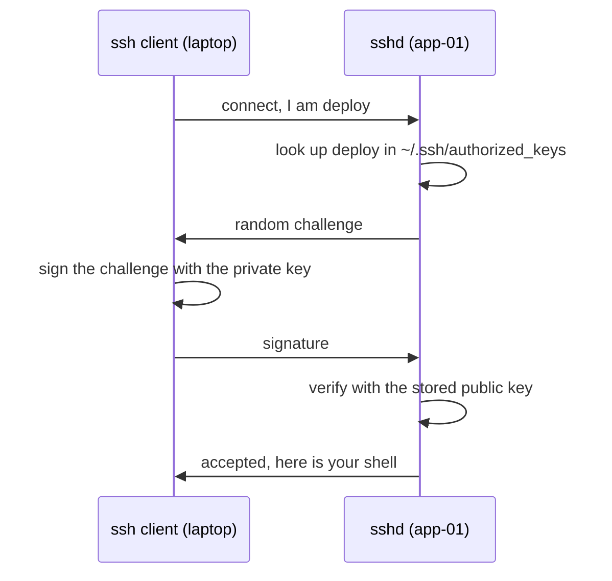

# Users, Permissions and SSH — Part 2

A server has no screen and no keyboard. Everything you will ever do to it goes
through SSH, which makes SSH both the most useful tool in this track and the one
most worth getting right — a mistake here either locks you out of your own
machine or lets someone else in. This part takes SSH from "what is it" to keys,
file copying, a config file that saves you typing, the three hardening steps
that matter, and tunnels, which are how you reach a database that is not
exposed to the internet.

> **⬅️ This continues [Part 1](03-users-permissions-and-ssh-part-1.md).**

> **📌 In one line:** SSH proves who you are with a key pair whose private half
> never leaves your laptop — so hardening a server means turning off every other
> way in.

## Table of Contents

1. [What SSH Is](#what-ssh-is)
2. [How Key-Based Authentication Works](#how-key-based-authentication-works)
3. [Generating a Key Pair](#generating-a-key-pair)
4. [`authorized_keys` and Getting Your Key Onto the Server](#authorized_keys-and-getting-your-key-onto-the-server)
5. [Permissions on `~/.ssh`](#permissions-on-ssh)
6. [Copying Files: `scp` and `rsync`](#copying-files-scp-and-rsync)
7. [`~/.ssh/config`](#sshconfig)
8. [Hardening a Server's SSH](#hardening-a-servers-ssh)
9. [`ssh-agent` and Agent Forwarding](#ssh-agent-and-agent-forwarding)
10. [Advanced: SSH Tunnels](#advanced-ssh-tunnels)
11. [Common Mistakes](#common-mistakes)
12. [Questions to Test Yourself](#questions-to-test-yourself)
13. [Related](#related)

---

## What SSH Is

**SSH** stands for Secure Shell. It is a protocol that gives you an encrypted
connection to a shell on another machine. Two programs are involved:

- The **client**, `ssh`, running on your laptop.
- The **server**, `sshd`, a daemon running on the remote machine and listening
  on port 22.

```text
   your laptop                            app-01
┌───────────────┐                   ┌──────────────────┐
│   ssh client  │ ───── TCP 22 ────▶│  sshd            │
│               │   encrypted       │   └─ bash as you │
└───────────────┘                   └──────────────────┘
```

Everything is encrypted, which is why SSH replaced `telnet` decades ago. But
encryption only protects the *channel*. The server still has to answer a
separate question — **are you allowed in?** — and there are two ways to do it.

| Method | How it works | Problem |
|---|---|---|
| Password | You type the account's password | Guessable, brute-forceable, reusable, typed into anything that asks |
| Public key | You prove you hold a private key | Nothing to guess, nothing to type, nothing to steal remotely |

Any server with a public IP and password login enabled receives thousands of
attempts a day from bots trying `root`/`admin`/`test`. Look at
`/var/log/auth.log` on a fresh cloud VM after an hour. Keys make that entire
category of attack impossible.

---

## How Key-Based Authentication Works

A **key pair** is two mathematically linked files:

- The **private key** (`~/.ssh/id_ed25519`) — stays on your laptop, forever.
- The **public key** (`~/.ssh/id_ed25519.pub`) — copied to every server you
  want to reach. Safe to share, email, or paste into GitHub.

The core property: something signed by the private key can be verified with the
public key, but the public key cannot produce a signature. So a server holding
your public key can check that you hold the private one without ever seeing it.



Note what never crosses the network: the private key, and any password. Someone
recording the whole conversation learns nothing reusable, because the challenge
is different every time.

> **📌 Remember:** the private key never leaves the machine it was created on.
> Not in Slack, not in a repository, not in a CI secret, not "just this once".
> If a key needs to be on two machines, generate two key pairs.

---

## Generating a Key Pair

Run this on your **laptop**, not on the server.

```text
$ ssh-keygen -t ed25519 -C "afsar@appifylab.com"
Enter file in which to save the key (/home/afsar/.ssh/id_ed25519):
Enter passphrase (empty for no passphrase):
Your identification has been saved in /home/afsar/.ssh/id_ed25519
Your public key has been saved in /home/afsar/.ssh/id_ed25519.pub
The key fingerprint is:
SHA256:7xK2mQ8vR4tL9nP1wY3zA6bC5dE0fG8hJ2kM4nQ6rS8 afsar@appifylab.com
```

`-t ed25519` picks the algorithm: short, fast and secure, so prefer it over RSA
unless something old refuses it (then `-t rsa -b 4096`). `-C` is only a comment
stored in the public key, so use something that identifies the machine. **The
passphrase encrypts the private key file** — use one, because then a stolen
laptop is not immediately a compromised server, and `ssh-agent` means you type
it once per session.

```text
$ ls -l ~/.ssh/
-rw------- 1 afsar afsar  411 Oct  4 11:02 id_ed25519
-rw-r--r-- 1 afsar afsar   99 Oct  4 11:02 id_ed25519.pub

$ cat ~/.ssh/id_ed25519.pub
ssh-ed25519 AAAAC3NzaC1lZDI1NTE5AAAAIK3vL9... afsar@appifylab.com
```

The private key is `600` and the public key `644`. That is not decoration — two
sections down shows what happens when it is wrong.

---

## `authorized_keys` and Getting Your Key Onto the Server

On the server, each user has a file `~/.ssh/authorized_keys`: a plain list of
public keys, one per line. If the key you present matches any line, you are let
in as that user. The easy way to add yours:

```text
$ ssh-copy-id deploy@203.0.113.40
/usr/bin/ssh-copy-id: INFO: attempting to log in with the new key(s)
deploy@203.0.113.40's password:
Number of key(s) added: 1

$ ssh deploy@203.0.113.40
Welcome to Ubuntu 24.04.3 LTS (GNU/Linux 6.8.0-45-generic x86_64)
deploy@app-01:~$
```

That was the last time you type that password. If `ssh-copy-id` is unavailable,
or the server already allows keys only, append it by hand:

```text
$ cat ~/.ssh/id_ed25519.pub | ssh deploy@203.0.113.40 \
    "mkdir -p ~/.ssh && chmod 700 ~/.ssh && cat >> ~/.ssh/authorized_keys && chmod 600 ~/.ssh/authorized_keys"
```

> **💡 Tip:** when you create a cloud VM, the provider asks for a public key and
> writes it into `authorized_keys` at first boot. Same mechanism, done for you.

Removing access is just as simple: delete that person's line. This is a real
advantage over shared passwords — revoking one person disturbs nobody else.

---

## Permissions on `~/.ssh`

SSH refuses to use files other users can read or write — a private key your
colleagues can read is not a private key. The error message confuses everyone
the first time.

```text
$ ssh deploy@203.0.113.40
@@@@@@@@@@@@@@@@@@@@@@@@@@@@@@@@@@@@@@@@@@@@@@@@@@@@@@@@@@@
@         WARNING: UNPROTECTED PRIVATE KEY FILE!          @
@@@@@@@@@@@@@@@@@@@@@@@@@@@@@@@@@@@@@@@@@@@@@@@@@@@@@@@@@@@
Permissions 0644 for '/home/afsar/.ssh/id_ed25519' are too open.
It is required that your private key files are NOT accessible by others.
This private key will be ignored.
Load key "/home/afsar/.ssh/id_ed25519": bad permissions
deploy@203.0.113.40: Permission denied (publickey).
```

Read the last line carefully: `Permission denied (publickey)`. It looks like the
server rejected you. It did not — your own client refused to use the key, so no
key was offered at all.

The required modes, on **both** machines:

| Path | Mode | Why |
|---|---|---|
| `~` | `755` or stricter | Must not be group- or world-writable |
| `~/.ssh` | `700` | Only you may enter it |
| `~/.ssh/id_ed25519` | `600` | Only you may read the private key |
| `~/.ssh/id_ed25519.pub` | `644` | Public, harmless |
| `~/.ssh/authorized_keys` | `600` | If others could write it, they could add their own key |

The fix, worth memorising:

```text
$ chmod 700 ~/.ssh
$ chmod 600 ~/.ssh/id_ed25519 ~/.ssh/authorized_keys ~/.ssh/config
```

> **⚠️ Warning:** the same rules apply on the **server** side. If
> `/home/deploy/.ssh` is `777`, `sshd` silently ignores `authorized_keys` and
> you get `Permission denied (publickey)` with nothing useful in your terminal.
> The explanation is in the server's own log: `sudo journalctl -u ssh -n 50`.

When a key login fails, `ssh -v` shows exactly which keys were offered and what
the server said about each. Use it before guessing.

---

## Copying Files: `scp` and `rsync`

**`scp`** copies files over the same SSH connection. Simple, fine for one file.

```text
$ scp ./dump.sql deploy@203.0.113.40:/tmp/dump.sql
dump.sql                                  100%  2184KB   4.1MB/s   00:00

$ scp deploy@203.0.113.40:/var/log/saas-api/app.log ./app.log
app.log                                   100%   47MB   6.2MB/s   00:07
```

The shape is `scp SOURCE DESTINATION`, where either side may be
`user@host:/path`. `-r` is needed for directories.

**`rsync`** is what you should use for anything repeated. It transfers only the
differences, so the second run of a 400 MB deploy takes a second.

```text
$ rsync -avz --delete ./build/ deploy@203.0.113.40:/opt/saas-api/build/
sending incremental file list
build/bin/server.js
build/app/controllers/invoices_controller.js

sent 184,221 bytes  received 1,204 bytes  123,616.67 bytes/sec
total size is 48,221,904  speedup is 259.95
```

`speedup is 259.95` is the point: 48 MB of files, 184 KB actually sent.

| Flag | Does |
|---|---|
| `-a` | Archive: recursive, preserving permissions and timestamps |
| `-v` / `-z` | Verbose, so you see what moved / compress during transfer |
| `--delete` | Remove destination files that are gone from the source |
| `--exclude` | Skip a pattern, quoted so the shell leaves it alone |
| `--dry-run` | Show what would happen and change nothing |

> **⚠️ Warning:** the trailing slash on the source changes everything. `./build/`
> copies the *contents* into the destination; `./build` copies the *directory*,
> giving `/opt/saas-api/build/build`. Always `--dry-run` the first time.

---

## `~/.ssh/config`

Typing `ssh -i ~/.ssh/deploy_key -p 2222 deploy@203.0.113.40` twenty times a day
is a waste. The client reads `~/.ssh/config`, which lets you name hosts.

```text
# ~/.ssh/config

Host app-01
    HostName 203.0.113.40
    User deploy
    IdentityFile ~/.ssh/id_ed25519

Host db-01
    HostName 10.0.1.20
    User deploy
    # Reach the private database host by hopping through app-01 first
    ProxyJump app-01

Host *
    # Keep idle connections alive through NAT and load balancers
    ServerAliveInterval 60
    # Reuse one connection for several sessions - noticeably faster
    ControlMaster auto
    ControlPath ~/.ssh/control-%r@%h:%p
    ControlPersist 10m
```

Now everything is short — `ssh app-01`, `scp ./dump.sql app-01:/tmp/`,
`rsync -avz ./build/ app-01:/opt/saas-api/build/` — because `scp` and `rsync`
read the same config.

`ProxyJump` is worth noticing: `db-01` has a private address unreachable from
the internet, but `ssh db-01` works, because the client connects to `app-01`
first and tunnels through it.

---

## Hardening a Server's SSH

Three changes. Do these three, in this order, and change nothing else until
they are done. Everything is in `/etc/ssh/sshd_config`.

**1. Make sure key login works first.** This is a step, not a preamble. Open a
**second** terminal, log in with your key, and leave that session open while you
make the changes. If you lock yourself out, that session is your way back.

**2. Disable password authentication.** A bot can then guess forever and never
get in, because there is nothing to guess.

```text
PasswordAuthentication no
KbdInteractiveAuthentication no
PubkeyAuthentication yes
```

**3. Disable root login.** `root` is the one username every attacker knows
exists. Log in as `deploy` and use `sudo`, which also gives you the audit trail
from Part 1.

```text
PermitRootLogin no
```

Then test and reload:

```text
$ sudo sshd -t                       # check the config file for syntax errors
$ sudo systemctl reload ssh
$ ssh deploy@203.0.113.40            # from a NEW terminal, before closing the old one
deploy@app-01:~$
```

> **⚠️ Warning:** run `sudo sshd -t` before every reload. A typo in
> `sshd_config` makes `sshd` fail to start, and if you already closed your
> session you now need console access from your cloud provider to recover.

Why "change nothing else": every extra option is another chance to lock yourself
out, and those three remove almost all of the risk. Once they are in place,
these are reasonable next steps:

| Option | Effect | Worth it? |
|---|---|---|
| `AllowUsers deploy` | Only this user may log in at all | Yes, once stable |
| `Port 2222` | Moves SSH off 22 | Only cuts log noise, not real attacks |
| `fail2ban` | Bans IPs that fail repeatedly | Mostly redundant once passwords are off |
| `MaxAuthTries 3` | Fewer attempts per connection | Cheap, harmless |

Secrets management for the deploy keys and tokens this server needs is a
separate topic:
[Secrets and Configuration — Part 1](../../backend-fundamentals/11-api-security/05-secrets-and-configuration-part-1.md).

---

## `ssh-agent` and Agent Forwarding

With a passphrase on your key, SSH asks for it every connection. **`ssh-agent`**
holds the decrypted key in memory, so you type the passphrase once per session.

```text
$ eval "$(ssh-agent -s)"
Agent pid 24115

$ ssh-add ~/.ssh/id_ed25519
Enter passphrase for /home/afsar/.ssh/id_ed25519:
Identity added: /home/afsar/.ssh/id_ed25519 (afsar@appifylab.com)

$ ssh-add -l
256 SHA256:7xK2mQ8vR4tL9nP1wY3zA6bC5dE0fG8hJ2kM4nQ6rS8 afsar@appifylab.com (ED25519)
```

Most desktop Linux and macOS start an agent for you. `ssh-add -l` lists what is
loaded; `ssh-add -D` forgets everything.

**Agent forwarding** (`ssh -A app-01`) lets a program on the remote server use
your local agent to authenticate onwards — `git pull` on the server using your
GitHub key, without that key ever being on the server.

> **⚠️ Warning:** agent forwarding to a host you do not fully trust is
> dangerous. While you are connected, **root on that server can use your agent
> socket to authenticate as you** to any machine your key opens, including
> production and GitHub. They cannot copy the key, but they do not need to. Use
> `ProxyJump`, which tunnels through the server without exposing the agent.

---

## Advanced: SSH Tunnels

Your production Postgres is on `10.0.1.20:5432`, on a private network with no
public address. That is correct — a database should never be exposed to the
internet. But you need to run one query from a GUI client on your laptop.

**Local port forwarding** opens a port on *your* machine and forwards everything
sent to it through the SSH connection, out of the server, to a destination the
server can reach.

```text
$ ssh -L 15432:10.0.1.20:5432 app-01
```

Read `-L` as `LOCAL_PORT:TARGET_HOST:TARGET_PORT`: "listen on 15432 here, send
it to 10.0.1.20 port 5432 as seen from app-01."

```text
   your laptop                    app-01                   db-01
┌──────────────────┐        ┌───────────────┐        ┌──────────────┐
│ psql -p 15432    │        │               │        │              │
│       │          │        │               │        │ postgres     │
│  localhost:15432 ├──SSH──▶│ forwards to ──┼───────▶│ 10.0.1.20    │
└──────────────────┘   22   └───────────────┘  5432  └──────────────┘
```

With that session open, in another terminal on your laptop:

```text
$ psql -h localhost -p 15432 -U saas_readonly -d saas_production
psql (17.2)
saas_production=> SELECT count(*) FROM invoices WHERE status = 'overdue';
 count
-------
   184
(1 row)
```

Your GUI client connects to `localhost:15432` with no idea a tunnel exists, and
closing the SSH session closes the tunnel. Adding `-N` means "do not run a
shell, just forward", which is what you want for a tunnel you leave open:
`ssh -N -L 15432:10.0.1.20:5432 app-01 &`. Or put it in `~/.ssh/config` so
`ssh db-tunnel` is enough:

```text
Host db-tunnel
    HostName 203.0.113.40
    User deploy
    LocalForward 15432 10.0.1.20:5432
    RequestTTY no
```

Three directions exist; you will use the first almost exclusively. `-L` forwards
a local port out to the remote network, which is how you reach a private
database. `-R` forwards a remote port back to your machine, which is rare. `-D`
opens a SOCKS proxy that routes a browser through the server.

> **📌 Remember:** a tunnel is for **you**, temporarily — not deployment
> architecture. An app that needs the database should run where it can reach the
> database. A tunnel in a script is a fragile dependency nobody finds at 2 AM.

---

## Common Mistakes

| Mistake | Why it is wrong | Do this instead |
|---|---|---|
| Copying the private key to the server | A private key on a server is a compromised key | Copy only `.pub`; generate a second pair if needed |
| `chmod 777 ~/.ssh` to "fix" login | SSH ignores the files entirely and login still fails | `700` on the directory, `600` on the keys |
| Disabling password login with no second session open | One typo and you are locked out of your own server | Keep a verified session open, `sudo sshd -t` first |
| Reading `Permission denied (publickey)` as a server problem | Often your client refused its own key over file modes | `ssh -v`, then check local modes |
| `ssh -A` to any machine you can reach | Root there can authenticate as you, anywhere | `ProxyJump`, or no forwarding |
| `rsync -a ./build` without the trailing slash | Creates `build/build` on the destination | `./build/`, and `--dry-run` first |
| A tunnel as part of production architecture | Dies with the SSH session, invisible to monitoring | Run the app where it can reach the database |
| Sharing one key across the whole team | Revoking one person revokes everyone | One key pair per person per machine |

---

## Questions to Test Yourself

1. Explain why the public key is safe to publish while the private key never
   leaves your laptop. What property of the pair makes that true?
2. Nothing secret crosses the network during a key login. So what does the
   server actually check?
3. You see `Permission denied (publickey)` and the private key is `644`. Who
   rejected the login — the client or the server? How do you prove it?
4. Give the order of the three hardening steps and explain why key login must be
   verified first.
5. Describe concretely what someone with root on a server can do while you are
   connected with `ssh -A`. What should you use instead?
6. In `ssh -L 15432:10.0.1.20:5432 app-01`, which machine resolves and connects
   to `10.0.1.20`, and why does that matter?
7. `rsync -avz ./build app-01:/opt/saas-api/build/` produced
   `/opt/saas-api/build/build`. What was wrong?
8. Your teammate suggests a permanent SSH tunnel so the API can reach the
   database. Give two reasons that is a bad architecture.

---

## Related

- [Users, Permissions and SSH — Part 1](03-users-permissions-and-ssh-part-1.md)
  — the `600` and `700` modes SSH insists on, explained from first principles.
- [Networking, Ports and Firewalls — Part 1](04-networking-ports-and-firewalls-part-1.md)
  — port 22, what else is listening, and the firewall rule that must come first.
- [Logs, Disks and Debugging — Part 1](05-logs-disks-and-debugging-part-1.md) —
  `journalctl -u ssh` and `/var/log/auth.log`, where failed logins are recorded.
- [Secrets and Configuration — Part 1](../../backend-fundamentals/11-api-security/05-secrets-and-configuration-part-1.md)
  — how deploy keys and tokens should be stored once they reach the server.
- [HTTPS and TLS](../../backend-fundamentals/01-http-foundations/06-https-and-tls.md)
  — the same public-key idea, applied to web traffic instead of logins.
