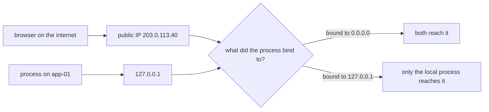
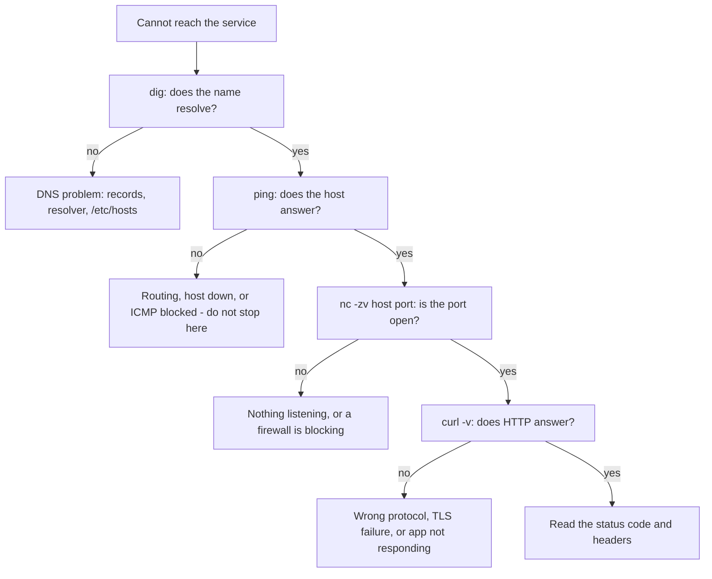

# Networking, Ports and Firewalls — Part 1

"It works on my laptop but not from outside." Almost every deployment produces
this sentence at least once, and almost every time the cause is one of three
things: the process is not listening, it is listening on the wrong address, or
something between you and it is blocking the port.

This part gives you the tools to tell those three apart in under a minute. It is
about ports and addresses **from the machine's side** — not protocol theory.

> **➡️ Continued in [Part 2](04-networking-ports-and-firewalls-part-2.md).**

> **📌 In one line:** a port is a number a process claims on a specific address,
> and "it works locally but not from outside" is almost always that address
> being `127.0.0.1` when it should be `0.0.0.0`.

## Table of Contents

1. [A Port, From the Machine's Side](#a-port-from-the-machines-side)
2. [`localhost` vs `0.0.0.0` vs a Public IP](#localhost-vs-0000-vs-a-public-ip)
3. [BROKEN vs FIXED: Binding in Node](#broken-vs-fixed-binding-in-node)
4. [Seeing What Is Listening: `ss -tulpn`](#seeing-what-is-listening-ss--tulpn)
5. [Port Already in Use](#port-already-in-use)
6. [The Troubleshooting Ladder](#the-troubleshooting-ladder)
7. [Rung 1: `ping` — Is the Host There?](#rung-1-ping--is-the-host-there)
8. [Rung 2: `dig` — Does the Name Resolve?](#rung-2-dig--does-the-name-resolve)
9. [Rung 3: `nc` — Is the Port Open?](#rung-3-nc--is-the-port-open)
10. [Rung 4: `curl -v` — Does HTTP Work?](#rung-4-curl--v--does-http-work)
11. [Common Mistakes](#common-mistakes)
12. [Questions to Test Yourself](#questions-to-test-yourself)
13. [Related](#related)

---

## A Port, From the Machine's Side

You already know ports from the protocol side: HTTP is 80, HTTPS is 443, your
API is 3333. If that is hazy, read
[How the Web Works](../../backend-fundamentals/01-http-foundations/01-how-the-web-works.md)
and the [networking/](../../networking/README.md) track, which cover TCP, IP and
the protocol stack. This file does not repeat any of it.

From the **machine's** side a port is simpler and more concrete. One machine has
one IP address but runs many programs. When a packet arrives, the kernel needs
to know which program gets it. The port number is that answer: a 16-bit number,
1 to 65535, that a process **claims**.

The claim is the important word. A process calls `listen()` on a port, and from
then on the kernel delivers matching packets to it. Two consequences follow:

- **A port can be claimed by only one process at a time** (for the same address
  and protocol). That is why `EADDRINUSE` exists.
- **A port with nothing listening is closed.** Nothing answers, and the kernel
  replies "connection refused" immediately.

```text
                 app-01   (IP 203.0.113.40)
     ┌───────────────────────────────────────────┐
     │  kernel                                   │
     │   :22   ──▶ sshd                          │
     │   :80   ──▶ nginx                         │
     │   :443  ──▶ nginx                         │
     │   :3333 ──▶ node (your API)               │
     │   :5432 ──▶ postgres                      │
     │   :6379 ──▶ redis                         │
     └───────────────────────────────────────────┘
```

Ports below 1024 are **privileged**: only root may bind to them. That is why
your Node app listens on 3333 and nginx — started by root, then dropping
privileges — handles 80 and 443 in front of it.

| Port | Usually |
|---|---|
| 22 | SSH |
| 80 / 443 | HTTP / HTTPS, normally nginx |
| 3000, 3333, 8080 | Application servers in development |
| 5432 | PostgreSQL |
| 6379 | Redis |

---

## `localhost` vs `0.0.0.0` vs a Public IP

This is the single most valuable idea in this file.

A machine does not have one address. It has one per **network interface**, plus
a special one that never leaves the machine.

```text
$ ip -brief addr
lo               UNKNOWN        127.0.0.1/8
eth0             UP             10.0.1.15/24
```

- `lo` is the **loopback** interface, address `127.0.0.1`, name `localhost`.
  Packets sent here never touch a network card. Only this machine can reach it.
- `eth0` is a real interface with a real address that other machines can reach.

When a process listens, it does not only choose a port — it chooses **which
address to listen on**. That choice decides who can connect.

| Bind address | Who can connect | Use it for |
|---|---|---|
| `127.0.0.1` | Only processes on this same machine | Postgres, Redis, an app behind nginx on the same host |
| `0.0.0.0` | Anyone who can reach **any** of this machine's addresses | A server that must be reachable from outside |
| `10.0.1.15` | Anyone who can reach that one interface | Private network only, not the public one |
| `::` | Same as `0.0.0.0`, for IPv6 | Dual-stack servers |

`0.0.0.0` is not an address you connect *to*. It is a wildcard meaning "every
address this machine has, including ones added later".



**The failure, concretely.** Your Node app binds to `127.0.0.1:3333`. On the
server, `curl http://localhost:3333/health` returns `200`. From your laptop,
`curl http://203.0.113.40:3333/health` hangs or is refused. Nothing is broken
and no firewall is involved — the process simply never agreed to answer on that
address.

> **📌 Remember:** binding to `127.0.0.1` is a **feature**, not a bug. Postgres
> and Redis should bind to loopback, so they are unreachable from the internet
> no matter what the firewall says. Your app binds to `0.0.0.0` only when
> something outside the machine must reach it directly. Behind nginx on the same
> host, `127.0.0.1` is correct and safer.

---

## BROKEN vs FIXED: Binding in Node

```ts
// ❌ BROKEN - defaults to 127.0.0.1 inside a container, so nothing outside
//            the container can ever reach it, whatever ports you publish
server.listen(3333, '127.0.0.1')
```

```ts
// ✅ FIXED - listen on every interface; the firewall decides who gets in
const host = process.env.HOST ?? '0.0.0.0'
const port = Number(process.env.PORT ?? 3333)

server.listen(port, host, () => {
  logger.info({ host, port }, 'server listening')
})
```

Making the bind address configurable is the real fix. Locally you may want
`127.0.0.1`; in a container you need `0.0.0.0`; behind nginx on one host you
want `127.0.0.1` again. Logging the value you actually bound to turns a
twenty-minute mystery into one glance at the log. In AdonisJS this is the `HOST`
environment variable, read in `config/app.ts` — see
[Secrets and Configuration — Part 1](../../backend-fundamentals/11-api-security/05-secrets-and-configuration-part-1.md).

---

## Seeing What Is Listening: `ss -tulpn`

`ss` ("socket statistics") lists sockets. `ss -tulpn` is the one invocation to
memorise. The flags are five separate things:

| Flag | Means |
|---|---|
| `-t` | TCP sockets |
| `-u` | UDP sockets |
| `-l` | Only **listening** sockets, not established connections |
| `-p` | Show the **process** that owns each one. Needs `sudo` to see other users' |
| `-n` | **Numeric** — show `:443`, not `:https`, and IPs, not names |

```text
$ sudo ss -tulpn
Netid State  Recv-Q Send-Q  Local Address:Port  Peer Address:Port Process
tcp   LISTEN 0      4096          0.0.0.0:22         0.0.0.0:*     users:(("sshd",pid=812,fd=3))
tcp   LISTEN 0      511           0.0.0.0:80         0.0.0.0:*     users:(("nginx",pid=940,fd=6))
tcp   LISTEN 0      511           0.0.0.0:443        0.0.0.0:*     users:(("nginx",pid=940,fd=7))
tcp   LISTEN 0      511         127.0.0.1:3333       0.0.0.0:*     users:(("node",pid=2210,fd=20))
tcp   LISTEN 0      244         127.0.0.1:5432       0.0.0.0:*     users:(("postgres",pid=1021,fd=5))
tcp   LISTEN 0      511         127.0.0.1:6379       0.0.0.0:*     users:(("redis-server",pid=1105,fd=6))
```

Read it column by column:

| Column | Meaning |
|---|---|
| `Netid` | `tcp` or `udp` |
| `State` | `LISTEN` here, because `-l` filtered to listeners |
| `Recv-Q` | For a listener, **connections waiting to be accepted**. Persistently non-zero means your app is not accepting fast enough |
| `Send-Q` | For a listener, the **backlog size** — how many may queue before the kernel refuses |
| `Local Address:Port` | **The address it bound to.** The most important column |
| `Peer Address:Port` | `0.0.0.0:*` for a listener: it will accept from anywhere |
| `Process` | The program name and PID. This is what `-p` bought you |

That listing tells a complete story without running anything else:

- SSH and nginx are on `0.0.0.0` — reachable from outside. Correct.
- Node is on `127.0.0.1:3333` — only reachable from this machine. Correct **if**
  nginx proxies to it, wrong if you expect to hit 3333 directly.
- Postgres and Redis are on `127.0.0.1` — not exposed to the internet. Correct.

> **💡 Tip:** on older machines without `ss`, the equivalent is
> `netstat -tulpn` — same flags, same meaning, slower on busy servers. `ss` is
> the modern replacement and reads the kernel directly.

Narrow it with `sudo ss -tulpn | grep 3333` when you care about one port. Drop
`-l` to see established connections instead of listeners, which is how you count
a service's current clients:

```text
$ ss -tn state established '( sport = :3333 )' | wc -l
47
```

---

## Port Already in Use

You will hit this weekly. The error from Node:

```text
$ node build/bin/server.js
Error: listen EADDRINUSE: address already in use 0.0.0.0:3333
    at Server.setupListenHandle [as _listen2] (node:net:1872:16)
```

It means exactly what it says: another process has already claimed port 3333.
The diagnosis is three commands and takes fifteen seconds.

**Step 1 — who has it?**

```text
$ sudo ss -tulpn | grep :3333
tcp LISTEN 0 511 0.0.0.0:3333 0.0.0.0:* users:(("node",pid=18240,fd=20))
```

`sudo lsof -i :3333` gives the same answer in a different layout.

**Step 2 — what is it?** Never kill a PID you have not identified. It might be
the production service you are trying to replace, or something unrelated.

```text
$ ps -p 18240 -o pid,ppid,user,etime,cmd
    PID    PPID USER     ELAPSED CMD
  18240   18103 deploy     02:14 node build/bin/server.js
```

Two minutes old, parent is your shell: this is the copy you started by hand and
forgot. If instead `PPID` were `1`, it would be the systemd service, and the
right action is `systemctl stop`, not `kill`.

**Step 3 — stop it properly.**

```text
$ kill 18240                    # SIGTERM, lets it shut down gracefully
$ sleep 2 && sudo ss -tulpn | grep :3333
$ node build/bin/server.js
info: server listening on 3333
```

The four real causes, and what each actually needs:

| Cause | Tell | Fix |
|---|---|---|
| A copy you started earlier | `PPID` is your shell, recent `ELAPSED` | `kill` it |
| The systemd service is already running | `PPID 1` | `sudo systemctl stop saas-api` |
| A `Ctrl+Z`-suspended process | `STAT` is `T` in `ps` | `fg` then `Ctrl+C`, or `kill` |
| A container publishing that port | Nothing in `ss` matches a host process you recognise | `docker ps`, then stop the container |

> **⚠️ Warning:** `sudo kill -9 $(sudo lsof -t -i:3333)` is a popular one-liner
> and a bad habit. You skip identification, skip graceful shutdown, and
> eventually kill the wrong thing. The three steps above take fifteen seconds
> and never surprise you.

A fifth case looks identical but is not: a port in `TIME_WAIT` from a connection
that just closed. Modern servers set `SO_REUSEADDR` so this rarely blocks you,
but if a port frees itself after a minute with no process visible, that was it.

---

## The Troubleshooting Ladder

When "it does not connect", do not guess. Climb the ladder from the bottom. Each
rung tests one layer, and the first failure tells you where the problem is.



| Rung | Tool | Answers |
|---|---|---|
| 1 | `dig` | Does the name turn into the IP I expect? |
| 2 | `ping` | Can packets reach the host at all? |
| 3 | `nc -zv` | Is anything listening on that port, and does a firewall allow me? |
| 4 | `curl -v` | Does the application answer correctly? |

The value is in **stopping at the first failure**. Debugging TLS when DNS is
pointing at the wrong server wastes an hour.

---

## Rung 1: `ping` — Is the Host There?

`ping` sends an ICMP echo request and waits for a reply. It tests that a host
exists and is routable. It tells you nothing about any port.

```text
$ ping -c 3 203.0.113.40
PING 203.0.113.40 (203.0.113.40) 56(84) bytes of data.
64 bytes from 203.0.113.40: icmp_seq=1 ttl=54 time=24.1 ms
64 bytes from 203.0.113.40: icmp_seq=2 ttl=54 time=23.8 ms
64 bytes from 203.0.113.40: icmp_seq=3 ttl=54 time=24.3 ms

--- 203.0.113.40 ping statistics ---
3 packets transmitted, 3 received, 0% packet loss, time 2003ms
rtt min/avg/max/mdev = 23.812/24.077/24.312/0.204 ms
```

`0% packet loss` and a stable `time` means the network path is healthy. Loss in
the middle, or times jumping from 24 ms to 800 ms, is a network problem rather
than an application one.

> **⚠️ Warning:** **a failed `ping` does not prove the host is down.** Many
> cloud providers and firewalls block ICMP by default, so a perfectly healthy
> server with a working website will not reply. Treat a failure as inconclusive
> and move to the next rung. A *successful* ping is solid information; a failed
> one is not.

---

## Rung 2: `dig` — Does the Name Resolve?

`dig` asks DNS what a name points to. Run it before anything else when a
hostname is involved, because every later test uses the answer.

```text
$ dig +short api.example.com
203.0.113.40

$ dig api.example.com
;; ANSWER SECTION:
api.example.com.   300  IN  A  203.0.113.40

;; Query time: 18 msec
;; SERVER: 127.0.0.53#53(127.0.0.53)
```

The `300` is the TTL in seconds — how long resolvers may cache this. It is why a
DNS change takes time to appear, and why you lower the TTL *before* a migration,
not during it.

Two checks worth knowing:

```text
$ dig +short api.example.com @8.8.8.8      # ask a public resolver, bypass local cache
$ dig +short api.example.com @ns1.example.com   # ask the authoritative server
```

If your resolver and a public one disagree, you are looking at caching or a
local override — which is where `/etc/hosts` comes in, covered in
[Part 2](04-networking-ports-and-firewalls-part-2.md).

---

## Rung 3: `nc` — Is the Port Open?

This is the rung people skip, and it is the most informative. `nc` (netcat)
opens a TCP connection and tells you whether it succeeded. No HTTP, no TLS —
just "did the handshake complete?".

```text
$ nc -zv 203.0.113.40 443
Connection to 203.0.113.40 443 port [tcp/https] succeeded!

$ nc -zv 203.0.113.40 3333
nc: connect to 203.0.113.40 port 3333 (tcp) failed: Connection refused

$ nc -zv 203.0.113.40 5432
nc: connect to 203.0.113.40 port 5432 (tcp) timed out
```

`-z` means "scan only, send no data", `-v` means "tell me what happened". The
three outcomes are three different diagnoses, and this distinction is worth
memorising:

| Result | Means | Look at |
|---|---|---|
| `succeeded` | Something is listening and nothing blocked you | The application layer — rung 4 |
| `Connection refused` | Packets **arrived**, but nothing is listening there | `ss -tulpn` on the server: wrong bind address, or not running |
| `timed out` | Packets vanished with no reply at all | A firewall silently dropping them: `ufw`, or a cloud security group |

**Refused means you reached the machine. Timed out means you did not.** A
firewall that *rejects* produces "refused"; one that *drops* produces a timeout,
and dropping is the normal configuration because it gives attackers no
information.

`telnet host port` does the same job on machines without `nc`, and
`curl -v telnet://host:port` works when neither is installed.

---

## Rung 4: `curl -v` — Does HTTP Work?

Once the port is open, `curl -v` shows the whole HTTP conversation: DNS, TCP,
TLS, request headers, response headers, body.

```text
$ curl -v https://api.example.com/health
* Host api.example.com:443 was resolved.
*   Trying 203.0.113.40:443...
* Connected to api.example.com (203.0.113.40) port 443
* ALPN: server accepted h2
* SSL connection using TLSv1.3 / TLS_AES_256_GCM_SHA384
* Server certificate:
*  subject: CN=api.example.com
*  expire date: Dec 28 11:00:00 2026 GMT
> GET /health HTTP/2
> Host: api.example.com
> User-Agent: curl/8.5.0
>
< HTTP/2 200
< content-type: application/json; charset=utf-8
< x-request-id: 01JB2M4K8T
<
{"status":"ok","uptime":97442}
```

The prefixes matter: `*` is curl explaining itself, `>` is what it sent, `<` is
what came back. Each `*` line is one rung of the ladder passing — resolved,
connected, TLS negotiated, certificate accepted.

`curl` in depth — headers, methods, bodies, redirects, timing — is the first
section of [Part 2](04-networking-ports-and-firewalls-part-2.md).

---

## Common Mistakes

| Mistake | Why it is wrong | Do this instead |
|---|---|---|
| Binding to `127.0.0.1` in a container | Nothing outside the container can reach it, whatever ports you publish | `0.0.0.0`, from a `HOST` variable |
| Binding Postgres to `0.0.0.0` | Exposes the database to anyone who finds the IP | `127.0.0.1`, or a private interface |
| Concluding "the host is down" from a failed `ping` | ICMP is blocked by default on many networks | Move to `nc -zv` |
| Skipping `nc` and debugging TLS | You cannot debug HTTPS on a port that never connects | Climb the ladder in order |
| Treating "refused" and "timed out" as the same | One is a missing listener, the other is a firewall | Read the exact wording |
| `kill -9 $(lsof -t -i:3333)` for `EADDRINUSE` | Kills an unidentified process without graceful shutdown | `ss -tulpn`, `ps -p`, then `kill` |
| `ss -tulp` without `-n` | Shows `:https` instead of `:443` and resolves IPs slowly | Always include `-n` |

---

## Questions to Test Yourself

1. Explain, from the kernel's point of view, what "listening on a port" means
   and why two processes cannot share one.
2. Your app answers `curl localhost:3333` on the server but not from outside,
   and the firewall is off. What is the cause and which command proves it?
3. Why is binding Postgres to `127.0.0.1` a security feature rather than a
   limitation?
4. In `ss -tulpn` output, which single column would you check first when
   diagnosing "not reachable from outside", and why?
5. `nc -zv host 5432` times out, while `nc -zv host 443` is refused. What do you
   conclude about each port?
6. Why is a failed `ping` weak evidence but a successful one strong evidence?
7. Give the four steps you take when Node prints `EADDRINUSE`, and say what each
   step rules out.
8. What does the TTL in a `dig` answer control, and what should you do to it
   before moving a service to a new IP?

---

## Related

- [Networking, Ports and Firewalls — Part 2](04-networking-ports-and-firewalls-part-2.md)
  — `curl` in depth, `ufw`, cloud security groups and `/etc/hosts`.
- [How the Web Works](../../backend-fundamentals/01-http-foundations/01-how-the-web-works.md)
  — the protocol side of ports, which this file deliberately does not repeat.
- [networking/](../../networking/README.md) — TCP, IP and the protocol stack in
  full.
- [Processes and Services — Part 1](02-processes-and-services-part-1.md) —
  identifying the process that holds a port before you kill it.
- [Users, Permissions and SSH — Part 2](03-users-permissions-and-ssh-part-2.md)
  — port 22, and tunnelling to a service bound to `127.0.0.1` on a remote host.
