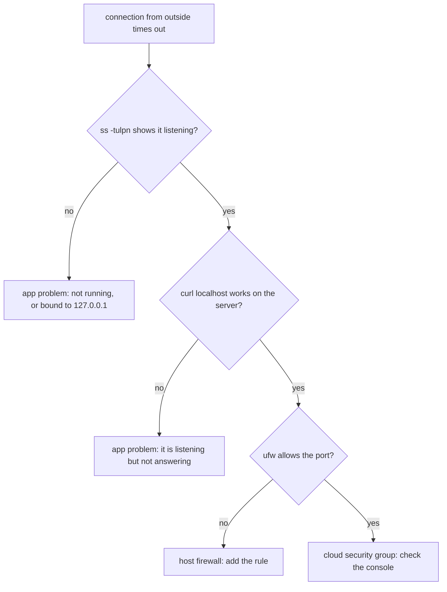

# Networking, Ports and Firewalls — Part 2

Part 1 got you to the top of the troubleshooting ladder. This part is what you
do there: `curl` properly, so you can test any endpoint without Postman, and
firewalls, so only the ports you chose are reachable. It also contains the one
command in this track that can permanently lock you out of your own server. That
warning is marked, and it is not an exaggeration — people do this on their first
day with `ufw`.

> **⬅️ This continues [Part 1](04-networking-ports-and-firewalls-part-1.md).**

> **📌 In one line:** `curl -v` tells you exactly what the server said, and a
> firewall decides which ports can be reached at all — so always allow port 22
> before you enable one.

## Table of Contents

1. [`curl`: The Flags Worth Knowing](#curl-the-flags-worth-knowing)
2. [Realistic `curl` Against the SaaS API](#realistic-curl-against-the-saas-api)
3. [Timing a Request with `-w`](#timing-a-request-with--w)
4. [What a Firewall Does](#what-a-firewall-does)
5. [`ufw` Basics](#ufw-basics)
6. [Locking Yourself Out](#locking-yourself-out)
7. [Cloud Security Groups: The Second Firewall](#cloud-security-groups-the-second-firewall)
8. [`/etc/hosts` and Local DNS Overrides](#etchosts-and-local-dns-overrides)
9. [Advanced: When All Else Fails](#advanced-when-all-else-fails)
10. [Common Mistakes](#common-mistakes)
11. [Questions to Test Yourself](#questions-to-test-yourself)
12. [Related](#related)

---

## `curl`: The Flags Worth Knowing

`curl` is the backend developer's most useful command-line tool. It makes an
HTTP request and prints the result, so you can test an endpoint from anywhere —
your laptop, the server, inside a container, inside a CI job — with no GUI and
no dependencies. Nine flags cover almost everything:

| Flag | Does |
|---|---|
| `-v` | Verbose: show connection, TLS, request headers and response headers |
| `-i` | Include response headers in the output, but not the rest of the noise |
| `-s` | Silent: hide the progress meter. Essential inside scripts |
| `-S` | With `-s`, still show errors. The pair `-sS` is the script idiom |
| `-X POST` | Set the HTTP method |
| `-H 'Name: value'` | Add a request header. Repeatable |
| `-d '{"a":1}'` | Send a request body. Implies `POST` |
| `-L` | Follow redirects |
| `-o file` / `-w fmt` | Body to a file / print chosen numbers afterwards |

Two more matter in production: `--max-time 10` caps the whole request and
`--connect-timeout 3` caps the connection phase. Without them a hung script
waits forever.

**`-v` versus `-i`.** `-i` gives headers plus body and nothing else, which is
what you want nine times out of ten. `-v` adds connection and TLS details, which
is what you want when the request is failing rather than returning the wrong
thing.

```text
$ curl -i https://api.example.com/health
HTTP/2 200
content-type: application/json; charset=utf-8
x-request-id: 01JB2M4K8T
cache-control: no-store

{"status":"ok","uptime":97442}
```

That `x-request-id` is the thread to pull on in the logs:
[Correlation IDs and Tracing](../../backend-fundamentals/08-logging-and-observability/03-correlation-ids-and-tracing.md).

---

## Realistic `curl` Against the SaaS API

**Log in and capture the token**, with `-s` silencing the progress meter so `jq`
gets clean JSON.

```text
$ TOKEN=$(curl -sS -X POST https://api.example.com/auth/login \
    -H 'Content-Type: application/json' \
    -d '{"email":"afsar@appifylab.com","password":"..."}' | jq -r '.token')
$ echo "$TOKEN"
eyJhbGciOiJIUzI1NiIsInR5cCI6IkpXVCJ9.eyJzdWIiOiI0MiJ9.8xQ...
```

**An authenticated GET**, with the token from the shell variable:

```text
$ curl -sS https://api.example.com/api/projects \
    -H "Authorization: Bearer $TOKEN" | jq '.data[0]'
{
  "id": 17,
  "name": "Website Redesign",
  "companyId": 42
}
```

Note the quoting: `"Bearer $TOKEN"` is double-quoted so the variable expands,
while the JSON bodies are single-quoted so the shell leaves `$` and `"` alone —
the rule from
[01-the-shell-and-filesystem-part-2.md](01-the-shell-and-filesystem-part-2.md).

**A POST that creates something**, with `-i` so you can check the status code
and the `Location` header:

```text
$ curl -i -sS -X POST https://api.example.com/api/projects/17/tasks \
    -H "Authorization: Bearer $TOKEN" \
    -H 'Content-Type: application/json' \
    -d '{"title":"Fix invoice PDF margins","assigneeId":8}'
HTTP/2 201
content-type: application/json; charset=utf-8
location: /api/projects/17/tasks/901
x-request-id: 01JB2M9QX4

{"id":901,"title":"Fix invoice PDF margins","status":"open"}
```

**Reproducing a validation error**, the request you send when a user reports "it
says something went wrong":

```text
$ curl -i -sS -X POST https://api.example.com/api/projects/17/tasks \
    -H "Authorization: Bearer $TOKEN" \
    -H 'Content-Type: application/json' \
    -d '{"title":""}'
HTTP/2 422
content-type: application/json; charset=utf-8

{"errors":[{"field":"title","rule":"minLength","message":"Title is required"}]}
```

A `422` with a field-level message is a well-behaved API. A `500` here means the
bug is yours: [07-error-handling/](../../backend-fundamentals/07-error-handling/).

**Following redirects.** Without `-L`, curl shows the `301` and stops, which is
the correct default because it shows what really happened:

```text
$ curl -i -sS http://api.example.com/health
HTTP/1.1 301 Moved Permanently
location: https://api.example.com/health

$ curl -sS -L -o /dev/null -w '%{http_code} %{num_redirects}\n' http://api.example.com/health
200 1
```

A body too long for one line reads better from a file: `-d @invoice.json` sends
the file's contents as the request body. Browser dev tools can also copy any
request as a `curl` command ("Copy as cURL"), which is the fastest way to
reproduce something a frontend did, headers and cookies included.

### BROKEN vs FIXED: `curl` Inside a Script

```bash
# ❌ BROKEN - the progress meter corrupts the parsed output, a connection
#             error is silent, and a hung server blocks the deploy forever
STATUS=$(curl -o /dev/null -w '%{http_code}' https://api.example.com/health)
```

```bash
# ✅ FIXED - silent but not deaf, with hard limits on how long it may wait
STATUS=$(curl -sS --connect-timeout 3 --max-time 10 \
           -o /dev/null -w '%{http_code}' https://api.example.com/health)
[ "$STATUS" = "200" ] || { echo "health check failed: $STATUS"; exit 1; }
```

`-sS` is the pair that matters: `-s` removes the progress meter, `-S` puts real
errors back. Without timeouts, a health check in a deploy script waits forever
on a server that accepted the connection and then stopped responding.

---

## Timing a Request with `-w`

When an endpoint is "slow", the useful question is *which part* is slow. `-w`
prints timing values after the response.

```text
$ curl -sS -o /dev/null -w \
  'dns=%{time_namelookup} connect=%{time_connect} tls=%{time_appconnect} ttfb=%{time_starttransfer} total=%{time_total}\n' \
  https://api.example.com/api/projects
dns=0.021 connect=0.045 tls=0.118 ttfb=0.884 total=0.891
```

Read the gaps, not the numbers:

| Value | Measures | A large value means |
|---|---|---|
| `time_namelookup` | DNS resolution | Slow or failing resolver |
| `time_connect` | TCP handshake | Network latency or distance |
| `time_appconnect` | TLS handshake complete | Certificate chain or cipher cost |
| `time_starttransfer` | First byte of the response | **Your application** is slow |
| `time_total` | Everything | Large with small `ttfb` means a big body |

Here DNS, TCP and TLS together cost 118 ms, then 766 ms passed before the first
byte. The network is fine and the handler is slow, which points at a query or an
external call rather than infrastructure — continue in
[databases/operations/](../../databases/operations/05-monitoring-and-troubleshooting-part-1.md).

---

## What a Firewall Does

A **firewall** inspects packets and decides whether to allow them. On a Linux
server it is a set of kernel rules matched on destination port, source address
and protocol. Its value is that **it is independent of your applications**: a
service you forgot about, a debug port left open, a package that starts a daemon
at install time — none becomes reachable if the firewall does not allow it.

There are three possible verdicts, and the difference matters because it is what
you saw with `nc` in Part 1:

| Verdict | What the sender sees | Used for |
|---|---|---|
| ALLOW | Normal connection | Ports you chose |
| REJECT | "Connection refused", immediately | Internal networks, where fast failure is kinder |
| DROP | Nothing. The connection times out | Internet-facing, so scanners learn nothing |

`ufw` ("Uncomplicated Firewall") is a friendly front end to the kernel's
`nftables`/`iptables`. It is the default on Ubuntu and is enough for a single
server.

---

## `ufw` Basics

The whole useful surface is six commands.

```text
$ sudo ufw status verbose
Status: inactive

$ sudo ufw default deny incoming
Default incoming policy changed to 'deny'
$ sudo ufw default allow outgoing
Default outgoing policy changed to 'allow'

$ sudo ufw allow 22/tcp
Rules updated
$ sudo ufw allow 80/tcp
$ sudo ufw allow 443/tcp
```

`default deny incoming` does the work: everything is blocked unless a rule
allows it. `default allow outgoing` lets your server reach Postgres, Stripe and
the package mirror. Now, and only now, enable it:

```text
$ sudo ufw enable
Command may disrupt existing ssh connections. Proceed with operation (y|n)? y
Firewall is active and enabled on system startup

$ sudo ufw status numbered
Status: active

     To                         Action      From
     --                         ------      ----
[ 1] 22/tcp                     ALLOW IN    Anywhere
[ 2] 80/tcp                     ALLOW IN    Anywhere
[ 3] 443/tcp                    ALLOW IN    Anywhere
```

Rules can be narrowed by source, which is how you expose a database to one
machine rather than the world:
`sudo ufw allow from 10.0.1.15 to any port 5432 proto tcp`.

> **💡 Tip:** `ufw status numbered` then `ufw delete <n>` is the safe way to
> remove a rule. Retyping the rule text to delete it invites a typo that leaves
> the real rule in place.

---

## Locking Yourself Out

> **⚠️ Warning:** **Never run `sudo ufw enable` before `sudo ufw allow 22/tcp`.**
> With `default deny incoming` and no rule for 22, enabling the firewall blocks
> SSH *instantly*, including the session you are typing in. You cannot undo it,
> because undoing it requires a connection you no longer have. The server keeps
> running perfectly and you cannot reach it.

```text
$ sudo ufw default deny incoming
$ sudo ufw enable            # ← no rule for 22 yet
Firewall is active and enabled on system startup

packet_write_wait: Connection to 203.0.113.40 port 22: Broken pipe
$ ssh deploy@203.0.113.40
ssh: connect to host 203.0.113.40 port 22: Connection timed out
```

Note `Connection timed out` rather than refused — the packets are being dropped,
exactly as Part 1 described.

**Recovery requires out-of-band access** — a path that does not use SSH. Your
cloud provider's web or serial console, where you log in through the browser and
run `sudo ufw allow 22/tcp`, is the usual one. Failing that, a rescue mode that
boots the disk separately so you can edit `/etc/ufw/` by hand. If neither
exists, you rebuild the server, which is why the warning above is so blunt.

**The safe procedure**, every time:

```text
$ sudo ufw allow 22/tcp          # 1. allow SSH first, always
$ sudo ufw status                # 2. confirm the rule exists
$ sudo ufw enable                # 3. only now
$ ssh deploy@203.0.113.40        # 4. from a NEW terminal, before closing this one
```

Step 4 is the same discipline as the SSH hardening in
[03-users-permissions-and-ssh-part-2.md](03-users-permissions-and-ssh-part-2.md):
keep one verified session open until a new one succeeds.

> **💡 Tip:** for risky firewall changes with no console access, schedule a
> safety net first: `echo "ufw disable" | sudo at now + 10 minutes`. If you lock
> yourself out, the firewall turns itself off. Cancel it with `atrm` once the
> new rules are confirmed.

---

## Cloud Security Groups: The Second Firewall

Here is the trap that wastes whole afternoons. On AWS, GCP, Azure, DigitalOcean
and the rest, there is a **second** firewall outside the machine — a security
group, network ACL or cloud firewall. Your traffic must pass **both**.

```text
  internet ──▶ security group   managed in the cloud console; invisible to the host
           ──▶ ufw on the host  sudo ufw status
           ──▶ process binding  ss -tulpn
```



The symptom is maddening: `sudo ufw status` shows the port allowed, `ss -tulpn`
shows the process listening on `0.0.0.0`, `curl localhost:3333` works on the
server — and from outside you get a timeout. Everything *on the machine* is
correct, and the machine cannot see the thing that is wrong.

```text
# on the server - everything looks perfect
$ sudo ufw status | grep 3333
3333/tcp                   ALLOW IN    Anywhere
$ sudo ss -tulpn | grep 3333
tcp LISTEN 0 511 0.0.0.0:3333 0.0.0.0:* users:(("node",pid=2210,fd=20))
$ curl -s -o /dev/null -w '%{http_code}\n' http://localhost:3333/health
200

# from your laptop
$ nc -zv 203.0.113.40 3333
nc: connect to 203.0.113.40 port 3333 (tcp) timed out
```

> **📌 Remember:** when everything on the host is correct and the connection
> still times out, **check the cloud console next**. There are three layers —
> security group, host firewall, bind address — and only two of them are visible
> from inside the machine.

A Kubernetes network policy and a Docker port publish (`-p 80:3333`) are further
layers of the same idea: each can block traffic the others allow, and each is
checked somewhere different.

---

## `/etc/hosts` and Local DNS Overrides

`/etc/hosts` maps names to addresses on this one machine and is consulted
**before** DNS. It is how you test a domain that does not point at your server
yet.

```text
$ cat /etc/hosts
127.0.0.1       localhost
127.0.1.1       app-01
203.0.113.40    api.example.com
10.0.1.20       db-01 db-01.internal
```

With that third line on your laptop, `curl https://api.example.com/health` goes
to `203.0.113.40` regardless of what public DNS says. The `Host` header is still
`api.example.com`, so nginx picks the right server block and the certificate
still matches. That is the point: you test the real hostname against the new
server before moving the DNS record.

```text
$ dig +short api.example.com        # public DNS still says the old server
198.51.100.7
$ curl -sS -o /dev/null -w '%{remote_ip}\n' https://api.example.com/health
203.0.113.40                        # but you reached the new one

$ curl -sS --resolve api.example.com:443:203.0.113.40 https://api.example.com/health
{"status":"ok","uptime":12}
```

That last line does the same thing for one command, with no file to clean up.

> **⚠️ Warning:** remove `/etc/hosts` overrides when you are done. A forgotten
> entry pointing at a decommissioned server produces failures that make no sense
> to anyone else, because only your machine behaves that way. `curl --resolve`
> avoids the problem entirely.

Inside a container, `/etc/hosts` is managed by the runtime and
`host.docker.internal` is the name that reaches your laptop from inside — a
useful detail covered in [../02-docker-in-practice/](../02-docker-in-practice/).

---

## Advanced: When All Else Fails

You climbed the ladder, the firewall is right, the process is bound correctly,
and it still does not work. The next tool is **`tcpdump`**, which shows the
actual packets arriving at and leaving the machine.

```text
$ sudo tcpdump -i any -n port 3333
12:04:18.221 IP 198.51.100.12.52244 > 10.0.1.15.3333: Flags [S], seq 1829...
12:04:19.223 IP 198.51.100.12.52244 > 10.0.1.15.3333: Flags [S], seq 1829...
```

That is a client sending `[S]` (SYN, the start of a handshake) twice with no
reply — proof that packets *do* arrive and something is dropping them on this
machine. If nothing appeared at all, they never arrived, and the problem is
upstream.

That is as far as this track goes with `tcpdump`. It is the right tool and worth
knowing the name; reading its output properly is a skill of its own.

Two more problems deserve a name and nothing more. **MTU mismatches** make large
responses hang while small ones succeed, typically over a VPN or tunnel. **TCP
keepalive and idle timeouts** kill connections that were fine for minutes,
typically through a NAT gateway or a load balancer.

> **📌 Remember:** if your evidence points at MTU or keepalives, stop and ask
> someone with network experience. These are genuinely hard, they are rarely the
> real cause, and the hours you would spend are better spent elsewhere.

---

## Common Mistakes

| Mistake | Why it is wrong | Do this instead |
|---|---|---|
| `ufw enable` before `ufw allow 22/tcp` | Instantly locks you out, with no way back over SSH | Allow 22, confirm, then enable |
| Checking only `ufw` when traffic is blocked | The cloud security group is a second firewall the host cannot see | Check the cloud console too |
| `curl` in a script without `-sS` | A progress meter corrupts parsed output; errors vanish | `curl -sS`, plus `--max-time` |
| `curl` with no timeout in production code | One hung request stalls a deploy or a cron job forever | `--max-time 10 --connect-timeout 3` |
| Single-quoting a header containing `$TOKEN` | The variable is not expanded and you send the literal text | `-H "Authorization: Bearer $TOKEN"` |
| Reading `total time` to judge a slow endpoint | Hides whether DNS, TLS or the handler is slow | `-w` with `time_starttransfer` |
| Leaving `/etc/hosts` overrides behind | Only your machine misbehaves, so nobody can reproduce it | `curl --resolve`, or clean up |
| `ufw allow 5432` to the world | Exposes the database to the internet | `ufw allow from <app-ip> to any port 5432` |

---

## Questions to Test Yourself

1. What is the difference between `-i` and `-v` in `curl`, and when is each the
   right choice?
2. You must send a JSON body containing `$` and a header containing `$TOKEN`.
   Which quotes go where, and why?
3. `time_appconnect` is 0.12 and `time_starttransfer` is 1.4. Where is the
   problem, and where is it not?
4. Explain exactly what happens, step by step, when you run `ufw enable` with
   `default deny incoming` and no rule for port 22.
5. Give the four-step safe procedure for enabling a firewall, and say what step
   4 protects you from.
6. `ufw status` shows the port allowed and `ss -tulpn` shows the process
   listening on `0.0.0.0`, but connections still time out. What is left to
   check, and why can the server not tell you?
7. Why does `/etc/hosts` let you test a hostname before DNS is moved, and what
   makes `curl --resolve` safer?
8. `tcpdump` shows repeated `[S]` packets arriving with no reply. What does that
   rule in, and what does it rule out?

---

## Related

- [Networking, Ports and Firewalls — Part 1](04-networking-ports-and-firewalls-part-1.md)
  — binding addresses, `ss -tulpn`, and the troubleshooting ladder.
- [Logs, Disks and Debugging — Part 1](05-logs-disks-and-debugging-part-1.md) —
  reading the server's own account of the request you just sent with `curl`.
- [Users, Permissions and SSH — Part 2](03-users-permissions-and-ssh-part-2.md)
  — the same "keep a session open" discipline, applied to `sshd_config`.
- [Correlation IDs and Tracing](../../backend-fundamentals/08-logging-and-observability/03-correlation-ids-and-tracing.md)
  — the `x-request-id` header `curl -i` showed you, and what to do with it.
- [Status Codes](../../backend-fundamentals/01-http-foundations/04-status-codes.md)
  — what the numbers in these responses actually promise.
- [networking/](../../networking/README.md) — the protocol theory underneath.
