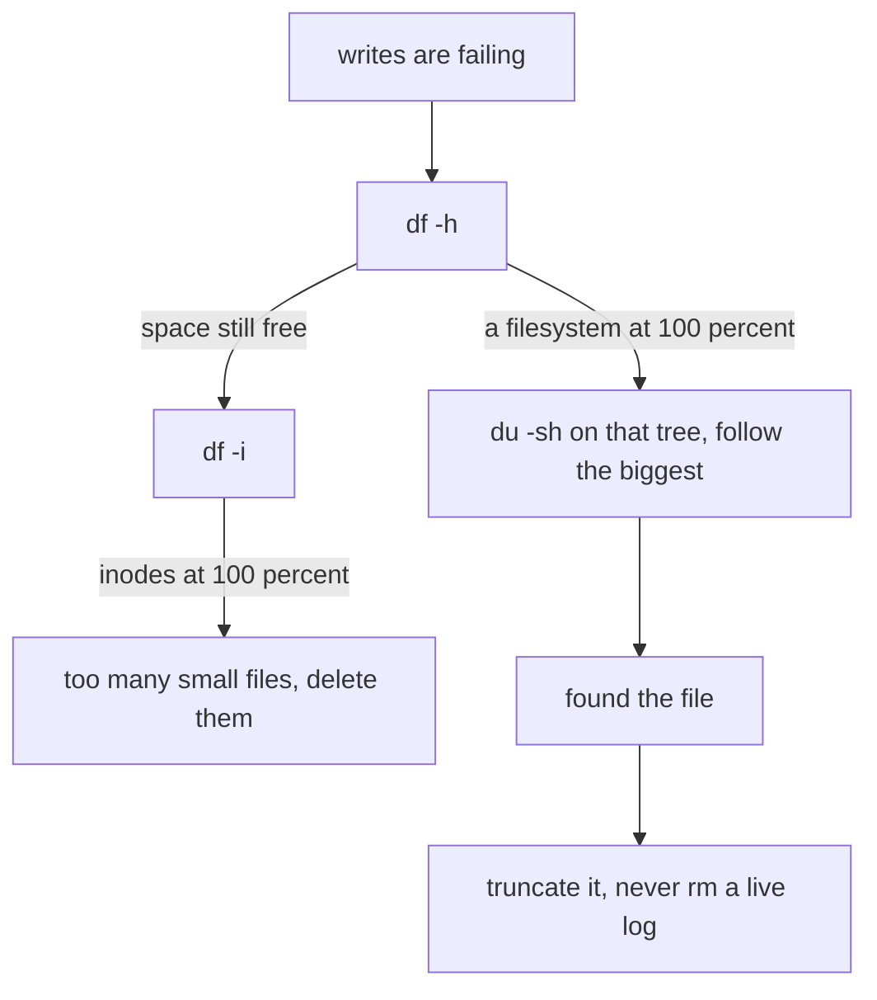

# Logs, Disks and Debugging — Part 1

Something is wrong in production. You have fifteen minutes and a terminal. The
difference between an engineer who fixes it and one who restarts things and
hopes is almost entirely about **knowing where to look and in what order**.

This part is the "where to look" half: where logs actually live, the four
`journalctl` commands worth memorising, and the two failure modes that produce
the strangest symptoms — an unrotated log and a full disk.

> **➡️ Continued in [Part 2](05-logs-disks-and-debugging-part-2.md).**

> **📌 In one line:** logs are in `/var/log` or in journald, a full disk breaks
> things in ways that look like anything but a full disk, and the file you
> deleted did not free any space because a process still has it open.

## Table of Contents

1. [Where Logs Actually Live](#where-logs-actually-live)
2. [`journalctl`: The Four Invocations](#journalctl-the-four-invocations)
3. [Reading a Log During an Incident](#reading-a-log-during-an-incident)
4. [`jq` Is How You Read JSON Logs on a Server](#jq-is-how-you-read-json-logs-on-a-server)
5. [Log Rotation, and the Outage It Prevents](#log-rotation-and-the-outage-it-prevents)
6. [Disk Full](#disk-full)
7. [The Deleted File That Freed Nothing](#the-deleted-file-that-freed-nothing)
8. [Why a Full Disk Breaks Everything Strangely](#why-a-full-disk-breaks-everything-strangely)
9. [Common Mistakes](#common-mistakes)
10. [Questions to Test Yourself](#questions-to-test-yourself)
11. [Related](#related)

---

## Where Logs Actually Live

There are three places, and knowing which is which saves you minutes.

**1. `/var/log` — plain text files**, written by the system and by older
services.

```text
$ ls -laht /var/log | head -n 8
total 412M
-rw-r-----  1 syslog  adm   2.1M Oct  4 12:14 syslog
-rw-r-----  1 syslog  adm   184K Oct  4 12:14 auth.log
-rw-r--r--  1 root    root   48M Oct  4 12:10 nginx/access.log
-rw-r--r--  1 root    root  1.2M Oct  4 11:58 nginx/error.log
-rw-r-----  1 syslog  adm    12M Oct  3 00:00 syslog.1
drwxr-xr-x  2 deploy  deploy 4.0K Oct  3 06:00 saas-api
```

**2. journald — the systemd journal**, a binary database holding everything a
systemd service wrote to stdout and stderr, plus kernel messages. You read it
with `journalctl`, never with `cat`.

**3. Your application's own files**, if you configured a file transport —
typically `/var/log/<app>/` or `<app>/storage/logs/`.

| Problem | Look here first |
|---|---|
| A service will not start | `journalctl -u <unit> -n 50` |
| The app is throwing errors | Your app log, or `journalctl -u saas-api` |
| Requests are 502 or 504 | `/var/log/nginx/error.log` |
| Who is hitting the API, and with what status | `/var/log/nginx/access.log` |
| SSH login failures or brute force | `/var/log/auth.log`, `journalctl -u ssh` |
| Something was killed and you do not know why | `dmesg -T`, `journalctl -k` |
| Package installs, broad system events | `/var/log/syslog`, `journalctl` |
| Cron jobs that did not run | `journalctl -u cron`, `/var/log/syslog` |

> **💡 Tip:** `ls -laht /var/log` sorts by modification time. The file that
> changed in the last minute is almost always the one you want, and this one
> command finds it without you knowing the layout.

If your app runs under systemd and logs to stdout — which is the right default,
and what a container needs anyway — then journald already has everything and you
do not need a file transport at all. See
[Logging Basics](../../backend-fundamentals/08-logging-and-observability/01-logging-basics.md).

---

## `journalctl`: The Four Invocations

Memorise these four. They cover almost every real use.

**1. Follow one service live.** The `journalctl` equivalent of `tail -f`.

```text
$ journalctl -u saas-api -f
Oct 04 12:20:11 app-01 saas-api[2210]: {"level":30,"msg":"request started","url":"/api/invoices"}
Oct 04 12:20:11 app-01 saas-api[2210]: {"level":30,"msg":"request completed","status":201}
^C
```

**2. The last N lines.** What `systemctl status` truncates to ten of.

```text
$ journalctl -u saas-api -n 100 --no-pager
```

`--no-pager` prints straight out instead of opening `less`, which is what you
want when piping to `grep` or when scrolling back in your terminal.

**3. A time window.** `--since` and `--until` accept plain English.

```text
$ journalctl -u saas-api --since "2026-10-04 03:00" --until "2026-10-04 04:00"
$ journalctl -u saas-api --since "30 min ago"
$ journalctl -u saas-api --since yesterday
$ journalctl -u saas-api --since "10:00" -p err
```

**4. Errors only.** `-p` filters by priority, using syslog levels.

```text
$ journalctl -u saas-api -p err --since today
Oct 04 03:14:02 app-01 saas-api[2210]: {"level":50,"msg":"invoice send failed","invoiceId":8812}
Oct 04 03:14:09 app-01 saas-api[2210]: {"level":50,"msg":"invoice send failed","invoiceId":8813}
```

| Level | Name | Means |
|---|---|---|
| 0–2 | `emerg`, `alert`, `crit` | The system or service is unusable |
| 3 | `err` | Errors. **This is the one you filter on** |
| 4 | `warning` | Something is off but working |
| 6 | `info` | Normal operation |
| 7 | `debug` | Noise, usually off in production |

`-p err` means "err and anything more severe", not "exactly err".

Four more flags that come up often:

```text
$ journalctl -k --since "1 hour ago"     # kernel messages (OOM kills live here)
$ journalctl -u saas-api -o json-pretty  # full structured records
$ journalctl --disk-usage                # how much space the journal is using
$ sudo journalctl --vacuum-time=7d       # delete journal entries older than 7 days
```

> **⚠️ Warning:** the journal has a size limit, and old entries are discarded
> when it is reached. Default retention on a busy server can be days, not weeks.
> If you need long retention, ship logs somewhere else — do not rely on
> journald being there next month.

---

## Reading a Log During an Incident

The skill is narrowing from thousands of lines to the handful that matter. The
pattern is always: **narrow by time, narrow by severity, then follow a thread.**

**Step 1 — when did it start?** Compare error counts per hour, using the
pipeline built in
[01-the-shell-and-filesystem-part-2.md](01-the-shell-and-filesystem-part-2.md).

```text
$ journalctl -u saas-api -p err --since today --no-pager -o cat \
    | jq -r .time | cut -c1-13 | sort | uniq -c
      2 2026-10-04T01
    311 2026-10-04T03
      1 2026-10-04T12
```

`-o cat` prints only the message itself, with no systemd prefix, which is what
makes the output valid JSON for `jq`.

**Step 2 — what is the error?** Go to that hour and look at distinct messages
rather than every line.

```text
$ journalctl -u saas-api -p err --since "03:00" --until "04:00" --no-pager -o cat \
    | jq -r .msg | sort | uniq -c | sort -rn
    309 invoice send failed
      2 redis connection lost
```

Two messages, 311 lines. One of them happened twice at the start — look at that
one first, because "redis connection lost" is far more likely to be the cause
than a symptom.

**Step 3 — follow one thread.** Every log line carries a request id, so pick one
and read the whole story.

```text
$ journalctl -u saas-api --since "03:00" --no-pager -o cat \
    | jq -r 'select(.requestId == "01JB2M4K8T") | "\(.time) \(.level) \(.msg)"'
2026-10-04T03:14:01.004Z 30 request started
2026-10-04T03:14:01.882Z 40 redis connection lost, retrying
2026-10-04T03:14:02.771Z 50 invoice send failed
2026-10-04T03:14:02.774Z 50 request failed status=500
```

Now you have the causal chain, not a pile of errors. Redis dropped, the job
enqueue failed, the request 500'd. The fix is in Redis, not in the invoice code.

That request id exists because somebody set it up —
[Correlation IDs and Tracing](../../backend-fundamentals/08-logging-and-observability/03-correlation-ids-and-tracing.md)
is how, and it is the single highest-value logging feature you can add.

**Step 4 — watch it live while you test.**

```text
$ journalctl -u saas-api -f -o cat | jq -r 'select(.level >= 40) | .msg'
```

Two terminals: this one following, another running `curl`. You see your own
request's errors appear as you make them.

---

## `jq` Is How You Read JSON Logs on a Server

Your logs are JSON because that is what
[Structured Logging](../../backend-fundamentals/08-logging-and-observability/02-structured-logging.md)
asks for, and it is right: machines can query JSON. The cost is that a raw line
is hard for a human to read on a server with no log platform. `jq` closes that
gap, and it is the one extra tool worth installing on every machine.

```text
$ journalctl -u saas-api -n 1 --no-pager -o cat
{"level":50,"time":"2026-10-04T03:14:02.771Z","requestId":"01JB2M4K8T","msg":"invoice send failed","invoiceId":8812,"err":{"message":"Connection is closed"}}

$ journalctl -u saas-api -n 1 --no-pager -o cat | jq
{
  "level": 50,
  "time": "2026-10-04T03:14:02.771Z",
  "requestId": "01JB2M4K8T",
  "msg": "invoice send failed",
  "invoiceId": 8812,
  "err": {
    "message": "Connection is closed"
  }
}
```

The five expressions worth knowing:

| Expression | Does |
|---|---|
| `jq` | Pretty-print and colour |
| `jq -r .msg` | One field, raw (no quotes) |
| `jq -c 'select(.level >= 50)'` | Filter, one compact line each |
| `jq -r '"\(.time) \(.msg)"'` | Build a custom line from several fields |
| `jq -s 'group_by(.msg) \| map({msg: .[0].msg, n: length})'` | Aggregate |

> **💡 Tip:** `jq` fails on a line that is not valid JSON, which includes your
> app's startup banner and any `console.log` that escaped. Add `-R 'fromjson?'`
> to skip non-JSON lines instead of stopping.

---

## Log Rotation, and the Outage It Prevents

A log file only grows. At 2 GB a day — easy for an API logging every request —
an unrotated log fills a 40 GB disk in under three weeks. Then the disk is full,
and the next section explains how badly that ends.

**`logrotate`** runs daily and renames, compresses and deletes old logs. Most
packages install a config; your own app needs one.

```text
# /etc/logrotate.d/saas-api
/var/log/saas-api/*.log {
    daily                 # rotate once a day
    rotate 14             # keep 14 old files, delete the rest
    maxsize 500M          # rotate early if it gets big before the day ends
    compress              # gzip the old ones
    delaycompress         # do not compress the newest, it may still be written
    missingok             # do not error if the file is absent
    notifempty            # skip empty files
    create 0640 deploy deploy   # recreate with this owner and mode
    copytruncate          # copy then truncate, so the app keeps its file handle
}
```

Two directives decide whether this works at all:

- **`copytruncate`** copies the file then empties the original **in place**. The
  app's open file handle stays valid and it keeps writing. Use this when the app
  cannot be told to reopen its log.
- The alternative is `postrotate ... systemctl reload saas-api ... endscript`,
  which renames the file and signals the app to reopen it. Cleaner, but only if
  your app handles that signal.

```text
$ sudo logrotate -d /etc/logrotate.d/saas-api    # dry run, change nothing
$ sudo logrotate -f /etc/logrotate.d/saas-api    # force a rotation now
$ ls -lah /var/log/saas-api/
-rw-r----- 1 deploy deploy  12M Oct  4 12:20 app.log
-rw-r----- 1 deploy deploy 480M Oct  4 00:00 app.log.1
-rw-r----- 1 deploy deploy  41M Oct  3 00:00 app.log.2.gz
```

> **⚠️ Warning:** without `copytruncate` or a reopen signal, rotation renames
> the file and your app **keeps writing to the renamed one**. `app.log` stays at
> zero bytes forever while `app.log.1` grows without limit. The logs look empty,
> the disk still fills, and this is a genuinely common production outage. Verify
> rotation with `logrotate -f` once, then check that `app.log` is growing again.

journald rotates itself, which is one more reason to log to stdout and let
systemd capture it. `journalctl --disk-usage` tells you what it is holding.

---

## Disk Full

The symptoms are rarely "disk full". They are random write failures, a database
refusing transactions, and an app that half-works.



**Step 1 — `df -h` finds the full filesystem.** Note `h` for human-readable.

```text
$ df -h
Filesystem      Size  Used Avail Use% Mounted on
/dev/root        39G   39G     0 100% /
tmpfs           3.9G     0  3.9G   0% /dev/shm
/dev/sdb1       197G   12G  176G   7% /mnt/data
```

Read the `Use%` column, not `Size`. Here `/` is at 100% with 0 bytes free, while
`/mnt/data` is nearly empty — so the problem is on the root filesystem and
adding another disk does not help by itself.

**Step 2 — `du -sh *` walks down to the culprit.** Start at the top of the full
filesystem and follow the biggest number, one level at a time.

```text
$ sudo du -sh /* 2>/dev/null | sort -rh | head -n 5
24G     /var
8.2G    /usr
3.1G    /home
1.4G    /opt

$ sudo du -sh /var/* 2>/dev/null | sort -rh | head -n 5
19G     /var/log
3.2G    /var/lib
1.1G    /var/cache

$ sudo du -sh /var/log/* 2>/dev/null | sort -rh | head -n 5
17G     /var/log/saas-api
1.2G    /var/log/journal
380M    /var/log/nginx

$ sudo ls -lahS /var/log/saas-api | head -n 4
total 17G
-rw-r----- 1 deploy deploy  17G Oct  4 12:31 app.log
-rw-r----- 1 deploy deploy 4.0K Oct  1 03:12 app.log.1
```

Four commands and you have it: one 17 GB log file, with an `app.log.1` of 4 KB
proving rotation ran once and then stopped working. That is exactly the
`copytruncate` bug from the previous section.

- `-s` summarises each argument instead of listing every file.
- `-h` is human-readable; `sort -rh` sorts those human sizes correctly.
- `2>/dev/null` discards the "Permission denied" noise.

**Step 3 — `df -i` if `df -h` shows free space.** You can run out of **inodes** —
the fixed number of file entries — while bytes remain. Millions of tiny session
or cache files do this.

```text
$ df -i
Filesystem      Inodes   IUsed  IFree IUse% Mounted on
/dev/root      2560000 2559812    188  100% /
```

`IUse% 100` with free bytes means "too many files", and the fix is deleting
files, not freeing space.

---

## The Deleted File That Freed Nothing

You found the 17 GB log, deleted it, and `df -h` still says 100%. This is not a
mistake you made; it is how Unix works, and it confuses everyone once.

Deleting a file removes its **name** from a directory. The data is freed only
when **no process still has it open**. Your app has `app.log` open and will keep
that space reserved — and keep writing into it — until it closes the file or
exits.

```text
$ sudo rm /var/log/saas-api/app.log
$ df -h /
Filesystem      Size  Used Avail Use% Mounted on
/dev/root        39G   39G     0 100% /

$ sudo lsof +L1 | head -n 3
COMMAND   PID   USER   FD   TYPE DEVICE  SIZE/OFF NLINK  NODE NAME
node     2210 deploy   22w  REG   8,1  18253611008     0 262301 /var/log/saas-api/app.log (deleted)
```

`+L1` lists open files with fewer than one link — exactly "deleted but still
open". `NLINK 0` and `(deleted)` are the proof, and `SIZE` is the space you are
not getting back.

### BROKEN vs FIXED: Freeing Space From a Live Log

```bash
# ❌ BROKEN - removes the name, not the data. The process keeps the file open,
#             the space stays reserved, and df -h does not move.
sudo rm /var/log/saas-api/app.log
```

```bash
# ✅ FIXED - empties the file in place. Space is freed immediately and the
#            application keeps writing to the same handle, with no restart.
sudo truncate -s 0 /var/log/saas-api/app.log
```

If it was already deleted, empty it through the process's own file descriptor
with `sudo truncate -s 0 /proc/2210/fd/22`. Restarting the service also works,
by closing the handle, but costs you an outage and your evidence.

> **📌 Remember:** **never `rm` a live log file.** This is the single most
> useful thing in this file when a disk is full at 2 AM.

---

## Why a Full Disk Breaks Everything Strangely

A full disk does not produce one clear error. It produces a dozen unrelated
ones, which is why it is so often diagnosed last.

| What breaks | What you see |
|---|---|
| Postgres cannot write WAL | `PANIC: could not write to file ... No space left on device`, then it refuses all writes |
| Your app cannot write logs | `ENOSPC`, or silence, because the error log cannot be written either |
| Sessions stored on disk | Users randomly logged out |
| File uploads | Half-written files, corrupt images |
| `apt`, `npm ci`, builds | Fail mid-way with confusing errors |
| systemd and journald | Cannot record that any of this happened |

The cruel part is the second row. The error that explains everything is the one
error that cannot be written down, so the log you reach for is empty.

> **💡 Tip:** **check `df -h` early in every incident.** It takes one second and
> rules out a cause that mimics a dozen others. It is step one of the triage
> runbook in [Part 2](05-logs-disks-and-debugging-part-2.md) for exactly this
> reason.

Postgres deserves its own note: it reserves space so that a full disk makes it
read-only rather than corrupt, and recovery means freeing space *then*
restarting it. See
[databases/operations/](../../databases/operations/05-monitoring-and-troubleshooting-part-2.md).

---

## Common Mistakes

| Mistake | Why it is wrong | Do this instead |
|---|---|---|
| `rm` on a live log file | Space is not freed while the process holds it open | `truncate -s 0 <file>` |
| `cat`ting a 17 GB log | Floods the terminal and may stall it | `tail -n 200`, `less +G`, or `journalctl -n` |
| No `logrotate` config for your own app | The disk fills in weeks and takes the server down | A config with `rotate`, `maxsize`, `compress` |
| Rotation without `copytruncate` or a reopen signal | The app writes to the renamed file; `app.log` stays empty | Test with `logrotate -f` and verify |
| Reading `df -h` size instead of `Use%` | A big disk can still be 100% full | Read `Use%` and `Avail`, and check `df -i` |
| `du -sh /` and waiting | Scans everything and takes minutes | `du -sh /*`, follow the biggest, one level at a time |
| Relying on journald for long retention | It is size-limited and discards old entries | Ship logs off the machine |
| `grep` on JSON logs for a field value | Matches substrings in unrelated fields | `jq 'select(.field == "...")'` |

---

## Questions to Test Yourself

1. Give the four `journalctl` invocations worth memorising and say what question
   each one answers.
2. Why does `-o cat` matter when you want to pipe `journalctl` output into `jq`?
3. You have 311 errors in one hour. Describe the three narrowing steps that take
   you from that number to a single causal chain.
4. Explain what `copytruncate` does and the exact failure you get without it.
5. You deleted a 17 GB log and `df -h` still shows 100%. Explain why, and give
   the command that proves it.
6. Why is `truncate -s 0` better than `rm` for a live log file?
7. `df -h` shows 60% used but writes are failing with "No space left on device".
   What do you check next?
8. Name three unrelated-looking symptoms a full disk produces, and explain why
   the log that would tell you is empty.

---

## Related

- [Logs, Disks and Debugging — Part 2](05-logs-disks-and-debugging-part-2.md) —
  memory, load average, the triage runbook, environment variables and UTC.
- [The Shell and the Filesystem — Part 2](01-the-shell-and-filesystem-part-2.md)
  — the pipelines these log queries are built from.
- [Processes and Services — Part 2](02-processes-and-services-part-2.md) — why a
  systemd service's output is in journald in the first place.
- [Structured Logging](../../backend-fundamentals/08-logging-and-observability/02-structured-logging.md)
  — why the logs are JSON, which is what makes `jq` possible.
- [Correlation IDs and Tracing](../../backend-fundamentals/08-logging-and-observability/03-correlation-ids-and-tracing.md)
  — the request id that turns a pile of errors into one story.
- [Monitoring and Troubleshooting — Part 2](../../databases/operations/05-monitoring-and-troubleshooting-part-2.md)
  — what a full disk does to Postgres specifically.
