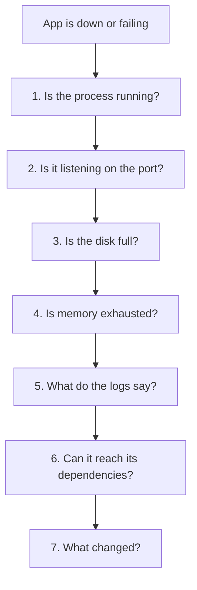

# Logs, Disks and Debugging — Part 2

Part 1 covered where to look. This part covers how to read what you find, in
what order, and the two "configuration" problems that cause outages nobody
expects: an environment variable that is invisible to your service, and a server
whose clock is in the wrong timezone.

It ends with a runbook. When the app is down and people are waiting, following
an ordered list beats improvising every time.

> **⬅️ This continues [Part 1](05-logs-disks-and-debugging-part-1.md).**

> **📌 In one line:** low free memory is normal, load average means nothing
> without the core count, and a variable you `export` in your shell does not
> exist for a systemd service.

## Table of Contents

1. [`free -h` and Why Low Free Memory Is Fine](#free--h-and-why-low-free-memory-is-fine)
2. [Load Average, Read Against Core Count](#load-average-read-against-core-count)
3. [Finding the Hog with `top`](#finding-the-hog-with-top)
4. [The Triage Runbook](#the-triage-runbook)
5. [Environment Variables on a Server](#environment-variables-on-a-server)
6. [BROKEN vs FIXED: The Variable That Works in Your Shell](#broken-vs-fixed-the-variable-that-works-in-your-shell)
7. [Time and Timezones](#time-and-timezones)
8. [Advanced: Capture Evidence Before You Restart](#advanced-capture-evidence-before-you-restart)
9. [Advanced: `strace` as a Last Resort](#advanced-strace-as-a-last-resort)
10. [Common Mistakes](#common-mistakes)
11. [Questions to Test Yourself](#questions-to-test-yourself)
12. [Related](#related)

---

## `free -h` and Why Low Free Memory Is Fine

```text
$ free -h
               total        used        free      shared  buff/cache   available
Mem:           7.8Gi       4.9Gi       241Mi        21Mi       2.6Gi       2.6Gi
Swap:             0B          0B          0B
```

Almost everyone reads `free: 241Mi` and panics. That is the wrong column.

| Column | Means |
|---|---|
| `total` | Physical RAM |
| `used` | Actually held by processes |
| `free` | **Completely untouched.** Low is normal and good |
| `buff/cache` | Disk contents the kernel is caching. **Reclaimable instantly** |
| `available` | **The real number**: what a new process could get without swapping |

Linux uses spare RAM as a disk cache, because unused RAM is wasted RAM. When a
process needs memory, the kernel drops cache and hands it over, at no cost. So
`free` trending to near zero on a long-running server is the system working
correctly.

**Read `available`.** Here it is 2.6 GB, so there is 2.6 GB of headroom despite
`free` showing 241 MB. If `available` were 120 MB, you would be in real trouble
and close to an OOM kill —
[02-processes-and-services-part-2.md](02-processes-and-services-part-2.md).

`Swap: 0B` is normal on cloud servers and deliberate. Swap turns an
out-of-memory crash into a machine so slow it is effectively down, which is
usually worse for a service that should just restart.

```text
$ free -h -s 5          # refresh every 5 seconds, to watch a leak grow
$ cat /proc/meminfo | head -n 5
```

> **💡 Tip:** to judge a memory leak, watch `available` fall steadily over hours
> while `RSS` for one process rises. A single snapshot tells you very little.

---

## Load Average, Read Against Core Count

```text
$ uptime
 12:42:03 up 3 days,  5:14,  1 user,  load average: 2.41, 1.98, 1.20
```

Load average is the number of processes that are **running or waiting to run**,
averaged over 1, 5 and 15 minutes. On Linux it also counts processes blocked on
disk, which is why heavy I/O raises it even when the CPU is idle.

The number alone is meaningless. Compare it with the core count:

```text
$ nproc
4
```

| Load vs cores | Means |
|---|---|
| Below core count | Spare capacity |
| About equal | Fully used, no queue. The efficient point |
| Above core count | Processes are waiting. Requests are queuing |
| Far above (3× or more) | Something is badly wrong, or it is disk wait |

With `nproc 4` and a load of 2.41, this machine is at about 60%. On a 2-core
machine the same number would mean it is overloaded.

**The three numbers are a direction.** `2.41, 1.98, 1.20` rises left to right:
load is climbing, and it is getting worse. `0.80, 1.98, 3.40` falls: the spike
is over and you are looking at the aftermath. That direction is often more
useful than the value.

> **⚠️ Warning:** high load with low CPU usage means **disk wait**, not CPU
> shortage. Check the `wa` figure in `top` and the `D` state in `ps`. Adding
> CPU will not help; the disk or the database will.

---

## Finding the Hog with `top`

```text
$ top -o %CPU
top - 12:44:11 up 3 days,  5:16,  1 user,  load average: 3.81, 2.40, 1.44
%Cpu(s): 71.2 us,  8.1 sy,  0.0 ni, 19.4 id,  1.0 wa
MiB Mem :   7976.0 total,    241.0 free,   5102.8 used,   2632.2 buff/cache

  PID USER     PR  NI    VIRT    RES    SHR S  %CPU  %MEM     TIME+ COMMAND
 2298 deploy   20   0 1105220 334012  29880 R  188.4   4.1  12:44.03 node
 1021 postgres 20   0  412880 184220 171004 S   22.0   2.3   8:14.02 postgres
 2210 deploy   20   0 1204880 523104  31204 S    3.1   6.4  41:02.11 node
```

`188.4%` for PID 2298 means it is using nearly two full cores. That is the
worker, not the API — and since Node runs your JavaScript on one thread, over
100% points at either worker threads or heavy native work such as image
processing or crypto.

Inside `top`: `P` sorts by CPU, `M` by memory, `1` shows each core separately,
`c` shows the full command line (essential when you have three `node`
processes), and `q` quits.

```text
$ top -b -n 1 -o %MEM | head -n 12 > /tmp/top-snapshot.txt
```

`-b -n 1` is batch mode, one iteration — how you capture `top` output into a
file or an incident note. More on capturing evidence below.

---

## The Triage Runbook

The app is down. Work through this in order. Every step is one command you
already know, and the order is chosen so that early steps rule out whole
categories.



1. **Is the process running?** `systemctl status saas-api`. Look at `Active:`
   and the uptime. "2s ago" means a crash loop; `failed` means it gave up. If it
   is not running, steps 2 to 4 are irrelevant and the answer is in step 5.
2. **Is it listening?** `sudo ss -tulpn | grep 3333`. A process that is running
   but not listening has failed during startup, or bound to the wrong address —
   [04-networking-ports-and-firewalls-part-1.md](04-networking-ports-and-firewalls-part-1.md).
   If it is listening, `curl localhost:3333/health` on the server separates "app
   broken" from "network broken".
3. **Is the disk full?** `df -h`, then `df -i`. One second, and it rules out a
   cause that mimics a dozen others. This is step 3 and not step 7 for exactly
   that reason — see [Part 1](05-logs-disks-and-debugging-part-1.md).
4. **Is memory exhausted?** `free -h` and read `available`. Then
   `sudo dmesg -T | grep -i "killed process"` for an OOM kill, which leaves no
   trace in your application log.
5. **What do the logs say?** `journalctl -u saas-api -n 100 --no-pager`, then
   narrow with `-p err --since`. Read the **first** error in the burst, not the
   last. Later errors are usually consequences.
6. **Can it reach its dependencies?** Postgres, Redis, and any external API.
   `nc -zv 10.0.1.20 5432`, `redis-cli ping`, `curl` the provider's status
   endpoint. "The app is down" is often "the database is down".
7. **What changed?** A deploy, a migration, a config edit, a certificate expiry,
   a cron job, a traffic spike. `journalctl --since "1 hour ago" | grep -i
   "starting\|stopped\|reload"` and your deploy history.

> **📌 Remember:** the order matters more than the individual commands. Steps 1
> to 4 take about thirty seconds and eliminate most causes. Jumping straight to
> the logs means reading a thousand lines of `ENOSPC` without realising the disk
> is full.

This mirrors the database runbook in
[Monitoring and Troubleshooting — Part 1](../../databases/operations/05-monitoring-and-troubleshooting-part-1.md)
and [Part 2](../../databases/operations/05-monitoring-and-troubleshooting-part-2.md)
on purpose. Step 6 is where one hands over to the other: if the app is healthy
and the database is slow, you switch runbooks.

---

## Environment Variables on a Server

An **environment variable** is a name-value pair attached to a process. Every
process gets a **copy** from its parent at the moment it starts. That one
sentence explains every confusion in this section.

```text
$ env | sort | head -n 5
HOME=/home/deploy
LANG=en_US.UTF-8
PATH=/usr/local/bin:/usr/bin:/bin
PWD=/home/deploy
USER=deploy

$ echo $NODE_ENV

$ export NODE_ENV=production
$ echo $NODE_ENV
production
```

`export` marks a variable so that **child processes** inherit it. Without
`export` it exists only in your shell, which is why a variable you set works in
one command and not in a script.

**The consequence that catches everyone:** a variable you export in your shell
is invisible to a systemd service. Your shell and the service are separate
processes, and the service is a child of `systemd` (PID 1), not of your shell.
Nothing you type in your terminal can reach it.

```text
$ export DB_PASSWORD='s3cret'
$ sudo systemctl restart saas-api

$ journalctl -u saas-api -n 3 --no-pager
Oct 04 13:02:11 app-01 saas-api[21002]: Error: DB_PASSWORD is required

$ sudo tr '\0' '\n' < /proc/$(systemctl show -p MainPID --value saas-api)/environ | grep DB_
DB_HOST=10.0.1.20
DB_DATABASE=saas_production
```

That last command reads a running process's **actual** environment from
`/proc/<pid>/environ`, where entries are separated by null bytes. It is the
definitive answer to "what does the service actually see?", and it beats
guessing every time.

The fix is `EnvironmentFile` in the unit, from
[02-processes-and-services-part-2.md](02-processes-and-services-part-2.md):

```ini
[Service]
EnvironmentFile=/etc/saas-api/env
Environment=NODE_ENV=production
```

```text
$ sudo nano /etc/saas-api/env          # KEY=value, no export, no quotes
$ sudo chmod 600 /etc/saas-api/env
$ sudo systemctl restart saas-api      # no daemon-reload needed for the file itself
```

> **⚠️ Warning:** editing the **unit file** needs `systemctl daemon-reload`;
> editing the **EnvironmentFile** needs only a restart. Mixing these up means
> changes that seem to do nothing.

Where these values should come from, and which ones must never be in a file at
all, is
[Secrets and Configuration — Part 1](../../backend-fundamentals/11-api-security/05-secrets-and-configuration-part-1.md).

---

## BROKEN vs FIXED: The Variable That Works in Your Shell

```bash
# ❌ BROKEN - sets it in YOUR shell only. The service is a child of systemd,
#             not of your shell, so it never sees this value.
export STRIPE_SECRET_KEY='sk_live_...'
sudo systemctl restart saas-api
```

```bash
# ✅ FIXED - the value lives where systemd will read it, with the right mode
echo "STRIPE_SECRET_KEY=sk_live_..." | sudo tee -a /etc/saas-api/env
sudo chmod 600 /etc/saas-api/env
sudo chown root:root /etc/saas-api/env
sudo systemctl restart saas-api

# verify what the process actually received
sudo tr '\0' '\n' < /proc/$(systemctl show -p MainPID --value saas-api)/environ \
  | grep -c STRIPE_SECRET_KEY
```

The verification line matters. "I set it" and "the process has it" are different
claims, and only the second one is worth anything at 2 AM.

---

## Time and Timezones

**Servers run UTC.** Not your timezone, not your customers'. Coordinated
Universal Time has no daylight saving, never shifts, and is the same on every
machine you own.

```text
$ timedatectl
               Local time: Sat 2026-10-04 13:14:02 UTC
           Universal time: Sat 2026-10-04 13:14:02 UTC
                 Time zone: Etc/UTC (UTC, +0000)
System clock synchronized: yes
              NTP service: active
```

Two lines to check: `Time zone: Etc/UTC`, and `System clock synchronized: yes`.
The second means NTP is keeping the clock correct. A drifting clock breaks TLS
certificate validation, JWT expiry checks and log correlation between machines.

```text
$ sudo timedatectl set-timezone Etc/UTC
$ sudo timedatectl set-ntp true
```

**What breaks when a server is not UTC:**

| Problem | What you see |
|---|---|
| Two servers in different zones | Log timestamps that cannot be ordered across machines |
| Daylight saving | An hour that happens twice, and an hour that never happens |
| A cron job at 02:30 local | Runs twice on one day a year, and not at all on another |
| Timestamps stored without a zone | Data that is silently an hour wrong, forever |
| JWT or session expiry | Tokens that expire early or late against a skewed clock |

The DST case is not theoretical. A nightly report at 02:30 in a zone that
springs forward past 02:30 simply does not run that day, and nobody notices
until the numbers are missing. Recurring jobs are covered in
[Scheduled and Recurring Jobs — Part 2](../../caching-and-background-jobs/03-background-jobs/06-scheduled-and-recurring-jobs-part-2.md).

> **📌 Remember:** UTC everywhere — server clock, database column, API response.
> Convert to the user's timezone in the browser, at the last possible moment.
> The Postgres side of this is
> [Postgres Data Types — Part 1](../../databases/data-modeling/05-postgres-data-types-part-1.md),
> which explains why the column type is `timestamptz` and never `timestamp`.

Check your app agrees with the machine:

```text
$ date -u
Sat Oct  4 13:14:02 UTC 2026
$ node -e "console.log(new Date().toISOString(), Intl.DateTimeFormat().resolvedOptions().timeZone)"
2026-10-04T13:14:02.118Z UTC
```

---

## Advanced: Capture Evidence Before You Restart

A restart fixes the symptom and destroys the cause. The memory that was leaking,
the connections that were stuck, the stack that was blocked — all gone, and the
problem returns next week with nothing to study.

Before you restart anything, spend sixty seconds collecting:

```text
$ INC=/tmp/incident-$(date +%F-%H%M); mkdir -p "$INC"
$ systemctl status saas-api --no-pager        > "$INC/status.txt"
$ journalctl -u saas-api -n 2000 --no-pager   > "$INC/journal.txt"
$ ps aux --sort=-%mem | head -n 20            > "$INC/ps.txt"
$ top -b -n 1 | head -n 20                    > "$INC/top.txt"
$ free -h; df -h; df -i                       > "$INC/resources.txt"
$ sudo ss -tulpn                              > "$INC/sockets.txt"
$ sudo dmesg -T | tail -n 100                 > "$INC/dmesg.txt"
$ sudo tr '\0' '\n' < /proc/$(systemctl show -p MainPID --value saas-api)/environ \
    | grep -v -i 'password\|secret\|key'      > "$INC/env.txt"
```

Then restart. You now have both a working service and the evidence.

> **💡 Tip:** keep that block in a script at `/usr/local/bin/collect-evidence`.
> At 2 AM nobody composes eight commands correctly, and the whole value is that
> it runs before the restart rather than after.

The `grep -v` on the environment dump is deliberate: an incident file gets
pasted into chat, and secrets must not travel with it.

---

## Advanced: `strace` as a Last Resort

When a process is running, not crashed, not logging, and doing nothing visible,
`strace` shows every system call it makes — every file opened, every socket
read, every lock waited on.

```text
$ sudo strace -p 2210 -f -tt -e trace=network,file
13:20:11.442 connect(22, {sa_family=AF_INET, sin_port=htons(5432),
                          sin_addr=inet_addr("10.0.1.20")}, 16) = -1 EINPROGRESS
13:20:16.447 poll([{fd=22, events=POLLOUT}], 1, 5000) = 0 (Timeout)
```

A connection to Postgres that starts and then times out after five seconds, over
and over: the app is not hung, it is retrying a database it cannot reach. No
application log would have shown that if the retry is silent.

> **⚠️ Warning:** `strace` pauses the traced process on every system call and
> can slow a busy service by an order of magnitude. Use it on one process, with
> a filter, for a few seconds, and only when the cheaper tools have failed.

That is as far as this track goes. `strace` is the right name to know, alongside
`tcpdump` from
[04-networking-ports-and-firewalls-part-2.md](04-networking-ports-and-firewalls-part-2.md).
Reading either one well is a skill of its own, and the triage runbook above
answers the question far more often.

---

## Common Mistakes

| Mistake | Why it is wrong | Do this instead |
|---|---|---|
| Panicking at low `free` memory | Linux uses spare RAM as reclaimable cache | Read the `available` column |
| Reading load average without core count | `4.0` is fine on 8 cores and dire on 2 | Compare against `nproc` |
| Treating high load as a CPU shortage | It also counts processes blocked on disk | Check `wa` in `top` and `D` in `ps` |
| `export VAR=...` then restarting a service | The service is a child of systemd, not of your shell | `EnvironmentFile`, then verify via `/proc` |
| `daemon-reload` after editing an EnvironmentFile | Only unit files need it; this wastes time | Restart the service |
| Restarting first, investigating after | The restart destroys the evidence | Collect evidence, then restart |
| A server not set to UTC | Cron jobs skip or repeat, timestamps cannot be compared | `timedatectl set-timezone Etc/UTC` |
| Reading the last error in a burst | Later errors are usually consequences | Read the **first** error |
| `strace` on a busy production process | Slows it badly and can make things worse | Filter, target one PID, seconds only |

---

## Questions to Test Yourself

1. `free -h` shows 241 MB free and 2.6 GB available. Is this machine short of
   memory? Explain both numbers.
2. Load average is `7.2` and `top` shows 85% idle CPU. What is happening, and
   what will adding CPU achieve?
3. List the seven triage steps in order, and say what category each one rules
   out.
4. Why is "is the disk full?" step 3 rather than step 7?
5. You `export DB_PASSWORD` and restart the service, and it still says the
   variable is missing. Explain why, and give the command that proves what the
   process actually has.
6. What is the difference between editing a unit file and editing an
   `EnvironmentFile`, in terms of what you must run afterwards?
7. A nightly job at 02:30 local time did not run one day in March. Explain
   exactly why, and how UTC fixes it.
8. Name three things a restart destroys that you needed, and list what you would
   capture first.
9. When is `strace` the right tool, and what does it cost you to run it?

---

## Related

- [Logs, Disks and Debugging — Part 1](05-logs-disks-and-debugging-part-1.md) —
  where logs live, `journalctl`, log rotation and full disks.
- [Processes and Services — Part 2](02-processes-and-services-part-2.md) —
  `EnvironmentFile`, OOM kills and crash loops, which steps 1 and 4 uncover.
- [Networking, Ports and Firewalls — Part 1](04-networking-ports-and-firewalls-part-1.md)
  — step 2 of the runbook, and the dependency checks in step 6.
- [Monitoring and Troubleshooting — Part 1](../../databases/operations/05-monitoring-and-troubleshooting-part-1.md)
  — the database runbook this one hands over to at step 6.
- [Postgres Data Types — Part 1](../../databases/data-modeling/05-postgres-data-types-part-1.md)
  — storing time correctly, which the UTC rule here depends on.
- [Secrets and Configuration — Part 1](../../backend-fundamentals/11-api-security/05-secrets-and-configuration-part-1.md)
  — where the values in your `EnvironmentFile` should really come from.
