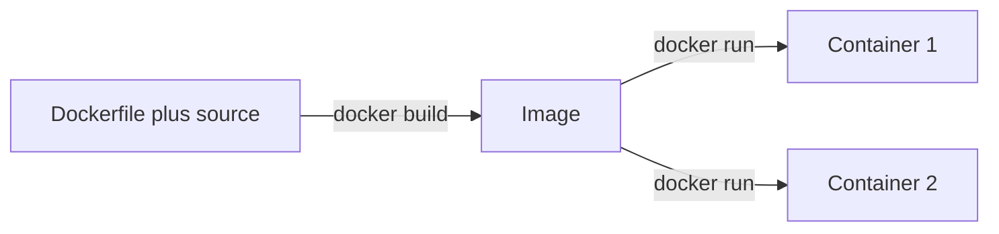

# A Dockerfile for Node — Part 1

You have a TypeScript backend. It has a `package.json`, a `tsconfig.json`, a
`src/` folder, and a build step that produces `dist/`. On your laptop you run
`npm run build && node dist/server.js` and it works.

A Dockerfile is a recipe for packing that project into one sealed box. The box
holds your code, Node itself, and the system libraries Node needs. Any machine
with Docker can open the box and get the same result as your laptop.

This file turns *that exact project* into a Docker image. We write the
Dockerfile one line at a time and explain each line as it goes in. By the end of
Part 1 you will have a working image. It will be bigger and slower than it
should be, and Part 2 fixes that.

The concepts underneath are short reference notes: what an image is, what a
layer is, and why containers are not virtual machines. They live in
[overview.md](../../cloud-devops/docker/overview.md) and
[image-vs-container.md](../../cloud-devops/docker/image-vs-container.md). This
file does not repeat them. It goes straight to *your* Dockerfile.

> **📌 In one line:** a Dockerfile is a build script for a machine image, and
> the order of its lines decides whether a one-character code change rebuilds in
> four seconds or four minutes.

## Table of Contents

1. [The Project We Are Containerising](#the-project-we-are-containerising)
2. [The First Dockerfile, Line by Line](#the-first-dockerfile-line-by-line)
3. [Choosing a Base Image](#choosing-a-base-image)
4. [Pin the Version](#pin-the-version)
5. [Layer Ordering and the Build Cache](#layer-ordering-and-the-build-cache)
6. [npm ci vs npm install](#npm-ci-vs-npm-install)
7. [The .dockerignore File](#the-dockerignore-file)
8. [Where Part 1 Leaves You](#where-part-1-leaves-you)
9. [Common Mistakes](#common-mistakes)
10. [Questions to Test Yourself](#questions-to-test-yourself)
11. [Related](#related)

---

## The Project We Are Containerising

Here is the repository. It is an invoicing API — users, companies, projects,
tasks, invoices, notifications — the same domain used everywhere in this repo.

```text
invoicing-api/
├── package.json
├── package-lock.json
├── tsconfig.json
├── src/                  <- server.ts, controllers, services, repositories
├── migrations/
├── tests/
├── .env                  <- real secrets, never goes in the image
└── node_modules/         <- 400 MB of installed packages
```

The two scripts that matter:

```json
{
  "scripts": {
    "build": "tsc -p tsconfig.json",
    "start": "node dist/server.js"
  }
}
```

So the app has a **build step**. TypeScript is not a runtime. Something must
turn `src/*.ts` into `dist/*.js` before Node can run it. That one fact makes a
Node Dockerfile different from a Python one, and it is why Part 2 is about
multi-stage builds.



`docker build` runs that recipe once and produces an image. `docker run` starts
a container from the image, as many times as you want.

## The First Dockerfile, Line by Line

Create a file called `Dockerfile` (no extension) in the project root. We add
one instruction at a time.

**Line 1 — where we start from.**

```dockerfile
FROM node:22-slim
```

Every image is built on top of another image. `FROM` says which one. This one
already holds a Linux filesystem and Node 22, so we never install Node
ourselves. Section 3 explains why `-slim`.

**Line 2 — the working directory inside the image.**

```dockerfile
WORKDIR /app
```

`WORKDIR` sets the current directory for every instruction after it, and for the
process when the container runs. Docker creates the directory if it is missing.
Without this line you run in `/`, and every relative path becomes a guess.

`/app` is a convention, not a rule. Use it.

**Line 3 — copy the dependency manifests.**

```dockerfile
COPY package.json package-lock.json ./
```

`COPY <source> <destination>`. The source is a path on your machine, relative to
the **build context** (the directory you pass to `docker build`, usually `.`).
The destination is a path inside the image.

Copying only these two files first, before the source code, is the single most
valuable line in this file. Section 5 explains why.

**Line 4 — install dependencies.**

```dockerfile
RUN npm ci
```

`RUN` executes a command *while building the image* and saves the resulting
filesystem as a new layer. This is build time, not run time. The `node_modules`
folder it creates becomes part of the image.

**Line 5 — copy the rest of the source.**

```dockerfile
COPY . .
```

Now everything else — `src/`, `tsconfig.json`, `migrations/`. The first `.` is
the build context on your machine. The second is `/app`, because of `WORKDIR`.

It does not copy anything listed in `.dockerignore`. Section 7 covers that.

**Line 6 — build the TypeScript.**

```dockerfile
RUN npm run build
```

This runs `tsc` inside the image and produces `/app/dist`.

**Line 7 — document the port.**

```dockerfile
EXPOSE 3333
```

This publishes nothing. It is documentation that tools can read. Part 2 explains
why people misunderstand it so consistently.

**Line 8 — what runs when the container starts.**

```dockerfile
CMD ["node", "dist/server.js"]
```

`CMD` is the default command for a container started from this image. Note the
array form with separate strings. Writing `CMD npm start` behaves very
differently. Part 2 covers that trap, because it silently breaks deploys.

**The whole file so far:**

```dockerfile
FROM node:22-slim
WORKDIR /app
COPY package.json package-lock.json ./
RUN npm ci
COPY . .
RUN npm run build
EXPOSE 3333
CMD ["node", "dist/server.js"]
```

Build and run it:

```bash
docker build -t invoicing-api:dev .
docker run --rm -p 3333:3333 --env-file .env invoicing-api:dev
```

```text
[+] Building 48.2s (11/11) FINISHED
 => [1/6] FROM docker.io/library/node:22-slim                            12.1s
 => [2/6] WORKDIR /app                                                    0.1s
 => [3/6] COPY package.json package-lock.json ./                          0.0s
 => [4/6] RUN npm ci                                                     28.7s
 => [5/6] COPY . .                                                        0.2s
 => [6/6] RUN npm run build                                               6.4s
 => exporting to image                                                    0.6s
 => => naming to docker.io/library/invoicing-api:dev
```

It works. It is also carrying the TypeScript compiler, every dev dependency,
your tests, and your `.git` folder. Part 2 removes all of that.

## Choosing a Base Image

`FROM` is the biggest single decision in the file. These are the four real
options for a Node backend.

| Base image | Rough size | What is inside | C library | Shell and debug tools | Honest verdict |
|---|---|---|---|---|---|
| `node:22` | ~1.1 GB | Full Debian, `git`, `curl`, `python3`, build toolchain | glibc | Everything | Too big for production, convenient for a builder stage |
| `node:22-slim` | ~220 MB | Minimal Debian plus Node | glibc | `bash`, `ls`, `cat`, package manager available | **The default answer** |
| `node:22-alpine` | ~150 MB | Alpine Linux plus Node | **musl** | `sh`, BusyBox versions of core tools | Smallest with a shell, but see the warning below |
| `gcr.io/distroless/nodejs22` | ~170 MB | Node runtime and nothing else | glibc | **No shell at all** | Most locked down, hardest to debug |

> **💡 Tip:** sizes drift between releases. Run `docker images` after a build and
> trust your own numbers, not a table on the internet.

### The Alpine and musl problem, stated honestly

Alpine does not use glibc, the C library almost every Linux distribution uses.
It uses **musl**, a smaller rewrite. For pure JavaScript packages this changes
nothing at all. For **native modules** — packages that ship compiled C or C++,
like `bcrypt`, `sharp`, `node-canvas`, or some database drivers — it changes
three things:

1. **Prebuilt binaries usually do not exist for musl.** npm falls back to
   compiling from source. Your image then needs `python3`, `make` and `g++`,
   and the build gets several minutes slower.
2. **Name lookups behave differently.** musl resolves hostnames with its own
   code, not glibc's. Some edge cases are handled differently, which shows up
   as confusing, intermittent lookup failures for internal hostnames.
3. **Stack traces and profiling tools sometimes behave oddly**, because the
   tooling ecosystem is tested far more against glibc.

None of this makes Alpine wrong. Many teams run it with no trouble. But saving
70 MB is a bad trade if one `bcrypt` build failure costs you half a day.

> **📌 Remember:** start on `node:22-slim`. Move to Alpine only if image size is
> a measured problem and you have verified every native dependency builds.

Distroless is a good *runtime* target once Part 2 has split the build apart,
because that stage needs a shell only for debugging. The cost is real:
`docker exec ... sh` does not work, and you need the technique in
[04-debugging-containers-part-2.md](./04-debugging-containers-part-2.md).

## Pin the Version

```dockerfile
# ❌ BROKEN - "latest" is whatever was pushed most recently, which changes
FROM node:latest

# ✅ FIXED - the same major and minor every time this builds
FROM node:22-slim
```

`node:latest` is not a version. It is a moving pointer. A build that worked on
Tuesday can fail on Thursday. The tag now points at a new major version of
Node, and nothing in your repository changed. One word, and your builds stopped
being repeatable.

There are four levels of pinning:

| Tag form | Example | What stays fixed | Use when |
|---|---|---|---|
| Floating | `node:latest` | Nothing | Never |
| Major | `node:22-slim` | Major version only | Fine for most teams |
| Major and minor | `node:22.11-slim` | Major and minor | You want patch updates but no minor surprises |
| Digest | `node:22-slim@sha256:9f2b...` | The exact bytes | Reproducible builds, regulated environments |

A digest pin gives you the same bytes forever. It also means no security
patches until a person updates the digest. Most teams pin the major version and
rebuild often. Pick one level on purpose and write the choice down.

## Layer Ordering and the Build Cache

Layer order decides whether your rebuilds take seconds or minutes.

Every instruction in a Dockerfile produces a **layer** — a saved snapshot of the
filesystem at that point. On a rebuild, Docker reuses a cached layer when that
instruction and everything before it are unchanged. The moment one layer
changes, every layer after it is rebuilt. The mechanics are in
[overview.md](../../cloud-devops/docker/overview.md#layers-and-the-build-cache).
Here is what it means for a Node project.

```dockerfile
# ❌ BROKEN - source code is copied before dependencies are installed
FROM node:22-slim
WORKDIR /app
COPY . .
RUN npm ci
RUN npm run build
CMD ["node", "dist/server.js"]
```

`COPY . .` copies your source. You edit one line in
`src/services/invoice-service.ts`. That changes the build context, so the `COPY`
layer is no longer valid. **Every instruction after it reruns.** That includes
`npm ci`, which downloads and installs several hundred packages that did not
change at all.

```dockerfile
# ✅ FIXED - manifests first, install, then source
FROM node:22-slim
WORKDIR /app
COPY package.json package-lock.json ./
RUN npm ci
COPY . .
RUN npm run build
CMD ["node", "dist/server.js"]
```

Now `npm ci` sits behind a `COPY` that only touches two files. Edit all the
TypeScript you like — as long as `package-lock.json` is unchanged, Docker reuses
the installed `node_modules` layer.

What this costs in real time, on a project with roughly 600 packages:

| Change you made | Broken order | Fixed order |
|---|---|---|
| First build, cold cache | 48 s | 48 s |
| Edited one line of TypeScript | 44 s | 7 s |
| Edited ten files of TypeScript | 44 s | 7 s |
| Added one npm package | 46 s | 46 s |

You can see the cache working in the build output:

```text
 => CACHED [2/6] WORKDIR /app                                             0.0s
 => CACHED [3/6] COPY package.json package-lock.json ./                   0.0s
 => CACHED [4/6] RUN npm ci                                               0.0s
 => [5/6] COPY . .                                                        0.2s
 => [6/6] RUN npm run build                                               6.3s
```

Read it as three columns: the step number, the instruction, and how long that
step took. `CACHED` means Docker reused the saved layer and ran nothing, which
is why those steps show `0.0s`. A line without `CACHED` was rebuilt.

So when a build is slow, find the first line without `CACHED`. That is where
the cache broke, and everything below it rebuilt because of it.
[04-debugging-containers-part-1.md](./04-debugging-containers-part-1.md) reads
more build output.

> **⚠️ Warning:** the rule generalises. Put the instructions that change rarely
> near the top, and the ones that change on every commit near the bottom. Base
> image, system packages, dependency install, then source code.

## npm ci vs npm install

Both install dependencies. They are not interchangeable inside a build.

| | `npm install` | `npm ci` |
|---|---|---|
| Reads | `package.json`, then the lockfile | **The lockfile only** |
| May change the lockfile | Yes | No, it errors instead |
| Existing `node_modules` | Updated in place | Deleted first, installed clean |
| Lockfile missing or out of sync | Resolves anyway | Fails the build immediately |
| Typical speed on a build server | Slower | Faster |

Use `npm ci` in a Dockerfile. Three reasons, in order of importance:

1. **The image gets the versions you tested.** `npm install` can pick a newer
   patch release of a transitive dependency — a dependency of one of your
   dependencies. You then debug a production bug that will not reproduce
   locally, because the two really are running different code.
2. **A stale lockfile fails loudly.** If a teammate added a dependency to
   `package.json` and forgot to commit the lockfile, `npm ci` stops the build
   with a clear message. `npm install` silently papers over it.
3. **It is deterministic.** Same lockfile in, same `node_modules` out.

This is also why `package-lock.json` must be committed. A lockfile you do not
commit is a lockfile that does not exist.

The same argument applies to `yarn install --frozen-lockfile` and
`pnpm install --frozen-lockfile`. The flag name changes, the principle does not.

## The .dockerignore File

`docker build .` does not read your project directly. It first packages the
whole directory and sends it to the Docker daemon as the **build context**.
Picture a 400 MB `node_modules` and a 200 MB `.git` folder in there. All 600 MB
is packed and sent before a single instruction runs.

`.dockerignore` sits next to the Dockerfile and excludes paths from the context,
using the same pattern syntax as `.gitignore`.

```text
# .dockerignore
node_modules
npm-debug.log
dist
.git
.gitignore
.env
.env.*
coverage
tests
*.md
.vscode
Dockerfile
docker-compose.yml
```

Four things this buys you:

| Entry | What goes wrong without it |
|---|---|
| `node_modules` | Your host's `node_modules` is copied in, then overwritten by `npm ci`. Slow, and if your host is macOS or Windows, any native module in there was compiled for the wrong platform |
| `.git` | Hundreds of megabytes of history shipped inside your production image, including every secret ever committed and later removed |
| `.env` | **Your real database password and API keys, baked into a layer** that anyone who can pull the image can read |
| `dist` | A stale build from your laptop gets copied in and may not be overwritten cleanly |

Take the `.env` row seriously. A file copied into an image stays there forever,
inside a layer, readable by anyone who pulls it. A later `RUN rm .env` does
**not** remove it, because the earlier layer still holds it. Part 2 shows the
same failure for build arguments, and
[05-secrets-and-configuration-part-1.md](../../backend-fundamentals/11-api-security/05-secrets-and-configuration-part-1.md)
covers where secrets should live instead.

Check it is working by looking at the context size in the build output:

```text
 => [internal] load build context                                         0.3s
 => => transferring context: 412.44kB
```

412 kB is a healthy TypeScript project. If you see `transferring context:
486.21MB`, your `.dockerignore` is missing or not being picked up.

## Where Part 1 Leaves You

You have a Dockerfile that builds, an image that runs, and rebuilds that take
seconds. You do not yet have an image you would put in front of users:

```bash
docker images invoicing-api
```

```text
REPOSITORY      TAG   IMAGE ID       CREATED          SIZE
invoicing-api   dev   7c1a9e4b2f80   2 minutes ago    843MB
```

843 MB, running as root, carrying the TypeScript compiler and the test suite,
and it ignores shutdown signals. Part 2 fixes each of those.

> **➡️ Continued in [Part 2](./01-a-dockerfile-for-node-part-2.md)** — the
> multi-stage build, the non-root user, the `PID 1` signal trap, `HEALTHCHECK`,
> and why a secret passed as a build argument is recoverable from the image.

---

## Common Mistakes

| Mistake | Why it is wrong | Do this instead |
|---|---|---|
| `FROM node:latest` | The tag moves. A build that worked yesterday can break today with no code change | Pin at least the major version: `FROM node:22-slim` |
| `COPY . .` before `RUN npm ci` | Every code change invalidates the install layer, so every rebuild reinstalls every package | Copy `package.json` and the lockfile first, install, then copy source |
| `RUN npm install` in a Dockerfile | Can resolve different versions than the ones you tested, and hides a stale lockfile | `RUN npm ci` |
| No `.dockerignore` | Slow builds, and `.git` plus `.env` shipped inside the image | Create one before the first build. Include `node_modules`, `.git`, `.env`, `dist` |
| Copying `.env` into the image | The secret lives in a layer forever and is readable by anyone who pulls the image | Pass configuration at run time with `-e` or `--env-file` |
| Reaching for Alpine first to save space | musl breaks prebuilt native modules and changes DNS behaviour | Start on `-slim`. Move to Alpine only after measuring and testing |
| Letting the host `node_modules` be copied in | Native modules compiled for macOS or Windows do not run on Linux | `node_modules` in `.dockerignore` |

## Questions to Test Yourself

1. You change one line in `src/controllers/invoice-controller.ts` and the
   rebuild reinstalls all 600 npm packages. Which instruction is in the wrong
   place, and why does moving it fix the problem?
2. A teammate adds `COPY . .` as the second line "to keep the file tidy". What
   do you say in review, in one sentence?
3. Your build output shows `transferring context: 486.21MB`. What is almost
   certainly in the context that should not be, and how do you confirm it?
4. Explain why `RUN rm .env` at the end of a Dockerfile does not remove the
   secret from the image.
5. Your colleague wants to switch the base image to `node:22-alpine` to save
   70 MB. The app uses `bcrypt` and `sharp`. What two questions do you ask
   before agreeing?
6. Someone pins `FROM node@sha256:9f2b...`. What does that guarantee, and what
   does it cost?

## Related

- [Part 2](./01-a-dockerfile-for-node-part-2.md) — multi-stage builds, non-root,
  signals, `HEALTHCHECK`, and build-argument secret leaks.
- [overview.md](../../cloud-devops/docker/overview.md) — the concept notes:
  containers versus virtual machines, what a layer is, the build cache.
- [image-vs-container.md](../../cloud-devops/docker/image-vs-container.md) — why
  an image is a template and a container is one disposable instance of it.
- [02-running-containers-locally-part-1.md](./02-running-containers-locally-part-1.md)
  — the commands that run the image you just built.
- [05-secrets-and-configuration-part-1.md](../../backend-fundamentals/11-api-security/05-secrets-and-configuration-part-1.md)
  — where the values in `.env` are supposed to live.
- [01-anatomy-of-a-backend-app.md](../../backend-fundamentals/03-request-lifecycle/01-anatomy-of-a-backend-app.md)
  — what `dist/server.js` actually starts up when the container runs it.
