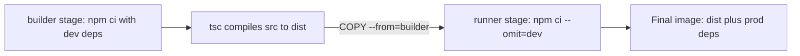
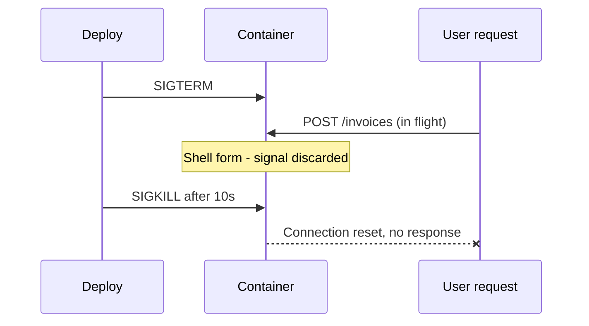

# A Dockerfile for Node — Part 2

> **⬅️ This continues [Part 1](./01-a-dockerfile-for-node-part-1.md).**

Part 1 produced a working image: 843 MB, running as root, carrying the
TypeScript compiler and the test suite, and ignoring shutdown signals. Every one
of those is fine on your laptop and a problem on a server.

This part fixes them one at a time. The multi-stage build cuts the size and
`USER` drops root. The `CMD` form decides whether your app ever receives
`SIGTERM`, and that decides whether a deploy drops requests. Then `HEALTHCHECK`,
and the build-argument trap that quietly puts secrets in a published image.

> **📌 In one line:** a production image carries only `dist/` and production
> dependencies, runs as a non-root user, and receives `SIGTERM` directly so it
> can finish in-flight requests before it dies.

## Table of Contents

1. [The Multi-Stage Build](#the-multi-stage-build)
2. [Running as a Non-Root User](#running-as-a-non-root-user)
3. [PID 1 and Signals](#pid-1-and-signals)
4. [Zombies, tini and --init](#zombies-tini-and---init)
5. [EXPOSE Documents, It Does Not Publish](#expose-documents-it-does-not-publish)
6. [HEALTHCHECK](#healthcheck)
7. [Build Arguments vs Runtime Environment](#build-arguments-vs-runtime-environment)
8. [The Complete Dockerfile](#the-complete-dockerfile)
9. [Common Mistakes](#common-mistakes)
10. [Questions to Test Yourself](#questions-to-test-yourself)
11. [Related](#related)

---

## The Multi-Stage Build

The image from Part 1 contains things the running app never touches:
`typescript`, `vitest`, `eslint`, every type definition package, `tests/`, and
the original `src/*.ts`. They produced `dist/`. They do not run it. A
multi-stage build separates those two jobs. The concept is in
[overview.md](../../cloud-devops/docker/overview.md#multi-stage-builds).



```dockerfile
# ---------- Stage 1: build ----------
FROM node:22-slim AS builder
WORKDIR /app

COPY package.json package-lock.json ./
RUN npm ci                      # ALL dependencies, including typescript

COPY tsconfig.json ./
COPY src ./src
RUN npm run build               # produces /app/dist

# ---------- Stage 2: runtime ----------
FROM node:22-slim AS runner
WORKDIR /app
ENV NODE_ENV=production

COPY package.json package-lock.json ./
RUN npm ci --omit=dev && npm cache clean --force

COPY --from=builder /app/dist ./dist

CMD ["node", "dist/server.js"]
```

Three things are happening.

**`FROM ... AS builder` names a stage.** Only the last `FROM` produces the image
that gets tagged. Earlier stages are scaffolding — built, used, thrown away.

**`COPY --from=builder` reaches into an earlier stage.** `/app/dist` crosses
over; nothing else does. The TypeScript compiler stays behind in a stage that is
never published.

**`npm ci --omit=dev` installs production dependencies only**, in the runtime
stage, so the `node_modules` that ships has no dev packages in it at all.

`ENV NODE_ENV=production` matters more than it looks: many Node libraries change
behaviour on it, and `npm` itself treats it as a signal.

```bash
docker build -t invoicing-api:1.4.0 .
docker images invoicing-api
```

```text
REPOSITORY      TAG     IMAGE ID       CREATED          SIZE
invoicing-api   1.4.0   3f8a1c0d9e22   8 seconds ago    268MB
invoicing-api   dev     7c1a9e4b2f80   1 hour ago       843MB
```

| | Single stage | Multi-stage |
|---|---|---|
| Image size | 843 MB | 268 MB |
| Contains `typescript`, `vitest`, `eslint` | Yes | No |
| Contains `src/*.ts` and `tests/` | Yes | No |
| Pull time on a 50 Mbit link | ~2 min 20 s | ~45 s |

Smaller images are not just about disk space. Every deploy pulls the image. So
does every rollback, and every new copy started because traffic rose.

> **💡 Tip:** the build cache still applies *inside each stage*. `COPY
> package.json` before `COPY src` matters here exactly as it did in Part 1.

## Running as a Non-Root User

By default, the process inside a container runs as `root`, which is user ID
(UID) 0. People assume the container wall makes that harmless. It is harmless
most of the time. The table below is the rest of the time.

| Risk | What it means in practice |
|---|---|
| Container escape | Namespace-escape bugs are rare but real. Escaping as UID 1000 is far less useful to an attacker than escaping as UID 0 |
| Volume writes | Files written to a mounted volume are owned by root on the host, so you cannot delete your own build output without `sudo` |
| Remote code execution | A bug that lets an attacker run their own code runs it as root inside the container, free to overwrite your code and read anything mounted in |

The official Node images already ship a non-root user called `node`, UID 1000.
Use it.

```dockerfile
# ❌ BROKEN - no USER instruction, so the app runs as root
COPY --from=builder /app/dist ./dist
CMD ["node", "dist/server.js"]
```

```dockerfile
# ✅ FIXED - files owned by node, process runs as node
COPY --chown=node:node package.json package-lock.json ./
RUN npm ci --omit=dev && npm cache clean --force
COPY --from=builder --chown=node:node /app/dist ./dist
USER node
CMD ["node", "dist/server.js"]
```

Two details to get right:

**Order matters.** `USER node` goes *after* the installs. `npm ci` writes into
`/app`, which is owned by root. Put `USER node` first and it fails with
`EACCES`.

**`--chown=node:node` on every `COPY`.** Without it the copied files belong to
root and `node` can read but not write them. Read-only is right for application
code, but any directory the app writes to needs
`RUN mkdir -p /app/tmp && chown node:node /app/tmp`.

```bash
docker run --rm invoicing-api:1.4.0 id
```

```text
uid=1000(node) gid=1000(node) groups=1000(node)
```

`uid` is the user ID and `gid` the group ID, exactly as described in
[03-users-permissions-and-ssh-part-1.md](../01-linux-essentials/03-users-permissions-and-ssh-part-1.md).
When that number does not match the owner of a mounted host directory, you get
the "permission denied on a mounted volume" problem in
[04-debugging-containers-part-2.md](./04-debugging-containers-part-2.md).

## PID 1 and Signals

This is the Node-specific trap, and the most expensive one in this folder.
Nothing looks broken until a deploy drops requests.

Inside a container, the first process started gets **process ID 1** (PID 1). On
Linux, PID 1 is special: it gets no default signal handlers. A normal process
that ignores `SIGTERM` still dies, because the kernel kills it by default. PID 1
has no default action, so an unhandled `SIGTERM` is discarded. Background on
signals:
[02-processes-and-services-part-1.md](../01-linux-essentials/02-processes-and-services-part-1.md).

`docker stop` does three things: send `SIGTERM`, wait 10 seconds, then send
`SIGKILL`. `SIGKILL` cannot be caught.

### The two forms of CMD

```dockerfile
# ❌ BROKEN - shell form. Docker runs: /bin/sh -c "npm start"
CMD npm start
```

```dockerfile
# ✅ FIXED - exec form. Docker runs node directly as PID 1
CMD ["node", "dist/server.js"]
```

With the shell form, the process tree inside the container is:

```text
PID 1  /bin/sh -c "npm start"
PID 7    └─ npm start
PID 18        └─ node dist/server.js       <- your actual app
```

`docker stop` sends `SIGTERM` to PID 1, which is `sh`, which does not forward
signals to its children. Your Node process never hears anything. Ten seconds
later everyone is `SIGKILL`ed. With the exec form the tree is one line —
`PID 1  node dist/server.js` — and `SIGTERM` arrives where you can handle it.

> **⚠️ Warning:** `CMD ["npm", "start"]` is the exec form but still wrong. `npm`
> becomes PID 1 and spawns `node` as a child. Signal forwarding has varied
> between npm versions and the exit code gets rewritten. Call `node` directly.

### What "handling it" means

```ts
// src/server.ts
import { createServer } from 'node:http'
import { app } from './app.js'
import { closeDatabasePool } from './database.js'

const server = createServer(app)
server.listen(3333, '0.0.0.0')   // 0.0.0.0, never 127.0.0.1 - see file 02

let shuttingDown = false

async function shutdown(signal: NodeJS.Signals): Promise<void> {
  if (shuttingDown) return
  shuttingDown = true
  console.log(JSON.stringify({ level: 'info', msg: 'shutdown started', signal }))

  // The callback fires once in-flight requests have finished responding.
  server.close(async () => {
    await closeDatabasePool()
    process.exit(0)
  })

  // The load balancer may still be sending traffic. Do not wait forever.
  setTimeout(() => process.exit(1), 8_000).unref()
}

process.on('SIGTERM', shutdown)
process.on('SIGINT', shutdown)
```

Eight seconds, not ten, because `docker stop` kills at ten and your own timeout
should win.

### Why this shows up as dropped requests



The user who was creating an invoice gets a connection reset. Your logs show
nothing, because the process was killed before it could write a line. You deploy
four times a day, so this happens four times a day. The fix is one pair of
square brackets and a signal handler.

## Zombies, tini and --init

PID 1 has a second job: **reaping zombie processes**. A zombie is a finished
child process that still holds a slot in the process table, because nobody read
its exit status. Normally PID 1 adopts these orphans and clears them.

Your Node app does not. If it spawns children — a PDF renderer, anything using
`child_process` — the slots pile up until no new process can start. Two fixes:

```bash
# Run Docker's built-in minimal init as PID 1
docker run --init -p 3333:3333 invoicing-api:1.4.0
```

```dockerfile
# Or bake it into the image
RUN apt-get update && apt-get install -y --no-install-recommends tini \
    && rm -rf /var/lib/apt/lists/*
ENTRYPOINT ["/usr/bin/tini", "--"]
CMD ["node", "dist/server.js"]
```

`tini` is a tiny init process. It becomes PID 1, forwards signals, and reaps
zombies. `--init` is Docker's bundled equivalent, with no Dockerfile change.

> **📌 Remember:** if your app never spawns child processes, the exec form plus
> a `SIGTERM` handler is enough. Add `--init` the moment you shell out.

## EXPOSE Documents, It Does Not Publish

```dockerfile
EXPOSE 3333
```

This opens nothing and changes no networking. It is **metadata** in the image: a
note saying "the thing inside listens on 3333". Only two things read it. One is
a human running `docker inspect`. The other is `docker run -P` (capital P),
which publishes every `EXPOSE`d port to a random host port and is rarely used.

To actually reach the app you need `-p 3333:3333` at run time, covered in
[02-running-containers-locally-part-1.md](./02-running-containers-locally-part-1.md).
Keep `EXPOSE` anyway — it is free documentation.

## HEALTHCHECK

A container can be *running* while the app inside it is stuck — an exhausted
database pool, a blocked event loop. `docker ps` still says `Up 4 hours`.
`HEALTHCHECK` tells Docker how to ask the app whether it is actually working.

```dockerfile
HEALTHCHECK --interval=30s --timeout=3s --start-period=20s --retries=3 \
  CMD node -e "fetch('http://127.0.0.1:3333/health/ready').then(r => process.exit(r.ok ? 0 : 1)).catch(() => process.exit(1))"
```

Why `node -e` and not `curl`? `node:22-slim` does not ship `curl`. Installing it
only for a health check adds a package and an attack surface for no gain. Node
can already make the request.

| Flag | What it controls | Starting value |
|---|---|---|
| `--interval` | Time between checks | `30s` |
| `--timeout` | How long one check may take before it counts as failed | `3s` |
| `--start-period` | Grace window at boot where failures do not count | `20s`, enough for migrations and pool warm-up |
| `--retries` | Consecutive failures before the container is `unhealthy` | `3` |

`--start-period` is the one people forget. Without it, a container that takes 15
seconds to connect to Postgres is marked unhealthy during a perfectly normal
startup. What the endpoint should actually check — and the liveness versus
readiness distinction — is in
[04-metrics-and-health-checks-part-2.md](../../backend-fundamentals/08-logging-and-observability/04-metrics-and-health-checks-part-2.md).
A readiness check that returns `{"ok": true}` without touching the database
tells you nothing.

```bash
docker ps
```

```text
CONTAINER ID   IMAGE                 STATUS                    PORTS
3f8a1c0d9e22   invoicing-api:1.4.0   Up 2 minutes (healthy)    0.0.0.0:3333->3333/tcp
```

`Up 2 minutes` is how long the container has run. The word in brackets is the
health state: `(health: starting)` first, then `(healthy)` or `(unhealthy)`.

## Build Arguments vs Runtime Environment

Two ways to get a value into a container, and they are not alternatives.

| | `ARG` | `ENV` |
|---|---|---|
| Available during | Build only | Build and run |
| Set by | `docker build --build-arg KEY=value` | `ENV` in the Dockerfile, or `-e` / `--env-file` at run time |
| Stored in the image | **Yes — in the build history** | Yes — in the image config |
| Changing it requires | A rebuild | A restart |
| Safe for secrets | **No** | No |

```dockerfile
# ❌ BROKEN - the token is now permanently in the image history
ARG NPM_TOKEN
RUN echo "//registry.npmjs.org/:_authToken=${NPM_TOKEN}" > .npmrc \
    && npm ci \
    && rm .npmrc
```

The `rm .npmrc` feels like it cleans up. It does not:

```bash
docker history --no-trunc invoicing-api:1.4.0
```

```text
IMAGE          CREATED BY
<missing>      |1 NPM_TOKEN=npm_7fK2xQ... /bin/sh -c echo "//registry.npmjs.org/...
```

The token is in the command text, recorded in the layer metadata. `docker
inspect` leaks `ENV` values the same way. This is a real credential leak — it is
how private registry tokens end up in images pushed to a shared registry.

```dockerfile
# ✅ FIXED - BuildKit secret mount: available during the RUN, never stored
RUN --mount=type=secret,id=npmrc,target=/root/.npmrc npm ci
```

```bash
docker build --secret id=npmrc,src=$HOME/.npmrc -t invoicing-api:1.4.0 .
```

The file is mounted into that one `RUN` and is in no layer afterwards.

For **runtime** secrets — database password, Stripe key, JWT signing secret —
none of this applies. They should never be in the image at all. They arrive when
the container starts:

```bash
docker run --env-file .env.production invoicing-api:1.4.0
```

`ARG` is still right for non-secret build inputs: a version string, a git SHA to
embed in `/health`. Where real secrets belong is covered in
[05-secrets-and-configuration-part-1.md](../../backend-fundamentals/11-api-security/05-secrets-and-configuration-part-1.md).

## The Complete Dockerfile

Everything from both parts, in one file.

```dockerfile
# syntax=docker/dockerfile:1

# ---------- Stage 1: build ----------
FROM node:22-slim AS builder
WORKDIR /app

COPY package.json package-lock.json ./
RUN npm ci

COPY tsconfig.json ./
COPY src ./src
RUN npm run build

# ---------- Stage 2: runtime ----------
FROM node:22-slim AS runner
WORKDIR /app

ENV NODE_ENV=production
ARG GIT_SHA=unknown
ENV GIT_SHA=${GIT_SHA}

COPY --chown=node:node package.json package-lock.json ./
RUN npm ci --omit=dev && npm cache clean --force

COPY --from=builder --chown=node:node /app/dist ./dist

USER node

EXPOSE 3333

HEALTHCHECK --interval=30s --timeout=3s --start-period=20s --retries=3 \
  CMD node -e "fetch('http://127.0.0.1:3333/health/ready').then(r => process.exit(r.ok ? 0 : 1)).catch(() => process.exit(1))"

CMD ["node", "dist/server.js"]
```

```bash
docker build --build-arg GIT_SHA="$(git rev-parse --short HEAD)" -t invoicing-api:1.4.0 .
```

---

## Common Mistakes

| Mistake | Why it is wrong | Do this instead |
|---|---|---|
| `CMD npm start` | Shell form. `sh` becomes PID 1 and never forwards `SIGTERM`, so shutdown is always a `SIGKILL` | `CMD ["node", "dist/server.js"]` |
| `CMD ["npm", "start"]` | `npm` becomes PID 1, your app is a child, and signal forwarding varies by npm version | Call `node` directly |
| No `SIGTERM` handler in the app | Even with the exec form, the process exits immediately and drops in-flight requests | Handle `SIGTERM`, call `server.close()`, close the pool |
| `USER node` before `npm ci` | `/app` is owned by root, so the install fails with `EACCES` | Put `USER node` after all installs |
| Copying `node_modules` from the builder into the runtime stage | Brings every dev dependency along and defeats the split | `npm ci --omit=dev` in the runtime stage |
| `ARG NPM_TOKEN` for a registry credential | Recorded in `docker history` forever, even if you delete the file afterwards | BuildKit `--mount=type=secret` |
| Expecting `EXPOSE 3333` to make the app reachable | It is metadata only | Publish with `-p 3333:3333` at run time |
| `HEALTHCHECK` without `--start-period` | A slow-starting app is marked unhealthy during a normal boot | Set it longer than your worst cold start |

## Questions to Test Yourself

1. Your deploys drop a handful of requests every time, with no errors in the
   logs. Walk through why, starting from the `CMD` line.
2. Why does `CMD ["npm", "start"]` not fully solve the signal problem even
   though it is the exec form?
3. A colleague moves `USER node` to just after `WORKDIR /app`. What breaks?
4. Explain, to someone who does not believe you, how a token passed with
   `--build-arg` can be recovered from the published image.
5. What exactly does `COPY --from=builder /app/dist ./dist` copy, and what is
   left behind in the builder stage?
6. Your app spawns a child process to render invoice PDFs. Which PID 1 problem
   does that introduce, and what is the one-flag fix?

## Related

- [Part 1](./01-a-dockerfile-for-node-part-1.md) — base images, pinning, layer
  ordering, `npm ci`, `.dockerignore`.
- [02-processes-and-services-part-2.md](../01-linux-essentials/02-processes-and-services-part-2.md)
  — what a signal actually is, and why PID 1 is special.
- [01-anatomy-of-a-backend-app.md](../../backend-fundamentals/03-request-lifecycle/01-anatomy-of-a-backend-app.md)
  — the server object `server.close()` drains.
- [03-users-permissions-and-ssh-part-1.md](../01-linux-essentials/03-users-permissions-and-ssh-part-1.md)
  — the UID and GID model behind `USER node`.
- [04-metrics-and-health-checks-part-2.md](../../backend-fundamentals/08-logging-and-observability/04-metrics-and-health-checks-part-2.md)
  — what a readiness endpoint should actually check.
- [05-secrets-and-configuration-part-1.md](../../backend-fundamentals/11-api-security/05-secrets-and-configuration-part-1.md)
  — where runtime secrets belong instead of the image.
- [overview.md](../../cloud-devops/docker/overview.md) — the multi-stage concept
  note this file builds on.
- [03-compose-for-local-development-part-1.md](./03-compose-for-local-development-part-1.md)
  — running this image next to Postgres and Redis.
