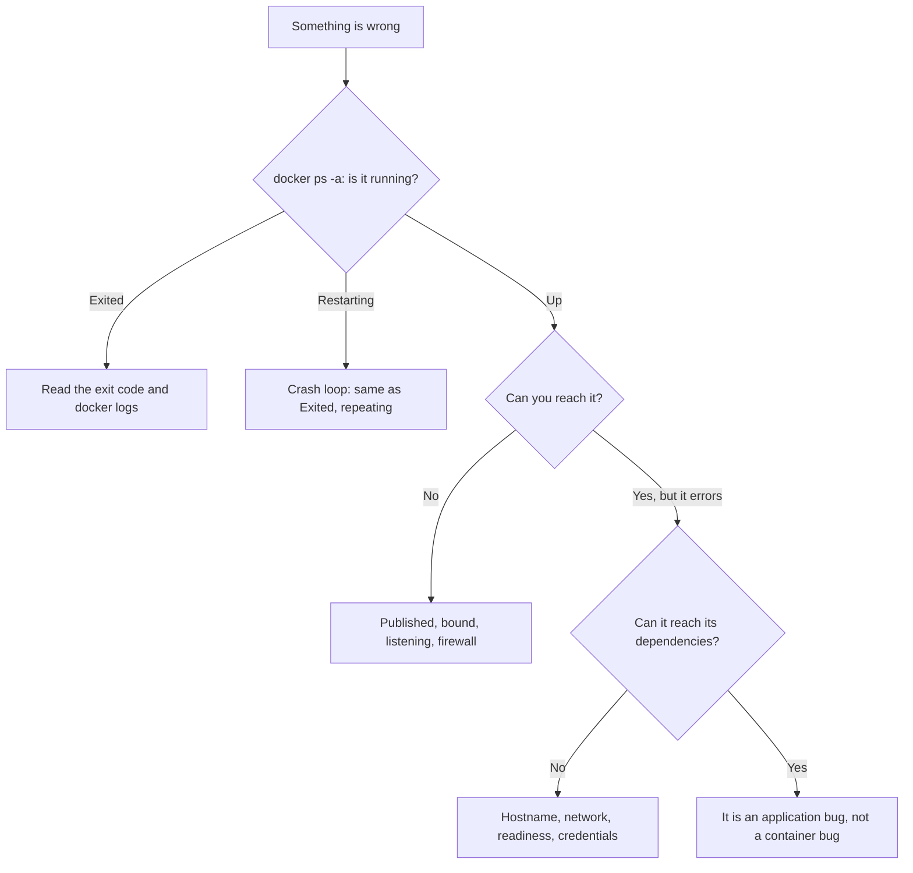
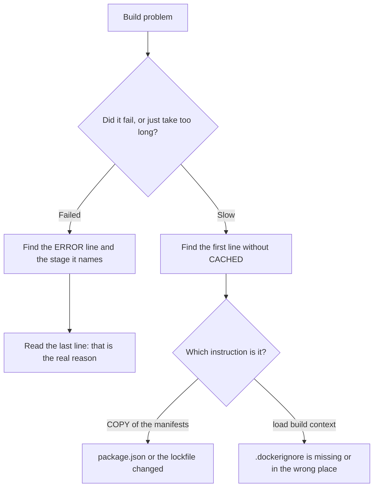

# Debugging Containers — Part 1

This file is a runbook, not an essay. Your container is not doing what you
expect, and you want the answer now.

An electrician does not rewire a house because one lamp is dark. They check the
bulb, then the switch, then the fuse. Debugging a container works the same way:
a fixed order of cheap checks, where each answer rules something out. This file
is that order.

Part 1 covers the three failures you hit most often. The container exits the
moment you start it. The build fails, or takes far too long. The app is clearly
running but nothing can reach it.

Part 2 covers the database connection, the architecture mismatch between your
laptop and the server, volume permissions, and getting into an image with no
shell.

> **📌 In one line:** read the exit code first, the logs second, and only then
> start guessing — most container failures announce exactly what they are.

## Table of Contents

1. [Start Here](#start-here)
2. [The Container Exits Immediately](#the-container-exits-immediately)
3. [Exit Codes](#exit-codes)
4. [The Build Fails or Is Mysteriously Slow](#the-build-fails-or-is-mysteriously-slow)
5. [The App Runs But You Cannot Reach It](#the-app-runs-but-you-cannot-reach-it)
6. [Common Mistakes](#common-mistakes)
7. [Questions to Test Yourself](#questions-to-test-yourself)
8. [Related](#related)

---

## Start Here



The first command is always the same:

```bash
docker ps -a
```

```text
CONTAINER ID   IMAGE                 COMMAND                 STATUS                          NAMES
a3f91c7e2b4d   invoicing-api:1.4.0   "node dist/server.js"   Exited (1) 4 seconds ago        api
7c2e9b1a5d03   postgres:16           "docker-entrypoint.s…"  Up 6 minutes (healthy)          postgres
```

Two columns answer the first question. `STATUS` says `Exited (1) 4 seconds ago`
for the API: it ran, then stopped, and the number in brackets is its exit code.
`COMMAND` shows what PID 1 actually was, which is how you catch a `CMD` that is
not the one you thought you wrote.

`-a` is essential. Without it, the container that just died is invisible, and it
looks like nothing was ever started.

## The Container Exits Immediately

You run it, the shell comes straight back, and `docker ps` shows nothing.

**Step 1 — confirm it exited and read the code.**

```bash
docker ps -a --filter name=api --format "table {{.Names}}\t{{.Status}}"
```

```text
NAMES   STATUS
api     Exited (1) 12 seconds ago
```

**Step 2 — read the logs. The answer is usually right here.**

```bash
docker logs api
```

```text
node:internal/modules/cjs/loader:1143
  throw err;
  ^
Error: Cannot find module '/app/dist/server.js'
    at Module._resolveFilename (node:internal/modules/cjs/loader:1140:15)
```

That is a complete diagnosis: the build step did not produce `dist/server.js`,
or the multi-stage `COPY --from=builder` pointed at the wrong path. Check inside
the image:

```bash
docker run --rm invoicing-api:1.4.0 ls -la /app /app/dist
```

**Step 3 — if the logs are empty, the process died before it could print.**

```bash
docker logs api
```

```text
```

An empty log with a non-zero exit usually means one of three things. The command
does not exist, which is exit 127. The file is not executable, which is 126. Or
the process was killed from outside, which is 137. The exit code tells you
which one.

**Step 4 — override the command to look around.**

```bash
docker run --rm -it --entrypoint sh invoicing-api:1.4.0
```

`--entrypoint sh` starts the image with a shell instead of your app. Now you can
look inside a container that never stays alive long enough to `exec` into.

> **💡 Tip:** a container exits when its PID 1 exits. That is not a bug — it is
> the model. A container running `node dist/server.js` stays up because the
> server keeps the event loop alive. A container whose app finishes its work
> exits, correctly.

### Crash loops

```text
STATUS
Restarting (1) 3 seconds ago
```

`Restarting` means `restart: unless-stopped` (or `--restart`) is bringing it
back and it keeps dying. The logs rotate fast, so capture them:

```bash
docker logs --tail 200 api > /tmp/api-crash.log
docker compose stop api        # stop the loop while you read
```

## Exit Codes

The exit code is in the `STATUS` column and in `docker inspect`.

```bash
docker inspect api --format '{{.State.ExitCode}} {{.State.OOMKilled}} {{.State.Error}}'
```

```text
137 true
```

Three fields, separated by spaces: the exit code, whether the kernel killed it
for memory, and any error Docker itself recorded. The third field is empty here,
which is normal. Docker had no complaint; the kernel did the killing.

| Code | Meaning | Where to look |
|---|---|---|
| `0` | Clean exit | Usually correct. A one-off task finished. For a server, it means something called `process.exit(0)` or the event loop emptied |
| `1` | Unhandled application error | `docker logs`. A thrown exception, a failed config check, a rejected promise |
| `125` | **The `docker run` command itself failed** | Your flags, not your app. A bad flag, an unknown image, a port already in use |
| `126` | Command found but not executable | A shell script without the executable bit, or with no `#!/bin/sh` first line |
| `127` | **Command not found** | A typo in `CMD`, or the binary does not exist in that base image |
| `137` | `SIGKILL` (128 + 9) | Out-of-memory kill, `docker kill`, or a `SIGTERM` your app ignored |
| `139` | `SIGSEGV` (128 + 11) | Segmentation fault. A native module compiled for the wrong platform, or a corrupt binary |
| `143` | `SIGTERM` (128 + 15) | Someone asked it to stop and it did |

Codes above 128 are **128 plus the signal number**. That is the pattern worth
memorising, because it covers every signal, not just these three.

> **📌 Remember:** read the exit code before you read anything else. It already
> tells you whether the fault is in your flags (125), your image (126 and 127),
> your own code (1), or something outside the container (137 and 143).

### 137 and 143 look alike and mean opposite things

This distinction matters more than any other code in the table.

| | 143 (`SIGTERM`) | 137 (`SIGKILL`) |
|---|---|---|
| Who sent it | `docker stop`, a deploy, an orchestrator | The kernel's OOM killer, or `docker kill` |
| Could the app react? | Yes — this is a graceful shutdown | No. `SIGKILL` cannot be caught |
| Normal? | **Yes.** Every normal stop produces 143 | **No.** Something went wrong |
| Logs | Your shutdown messages are there | Logs stop mid-sentence |

```bash
docker inspect api --format '{{.State.OOMKilled}}'
```

```text
true
```

`true` means memory. `false` with 137 means `SIGKILL` arrived from outside. Very
often that is your own deploy: the app did **not** handle `SIGTERM`, so
`docker stop` waited ten seconds and escalated. A 137 on every deploy is a
signal-handling
bug, not a memory bug, and the fix is in
[01-a-dockerfile-for-node-part-2.md](./01-a-dockerfile-for-node-part-2.md).

> **⚠️ Warning:** do not spend an afternoon debugging a 143 in your logs. It is
> what a correct shutdown looks like.

## The Build Fails or Is Mysteriously Slow



### Reading the build output

```text
 => CACHED [builder 2/6] WORKDIR /app                                     0.0s
 => CACHED [builder 3/6] COPY package.json package-lock.json ./           0.0s
 => CACHED [builder 4/6] RUN npm ci                                       0.0s
 => [builder 5/6] COPY . .                                                0.3s
 => [builder 6/6] RUN npm run build                                       6.1s
 => ERROR [runner 4/5] COPY --from=builder /app/build ./dist              0.1s
------
 > [runner 4/5] COPY --from=builder /app/build ./dist:
------
failed to solve: "/app/build": not found
```

Three things to read, in order:

1. **The `ERROR` line** names the exact instruction and the stage it is in.
2. **The block after `------`** repeats it with more context.
3. **The last line** is the actual reason. Here: `tsc` writes to `dist`, not
   `build`, so the path is wrong.

```dockerfile
# ❌ BROKEN - no /app/build exists in the builder stage
COPY --from=builder /app/build ./dist
```

```dockerfile
# ✅ FIXED - matches the outDir in tsconfig.json
COPY --from=builder /app/dist ./dist
```

### Which layer is rebuilding, and why

Every line without `CACHED` is being rebuilt. The **first** one of those is
where your cache broke; everything below it rebuilds whether it needed to or
not.

```text
 => CACHED [2/6] WORKDIR /app                                             0.0s
 => [3/6] COPY package.json package-lock.json ./                          0.0s
 => [4/6] RUN npm ci                                                     31.4s
```

Step 3 is not cached, so `npm ci` reran and cost 31 seconds. Something changed
in `package.json` or `package-lock.json`. The usual causes are an automatic
reformat, a version bump from a tool, or a lockfile regenerated on a different
npm version. `git diff` on those two files answers it.

> **💡 Tip:** `docker build --progress=plain` prints the full output of every
> `RUN` instead of collapsing it. Essential when a build step fails with a
> truncated error.

### Verifying .dockerignore is working

```text
 => [internal] load build context                                         8.9s
 => => transferring context: 486.21MB
```

486 MB is not a TypeScript project. It is `node_modules` and `.git`.

```bash
ls -la .dockerignore
docker build --no-cache --progress=plain -t probe . 2>&1 | grep "transferring context"
```

Common causes: the file is named `.dockerignore.txt`, or it is in the wrong
directory. `.dockerignore` must sit next to the **build context root** (the `.`
you pass to `docker build`), not next to the Dockerfile if those differ.

```bash
docker run --rm invoicing-api:1.4.0 ls -a /app
```

If `.git` or `.env` shows up in that listing, your ignore file is not being
applied, and you have shipped a secret. See
[01-a-dockerfile-for-node-part-1.md](./01-a-dockerfile-for-node-part-1.md).

### Build is slow but succeeds

| Symptom | Likely cause | Fix |
|---|---|---|
| `npm ci` reruns every build | `COPY . .` sits before it | Copy the manifests first |
| Context transfer takes 10+ seconds | Missing or ineffective `.dockerignore` | Add `node_modules`, `.git`, `dist` |
| Native module compiles from source every time | Alpine base, no prebuilt musl binary | Move to `-slim` |
| Everything is slow on the first build of the day | Docker Desktop's virtual machine is cold, or base layers expired | Nothing to fix |

## The App Runs But You Cannot Reach It

Work through this in order. Each step rules out one hop, and the hops are
independent.

```text
   your browser
        │  1. is the port published?
        ▼
   host port 3333
        │  2. does it map to the right container port?
        ▼
   container port 3333
        │  3. is the app bound to 0.0.0.0?
        ▼
   the node process
        │  4. is it actually listening yet?
        ▼
     responds
```

**1. Is it published?**

```bash
docker ps --format "table {{.Names}}\t{{.Ports}}"
```

```text
NAMES   PORTS
api     3333/tcp
```

`3333/tcp` with no `0.0.0.0:...->` prefix means **nothing is published**. That
is an `EXPOSE` from the Dockerfile and nothing more. You forgot `-p`, or the
Compose service has no `ports:`.

Correct output looks like this:

```text
NAMES   PORTS
api     0.0.0.0:3333->3333/tcp
```

**2. Is the mapping the right way round?**

```text
0.0.0.0:8080->3333/tcp      host 8080, container 3333  -> browse localhost:8080
0.0.0.0:3333->8080/tcp      host 3333, container 8080  -> wrong if the app uses 3333
```

Host on the left, container on the right. Swapped arguments produce a published
port that forwards to nothing.

**3. Is the app bound to `0.0.0.0`?**

```bash
docker exec -it api sh -c "ss -tulpn | grep 3333"
```

```text
tcp   LISTEN   127.0.0.1:3333    users:(("node",pid=1,fd=20))
```

`127.0.0.1` is the problem — the container's own loopback. Published traffic
arrives on `eth0`, where nothing is listening. Bind `0.0.0.0` instead; the full
explanation is in
[02-running-containers-locally-part-1.md](./02-running-containers-locally-part-1.md).

If `ss` is missing from the image:

```bash
docker exec api node -e "require('net').connect(3333,'127.0.0.1').on('connect',()=>{console.log('loopback ok');process.exit(0)}).on('error',e=>{console.log('no listener');process.exit(1)})"
```

**4. Is it actually listening yet?**

```bash
docker logs api | tail -3
```

```text
{"level":"info","msg":"running migrations"}
```

No "listening" line means the app is still starting. A slow migration or a
database retry loop can hold startup for a minute. This is not a networking
problem at all.

**5. Is something in front of it?**

```bash
curl -v http://localhost:3333/health/ready
```

```text
*   Trying 127.0.0.1:3333...
* connect to 127.0.0.1 port 3333 failed: Connection refused
```

The `* Trying 127.0.0.1:3333...` line shows the address curl really used, which
catches a wrong port before anything else. `Connection refused` then means
nothing is listening at that address — steps 1 to 4.
A **timeout** instead means packets are being dropped, which is a firewall, and
belongs to
[04-networking-ports-and-firewalls-part-1.md](../01-linux-essentials/04-networking-ports-and-firewalls-part-1.md).
On your own laptop a firewall is rarely the cause; on a server it very often is.

> **➡️ Continued in [Part 2](./04-debugging-containers-part-2.md)** — it cannot
> reach the database, it works on my machine but not on the server, volume
> permission errors, `inspect` and `diff`, image size, and debugging an image
> with no shell.

---

## Common Mistakes

| Mistake | Why it is wrong | Do this instead |
|---|---|---|
| Running `docker ps` when a container died | Dead containers are hidden, so it looks like nothing started | `docker ps -a` always |
| Guessing before reading `docker logs` | The error is usually printed in full | Logs first, every time |
| Treating exit 143 as a failure | 143 is `SIGTERM` — a normal, requested stop | Investigate 137, not 143 |
| Assuming 137 means your app crashed | `SIGKILL` comes from outside the process | Check `.State.OOMKilled` first |
| Rebuilding with `--no-cache` to "fix" a slow build | Guarantees the slowest possible build and hides the real cause | Find the first non-`CACHED` line instead |
| Deleting and recreating the container as a first move | Destroys the evidence, and usually the problem comes back | Read logs and `inspect` before removing anything |
| Concluding "the port is broken" from `docker ps` alone | Publishing is one of four hops | Walk the four steps in order |

## Questions to Test Yourself

1. A container shows `Exited (127)` with empty logs. What does that code point
   at, and which Dockerfile line do you look at?
2. Every deploy logs exit code 137 and users see reset connections. Is this a
   memory problem? How do you prove it either way?
3. Your build output shows `transferring context: 486.21MB`. What two
   directories are almost certainly in there, and what is the one-file fix?
4. In a build log, four lines say `CACHED` and the fifth does not. What does
   that tell you about lines six and seven?
5. `docker ps` shows `3333/tcp` in the PORTS column. Can you reach the app from
   your browser? Why or why not?
6. `curl` says `Connection refused` on one machine and times out on another.
   What different cause does each point to?
7. A container will not stay running long enough to `docker exec` into it. How
   do you get a shell in that image anyway?

## Related

- [Part 2](./04-debugging-containers-part-2.md) — database connectivity,
  architecture mismatches, volume permissions, `inspect`, image size, shell-less
  images.
- [02-running-containers-locally-part-1.md](./02-running-containers-locally-part-1.md)
  — the `0.0.0.0` bind and the port-mapping order this file keeps checking.
- [01-a-dockerfile-for-node-part-2.md](./01-a-dockerfile-for-node-part-2.md) —
  the `SIGTERM` handling behind the 137-versus-143 distinction.
- [04-networking-ports-and-firewalls-part-1.md](../01-linux-essentials/04-networking-ports-and-firewalls-part-1.md)
  — refused versus timed out, and reading `ss` output.
- [05-logs-disks-and-debugging-part-1.md](../01-linux-essentials/05-logs-disks-and-debugging-part-1.md)
  — the same investigation on the host, outside any container.
- [image-vs-container.md](../../cloud-devops/docker/image-vs-container.md) — the
  lifecycle states behind `Created`, `Up`, `Exited` and `Restarting`.
