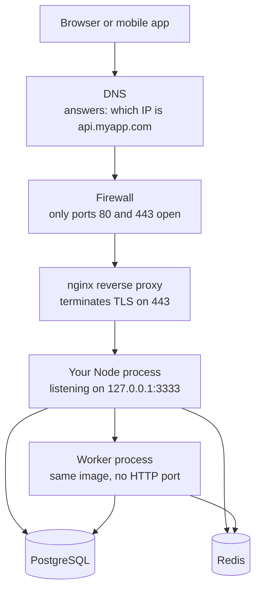

# What Deployment Actually Is

You have built a backend. It runs on your laptop at `http://localhost:3333`. Now
someone else needs to use it. The word people use for that step is "deployment",
and it sounds much bigger than it is. This file takes the mystery out of it,
shows you the pieces of a real production system, and helps you choose where to
put your own project.

> **📌 In one line:** deployment is copying your code onto a machine, starting
> the process, and pointing traffic at it — everything else you hear about is
> making those three steps repeatable and safe.

## Table of Contents

1. [Deployment in Plain Words](#deployment-in-plain-words)
2. [The Pieces of a Running System](#the-pieces-of-a-running-system)
3. [One Request, All the Way Through](#one-request-all-the-way-through)
4. [Where to Host It](#where-to-host-it)
5. [Why a Small VPS, For You](#why-a-small-vps-for-you)
6. [Environments: Development, Staging, Production](#environments-development-staging-production)
7. [The Checklist Before You Ever Deploy](#the-checklist-before-you-ever-deploy)
8. [Twelve-Factor Ideas Worth Keeping](#twelve-factor-ideas-worth-keeping)
9. [What Goes Wrong on the First Deploy](#what-goes-wrong-on-the-first-deploy)
10. [Common Mistakes](#common-mistakes)
11. [Questions to Test Yourself](#questions-to-test-yourself)
12. [Related](#related)

---

## Deployment in Plain Words

Think about moving into a rented flat. You carry your things in, you switch on
the electricity, and you tell people the new address. That is it. Everything
else — insurance, a spare key, a smoke alarm — is about what happens *after* you
move in, not about moving in itself.

Deployment is the same three steps:

1. **Get the code onto a machine** that is on the internet.
2. **Start the process** so it listens on a port.
3. **Point traffic at it** so a real domain name reaches that port.

That is the whole job. You could do it in ten minutes with `scp` and `node
server.js`. Many people have.

So why does deployment feel hard? Because doing it **once** is easy and doing it
**fifty times, safely, while users are connected** is not. Every scary word in
this area — CI/CD, blue-green, orchestration — exists to solve the *repeat*
problem, not the *first time* problem.

> **💡 Tip:** Separate the two in your head. "Can I get it running?" is a small
> question. "Can I get a new version running without breaking anyone?" is the
> real one, and it is what folders 3 and 4 of this part are about.

**Deploy** and **release** are also two different things, even though people use
them as one word. Deploying means the new code is on the server. Releasing means
users actually get the new behaviour. You can deploy on Monday and release on
Friday — see [feature flags](03-shipping-and-rollback-part-2.md#feature-flags-deploy-is-not-release).

---

## The Pieces of a Running System

Here is a complete, small production system. Nothing in this diagram is
optional for a real app with users.



As an ASCII box, because the shape matters:

```text
   internet
       |
   [ DNS ]  api.myapp.com  ->  203.0.113.10
       |
  ===================== one VPS =====================
  |    |                                            |
  | [ firewall: 22, 80, 443 ]                        |
  |    |                                             |
  | [ nginx :80 :443 ]  TLS ends here                 |
  |    |  plain HTTP over localhost                   |
  | [ node :3333 ]  <---- your code                    |
  |    |         \                                     |
  | [ redis :6379 ] [ worker process ]                  |
  ===================================================
       |
   [ managed PostgreSQL, separate machine ]
```

Two details that surprise people the first time:

- **Your Node process should listen on `127.0.0.1`, not `0.0.0.0`.** Then it is
  physically unreachable from the internet, and nginx is the only way in. If it
  listens on `0.0.0.0:3333` and the firewall ever opens, your app is exposed with
  no TLS.
- **TLS stops at nginx.** nginx decrypts HTTPS and talks plain HTTP to your app
  over the loopback interface. That traffic never leaves the machine, so it is
  not a security problem — but it does mean your app sees `http`, not `https`,
  unless you forward a header. That trips up redirect logic and cookie flags.

---

## One Request, All the Way Through

Follow one request: a user opens the task list in your SaaS app.

| # | Stage | What happens | Covered in |
|---|---|---|---|
| 1 | **DNS** | The browser asks "what IP is `api.myapp.com`?" and gets `203.0.113.10` | [How the Web Works](../../backend-fundamentals/01-http-foundations/01-how-the-web-works.md) |
| 2 | **TCP + firewall** | The browser opens a connection to port 443. The firewall allows 443 | [Networking, Ports and Firewalls](../01-linux-essentials/04-networking-ports-and-firewalls-part-2.md) |
| 3 | **TLS handshake** | nginx presents the certificate, both sides agree on keys | [HTTPS and TLS](../../backend-fundamentals/01-http-foundations/06-https-and-tls.md) |
| 4 | **Reverse proxy** | nginx decrypts, adds `X-Forwarded-For`, forwards to `127.0.0.1:3333` | [Reverse Proxy](../../system-design/foundational/reverse-proxy.md) |
| 5 | **Your process** | Node accepts, routes `GET /v1/projects/42/tasks`, runs middleware | [Anatomy of a Backend App](../../backend-fundamentals/03-request-lifecycle/01-anatomy-of-a-backend-app.md) |
| 6 | **Auth** | A session cookie or JWT is verified, `user_id` is attached | [Authentication Basics](../../backend-fundamentals/05-authentication/01-authentication-basics.md) |
| 7 | **Cache** | Redis is checked for `tasks:project:42` first | [Implementing Cache-Aside](../../caching-and-background-jobs/01-caching-in-practice/02-implementing-cache-aside-part-1.md) |
| 8 | **Database** | On a miss, a connection is borrowed from the pool and a query runs | [Connection Pooling](../../databases/operations/01-connection-pooling-part-1.md) |
| 9 | **Response** | JSON is serialised, nginx re-encrypts it, the browser renders | [DTOs and Serialization](../../backend-fundamentals/09-application-architecture/04-dtos-and-serialization-part-1.md) |

Nothing in that list is new to you. **Deployment is not a new subject.** It is
the box those nine stages run inside. The only genuinely new pieces in this
folder are stages 1 to 4 — and they are the simplest ones.

> **📌 Remember:** when a deploy breaks, the fault is almost always at a seam
> between two rows of that table, not inside one of them. "nginx is up but the
> app is not", "the app is up but cannot reach the database".

---

## Where to Host It

There are four real choices. Here they are compared honestly, including the
part the marketing pages leave out: **what you have to operate yourself.**

| Option | Example | Cost for a small app | Control | You must operate |
|---|---|---|---|---|
| **VPS** (virtual private server) | Hetzner, DigitalOcean, Linode | 5–12 USD/month | Total — it is a Linux box | OS updates, firewall, nginx, TLS, backups, monitoring, restarts |
| **PaaS** (platform as a service) | Render, Railway, Fly.io | 7–25 USD/month | You give it a repo or an image | Almost nothing — you configure, they operate |
| **Serverless** | AWS Lambda, Cloudflare Workers | ~0 when idle, scales per request | Per-function, no machine | Cold starts, connection limits to Postgres, a very different code shape |
| **Kubernetes** | GKE, EKS, managed k8s | 70–200 USD/month minimum | Total, plus a whole new vocabulary | The cluster itself, plus everything a VPS needs |

The honest notes on each:

- **VPS** — one machine, one SSH key, one `docker compose up`. Cheapest, and the
  only option where you can see every moving part. When something breaks you can
  log in and look at it.
- **PaaS** — you push, it builds, it runs. You get TLS, deploys, logs and
  rollbacks for free. The cost is that when something goes wrong in a way the
  dashboard does not explain, you cannot get underneath it. It also gets
  expensive quickly once you add a worker, a database and a Redis.
- **Serverless** — genuinely excellent for spiky, stateless work. Bad first
  choice for a normal CRUD API with PostgreSQL, because every function instance
  wants its own database connection and you will hit `max_connections` long
  before you hit a traffic problem. See
  [Connection Pooling](../../databases/operations/01-connection-pooling-part-1.md).
- **Kubernetes** — the right tool when you have many services and a team to run
  them. For one Node app it is a cluster to babysit in exchange for features you
  do not need yet. The concepts live in
  [cloud-devops/kubernetes/](../../cloud-devops/kubernetes/) when you want them.

---

## Why a Small VPS, For You

Your roadmap says your DevOps knowledge is close to zero and that you cannot
deploy at work. That makes the choice easy.

**Take one small VPS. Two vCPU, 2–4 GB RAM, around 6 USD a month.**

The reason is not cost. The reason is that a VPS is the only option that
**makes the machine visible**. You will type `systemctl status nginx` and see a
service. You will type `df -h` and see a disk fill up. You will see a container
exit and have to find out why. A PaaS hides all of that, which is wonderful
when you already understand it and useless when you are trying to learn it.

> **💡 Tip:** Choose the VPS to *learn*. Choose a PaaS to *ship*. If your goal
> next month is a paying customer rather than a skill, use Render and feel no
> guilt — you can move to a VPS later, and nothing in this folder is wasted,
> because the app-side checklist below is identical either way.

The tiny machine is also a feature. A 2 GB box forces you to notice memory. A
20 GB disk forces you to set up log rotation. These are exactly the lessons that
a generous machine would let you skip until they hurt.

---

## Environments: Development, Staging, Production

An **environment** is one complete running copy of your system: a process, a
database, a Redis, and its own configuration.

Most people run two or three:

| Environment | Who uses it | Data | Scale |
|---|---|---|---|
| **development** | You, on your laptop | Fake seed data | One process, Docker Compose |
| **staging** | You, before releasing | A copy of the shape of production, never real user data | Smallest possible |
| **production** | Real users | Real data, backed up | Whatever the load needs |

The rule that matters is about what may differ and what may not.

```text
  MAY differ            MUST NOT differ
  ----------            ---------------
  the data              the application code
  the scale             the migration history
  the secrets           the OS and runtime versions
  the domain name       the way config is loaded
  feature flag values   the deploy process itself
```

If staging runs Node 20 and production runs Node 22, staging has stopped being a
test. If staging is deployed by hand and production by a pipeline, you have
tested the wrong thing. The point of staging is to be a rehearsal, and a
rehearsal on a different stage tells you nothing.

The thing that *should* differ — secrets — must come from the environment, never
from a file in the repository. That is covered in full in
[Secrets and Configuration](../../backend-fundamentals/11-api-security/05-secrets-and-configuration-part-1.md),
and it is the single most important app-side habit for deployment.

> **⚠️ Warning:** Never point a staging environment at the production database
> "just for a quick test". The classic accident is a staging worker sending real
> emails to real customers, or a staging migration running against production.

A solo project does not always need a staging environment. A very good
substitute is: run the production image locally with `docker run` and a staging
`.env` before you push. You get most of the value for none of the cost.

---

## The Checklist Before You Ever Deploy

Five properties. If your app has them, deployment is mechanical. If it does not,
no amount of nginx config will save you.

| # | The app must... | Why it matters on a server | Where it is covered |
|---|---|---|---|
| 1 | **Read all configuration from the environment** | The same image must run in staging and production with only env vars changed | [05-secrets-and-configuration-part-1.md](../../backend-fundamentals/11-api-security/05-secrets-and-configuration-part-1.md) and [part 2](../../backend-fundamentals/11-api-security/05-secrets-and-configuration-part-2.md) |
| 2 | **Log to stdout as JSON** | Docker and journald capture stdout; a log file inside a container is lost on restart | [02-structured-logging.md](../../backend-fundamentals/08-logging-and-observability/02-structured-logging.md) |
| 3 | **Expose a health endpoint** | The deploy script, nginx and your uptime monitor all need one honest yes/no | [04-metrics-and-health-checks-part-2.md](../../backend-fundamentals/08-logging-and-observability/04-metrics-and-health-checks-part-2.md) |
| 4 | **Shut down gracefully on SIGTERM** | Every deploy sends SIGTERM; without handling it, in-flight requests are killed | [01-anatomy-of-a-backend-app.md](../../backend-fundamentals/03-request-lifecycle/01-anatomy-of-a-backend-app.md) |
| 5 | **Run migrations as a separate step** | Migrations on boot race each other when two instances start together | [02-migrations-part-1.md](../../backend-fundamentals/10-database-integration/02-migrations-part-1.md) and [part 2](../../backend-fundamentals/10-database-integration/02-migrations-part-2.md) |

Here is number 1 as code, because it is the one people get subtly wrong.

```ts
// ❌ BROKEN - a default that silently works in production
const databaseUrl = process.env.DATABASE_URL ?? 'postgres://localhost:5432/app_dev'
const port = process.env.PORT ?? 3333

// The container starts, connects to nothing, and reports itself healthy.
// You find out when the first write fails, not when the process boots.
```

```ts
// ✅ FIXED - validate at boot, crash immediately if config is missing
import { z } from 'zod'

const envSchema = z.object({
  DATABASE_URL: z.string().url(),
  REDIS_URL: z.string().url(),
  PORT: z.coerce.number().int().positive().default(3333),
  NODE_ENV: z.enum(['development', 'staging', 'production']),
})

// Throws on startup with the exact missing key. A container that cannot
// start is loud; a container with wrong config is silent and much worse.
export const env = envSchema.parse(process.env)
```

A process that refuses to start is a *good* failure. Your deploy script sees a
non-zero exit code, stops, and leaves the old version running. That is the whole
safety mechanism, and it only works if the app is honest about being broken.

---

## Twelve-Factor Ideas Worth Keeping

"Twelve-factor app" is a well-known list of rules for software that runs on
servers. Some of it has aged. Five ideas are still worth internalising, and here
is what each one means for *your* Node, PostgreSQL and Redis stack.

**1. Config in the environment.** Not in `config/production.ts`, not in a
committed `.env`. One image, many environments, differing only by env vars. This
is what makes "promote the exact artifact that passed tests" possible.

**2. Backing services are attached resources.** PostgreSQL and Redis are reached
by URL. Swapping your self-hosted Postgres for a managed one should be a change
to `DATABASE_URL` and nothing else. If your code says `localhost` anywhere
outside a default for local development, you have broken this.

**3. Processes are stateless.** Anything stored in a local variable or on the
container's disk disappears on the next deploy. Sessions go in Redis or a signed
cookie. Uploaded files go to object storage, covered in
[Object Storage](../../backend-fundamentals/12-files-and-integrations/02-object-storage-and-serving-files.md).
In-memory caches are fine as an optimisation, never as the only copy.

**4. Build, release, run are three separate stages.** Build produces an image.
Release combines that image with this environment's config. Run starts it. You
never edit code on the server — if you cannot rebuild the exact running version
from a commit SHA, you do not know what is in production.

**5. Logs are an event stream.** Your app writes JSON lines to stdout and does
nothing else. It does not open files, does not rotate, does not ship. The
platform does that. This is why point 2 of the checklist exists.

**6. Admin tasks run as one-off processes.** Migrations, backfills and data fixes
run as a separate command against the **same image**, not a different script that
drifted. `docker run --rm myapp:sha node ace migration:run`.

> **📌 Remember:** the thread through all six is *the same artifact, configured
> differently*. Almost every deployment disaster is a version of "the thing in
> production was not the thing I tested".

---

## What Goes Wrong on the First Deploy

You will hit most of these. Knowing the symptom in advance turns an hour of
panic into two minutes of fixing.

| Symptom | Almost always means | First thing to check |
|---|---|---|
| `502 Bad Gateway` from nginx | nginx is fine, your app is not running or not on the expected port | `docker ps`, then `docker logs <id>` |
| Connection times out, no response at all | The firewall is blocking the port, or DNS points at the wrong IP | `sudo ufw status`, `dig api.myapp.com` |
| Container exits straight away | Config validation failed, or the start command is wrong | `docker logs <id>` — the error is in the first ten lines |
| `ECONNREFUSED 127.0.0.1:5432` inside a container | `localhost` inside a container is the container, not the host | Use the service name or the host's real address |
| Works over HTTP, breaks over HTTPS | The app redirects to HTTP because it does not see `X-Forwarded-Proto` | Trust the proxy — see [part 2](02-setting-up-the-server-part-2.md) |
| Every client IP in the logs is `127.0.0.1` | The app is reading the socket address instead of `X-Forwarded-For` | Same fix as above |
| Certificate error in the browser | certbot has not run, or nginx points at a path that does not exist | `sudo certbot certificates` |
| The app is up but every request 500s | Migrations have not run against the production database | Run the migration step, check the migrations table |
| It worked, then died overnight | Out of memory, or the disk filled with logs | `free -h`, `df -h` |

> **💡 Tip:** When you hit one of these, resist changing two things at once. Fix
> one, check, repeat. The hardest deploy bugs are the ones where three
> half-fixes are layered on top of each other.

---

## Common Mistakes

| Mistake | Why it is wrong | Do this instead |
|---|---|---|
| Editing code directly on the server to fix something fast | The server now runs code that exists nowhere in git; the next deploy silently reverts it | Fix it in git, deploy again — if that is too slow, that is a deploy-speed problem to solve |
| Binding the Node process to `0.0.0.0` on a public VPS | Your app is reachable on its raw port with no TLS and no firewall protection | Bind to `127.0.0.1` and let nginx be the only door |
| Choosing Kubernetes for one Node app because it is what real companies use | You spend your learning time on the cluster instead of on your app | One VPS. Revisit when you genuinely have more than one machine |
| Putting a committed `.env` file in the image | Secrets end up in the image layers and in your git history forever | Inject env vars at run time |
| Treating staging as "production but with different code" | A rehearsal with a different script proves nothing | Same code, same migrations, same OS — only data, scale and secrets differ |
| Running migrations automatically when the app boots | Two instances starting together run the same migration twice | A separate step before the new version starts |
| Assuming deployment is a new skill with new concepts | It is the same request path you already know, inside a box | Learn the box — DNS, firewall, proxy, TLS — the rest you have |

---

## Questions to Test Yourself

1. A request reaches `https://api.myapp.com/v1/tasks`. Name every piece it
   passes through, in order, and say which one terminates TLS.
2. Your app returns `502 Bad Gateway`. Which process is definitely running, and
   which one is definitely not? How do you know without looking at any logs?
3. You deploy the same Docker image to staging and production. Name three things
   that are allowed to differ and three that must not.
4. Why does running migrations on application boot become dangerous *only* once
   you run more than one instance?
5. Serverless costs nothing when idle. Give one concrete technical reason it is
   still a poor first choice for a PostgreSQL-backed CRUD API.
6. Your app writes logs to `/var/log/myapp.log` inside its container. What
   happens to those logs on the next deploy, and why is stdout better?
7. A colleague says "just SSH in and patch the file, we will commit it later".
   Explain in two sentences what will go wrong.
8. You have 6 USD a month and no DevOps experience. Justify your hosting choice
   to someone who insists you should use Kubernetes.

---

## Related

- [02-setting-up-the-server-part-1.md](02-setting-up-the-server-part-1.md) — build the machine this file described, step by step.
- [01-linux-essentials/](../01-linux-essentials/) — the shell, processes, ports and logs this folder assumes you can read.
- [02-docker-in-practice/](../02-docker-in-practice/) — the image that gets shipped to the server.
- [cloud-devops/nginx/overview.md](../../cloud-devops/nginx/overview.md) — what nginx is, as a concept.
- [cloud-devops/ci-cd/overview.md](../../cloud-devops/ci-cd/overview.md) — the pipeline idea, before we build one.
- [backend-fundamentals/11-api-security/05-secrets-and-configuration-part-1.md](../../backend-fundamentals/11-api-security/05-secrets-and-configuration-part-1.md) — the config habit the whole folder depends on.
- [backend-fundamentals/03-request-lifecycle/01-anatomy-of-a-backend-app.md](../../backend-fundamentals/03-request-lifecycle/01-anatomy-of-a-backend-app.md) — what "the server is running" actually means.
