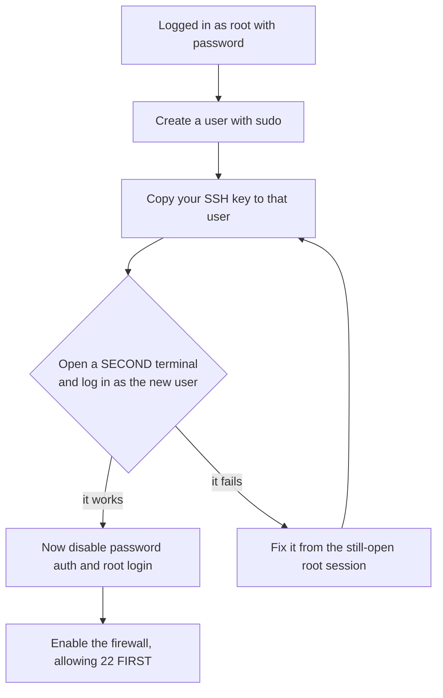

# Setting Up the Server — Part 1

This is the part you can follow literally. By the end of Part 1 you will have a
real machine on the internet, locked down so that only you can reach it, with
Docker installed and security updates applying themselves. Part 2 puts nginx,
HTTPS and a domain name in front of it.

Do this with a terminal open. Reading it does not count.

> **📌 In one line:** create the box, make a non-root user with your SSH key,
> turn off password login, open only the ports you need — in that order, because
> the wrong order locks you out.

## Table of Contents

1. [Creating the VPS](#creating-the-vps)
2. [Choosing a Region](#choosing-a-region)
3. [Sizing It Honestly](#sizing-it-honestly)
4. [First Login, and the Way People Lock Themselves Out](#first-login-and-the-way-people-lock-themselves-out)
5. [Hardening, in Order](#hardening-in-order)
6. [The Firewall](#the-firewall)
7. [Docker, or Node and a Process Manager](#docker-or-node-and-a-process-manager)
8. [Installing Docker](#installing-docker)
9. [Automatic Security Updates](#automatic-security-updates)
10. [Checkpoint](#checkpoint)
11. [Common Mistakes](#common-mistakes)
12. [Questions to Test Yourself](#questions-to-test-yourself)
13. [Related](#related)

---

## Creating the VPS

A **VPS** (virtual private server) is a slice of a real computer in a data
centre, rented by the month, that behaves exactly like a Linux machine you own.
You get an IP address and a way in, and that is all. The steps are the same at
Hetzner, DigitalOcean, Linode or Vultr:

1. Create an account and add a payment method.
2. **Add your SSH public key first**, before creating the machine. If the key
   is attached at creation, the provider disables root password login for you.
3. Create the server: choose **Ubuntu LTS** as the image (LTS means long-term
   support — security patches for five years), then a region and a size.
4. Note the IPv4 address it gives you.

If you do not have an SSH key yet, make one on your laptop:

```bash
ssh-keygen -t ed25519 -C "afsar@appifylab.com"
cat ~/.ssh/id_ed25519.pub
```

```text
Your public key has been saved in /home/afsar/.ssh/id_ed25519.pub
ssh-ed25519 AAAAC3NzaC1lZDI1NTE5AAAAI... afsar@appifylab.com
```

The `.pub` file is the one you paste into the provider. The file without `.pub`
never leaves your laptop. The SSH key mechanics are covered in
[Users, Permissions and SSH — Part 2](../01-linux-essentials/03-users-permissions-and-ssh-part-2.md).

> **💡 Tip:** Use a passphrase on the key and let your OS keychain remember it.
> A stolen laptop with a passphrase-free key is a stolen server.

---

## Choosing a Region

The region is where the physical machine sits. Two things pull on the choice.

| Pull | What it means | How much it matters |
|---|---|---|
| **Near your users** | Every request pays the round trip. Dhaka to Frankfurt is about 140 ms, Dhaka to Singapore about 60 ms | Noticeable. One page load makes several requests |
| **Near your database** | Every query pays the round trip, and one request makes many queries | **Much more.** 20 queries × 80 ms = 1.6 seconds of pure waiting |

The rule is simple: **the app and the database must be in the same region.**
Then pick whichever region in that set is closest to your users.

```text
  BAD:  app in Frankfurt, database in Singapore
        15 queries x 160ms = 2.4s of pure network, per request
  GOOD: app and database both in Singapore
        15 queries x 1ms = 15ms
```

This is the same reason the N+1 query problem hurts so much more in production
than on your laptop, where the database is a loopback call away.

Also consider data rules. If you will have European users, hosting in the EU
avoids a long conversation about data residency later.

---

## Sizing It Honestly

For a small SaaS with, say, under a few hundred active users, here is what
actually happens on each size.

| Size | Monthly cost | Runs comfortably | Where it breaks |
|---|---|---|---|
| 1 vCPU, 1 GB | ~4 USD | nginx + one small Node process | A `npm ci` build or a local Postgres will trigger the OOM killer |
| **2 vCPU, 4 GB** | **~6–8 USD** | **nginx + API + worker + Redis, with room to breathe** | **Good default** |
| 4 vCPU, 8 GB | ~15 USD | All of the above plus PostgreSQL locally | Only if you self-host the database |

Start at 2 vCPU / 4 GB. Resizing a VPS up is a reboot and a slider; it is not a
decision you need to get right now.

> **⚠️ Warning:** Do not build Docker images on a 1 GB machine. A TypeScript
> build plus `npm ci` can use well over a gigabyte, and the Linux OOM killer
> will stop your *running* app to make room for the build. Build images in CI,
> pull them on the server. Part 2 of
> [Shipping and Rollback](03-shipping-and-rollback-part-1.md) does exactly that.

Also check the disk. 40–80 GB is typical, and logs, Docker images and Postgres
data all share it. A full disk is the most common slow-motion outage — see
[Logs, Disks and Debugging — Part 1](../01-linux-essentials/05-logs-disks-and-debugging-part-1.md).

---

## First Login, and the Way People Lock Themselves Out

You now have an IP address. Log in as root:

```bash
ssh root@203.0.113.10
```

```text
Welcome to Ubuntu 24.04.1 LTS (GNU/Linux 6.8.0-45-generic x86_64)
  Usage of /: 2.1%    Memory usage: 8%    IPv4: 203.0.113.10
root@myapp-prod:~#
```

Before you type anything else, understand the trap.

Every step in the next section removes a way into the machine. Remove them in
the wrong order, or before confirming the replacement works, and your only
option is the provider's web console — which on some providers means rebuilding
the machine from scratch.



> **⚠️ Warning:** **Keep your first SSH session open the entire time.** Open a
> second terminal to test each change. If a change breaks login, the open
> session is how you undo it. Closing that session before testing is the
> classic beginner disaster, and it happens to almost everyone once.

---

## Hardening, in Order

Each step has a command and a reason. Do them in this order.

### 1. Create a non-root user with sudo

```bash
adduser afsar                 # it will prompt for a password; use a strong one
usermod -aG sudo afsar        # add to the sudo group
```

**Why:** root does anything with no confirmation and no audit trail; a typo in
an `rm` as root is unrecoverable. As a normal user, destructive commands need an
explicit `sudo` — a half-second pause that has saved a great many servers. See
[Users, Permissions and SSH — Part 1](../01-linux-essentials/03-users-permissions-and-ssh-part-1.md).

### 2. Copy your SSH key to the new user

```bash
rsync --archive --chown=afsar:afsar ~/.ssh /home/afsar/
```

**Why:** the key is currently in root's `~/.ssh/authorized_keys`. The new user
has no key at all, so without this step, step 4 locks you out completely. The
`--chown` matters: SSH refuses to use an `authorized_keys` file owned by the
wrong user.

Now **open a second terminal** and prove it works:

```bash
ssh afsar@203.0.113.10 'sudo whoami'
```

```text
[sudo] password for afsar:
root
```

If that printed `root`, continue. If not, fix it from the still-open root
session.

### 3. Disable password authentication

Edit `/etc/ssh/sshd_config` and set these three lines, then reload:

```text
PasswordAuthentication no
PubkeyAuthentication yes
KbdInteractiveAuthentication no
```

```bash
sudo sshd -t && sudo systemctl reload ssh
```

**Why:** port 22 is scanned and guessed at constantly, from the first minute the
machine exists — thousands of attempts a day is normal, not an attack on you
specifically. A password can be guessed; an ed25519 key cannot be, in any useful
sense. Turning off passwords removes the whole category of attack.

> **💡 Tip:** `sshd -t` tests the config file for syntax errors *before* you
> reload. It is the SSH equivalent of `nginx -t`. Get in the habit of chaining
> them with `&&` so a broken file never gets applied.

### 4. Disable root login

In the same file, set `PermitRootLogin no`, then reload again:

```bash
sudo sshd -t && sudo systemctl reload ssh
```

**Why:** `root` is the one username every attacker knows exists on every Linux
machine. Removing it as a login target means guessing a username *and* holding a
private key. You lose nothing — `sudo` still gives you root on request.

Some providers ship a drop-in file that overrides the main config. Check:

```bash
sudo grep -rE "PermitRootLogin|PasswordAuthentication" /etc/ssh/sshd_config /etc/ssh/sshd_config.d/
```

```text
/etc/ssh/sshd_config:PermitRootLogin no
/etc/ssh/sshd_config.d/50-cloud-init.conf:PasswordAuthentication yes
```

That second line quietly undoes your work — files in `sshd_config.d/` are read
after the main file. Fix the drop-in too, then reload again.

---

## The Firewall

A firewall decides which ports accept connections from outside. `ufw`
(uncomplicated firewall) is Ubuntu's friendly front end; ports, listening
sockets and what a firewall actually filters are covered in
[Networking, Ports and Firewalls — Part 2](../01-linux-essentials/04-networking-ports-and-firewalls-part-2.md).
The order below is not a style preference — it is the difference between a
working server and a brick.

```bash
# ❌ BROKEN - enabling first drops your own SSH connection instantly
sudo ufw enable
sudo ufw allow OpenSSH      # you will never reach this line
```

```bash
# ✅ FIXED - allow SSH BEFORE enabling, so the rule exists when the wall goes up
sudo ufw allow OpenSSH      # port 22
sudo ufw allow 80/tcp       # HTTP, needed for the certbot challenge in Part 2
sudo ufw allow 443/tcp      # HTTPS
sudo ufw enable             # now it is safe
sudo ufw status verbose
```

```text
Status: active
Default: deny (incoming), allow (outgoing), disabled (routed)

To                         Action      From
--                         ------      ----
22/tcp (OpenSSH)           ALLOW IN    Anywhere
80/tcp                     ALLOW IN    Anywhere
443/tcp                    ALLOW IN    Anywhere
```

`Default: deny (incoming)` is the line that matters — everything not listed is
refused. Note what is **not** listed: 3333 (your app), 5432 (Postgres), 6379
(Redis). Those must never face the internet. nginx reaches your app over
`127.0.0.1`, which never passes through the firewall at all.

> **⚠️ Warning:** Docker publishes ports by writing its own iptables rules,
> which **bypass ufw**. `docker run -p 6379:6379 redis` makes Redis reachable
> from the internet even though `ufw status` shows it blocked. Always bind to
> loopback explicitly: `-p 127.0.0.1:6379:6379`. This has exposed a very large
> number of real databases.

---

## Docker, or Node and a Process Manager

There are two honest ways to run a Node app on a server.

| | **Node + PM2 / systemd** | **Docker** |
|---|---|---|
| What ships | Source code, built on the server | A built image |
| Node version | Whatever is installed on the box | Pinned in the Dockerfile |
| "Works on my machine" | Still possible | Mostly gone |
| Rollback | `git checkout` an old commit and rebuild | Run the previous image tag |
| Redis, Postgres locally | Install and configure each one | One line in a compose file |
| Learning cost | Lower on day one | Higher on day one, lower by day thirty |
| Memory overhead | None | Small, perhaps 50 MB |

The non-Docker path looks like this, briefly, so you recognise it elsewhere:

```bash
curl -fsSL https://deb.nodesource.com/setup_lts.x | sudo -E bash -
sudo apt install -y nodejs && sudo npm install -g pm2
pm2 start build/bin/server.js --name api
pm2 startup && pm2 save     # survive a reboot
```

It works, and plenty of real apps run this way. But the Node version on the
server drifts from the one in CI, `npm ci` on a small box competes with your
running app, and rollback means rebuilding.

**This folder commits to Docker from here on.** You have just finished
[Docker in Practice](../02-docker-in-practice/), so the image already exists, is
built in CI, and pins its own Node version. Shipping it is now the simplest
option, not the fancy one.

---

## Installing Docker

Use Docker's own repository, not Ubuntu's `docker.io` package, which lags badly.

```bash
# Docker's signing key
sudo apt update && sudo apt install -y ca-certificates curl
sudo install -m 0755 -d /etc/apt/keyrings
sudo curl -fsSL https://download.docker.com/linux/ubuntu/gpg -o /etc/apt/keyrings/docker.asc
sudo chmod a+r /etc/apt/keyrings/docker.asc

# The repository for this Ubuntu release
echo "deb [arch=$(dpkg --print-architecture) signed-by=/etc/apt/keyrings/docker.asc] \
https://download.docker.com/linux/ubuntu $(. /etc/os-release && echo "$VERSION_CODENAME") stable" \
  | sudo tee /etc/apt/sources.list.d/docker.list > /dev/null

sudo apt update && sudo apt install -y docker-ce docker-ce-cli containerd.io \
  docker-buildx-plugin docker-compose-plugin
```

Let your user run Docker without `sudo`:

```bash
sudo usermod -aG docker afsar
newgrp docker          # or log out and back in
docker run --rm hello-world
```

```text
Hello from Docker!
This message shows that your installation appears to be working correctly.
```

> **📌 Remember:** being in the `docker` group is effectively being root. The
> Docker daemon runs as root, and anyone who can talk to it can mount the host
> filesystem into a container. Do not add users you would not give `sudo`.

Finally, cap Docker's log files. Container logs default to growing without
limit, and this is a genuinely common cause of a full disk months later.

```bash
sudo tee /etc/docker/daemon.json > /dev/null <<'JSON'
{
  "log-driver": "json-file",
  "log-opts": { "max-size": "10m", "max-file": "3" }
}
JSON
sudo systemctl restart docker
```

That caps every container at 30 MB of logs. Your real logs should be shipped to
a log service anyway — see
[Logging Basics](../../backend-fundamentals/08-logging-and-observability/01-logging-basics.md).

---

## Automatic Security Updates

A server you do not touch for three months is a server running three months of
known vulnerabilities. Let it patch itself.

```bash
sudo apt install -y unattended-upgrades
sudo dpkg-reconfigure --priority=low unattended-upgrades

# Then make the behaviour explicit
sudo tee /etc/apt/apt.conf.d/51custom-unattended > /dev/null <<'CONF'
Unattended-Upgrade::Automatic-Reboot "false";
Unattended-Upgrade::Remove-Unused-Kernel-Packages "true";
Unattended-Upgrade::Remove-Unused-Dependencies "true";
CONF
```

Check that it works:

```bash
sudo unattended-upgrade --dry-run --debug | tail -5
```

```text
Checking: openssl (["<Origin component:'main' archive:'noble-security'>"])
Packages that will be upgraded: openssl libssl3
```

`Automatic-Reboot "false"` is deliberate: patches install themselves, but a
kernel update needs a reboot and you want to choose when. Planning reboots is in
[Keeping It Running — Part 2](04-keeping-it-running-part-2.md).

---

## Checkpoint

Confirm all of this before moving on:

```bash
ssh afsar@203.0.113.10 'sudo whoami && docker --version && sudo ufw status | head -3'
```

```text
root
Docker version 27.3.1, build ce12230
Status: active
```

- [ ] You log in as `afsar`, not root, using a key and no password.
- [ ] `ssh root@...` is refused.
- [ ] Password login is refused even with the right password.
- [ ] `sudo` works for your user.
- [ ] `ufw status` is active and shows 22, 80, 443 — and nothing else.
- [ ] `docker run --rm hello-world` works without `sudo`.
- [ ] `unattended-upgrades` is installed and the dry run finds the security repo.

> **➡️ Continued in [Part 2](./02-setting-up-the-server-part-2.md)** — nginx,
> HTTPS, proxy headers, where the database lives, and pointing a domain at this
> machine.

---

## Common Mistakes

| Mistake | Why it is wrong | Do this instead |
|---|---|---|
| Running `ufw enable` before `ufw allow OpenSSH` | Your own SSH session is dropped and you cannot get back in | Allow 22 first, every time, without exception |
| Closing the root session before testing the new user | You find out login is broken when you have no way to fix it | Keep one session open, test in a second terminal |
| Disabling password auth before copying the SSH key across | The new user has no way to authenticate at all | Copy the key, log in successfully, *then* disable passwords |
| Running `docker run -p 6379:6379 redis` on a public box | Docker bypasses ufw; Redis is now open to the internet | Bind to loopback: `-p 127.0.0.1:6379:6379` |
| Editing `sshd_config` but not checking `sshd_config.d/` | A cloud-init drop-in re-enables password auth after you disabled it | `grep -r` both locations and fix whichever wins |
| Building Docker images on the production VPS | The build competes for memory with the running app and can trigger the OOM killer | Build in CI, pull the image on the server |
| Picking a region near you rather than near your database | Every query pays the round trip, many times per request | App and database in the same region, always |
| Leaving Docker logs uncapped | A noisy container fills the disk weeks later and everything stops | Set `max-size` and `max-file` in `daemon.json` |

---

## Questions to Test Yourself

1. Write out the five hardening steps in the correct order, and explain what
   breaks if you swap steps 2 and 3.
2. Your `ufw status` shows only 22, 80 and 443 allowed, yet `redis-cli -h
   203.0.113.10` connects from your laptop. What happened?
3. Why does `sudo sshd -t` matter before `systemctl reload ssh`? What is the
   nginx equivalent?
4. You disabled `PasswordAuthentication` but password login still works.
   Where would you look?
5. Your app makes 15 database queries per request. The app is in Frankfurt and
   the managed database is in Singapore. Estimate the added latency and say why
   it is worse than it looks.
6. Give two concrete reasons to prefer Docker over PM2 on this server, and one
   honest reason PM2 would be fine.
7. Why is being in the `docker` group almost the same as having root?
8. `unattended-upgrades` installs a kernel security patch at 3am. Is your
   server now protected? Explain.

---

## Related

- [01-what-deployment-actually-is.md](01-what-deployment-actually-is.md) — the system this machine is going to become.
- [02-setting-up-the-server-part-2.md](02-setting-up-the-server-part-2.md) — nginx, TLS, DNS and the database decision.
- [01-linux-essentials/03-users-permissions-and-ssh-part-1.md](../01-linux-essentials/03-users-permissions-and-ssh-part-1.md) — users, groups and what `sudo` actually does.
- [01-linux-essentials/03-users-permissions-and-ssh-part-2.md](../01-linux-essentials/03-users-permissions-and-ssh-part-2.md) — SSH keys, `authorized_keys`, and hardening a server's SSH.
- [01-linux-essentials/04-networking-ports-and-firewalls-part-1.md](../01-linux-essentials/04-networking-ports-and-firewalls-part-1.md) — what a port and a listening socket actually are.
- [01-linux-essentials/04-networking-ports-and-firewalls-part-2.md](../01-linux-essentials/04-networking-ports-and-firewalls-part-2.md) — `ufw`, cloud security groups, and locking yourself out.
- [02-docker-in-practice/](../02-docker-in-practice/) — the image you are about to run on this box.
- [cloud-devops/docker/overview.md](../../cloud-devops/docker/overview.md) — containers as a concept.
- [backend-fundamentals/08-logging-and-observability/01-logging-basics.md](../../backend-fundamentals/08-logging-and-observability/01-logging-basics.md) — why capped container logs are not your real logging strategy.
