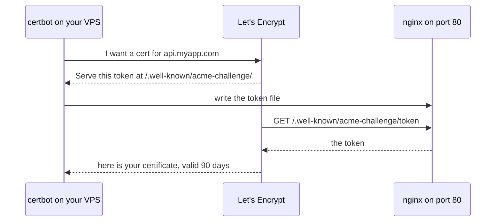

# Setting Up the Server — Part 2

Part 1 left you with a locked-down Ubuntu box running Docker. It has an IP
address and nothing listening on it. This part puts a front door on it: nginx,
a real certificate, a domain name, and an honest decision about where your
database lives.

> **⬅️ This continues [Part 1](./02-setting-up-the-server-part-1.md).**

> **📌 In one line:** nginx owns 80 and 443 and terminates TLS, your Node
> process hides on `127.0.0.1`, and the headers nginx adds are what let your app
> still know who the real client was.

## Table of Contents

1. [Why Your App Should Not Face the Internet](#why-your-app-should-not-face-the-internet)
2. [A Complete nginx Server Block](#a-complete-nginx-server-block)
3. [HTTPS With Let's Encrypt](#https-with-lets-encrypt)
4. [Proving Renewal Actually Works](#proving-renewal-actually-works)
5. [Proxy Headers Done Right](#proxy-headers-done-right)
6. [Where the Database Should Live](#where-the-database-should-live)
7. [DNS and Pointing a Domain](#dns-and-pointing-a-domain)
8. [Verification Checklist](#verification-checklist)
9. [Common Mistakes](#common-mistakes)
10. [Questions to Test Yourself](#questions-to-test-yourself)
11. [Related](#related)

---

## Why Your App Should Not Face the Internet

Node *can* serve HTTPS directly. `https.createServer` exists. So why add another
process in front of it?

Four real reasons, in the order they will matter to you:

| Reason | What nginx does | What happens without it |
|---|---|---|
| **TLS termination** | Holds the certificate, decrypts, talks plain HTTP to your app | Your app restarts every renewal, and certificate handling is now your code's problem |
| **Slow clients** | Buffers the whole request and the whole response | A client on bad mobile data ties up an event-loop connection for seconds |
| **Static files** | Serves them from disk without touching Node | Every logo and CSS file costs you a trip through your middleware stack |
| **Several apps, one machine** | Routes by `server_name` to different ports | Only one process can own port 443 |

The slow-client reason is the least obvious and the most valuable. Node has one
thread for your JavaScript; nginx holds thousands of idle connections cheaply,
which is exactly what its event-driven worker model is built for — see
[cloud-devops/nginx/overview.md](../../cloud-devops/nginx/overview.md).

```text
  Without nginx                    With nginx
  -------------                    ----------
  slow client ---- 4s ----> node   slow client ---- 4s ----> nginx -- 8ms --> node
  node connection busy 4s          node connection busy 8ms
```

nginx also lets you reload configuration without dropping connections
(`nginx -s reload`), which becomes the switch you flip during a zero-downtime
deploy in [Shipping and Rollback — Part 2](03-shipping-and-rollback-part-2.md).

---

## A Complete nginx Server Block

The config *syntax* — directives, `location` matching, `upstream`, timeouts,
WebSockets — is already covered in
[cloud-devops/nginx/reverse-proxy-config.md](../../cloud-devops/nginx/reverse-proxy-config.md);
read that for the reference. What follows is one complete working file for a
Node API, annotated with why each line is there.

Install nginx, then write `/etc/nginx/sites-available/api.myapp.com`:

```bash
sudo apt install -y nginx && sudo systemctl enable --now nginx
```

```nginx
# The Node containers behind this proxy. Named so a deploy can swap the
# port inside without touching the server block below.
upstream app_backend {
    server 127.0.0.1:3333;
    keepalive 32;          # reuse connections to Node instead of a new TCP handshake per request
}

server {
    listen 80;
    server_name api.myapp.com;

    # certbot writes its challenge file here; it must stay on plain HTTP
    location /.well-known/acme-challenge/ {
        root /var/www/certbot;
    }

    location / {
        return 301 https://$host$request_uri;   # everything else goes to HTTPS
    }
}

server {
    listen 443 ssl;
    http2 on;
    server_name api.myapp.com;

    # certbot fills these in; see the next section
    ssl_certificate     /etc/letsencrypt/live/api.myapp.com/fullchain.pem;
    ssl_certificate_key /etc/letsencrypt/live/api.myapp.com/privkey.pem;
    include             /etc/letsencrypt/options-ssl-nginx.conf;

    # A request body larger than this is rejected by nginx before Node sees it.
    # Default is 1m, which silently breaks file uploads.
    client_max_body_size 10m;

    access_log /var/log/nginx/api.access.log;
    error_log  /var/log/nginx/api.error.log;

    # nginx answers the health probe path from the app, not from a static file,
    # so the check proves the whole chain works.
    location = /health {
        proxy_pass http://app_backend;
        access_log off;            # a probe every 30s would drown the real log
    }

    location / {
        proxy_pass http://app_backend;
        proxy_http_version 1.1;    # required for upstream keepalive
        proxy_set_header Connection "";

        proxy_set_header Host              $host;
        proxy_set_header X-Real-IP         $remote_addr;
        proxy_set_header X-Forwarded-For   $proxy_add_x_forwarded_for;
        proxy_set_header X-Forwarded-Proto $scheme;

        proxy_connect_timeout 5s;   # Node is on loopback; if it does not answer fast, it is down
        proxy_read_timeout   60s;   # your slowest legitimate endpoint, plus margin
    }
}
```

Enable it and reload:

```bash
sudo ln -s /etc/nginx/sites-available/api.myapp.com /etc/nginx/sites-enabled/
sudo rm -f /etc/nginx/sites-enabled/default      # stop the "Welcome to nginx" page
sudo nginx -t && sudo systemctl reload nginx
```

> **⚠️ Warning:** The 443 block references certificate files that do not exist
> yet, so `nginx -t` will fail. Create the file with only the port 80 block
> first, run certbot, and add the 443 block after. certbot can also write it for
> you — see below.

> **💡 Tip:** Always `nginx -t && systemctl reload nginx` as one chained command.
> `reload` keeps existing connections alive; `restart` drops them. The `&&` means
> a broken config never gets applied.

---

## HTTPS With Let's Encrypt

**Let's Encrypt** is a certificate authority that issues free TLS certificates
automatically. **certbot** is the tool that asks it for one. Why TLS matters at
all — what the handshake does, what a certificate proves — is in
[HTTPS and TLS](../../backend-fundamentals/01-http-foundations/06-https-and-tls.md).

The proof works like this: certbot asks Let's Encrypt for a certificate for
`api.myapp.com`. Let's Encrypt gives it a random token. certbot writes that
token to a file on your server. Let's Encrypt fetches
`http://api.myapp.com/.well-known/acme-challenge/<token>` over plain HTTP. If it
gets the right content, you have proved you control the domain.



That is why **port 80 must stay open** even though everything redirects to
HTTPS, and why the `/.well-known/acme-challenge/` location must not redirect.

```bash
sudo apt install -y certbot python3-certbot-nginx
sudo certbot --nginx -d api.myapp.com -m afsar@appifylab.com --agree-tos
```

```text
Successfully received certificate.
Certificate is saved at: /etc/letsencrypt/live/api.myapp.com/fullchain.pem
This certificate expires on 2026-01-02.
Successfully deployed certificate for api.myapp.com
```

`--nginx` means certbot edits your nginx config itself and reloads it. If you
prefer to own the config, use `--webroot -w /var/www/certbot` and paste the
paths in yourself.

Certificates last **90 days**, deliberately: a short life forces automatic
renewal, and automatic renewal is the only kind still working a year later.

---

## Proving Renewal Actually Works

The certbot package installs a systemd timer that tries renewal twice a day. It
only renews when fewer than 30 days remain, so most runs do nothing.

**A silently failed renewal is one of the most predictable outages there is.**
Everything works for 60 days, then every client — browsers, mobile apps, your
own webhooks — refuses to connect on the same morning.

Check the timer is actually scheduled:

```bash
systemctl list-timers snap.certbot.renew.timer certbot.timer
```

```text
NEXT                        LEFT     UNIT          ACTIVATES
Sat 2026-10-04 23:41:00 UTC 9h left  certbot.timer certbot.service
```

Then do a real dry run. It performs the entire renewal, including the HTTP
challenge, against staging servers and without using up your rate limit:

```bash
sudo certbot renew --dry-run
```

```text
Simulating renewal of an existing certificate for api.myapp.com
Congratulations, all simulations of the renewals succeeded:
  /etc/letsencrypt/live/api.myapp.com/fullchain.pem (success)
```

> **📌 Remember:** `certbot renew --dry-run` is the only thing that proves
> renewal works. "certbot is installed" proves nothing. Run it now, and again
> any time you change the nginx config or the firewall.

The common ways it breaks later, all of which the dry run catches:

| Cause | Why it fails |
|---|---|
| Port 80 closed in ufw after a "cleanup" | Let's Encrypt cannot fetch the challenge |
| A `location /` redirect added above the ACME location | The challenge request is 301'd to HTTPS |
| The domain moved to a new IP | The challenge reaches a different machine |
| nginx reload hook missing | The cert renews but nginx keeps serving the old one from memory |

That last one deserves attention: renewing the file is not enough, nginx must
reload to pick it up. The packaged certbot does this with a deploy hook. Confirm
it exists, or add one:

```bash
echo -e '#!/bin/sh\nsystemctl reload nginx' \
  | sudo tee /etc/letsencrypt/renewal-hooks/deploy/reload-nginx.sh
sudo chmod +x /etc/letsencrypt/renewal-hooks/deploy/reload-nginx.sh
```

Also set a calendar reminder, and an external certificate-expiry check — that is
in [Keeping It Running — Part 1](04-keeping-it-running-part-1.md).

While you are here, the response headers your app should be sending — HSTS,
`Content-Security-Policy`, and friends — are covered in
[Security Headers](../../backend-fundamentals/11-api-security/04-security-headers-part-1.md)
and [part 2](../../backend-fundamentals/11-api-security/04-security-headers-part-2.md).
Decide whether nginx or your app sets them, and do not do both.

---

## Proxy Headers Done Right

Here is the problem, concretely. Your rate limiter allows 100 requests per
minute per IP. Behind nginx, **every request arrives from `127.0.0.1`**. So all
your users share one bucket, and the first busy user locks out everybody.

The same mistake makes every access-log line useless and turns an audit trail
into a list of `127.0.0.1`. nginx already sends the right information (the
`proxy_set_header` lines above) — the missing half is your app believing it.

```ts
// ❌ BROKEN - behind a proxy, this is the proxy's address on every request
import type { Request } from 'express'

function clientIpFor(request: Request): string {
  return request.socket.remoteAddress ?? 'unknown'
  // => '127.0.0.1' for every user, forever
}
```

```ts
// ✅ FIXED - tell the framework which proxies to trust, then use its own getter
// 'loopback' means: trust X-Forwarded-* only when the connection came from
// 127.0.0.1 — i.e. from our own nginx, never from a random internet client.
app.set('trust proxy', 'loopback')

function clientIpFor(request: Request): string {
  return request.ip ?? 'unknown'   // now the real client address
}
```

In **AdonisJS** the same setting lives in the HTTP server configuration, where
`trustProxy` takes a `proxy-addr` matcher. In recent versions it looks like
this — check your version's config file name:

```ts
// config/app.ts — trust only our own nginx on the same machine
import proxyAddr from 'proxy-addr'

export const http = defineConfig({
  trustProxy: proxyAddr.compile('loopback'),
  // then request.ip() and request.protocol() are correct,
  // and secure cookies are set correctly on HTTPS requests
})
```

Why "trust only loopback" and not "trust everything":

```text
  trust proxy = true  (trust any X-Forwarded-For)
      attacker sends:  X-Forwarded-For: 1.2.3.4
      your app logs and rate-limits:  1.2.3.4
      -> the rate limiter is now bypassable by sending a header

  trust proxy = 'loopback'
      the header is only believed when nginx (127.0.0.1) sent the connection
      -> a client cannot forge its own identity
```

`X-Forwarded-Proto` matters just as much. Without it your app thinks every
request is plain HTTP, so an "always redirect to HTTPS" rule loops forever, and
cookies marked `secure` are never set. What those headers mean in general is in
[Headers](../../backend-fundamentals/01-http-foundations/05-headers.md); the
rate-limiting side is in
[Rate Limiting](../../system-design/foundational/rate-limiting.md).

---

## Where the Database Should Live

You can run PostgreSQL in a container on this same VPS, or pay for a managed
database. This is a real trade-off, not an obvious one.

| | **Postgres on the same box** | **Managed (RDS, Neon, Supabase, DO Managed)** |
|---|---|---|
| **Cost** | 0 extra — it uses RAM you already rent | 15–60 USD/month for a small instance |
| **Latency** | Sub-millisecond, loopback | 1–3 ms in the same region; much worse across regions |
| **Backups** | You write the cron job, and you test the restore | Automatic, with point-in-time recovery |
| **Failover** | None. The box dies, you are down until you rebuild | Usually automatic or one click |
| **Upgrades** | You plan the major-version upgrade and the downtime | A maintenance window you approve |
| **Tuning** | `shared_buffers`, `work_mem`, connection limits — yours | Sensible defaults, mostly tuned for the instance size |
| **Your time** | Hours per month, concentrated in the worst moments | Close to zero |
| **Worst case** | Disk fills, Postgres refuses writes, app and database die together | You get an email |

**The recommendation: managed, as soon as the data is something you would be
upset to lose.** A side project with seed data can absolutely run Postgres in a
container. The moment a real person's invoices are in there, 15 USD a month to
make backups and failover someone else's job is cheap.

Self-hosting means signing up for all of this: automated `pg_dump` copied **off
the machine** with retention; a restore you have actually performed; tuning
`shared_buffers` and `max_connections` for your RAM; watching vacuum and bloat
(see [Vacuum and Autovacuum](../../databases/operations/02-vacuum-and-autovacuum-part-1.md));
planning major-version upgrades; and accepting that one full disk takes out the
app and the database together.

> **⚠️ Warning:** The real danger of same-box Postgres is **shared failure**. A
> memory leak in your Node app lets the OOM killer choose a Postgres backend. A
> runaway log file fills the disk and Postgres stops accepting writes. On a
> managed database, an app problem stays an app problem.

Either way the application code is identical — the pool math and the
`max_connections` ceiling are in
[Connection Pooling](../../databases/operations/01-connection-pooling-part-1.md)
and [part 2](../../databases/operations/01-connection-pooling-part-2.md).

---

## DNS and Pointing a Domain

**DNS** (domain name system) is the phone book that turns `api.myapp.com` into
`203.0.113.10`. You need two record types.

| Record | Points to | Use it for |
|---|---|---|
| **A** | An IPv4 address | `api.myapp.com` → `203.0.113.10` |
| **AAAA** | An IPv6 address | The same, if your VPS has IPv6 |
| **CNAME** | Another name | `www.myapp.com` → `myapp.com` |

At your registrar, add `A  api  203.0.113.10` with a TTL of 300.

**TTL** (time to live) is how many seconds a resolver may cache the answer
before asking again. It decides how fast a change takes effect.

```text
  TTL 300 (5 min)    change the IP -> everyone follows within 5 minutes
  TTL 86400 (1 day)  change the IP -> some users hit the old box for a day
```

So **lower the TTL to 300 a day before you plan to move anything**, then raise
it afterwards. Lowering it at the moment you need it does not help, because
resolvers are already holding the old long TTL.

Check it from your laptop with `dig +short api.myapp.com`.

> **💡 Tip:** If `dig` shows the right IP but the browser still cannot reach the
> site, the problem is not DNS. Check ufw and `nginx -t`. DNS failures look like
> "cannot find the server"; firewall failures hang and then time out.

---

## Verification Checklist

Run all of this before you deploy any code. Every row is a command, not a
feeling.

| Check | Command | Expected |
|---|---|---|
| Domain resolves | `dig +short api.myapp.com` | Your VPS IP |
| Firewall is minimal | `sudo ufw status` | active; only 22, 80, 443 |
| nginx config is valid | `sudo nginx -t` | `syntax is ok` / `test is successful` |
| HTTP redirects | `curl -I http://api.myapp.com` | `301` to `https://` |
| HTTPS answers | `curl -I https://api.myapp.com` | A response, no certificate warning |
| Certificate is real | `sudo certbot certificates` | Valid, with an expiry date months out |
| Renewal works | `sudo certbot renew --dry-run` | All simulations succeeded |
| Reload hook exists | `ls /etc/letsencrypt/renewal-hooks/deploy/` | Your reload script |
| Nothing else is exposed | `sudo ss -tlnp` | 3333 and 6379 bound to `127.0.0.1` only |
| Docker works | `docker run --rm hello-world` | The hello message |
| Database is reachable | `psql "$DATABASE_URL" -c 'select 1'` | `1` |
| Survives a reboot | `sudo reboot`, wait, re-check | Everything comes back |

The reboot is the row people skip. Do it **now**, while nothing is running.
Finding out nginx does not start on boot is a five-minute problem today and an
hour-long outage in three months.

```text
$ sudo ss -tlnp | grep -E '3333|6379'
LISTEN 0 511 127.0.0.1:3333 0.0.0.0:*  users:(("docker-proxy",pid=1412,fd=4))
LISTEN 0 511 127.0.0.1:6379 0.0.0.0:*  users:(("docker-proxy",pid=1388,fd=4))
```

`127.0.0.1:3333`, not `0.0.0.0:3333`. If you see `0.0.0.0` or `*`, that service
is reachable from the internet and Docker has written around your firewall.

---

## Common Mistakes

| Mistake | Why it is wrong | Do this instead |
|---|---|---|
| Letting Node listen on `0.0.0.0` and skipping nginx | No TLS, no buffering, no firewall protection, and one app per machine forever | Bind to `127.0.0.1` and put nginx in front |
| Redirecting everything on port 80 to HTTPS, including `/.well-known/` | certbot's challenge gets a 301 and renewal fails | Keep the ACME location on plain HTTP above the redirect |
| Installing certbot and assuming renewal works | It fails silently and the site dies on day 90 | `certbot renew --dry-run`, and monitor expiry externally |
| Renewing the cert without reloading nginx | nginx keeps serving the old certificate from memory | A deploy hook that runs `systemctl reload nginx` |
| `app.set('trust proxy', true)` | Any client can forge `X-Forwarded-For` and bypass your rate limiter | Trust `'loopback'` — only your own nginx |
| Leaving `client_max_body_size` at the default | Uploads over 1 MB fail with a 413 from nginx, which your app never sees | Set it to match your upload limit |
| Self-hosting Postgres with no tested restore | An untested backup is not a backup | Managed database, or a restore drill you have done |
| Setting a one-day TTL and then needing to move the IP | Some users keep reaching the dead machine all day | TTL 300 normally; raise it only once things are stable |

---

## Questions to Test Yourself

1. Give the three strongest reasons to put nginx in front of Node, and say which
   one is invisible until you have real users on bad connections.
2. Why must port 80 stay open and un-redirected at `/.well-known/acme-challenge/`
   even though your whole site is HTTPS?
3. Your certificate renewed last night but browsers still see the old one. What
   is missing?
4. An attacker sends `X-Forwarded-For: 203.0.113.99` directly to your server.
   Under `trust proxy = true` versus `'loopback'`, what does your rate limiter
   see in each case?
5. Your login redirect loops forever in production and works locally. Name the
   header involved and the setting that fixes it.
6. You self-host Postgres on the same VPS and a log file fills the disk. Describe
   what the user sees, and why this cannot happen with a managed database.
7. You need to move to a new server next week. What do you change in DNS today,
   and why does doing it on the day not help?
8. `sudo ss -tlnp` shows `0.0.0.0:6379`. Your `ufw status` says Redis is blocked.
   Both are telling the truth. Explain.

---

## Related

- [02-setting-up-the-server-part-1.md](02-setting-up-the-server-part-1.md) — the hardened box this part builds on.
- [03-shipping-and-rollback-part-1.md](03-shipping-and-rollback-part-1.md) — now put code on it.
- [cloud-devops/nginx/reverse-proxy-config.md](../../cloud-devops/nginx/reverse-proxy-config.md) — the full nginx proxy reference: timeouts, WebSockets, buffering.
- [cloud-devops/nginx/overview.md](../../cloud-devops/nginx/overview.md) — config structure and why nginx handles concurrency well.
- [backend-fundamentals/01-http-foundations/06-https-and-tls.md](../../backend-fundamentals/01-http-foundations/06-https-and-tls.md) — what the certificate actually proves.
- [backend-fundamentals/01-http-foundations/05-headers.md](../../backend-fundamentals/01-http-foundations/05-headers.md) — the `X-Forwarded-*` family in context.
- [backend-fundamentals/11-api-security/04-security-headers-part-1.md](../../backend-fundamentals/11-api-security/04-security-headers-part-1.md) — HSTS and friends, once TLS works.
- [system-design/foundational/rate-limiting.md](../../system-design/foundational/rate-limiting.md) — why the client IP has to be right.
- [databases/operations/01-connection-pooling-part-1.md](../../databases/operations/01-connection-pooling-part-1.md) — sizing the pool against `max_connections`.
