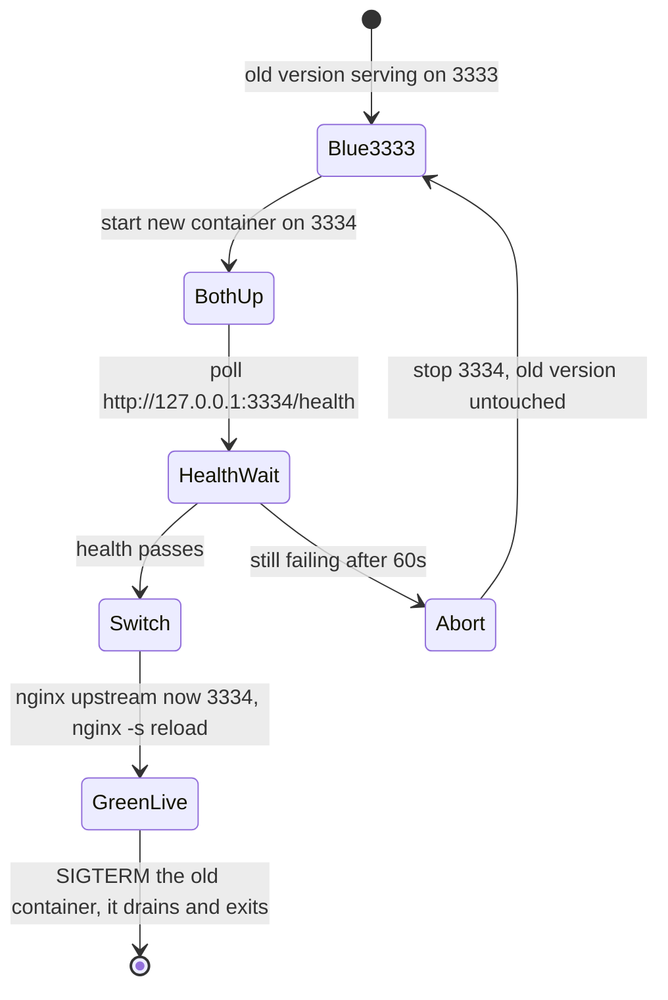
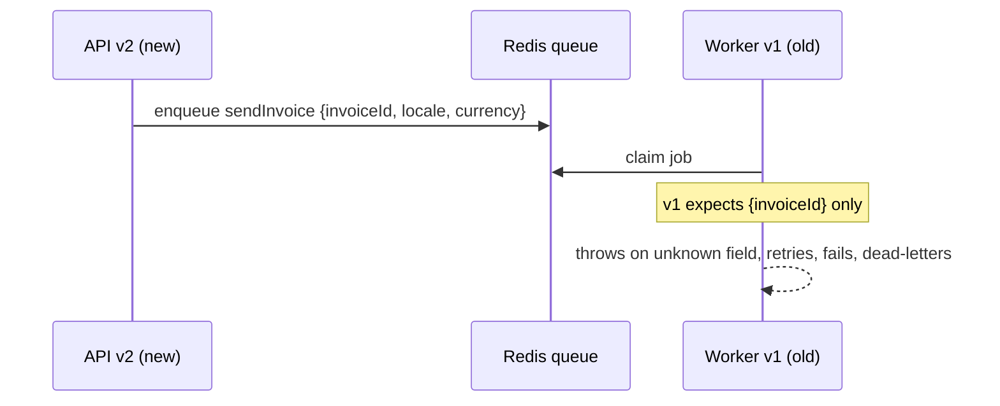

# Shipping and Rollback — Part 2

Part 1 got a new image onto the server. This part is about the ten seconds
around the swap — not dropping requests while it happens — and about the much
less pleasant question of what you do at 11pm when the new version is worse than
the old one.

> **⬅️ This continues [Part 1](./03-shipping-and-rollback-part-1.md).**

> **📌 In one line:** start the new container, wait for its health check, point
> nginx at it, then stop the old one — and because rolling back a migration is
> hard, keep every migration backward compatible for one release.

## Table of Contents

1. [Zero Downtime on One Small Server](#zero-downtime-on-one-small-server)
2. [The deploy.sh That Does It](#the-deploysh-that-does-it)
3. [Draining Connections on SIGTERM](#draining-connections-on-sigterm)
4. [Rollback: What You Actually Do](#rollback-what-you-actually-do)
5. [Roll Back or Roll Forward](#roll-back-or-roll-forward)
6. [Deploying Workers Alongside the API](#deploying-workers-alongside-the-api)
7. [Version Skew in the Queue](#version-skew-in-the-queue)
8. [Feature Flags: Deploy Is Not Release](#feature-flags-deploy-is-not-release)
9. [Post-Deploy Verification](#post-deploy-verification)
10. [Common Mistakes](#common-mistakes)
11. [Questions to Test Yourself](#questions-to-test-yourself)
12. [Related](#related)

---

## Zero Downtime on One Small Server

The naive deploy has a hole in it:

```bash
docker stop myapp-api && docker rm myapp-api     # <- nothing is serving now
docker run -d --name myapp-api ...:$SHA          # <- 2 to 15 seconds later
```

Between those two lines, nginx has nothing to proxy to. Every request gets
`502 Bad Gateway`. If your app takes eight seconds to connect to the database
and warm up, that is eight seconds of visible outage, several times a day.

You do not need a load balancer or a second machine to fix this. You need **two
ports and a reload**.



This is blue-green deployment, scaled down to one machine. The concept, and how
it compares with rolling updates and canary releases, is in
[cloud-devops/deployment-strategies/blue-green-deployment.md](../../cloud-devops/deployment-strategies/blue-green-deployment.md)
and
[rolling-updates.md](../../cloud-devops/deployment-strategies/rolling-updates.md).
What you have here is the cheap version: two containers, alternating ports, and
`nginx -s reload` as the traffic switch.

```text
  t=0   nginx -> :3333 (v1)                      v1 serving
  t=1   nginx -> :3333 (v1)   :3334 (v2) booting  v1 serving
  t=9   nginx -> :3333 (v1)   :3334 (v2) HEALTHY  v1 serving
  t=10  nginx -> :3334 (v2)                        v2 serving, v1 draining
  t=25  nginx -> :3334 (v2)                        v1 exited
```

Two properties make this safe:

- **The new version proves itself before it gets traffic.** If it cannot start —
  bad config, missing env var, unreachable database — the health check never
  passes, the script aborts, and v1 never stopped serving.
- **nginx `reload` does not drop connections.** Existing requests finish against
  the old upstream; new connections go to the new one.

> **📌 Remember:** the health check is what turns this from "restart and hope"
> into a safe deploy. A health endpoint that returns 200 unconditionally gives
> you none of this protection — see
> [Metrics and Health Checks — Part 2](../../backend-fundamentals/08-logging-and-observability/04-metrics-and-health-checks-part-2.md)
> and
> [cloud-devops/deployment-strategies/health-checks.md](../../cloud-devops/deployment-strategies/health-checks.md).

---

## The deploy.sh That Does It

This lives in git at `/srv/myapp/deploy.sh` on the server. CI calls it with a
SHA. You can also run it by hand, which is exactly the point.

```bash
#!/usr/bin/env bash
set -euo pipefail          # stop on any error, and on any unset variable

SHA="$1"
IMAGE="ghcr.io/afsartanvir/myapp-api:${SHA}"

# Alternate between two ports so old and new can run at the same time.
CURRENT_PORT=$(cat /srv/myapp/.current_port 2>/dev/null || echo 3333)
if [ "$CURRENT_PORT" = "3333" ]; then NEW_PORT=3334; else NEW_PORT=3333; fi

docker pull "$IMAGE"

# 1. Migrations first, with the OLD code still serving.
#    Requires migrations to be backward compatible — see the rollback section.
docker run --rm --env-file /srv/myapp/.env "$IMAGE" \
  node ace migration:run --force

# 2. Start the new container on the spare port.
docker run -d --name "myapp-api-${NEW_PORT}" --restart unless-stopped \
  --env-file /srv/myapp/.env -p "127.0.0.1:${NEW_PORT}:3333" "$IMAGE"

# 3. Wait for it to report healthy. Abort without touching the old one.
for i in $(seq 1 30); do
  if curl -fsS "http://127.0.0.1:${NEW_PORT}/health" > /dev/null; then
    echo "healthy after ${i}s"; break
  fi
  if [ "$i" = "30" ]; then
    echo "new version never became healthy - aborting"
    docker logs --tail 50 "myapp-api-${NEW_PORT}"
    docker rm -f "myapp-api-${NEW_PORT}"
    exit 1                 # old version is still serving; nothing changed
  fi
  sleep 1
done

# 4. Switch nginx. The upstream file holds one line.
echo "upstream app_backend { server 127.0.0.1:${NEW_PORT}; keepalive 32; }" \
  | sudo tee /etc/nginx/conf.d/upstream.conf > /dev/null
sudo nginx -t && sudo nginx -s reload

# 5. Stop the old container. SIGTERM, then 30s to drain before SIGKILL.
docker stop --time 30 "myapp-api-${CURRENT_PORT}" 2>/dev/null || true
docker rm "myapp-api-${CURRENT_PORT}" 2>/dev/null || true
echo "$NEW_PORT" > /srv/myapp/.current_port

docker image prune -af --filter "until=168h"   # keep a week of images for rollback
```

Move the `upstream app_backend { ... }` block out of your site config and into
`/etc/nginx/conf.d/upstream.conf` so this script rewrites one small file rather
than editing the server block.

> **💡 Tip:** `set -euo pipefail` on the first line is what makes the abort in
> step 3 trustworthy. Without `-e`, a failed command prints an error and the
> script cheerfully continues to step 4.

---

## Draining Connections on SIGTERM

Step 5 sends `SIGTERM`. What happens next is decided entirely by your
application code.

`docker stop` sends SIGTERM, waits (10 seconds by default, 30 above), then sends
SIGKILL, which cannot be caught. A process that ignores SIGTERM gets killed
mid-request: a half-written response to the client, an open transaction rolled
back by the database, a job claimed by a worker and never finished.

Graceful shutdown is covered in full in
[Anatomy of a Backend App](../../backend-fundamentals/03-request-lifecycle/01-anatomy-of-a-backend-app.md#graceful-shutdown).
Three things matter specifically for deploys:

```ts
// ✅ The shape that makes a deploy invisible to users
process.on('SIGTERM', async () => {
  isShuttingDown = true              // 1. /health starts returning 503 immediately

  server.close(async () => {         // 2. stop accepting new connections,
                                     //    let in-flight requests finish
    await queue.close()              // 3. finish the current job, claim no more
    await db.destroy()               //    then release the pool
    process.exit(0)
  })

  // Never hang forever. If something will not close, exit anyway
  // before Docker's SIGKILL makes the decision for you.
  setTimeout(() => process.exit(1), 25_000).unref()
})
```

The ordering is the whole trick:

```text
  SIGTERM
    |-- /health -> 503          nginx and monitors stop sending work
    |-- server.close()           existing requests run to completion
    |-- no new connections        new requests go to the other container
    |-- drain pool, close queue
    |-- exit 0                    before SIGKILL at 30s
```

> **⚠️ Warning:** `process.exit(0)` directly inside the SIGTERM handler is the
> most common version of this bug. It terminates immediately, killing every
> in-flight request. The exit must happen in the `server.close` callback.

Two Docker details that silently break this:

- **PID 1 and signals.** If your container starts the app through a shell
  (`CMD npm start`), the shell is PID 1 and may not forward SIGTERM to Node.
  Use exec form — `CMD ["node", "build/bin/server.js"]` — or `--init`. This is
  covered in
  [A Dockerfile for Node](../02-docker-in-practice/01-a-dockerfile-for-node-part-2.md).
- **The stop timeout.** Docker's default 10 seconds is shorter than many
  requests. Pass `--time 30`, and make your own internal timeout shorter than
  that, so *you* choose how it ends.

---

## Rollback: What You Actually Do

It is 23:10. Error rate jumped from 0.1% to 14% four minutes after a deploy.
Here is the honest asymmetry:

```text
  Rolling back CODE        -> one command, ~15 seconds, completely safe
  Rolling back a MIGRATION -> often impossible without losing data
```

Code rollback is just a deploy of the previous SHA:

```bash
# Find what you were running before
docker images ghcr.io/afsartanvir/myapp-api --format '{{.Tag}}\t{{.CreatedAt}}'
```

```text
a1b2c3d   2026-10-04 23:06:12 +0000 UTC
9f8e7d6   2026-10-03 17:42:55 +0000 UTC
```

```bash
/srv/myapp/deploy.sh 9f8e7d6
```

Same script, older tag, same health check. This works **only** because you
tagged by SHA and kept the images. That decision, made calmly in Part 1, is what
makes this moment boring.

Migrations are the other half, and they are why rollback is a design decision
rather than a command. A `down` migration that drops the column you just added
also drops every value written to it since the deploy. If the new version wrote
to that column for four minutes, rolling the schema back destroys four minutes
of real data.

**So the rule is: migrations must be backward compatible for one release.**

```text
  Release N:   ADD COLUMN invoices.paid_at (nullable)
               new code writes it, old code ignores it
               -> rolling back to N-1 code is completely safe

  Release N+1: code now requires paid_at
  Release N+2: DROP COLUMN old_paid_flag
```

Each release is safe to undo by one step, because the schema at every point
works with both the current and the previous code. That is expand/contract
again, in
[Migrations — Part 2](../../backend-fundamentals/10-database-integration/02-migrations-part-2.md).

---

## Roll Back or Roll Forward

Rolling back is not automatically right. Use this table.

| Situation | Decision | Why |
|---|---|---|
| Error rate spiked right after deploy, cause unknown | **Roll back now** | Stop the bleeding, investigate with users unaffected |
| A clearly identified one-line bug, fix is obvious and tested | **Roll forward** | Faster than a rollback, and does not undo other changes in the release |
| The release included a destructive migration | **Roll forward** | Rolling the schema back loses data; fix the code against the new schema |
| Data is being corrupted right now | **Roll back and stop writes** | Every extra minute is more cleanup later |
| It is slow but working, nobody is blocked | **Neither yet** | Look first. A panicked deploy at 23:30 makes things worse |
| A third-party dependency is down, not your code | **Neither** | Rolling back changes nothing; degrade gracefully instead |
| You cannot tell whether the deploy caused it | **Roll back** | Removing the newest variable is the fastest way to find out |

> **📌 Remember:** you are one person at 11pm. The right default is **roll back
> first, understand second.** Investigating a bug while production is broken
> costs you both the outage and your judgement.

Write the SHA somewhere you can read it when you are tired. A one-line append in
`deploy.sh` is enough:

```bash
echo "$(date -Iseconds) $SHA $(git -C /srv/myapp log -1 --format=%s "$SHA" 2>/dev/null)" \
  >> /srv/myapp/deploy.log
```

---

## Deploying Workers Alongside the API

Your background worker runs the same image with a different command. It has no
HTTP port, so the health-check trick above does not apply to it directly.

```bash
docker run -d --name myapp-worker --restart unless-stopped \
  --env-file /srv/myapp/.env "$IMAGE" node ace queue:work
```

Deploy order matters, and it is the opposite of what people assume:

```text
  1. migrate
  2. deploy WORKERS first   (they can handle both old and new job payloads)
  3. deploy the API         (which starts producing new job payloads)
```

Workers first, because a worker that understands both the old and new payload
formats can process anything. An API deployed first starts enqueueing jobs that
old workers cannot read.

For the worker, "healthy" means "it claimed a job recently", not "it answers
HTTP". Operating that — the metrics, the stuck-queue runbook — is in
[Operating Queues — Part 1](../../caching-and-background-jobs/03-background-jobs/07-operating-queues-part-1.md).

---

## Version Skew in the Queue

**Version skew** means two versions of your code are running at the same time.
During every deploy, for a few seconds, they are. With a queue it lasts longer,
because a job enqueued now may not run for minutes.



Three rules keep this harmless:

1. **Only add optional fields to a payload.** Never remove a field, never rename
   one, never change its type, within a single release.
2. **Never put an object in a payload. Put an id.** The worker loads the current
   row itself, so it reads whatever the schema is at run time.
3. **A new job type ships to the workers before anything enqueues it.** If v1
   workers see a job type they do not know, they fail every one of them.

```ts
// ❌ BROKEN - a required new field; old workers crash on every job
await queue.add('sendInvoice', { invoiceId, locale, currency })

// ✅ FIXED - id only; the worker reads locale and currency from the row
await queue.add('sendInvoice', { invoiceId })
```

The detailed treatment, including draining a queue across a deploy, is in
[Operating Queues — Part 2](../../caching-and-background-jobs/03-background-jobs/07-operating-queues-part-2.md).

---

## Feature Flags: Deploy Is Not Release

A **feature flag** is a runtime switch that decides whether a code path is
active. It separates "the code is on the server" from "users can see it".

```ts
// The new invoice engine ships to production disabled, then turns on
// for you, then for 5% of companies, then for everyone - no deploy between.
if (await flags.isEnabled('invoices.new-engine', { companyId })) {
  return newInvoiceEngine.render(invoice)
}
return legacyInvoiceEngine.render(invoice)
```

Why this matters for deployment specifically: **turning a flag off is faster and
safer than a rollback.** It needs no new container, no migration concerns, and
it affects only the one feature instead of the whole release.

For a solo project, a `feature_flags` table with a boolean per flag, cached in
Redis for 30 seconds, is entirely sufficient. You do not need a vendor.

Two rules: give every flag a removal date, and delete the flag and the dead
branch once the feature is fully on. A codebase with forty stale flags has
2^40 possible behaviours and nobody knows which one is live. Flags also pair
naturally with canary releases —
[cloud-devops/deployment-strategies/canary-deployment.md](../../cloud-devops/deployment-strategies/canary-deployment.md).

---

## Post-Deploy Verification

Five checks, in this order, every time. CI does the first; you do the rest if
anything feels wrong.

| # | Check | Command or place | What a bad answer means |
|---|---|---|---|
| 1 | **Health endpoint reports the new SHA** | `curl -s https://api.myapp.com/health` | The old container is still serving; the switch failed |
| 2 | **A real request works end to end** | Log in, open a project, create a task | Health is lying — it does not touch the paths users do |
| 3 | **Error rate over the last 5 minutes** | Your dashboard or `docker logs --since 5m \| grep -c '"level":50'` | A spike means roll back; a slow climb means watch closely |
| 4 | **Queue depth and oldest job age** | Queue dashboard | Rising age means workers died or cannot read new payloads |
| 5 | **Logs for new error types** | `docker logs --since 10m myapp-api-3334` | Unfamiliar stack traces are the earliest signal you get |

```bash
curl -s https://api.myapp.com/health | jq
```

```text
{
  "status": "ok",
  "version": "a1b2c3d",
  "checks": { "database": "ok", "redis": "ok" }
}
```

> **💡 Tip:** Watch for ten minutes, not ten seconds. The failures that matter
> most — a connection pool slowly exhausting, a memory leak, a cache that never
> gets populated — take minutes to show up, not seconds. Deploy at a time when
> you are willing to watch.

---

## Common Mistakes

| Mistake | Why it is wrong | Do this instead |
|---|---|---|
| `docker stop` then `docker run` | Nothing serves during the gap; every request is a 502 | Start the new one on a spare port, health check it, then switch nginx |
| Switching nginx before the new container is healthy | Traffic goes to a container that may never start | Poll `/health` first and abort if it never passes |
| `process.exit(0)` directly in the SIGTERM handler | Kills every in-flight request instantly | Exit inside the `server.close` callback, with a timeout as backstop |
| `CMD npm start` in the Dockerfile | A shell as PID 1 may swallow SIGTERM; the container is SIGKILLed | Exec form: `CMD ["node", "build/bin/server.js"]` |
| Deploying the API before the workers | New job payloads reach workers that cannot read them | Migrate, then workers, then API |
| Putting whole objects in job payloads | The payload shape becomes a contract between two versions | Enqueue an id; let the worker read the current row |
| Writing a `down` migration and assuming rollback is safe | It drops data the new version already wrote | Backward-compatible migrations, one release of overlap |
| Pruning all old images right after a deploy | You delete the thing you need to roll back to | `--filter until=168h`, keep a week |
| Deploying on Friday evening and closing the laptop | Nobody is watching when it starts failing | Deploy when you can watch for ten minutes |

---

## Questions to Test Yourself

1. Why does starting the new container on a different port remove the 502 window
   entirely, rather than just shortening it?
2. The new container never becomes healthy. Describe the exact state of the
   system when `deploy.sh` exits, and why no user noticed.
3. Your SIGTERM handler calls `process.exit(0)` on the first line. What happens
   to a request that is 200 ms into a 400 ms database query?
4. `docker stop` SIGKILLs your container after 10 seconds even though you handle
   SIGTERM. Give two possible causes.
5. A deploy at 23:00 included a migration that dropped a column. At 23:08 the
   error rate is 14%. Do you roll back? Justify it.
6. State the migration compatibility rule in one sentence, and show it with a
   three-release sequence for renaming a column.
7. You deploy the API first and workers second. Describe the failure, and say
   which of the three payload rules would have prevented it.
8. Why is turning off a feature flag safer and faster than a rollback, even when
   both would stop the errors?

---

## Related

- [03-shipping-and-rollback-part-1.md](03-shipping-and-rollback-part-1.md) — the pipeline that produced the image.
- [04-keeping-it-running-part-1.md](04-keeping-it-running-part-1.md) — monitoring, backups, and noticing problems between deploys.
- [cloud-devops/deployment-strategies/blue-green-deployment.md](../../cloud-devops/deployment-strategies/blue-green-deployment.md) — the strategy this file scales down to one box.
- [cloud-devops/deployment-strategies/rolling-updates.md](../../cloud-devops/deployment-strategies/rolling-updates.md) — the comparison, and the two-versions-live problem.
- [cloud-devops/deployment-strategies/health-checks.md](../../cloud-devops/deployment-strategies/health-checks.md) — liveness versus readiness as a concept.
- [backend-fundamentals/03-request-lifecycle/01-anatomy-of-a-backend-app.md](../../backend-fundamentals/03-request-lifecycle/01-anatomy-of-a-backend-app.md) — graceful shutdown in full.
- [backend-fundamentals/10-database-integration/02-migrations-part-2.md](../../backend-fundamentals/10-database-integration/02-migrations-part-2.md) — expand/contract on a live database.
- [caching-and-background-jobs/03-background-jobs/07-operating-queues-part-1.md](../../caching-and-background-jobs/03-background-jobs/07-operating-queues-part-1.md) — queue health and the stuck-queue runbook.
- [02-docker-in-practice/01-a-dockerfile-for-node-part-2.md](../02-docker-in-practice/01-a-dockerfile-for-node-part-2.md) — PID 1, exec form, and signal handling.
