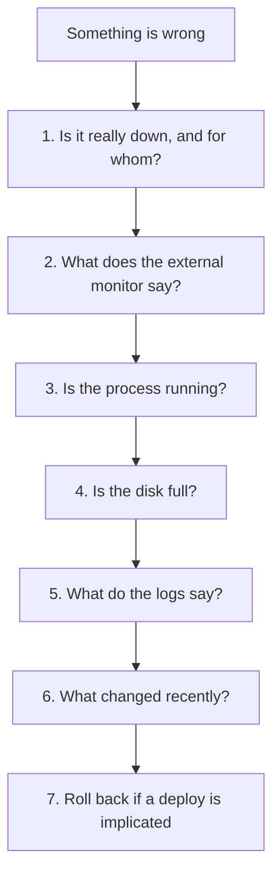

# Keeping It Running — Part 2

Part 1 set up the things that tell you something is wrong. This part is what you
do about it: keeping the machine patched, catching the certificate before it
expires, and an ordered runbook for the night something breaks and you are the
only person who can fix it.

It ends with the two questions nobody answers for beginners: when is one server
no longer enough, and what does all this actually cost?

> **⬅️ This continues [Part 1](./04-keeping-it-running-part-1.md).**

> **📌 In one line:** during an incident, work the checklist in order instead of
> guessing — and the answer is almost always "something changed recently".

## Table of Contents

1. [Keeping the Server Patched](#keeping-the-server-patched)
2. [Certificate Renewal Monitoring](#certificate-renewal-monitoring)
3. [The Incident Runbook](#the-incident-runbook)
4. [Writing Down What Happened](#writing-down-what-happened)
5. [Knowing When to Leave This Setup](#knowing-when-to-leave-this-setup)
6. [What Comes Next](#what-comes-next)
7. [What It Actually Costs](#what-it-actually-costs)
8. [Common Mistakes](#common-mistakes)
9. [Questions to Test Yourself](#questions-to-test-yourself)
10. [Related](#related)

---

## Keeping the Server Patched

`unattended-upgrades` from
[Setting Up the Server — Part 1](02-setting-up-the-server-part-1.md#automatic-security-updates)
installs security patches by itself. That covers most of the risk and none of
the thinking.

Two things it deliberately does not do: reboot, and upgrade the Ubuntu release.

**Reboots.** A kernel or glibc patch only takes effect after a restart. Until
then the patched file is on disk and the vulnerable code is still in memory.
Ubuntu tells you when one is needed:

```bash
ls /var/run/reboot-required 2>/dev/null && cat /var/run/reboot-required.pkgs
```

```text
/var/run/reboot-required
linux-image-6.8.0-45-generic
libssl3
```

Plan it rather than avoiding it. A reboot on a healthy server takes about 30
seconds, and your containers come back because you used `--restart
unless-stopped`.

```bash
# Before: check that everything will actually come back
systemctl is-enabled nginx docker          # both should say "enabled"
docker ps --format '{{.Names}}\t{{.Status}}'

sudo reboot

# After, from your laptop
curl -fsS https://api.myapp.com/health
```

> **💡 Tip:** Reboot once a month on purpose, at a quiet hour you choose. A
> server that has been up for 400 days is not impressive — it is a machine where
> nobody knows whether it still boots, running a kernel from two years ago.

**Release upgrades.** Ubuntu LTS gets five years of security updates, so you have
time. But "I will do it later" turns into an unsupported OS. Pick a quarter,
back up, snapshot the VPS, and run `do-release-upgrade`. Because your app is in
a container, the host OS version matters far less than it would otherwise —
which is one of the quieter benefits of the Docker choice.

**Your dependencies** patch on a different schedule, in git, through the
pipeline. Enable Dependabot or Renovate, let it open pull requests, and let CI
tell you whether the upgrade is safe. A dependency vulnerability reaches
production exactly the same way a feature does — through a deploy.

---

## Certificate Renewal Monitoring

certbot renews automatically, and when it fails it fails silently. You proved
renewal works in
[Setting Up the Server — Part 2](02-setting-up-the-server-part-2.md#proving-renewal-actually-works).
This is about noticing if it stops working in four months.

Three layers, cheapest first:

1. **The external monitor's TLS check.** One tick-box, alerts at 21 days. This
   is the one that actually saves you, because it runs on someone else's
   machine and sees exactly what a user's browser sees.
2. **A local check in cron**, as a backstop:

```bash
#!/usr/bin/env bash
DAYS=$(( ( $(date -d "$(openssl s_client -connect api.myapp.com:443 \
  -servername api.myapp.com 2>/dev/null | openssl x509 -noout -enddate \
  | cut -d= -f2)" +%s) - $(date +%s) ) / 86400 ))
echo "certificate expires in ${DAYS} days"
[ "$DAYS" -lt 21 ] && curl -fsS "https://hc-ping.com/${HC_CERT_UUID}/fail"
```

3. **`certbot renew --dry-run` quarterly**, by hand, as part of the same
   afternoon as your restore drill. It catches config changes that broke the
   challenge path long before the real renewal needs it.

```bash
# ❌ BROKEN - reads the file on disk, which nginx may never have reloaded
sudo openssl x509 -noout -enddate -in /etc/letsencrypt/live/api.myapp.com/fullchain.pem
# notAfter=Jan  2 11:30:00 2027 GMT   <- renewed, but is it being SERVED?

# ✅ FIXED - asks the running server, exactly as a browser would
openssl s_client -connect api.myapp.com:443 -servername api.myapp.com </dev/null 2>/dev/null \
  | openssl x509 -noout -enddate
# notAfter=Oct  9 11:30:00 2026 GMT   <- the old one, still in nginx's memory
```

> **⚠️ Warning:** Check the **live** certificate over the network, not the file
> on disk. A renewed file that nginx never reloaded is the exact failure mode
> that catches people, and only an over-the-network check sees it.

---

## The Incident Runbook

Something is broken, you are tired, and the instinct is to start trying things.
Don't. Work the list in order. It is the same shape as the database triage
checklist in
[Monitoring and Troubleshooting — Part 2](../../databases/operations/05-monitoring-and-troubleshooting-part-2.md#the-triage-checklist),
for the same reason: the order finds one cause behind twenty symptoms.



**1. Confirm it is really down, and for whom.** Before anything else, reproduce
it. One user on hotel wifi is not an outage.

```bash
curl -s -o /dev/null -w '%{http_code} %{time_total}s\n' https://api.myapp.com/health
```

```text
502 0.184s
```

A 502 means nginx is alive and your app is not. A timeout means the machine or
the network. A certificate error means certbot. A DNS error means DNS. **The
error type you get here narrows the whole investigation**, so read it carefully
before moving on.

**2. Check the external monitor.** It has history you do not. When did it start?
Was there a blip an hour earlier? Did it recover by itself and come back? A
problem that flaps is a different problem from one that is simply down.

**3. Is the process running?**

```bash
ssh afsar@203.0.113.10
docker ps -a --format '{{.Names}}\t{{.Status}}'
systemctl is-active nginx docker
```

```text
myapp-api-3334   Exited (137) 4 minutes ago
myapp-worker     Up 6 days
active
active
```

Exit code **137** means SIGKILL, and on a small box that almost always means the
OOM killer. Exit **143** is SIGTERM — something asked it to stop. Exit **1** is
your application crashing on startup, usually configuration.

**4. Is the disk full?** Check this early, because a full disk produces a dozen
unrelated-looking symptoms and every one of them is a dead end.

```bash
df -h / && free -h
```

```text
Filesystem      Size  Used Avail Use% Mounted on
/dev/vda1        78G   78G     0 100% /
```

If it is full: `docker system prune -af`, `journalctl --vacuum-size=100M`, then
find what grew. Details in
[Logs, Disks and Debugging — Part 1](../01-linux-essentials/05-logs-disks-and-debugging-part-1.md).

**5. What do the logs say?** Now, and not before — the three checks above are
faster and rule out whole categories.

```bash
docker logs --tail 100 --timestamps myapp-api-3334
journalctl -u nginx --since '15 min ago' --no-pager | tail -30
```

Read the **first** error, not the last. A connection pool timeout at 23:04
produces a thousand errors by 23:09, and only the first one names the cause.
Correlation ids make this much easier —
[Correlation IDs and Tracing](../../backend-fundamentals/08-logging-and-observability/03-correlation-ids-and-tracing.md).

**6. What changed recently?** This is the answer. Not usually — almost always.

```bash
tail -5 /srv/myapp/deploy.log
```

```text
2026-10-04T22:58:11+00:00 a1b2c3d Add invoice export endpoint
```

Then widen it: a deploy, a migration, a feature flag, a dependency release, a
certificate renewal, an OS patch, or a third-party provider's own incident. If
nothing on your side changed, check your provider's status page — their outage
looks exactly like yours.

**7. Roll back if a deploy is implicated.** Do not finish diagnosing first.

```bash
/srv/myapp/deploy.sh 9f8e7d6
```

The decision table for rolling back versus rolling forward is in
[Shipping and Rollback — Part 2](03-shipping-and-rollback-part-2.md#roll-back-or-roll-forward).

> **📌 Remember:** the order matters more than any individual command. Steps 1
> and 3 tell you which half of the system is broken in under a minute. Jumping
> straight to step 5 means reading a thousand log lines produced by a disk that
> filled up twenty minutes ago.

---

## Writing Down What Happened

When it is over, write five sentences. Not a document — a note in the repository
or an issue, ten minutes while it is fresh.

```markdown
## 2026-10-04 — API down 23:04–23:21 (17 min)

**Impact:** All API requests returned 502. Roughly 40 users affected.
**Cause:** The 22:58 deploy raised the connection pool size to 50. The managed
database allows 40 connections, so every new connection was refused and the
container failed its health check and was OOM-killed on retry.
**Fix:** Rolled back to 9f8e7d6 at 23:19. Service recovered at 23:21.
**Detected by:** External uptime monitor, 23:06. Two minutes after it started.
**Next time:** Pool size is now derived from an env var and validated at boot
against the database's max_connections. Added to the deploy checklist.
```

Why bother when you are the only engineer?

- **You will forget.** In March you will see the same 502 and spend an hour
  rediscovering what you already knew in October.
- **The fix is usually not the code.** It is a missing check, a missing alert,
  or a default that was wrong. Those only get fixed if they are written down.
- **Patterns only appear in writing.** Three notes that all say "the deploy did
  it" tell you to improve the deploy. You will not notice that from memory.
- **It is practice for a team.** Writing a clear incident note is a senior
  skill, and this is a cheap place to learn it.

**Blameless** means the note describes the system, not the person. "The deploy
raised the pool size past the database limit" is useful. "I was careless" is
not — it suggests no fix, so nothing improves. Even alone, write it the way you
would want a colleague to write it about you. The habit transfers.

---

## Knowing When to Leave This Setup

One VPS is genuinely enough for longer than people claim. A 4 GB box behind
nginx serves a lot of traffic. Do not grow for the sake of it.

But there are honest signals, and they are not about traffic:

| Signal | What it really means | What to do |
|---|---|---|
| **You need availability, not capacity** | A reboot is an outage. One disk failure is a day of downtime you cannot shorten | Two app servers behind a load balancer |
| **Deploys are frightening** | Something in the process is not reversible, or not understood | Fix the process before adding machines |
| **You spend more time operating than building** | The operational load has outgrown one person's spare attention | Managed database, managed Redis, or a PaaS |
| You cannot scale the box any further | You are at the biggest instance and still saturated | Horizontal scaling — but measure first |
| Several apps now fight over one machine | One noisy service degrades the others | Separate them, by machine or by orchestrator |
| Users are on another continent and it is slow | Latency is physics, not CPU | A CDN first; a second region only if that is not enough |

Two of those deserve emphasis.

**"I need two machines for availability, not capacity"** is the real threshold.
Capacity you solve by resizing the VPS, which takes a reboot. Availability you
cannot solve on one machine at all, by definition. When a 30-second reboot is no
longer acceptable, you have outgrown one server — and that is a business
decision, not a technical one.

**"Deploys are frightening"** is the signal people ignore longest, and more
machines make it worse. If you hesitate before deploying, the problem is in the
pipeline: no health gate, no rollback path, migrations that cannot be undone, no
verification. Fix that first. A frightening deploy on three servers is three
times as frightening.

> **⚠️ Warning:** The most expensive mistake at this stage is adopting
> Kubernetes to solve a problem one extra machine would have solved. You take on
> a cluster to operate, in exchange for features you do not need yet.

---

## What Comes Next

In order, as the problems actually arrive:

1. **Move the database off the box** — managed PostgreSQL. Buys you backups,
   failover and upgrades for less than the cost of one bad night.
2. **A second app server behind a load balancer.** Your app is already
   stateless, so this mostly works already. The concepts:
   [Load Balancing](../../system-design/foundational/load-balancing.md).
3. **A read replica**, when reads dominate and reporting queries slow down
   writes. The lag is the catch:
   [Database Replication](../../system-design/foundational/database-replication.md)
   and
   [Read Replicas and Replication Lag](../../databases/operations/04-read-replicas-and-replication-lag.md).
4. **A CDN in front**, for static assets and geography:
   [CDN and Edge Caching](../../system-design/scale-patterns/cdn-and-edge-caching.md).
5. **An orchestrator**, only when you have several services and a team to run
   them: [cloud-devops/kubernetes/](../../cloud-devops/kubernetes/).

The honest ordering note: steps 1 to 4 solve real problems you will feel. Step 5
solves a problem about managing many services. Reaching it is not a milestone to
aim for.

---

## What It Actually Costs

Nobody tells beginners this, and it is genuinely useful. Figures are rough and
in US dollars per month, as of writing — check current prices.

| Item | Learning / side project | Small app, real users | Growing |
|---|---|---|---|
| App server | 1 VPS, 2 vCPU 4 GB — **6** | Same — **6** | 2 VPS — **12** |
| Database | Same box — **0** | Managed, smallest — **15** | Managed with replica — **50** |
| Redis | Same box — **0** | Same box — **0** | Managed — **15** |
| Object storage | R2 / Spaces, 10 GB — **0–5** | **5** | **10** |
| Domain | ~**1** (12/year) | **1** | **1** |
| TLS certificate | Let's Encrypt — **0** | **0** | **0** |
| Uptime monitoring | Free tier — **0** | **0–7** | **7** |
| Error tracking | Sentry free tier — **0** | **0–26** | **26** |
| Log aggregation | `docker logs` — **0** | **0–10** | **10** |
| Backups storage | **0–2** | **2** | **5** |
| CI/CD | GitHub Actions free minutes — **0** | **0** | **0–10** |
| **Total** | **~8–15** | **~30–70** | **~140–190** |

Three things worth noticing:

- **The jump from learning to real users is mostly the database.** Fifteen
  dollars a month buys automatic backups, point-in-time recovery and failover —
  the three things you would otherwise do badly by hand.
- **The free tiers are not toys.** Sentry, UptimeRobot, Healthchecks.io and
  GitHub Actions all have free tiers that are genuinely sufficient for a small
  app. Use them from day one.
- **Compare against the alternative.** A managed Kubernetes control plane plus
  nodes starts around 100–150 per month before you have deployed anything. The
  whole setup in this folder costs less than one hour of your time per month.

> **📌 Remember:** the cheapest line in that table is the one that is not there —
> your own time. Pay 15 dollars to not operate a database. Do not pay 150 to
> operate a cluster you did not need.

---

## Common Mistakes

| Mistake | Why it is wrong | Do this instead |
|---|---|---|
| Never rebooting, and being proud of the uptime | The kernel patches are installed but not active, and nobody knows if it still boots | A planned reboot monthly, at an hour you choose |
| Checking the certificate file on disk | A renewed file nginx never reloaded still serves the old certificate | Check it over the network, as a browser would |
| Reading logs as step one of an incident | A full disk produces a thousand misleading errors | Confirm down, check the process, check the disk, then read |
| Reading the last error instead of the first | Later errors are consequences; only the first names the cause | Sort by time, read forwards from the start |
| Diagnosing before rolling back | Every minute spent understanding is a minute users are broken | Roll back, then investigate calmly |
| Not writing anything down after an incident | You pay the full cost again in four months | Five sentences: impact, cause, fix, detection, next time |
| Adding servers because deploys feel risky | More machines multiply the risk rather than reducing it | Fix the pipeline first — health gate, rollback, verification |
| Moving to Kubernetes to solve a one-machine problem | You add a cluster to operate and keep the original problem | One more VPS, or a managed service |

---

## Questions to Test Yourself

1. `unattended-upgrades` installed a kernel patch last night. Is the server
   protected? What command tells you, and what do you have to do?
2. `certbot certificates` shows a valid certificate expiring in 80 days, but
   users see an expiry warning. Explain how both are true.
3. Walk the runbook for a 502. Which step tells you nginx is alive, and which
   one tells you why your app is not?
4. A container shows `Exited (137)`. What killed it, and which monitor from
   Part 1 would have warned you first?
5. Why does the runbook check the disk before reading the logs?
6. Write a five-sentence incident note for: a migration added an index on a
   large table, locked it for six minutes, and every request timed out.
7. Give the one signal that genuinely means you have outgrown a single VPS, and
   explain why "more traffic" is not it.
8. Your monthly bill is 8 dollars and you just signed your first paying
   customer. Which single line item do you increase first, and why that one?

---

## Related

- [04-keeping-it-running-part-1.md](04-keeping-it-running-part-1.md) — the monitoring and backups this part assumes exist.
- [03-shipping-and-rollback-part-2.md](03-shipping-and-rollback-part-2.md) — the rollback you reach for at step 7.
- [02-setting-up-the-server-part-2.md](02-setting-up-the-server-part-2.md) — certbot, renewal, and the nginx config being monitored.
- [databases/operations/05-monitoring-and-troubleshooting-part-2.md](../../databases/operations/05-monitoring-and-troubleshooting-part-2.md) — the database triage checklist this runbook mirrors.
- [01-linux-essentials/05-logs-disks-and-debugging-part-1.md](../01-linux-essentials/05-logs-disks-and-debugging-part-1.md) — journald, reading logs during an incident, and the disk-full forensics.
- [01-linux-essentials/05-logs-disks-and-debugging-part-2.md](../01-linux-essentials/05-logs-disks-and-debugging-part-2.md) — memory, load average, and the Linux triage runbook this one mirrors.
- [backend-fundamentals/08-logging-and-observability/03-correlation-ids-and-tracing.md](../../backend-fundamentals/08-logging-and-observability/03-correlation-ids-and-tracing.md) — following one request through the logs.
- [system-design/foundational/load-balancing.md](../../system-design/foundational/load-balancing.md) — the next step when one machine is not enough.
- [system-design/foundational/database-replication.md](../../system-design/foundational/database-replication.md) — read replicas and what replication lag costs.
- [cloud-devops/kubernetes/](../../cloud-devops/kubernetes/) — the orchestrator, for when you genuinely have several services.
