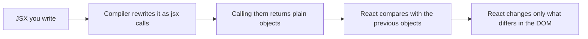
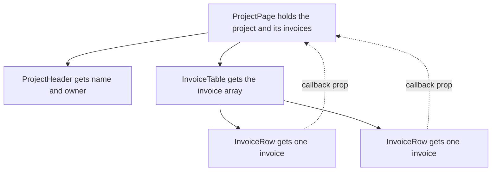

# Components and Props — Part 1

You already write functions that take data and return something. A React
component is that, and nothing more: a function that takes data and returns a
*description* of what the screen should look like.

The confusion is almost never the function. It is the angle brackets. `<Invoice
amount={100} />` looks like HTML living inside JavaScript, and that look makes
people treat React as a template language with strange rules. It is not. This
part removes that illusion first, because once you see the function call hiding
inside the brackets, most "React magic" stops being magic. Part 2 then covers
rendering lists, deciding component boundaries, and designing a component other
people can reuse.

> **📌 In one line:** a component is a plain function from props to a
> description of UI, and JSX is sugar for calling that function.

## Table of Contents

1. [A Component Is Just a Function](#a-component-is-just-a-function)
2. [JSX Is a Function Call Wearing Angle Brackets](#jsx-is-a-function-call-wearing-angle-brackets)
3. [Props: Data Flowing Down](#props-data-flowing-down)
4. [Typing Props With an Interface](#typing-props-with-an-interface)
5. [BROKEN vs FIXED: Why Props Are Read-Only](#broken-vs-fixed-why-props-are-read-only)
6. [Composition and children](#composition-and-children)
7. [Common Mistakes](#common-mistakes)
8. [Questions to Test Yourself](#questions-to-test-yourself)
9. [Related](#related)

---

## A Component Is Just a Function

Here is a complete, real React component.

```tsx
function InvoiceTotal() {
  return <p>Total: $4,200.00</p>
}
```

That is it. A function, with a capital letter at the start of its name, that
returns something. There is no class to extend, no framework object to
register, no lifecycle to learn before you can show text on a screen.

The capital letter is not style. It is a rule the compiler uses: `<InvoiceTotal
/>` means "call the function in scope called `InvoiceTotal`", while `<p>` means
"the HTML element `p`". Lowercase names become strings; capitalised names become
references to your function.

Because it is a function, everything you already know about functions still
applies. You can define it anywhere a function can live. You can pass it
around. You can destructure its argument, give parameters defaults, and return
early.

> **💡 Tip:** when a React example confuses you, mentally delete the angle
> brackets and ask "what does this function take, and what does it return?"
> That question has an answer in every case.

What a component returns is **not** HTML and **not** DOM. It is a plain
JavaScript object describing what you want. React compares that description
against the last one and decides what to change in the real page. You describe;
React performs.



This separation is the whole design. Your code never calls
`document.querySelector`. It returns a value, like any other function.

---

## JSX Is a Function Call Wearing Angle Brackets

JSX is **syntax sugar**. Sugar means a shorter way to write something that
already exists. The compiler (Babel, SWC, or the TypeScript compiler) rewrites
it before the browser ever sees it.

Write this:

```tsx
<Invoice amount={100} />
```

The compiler produces this:

```ts
import { jsx as _jsx } from 'react/jsx-runtime'

_jsx(Invoice, { amount: 100 })
```

Older setups produce the classic form, which is the same idea with a different
function name:

```ts
React.createElement(Invoice, { amount: 100 })
```

And what does that call return? Not a DOM node. A plain object, roughly:

```ts
{ type: Invoice, key: null, props: { amount: 100 } }
```

Read that object once more. `type` is **your function itself** — not its result.
React holds the function and decides when to call it. `props` is just an object
literal built from the attributes you wrote.

Nesting works the same way. Children become a prop named `children`:

```tsx
<Card title="Unpaid invoices">
  <Invoice amount={100} />
</Card>
```

```ts
_jsx(Card, {
  title: 'Unpaid invoices',
  children: _jsx(Invoice, { amount: 100 }),
})
```

Once you see this, several "rules" stop being rules and become obvious
consequences.

| JSX rule | Why it is true once you see the call |
|---|---|
| Attributes in `{}` take any expression | They are object values; any expression is legal |
| `class` is written `className` | `class` is a reserved word in JavaScript |
| You must return one root element | A function returns one value, not two |
| `<>...</>` fragments exist | A wrapper type that renders nothing but holds one value |
| You cannot put an `if` statement inside JSX | Statements are not expressions; `? :` is |
| Components must start with a capital | Lowercase compiles to the string `"p"`, not your function |

> **📌 Remember:** JSX has no runtime. By the time your code runs in the
> browser there are no angle brackets left — only function calls returning
> objects.

---

## Props: Data Flowing Down

**Props** is short for *properties*. They are the single argument your
component function receives. Nothing more exotic than that.

```tsx
function InvoiceRow(props: { number: string; amountCents: number }) {
  return (
    <tr>
      <td>{props.number}</td>
      <td>{formatMoney(props.amountCents)}</td>
    </tr>
  )
}
```

Most code destructures the argument, exactly as you would in a Node function:

```tsx
function InvoiceRow({ number, amountCents }: InvoiceRowProps) {
  return (
    <tr>
      <td>{number}</td>
      <td>{formatMoney(amountCents)}</td>
    </tr>
  )
}
```

A parent passes props by writing attributes:

```tsx
<InvoiceRow number="INV-2041" amountCents={420000} />
```

Note the two kinds of value. `number="INV-2041"` passes a string — quotes are a
shortcut for string literals. `amountCents={420000}` passes a real number,
because `{}` means "evaluate this JavaScript expression". Writing
`amountCents="420000"` passes a string instead, and TypeScript will stop you.

Data flows **down** only. A parent gives a child what it needs; a child cannot
reach up and read the parent's variables. This one-way flow is why you can read
a React tree top to bottom and always know where a value came from.



The dotted lines are the only way information travels upward: the parent passed
a function down, and the child calls it. There is no other channel.

---

## Typing Props With an Interface

Declare the shape once, as an interface, and both the component and every
caller are checked against it.

```ts
interface InvoiceRowProps {
  number: string
  amountCents: number
  status: 'draft' | 'sent' | 'paid' | 'overdue'
  dueDate: string                         // ISO date string from your API
  onOpen?: (invoiceId: string) => void    // optional callback prop
}
```

Three habits worth copying:

- **Use a union of string literals** for a status, not `string`. The compiler
  then catches `status="payed"` at build time.
- **Name callback props `onSomething`** and type them properly. A handler is a
  prop like any other; passing functions down is normal React.
- **Mark optional props with `?`** and give them a default while
  destructuring: `{ status = 'draft' }`.

Everything you know about interfaces applies here, including extending a base
shape for variants — see
[Interfaces](../../typescript-fundamentals/interfaces/interfaces.md). Props are
not a React concept with its own type system. They are an ordinary object
parameter.

> **⚠️ Warning:** never type props as `any` to silence an error. Props are the
> contract between two files written by two people. `any` deletes the only
> check that contract has.

---

## BROKEN vs FIXED: Why Props Are Read-Only

A component must never modify the props it was given.

```tsx
// ❌ BROKEN - mutating a prop; the parent still owns this object
function InvoiceRow({ invoice }: { invoice: Invoice }) {
  invoice.status = 'paid'          // silently changes the parent's data
  return <td>{invoice.status}</td>
}

// ✅ FIXED - derive what you need locally, and ask the owner to change the data
function InvoiceRow({ invoice, onMarkPaid }: InvoiceRowProps) {
  const label = invoice.status === 'paid' ? 'Paid' : 'Awaiting payment'
  return (
    <td>
      {label}
      <button onClick={() => onMarkPaid(invoice.id)}>Mark paid</button>
    </td>
  )
}
```

The reason is the reference rule you already studied in
[Objects and References](../../typescript-fundamentals/objects-and-references/objects-and-references.md).
The parent passed a *reference*, not a copy. Writing `invoice.status = 'paid'`
edits the very object the parent is holding — without the parent knowing. React
does not watch objects for changes, so nothing re-renders, and now the screen
and the data disagree. The bug surfaces three components away, in a file you
did not touch.

The discipline is simple: **the component that owns a piece of data is the only
one allowed to change it.** Children receive values, and receive functions to
request changes.

This same reference rule is the cause of the single most common React bug of
all, which Part 1 of the next file is entirely about.

---

## Composition and children

`children` is the prop React fills with whatever you wrote between the opening
and closing tags. This gives you wrappers that know nothing about their
contents.

```tsx
interface CardProps {
  title: string
  action?: React.ReactNode   // anything renderable: element, string, number
  children: React.ReactNode
}

function Card({ title, action, children }: CardProps) {
  return (
    <section className="card">
      <header className="card-head">
        <h2>{title}</h2>
        {action}
      </header>
      <div className="card-body">{children}</div>
    </section>
  )
}
```

Used twice, with completely different contents:

```tsx
<Card title="Overdue invoices" action={<button>Export</button>}>
  <InvoiceTable invoices={overdue} />
</Card>

<Card title="Recent activity">
  <NotificationList notifications={notifications} />
</Card>
```

`Card` has no idea what a table or a notification is. That is the point.
`React.ReactNode` is the type for "something React can render": an element, a
string, a number, an array of those, `null`, or `undefined`.

> **💡 Tip:** a prop typed `React.ReactNode` is a *slot*. Slots are the
> cheapest way to make a component reusable, and they cost the caller no
> configuration at all. Part 2 pushes this idea further.

---

## Common Mistakes

| Mistake | Why it is wrong | Do this instead |
|---|---|---|
| Lowercase component name | `<invoiceRow />` compiles to the string tag `"invoiceRow"` | Capitalise every component name |
| Mutating a prop object | The parent owns that reference; nothing re-renders | Call a callback prop and let the owner change it |
| Typing props as `any` | Deletes the contract between caller and component | Declare an interface for every props type |
| `amount="100"` without braces | Passes a string where a number is meant | `amount={100}` |
| Returning two sibling elements | A function returns one value, not two | Wrap them in `<>...</>` |
| `status: string` instead of a union | Typos like `"payed"` compile fine | `'draft' \| 'sent' \| 'paid' \| 'overdue'` |
| Reaching for a parent's variable from a child | There is no upward channel in React | Pass it down as a prop |
| Spreading unknown props with `{...rest}` everywhere | Hides what a component actually accepts | List the props you support |

---

## Questions to Test Yourself

1. What does `<InvoiceRow invoice={inv} />` compile to, and what kind of value
   does that expression produce at runtime?
2. Why must a component name start with a capital letter? What exactly happens
   if it does not?
3. In the compiled object `{ type: InvoiceRow, props: {...} }`, what is stored
   in `type` — the function or its result? Why does the difference matter?
4. A child writes `props.project.name = 'New name'`. Describe the two separate
   problems this creates.
5. Explain what `children` is in one sentence, without using the word
   "special".
6. Why can you not write an `if` statement inside JSX, but you can write a
   ternary?
7. A teammate types a props interface as `Record<string, unknown>`. What do you
   lose, and what do you suggest instead?

---

> **➡️ Continued in [Part 2](./01-components-and-props-part-2.md)** — rendering
> lists, the `key` prop and the bug it prevents, choosing component boundaries,
> and designing reusable components.

## Related

- [Components and Props — Part 2](01-components-and-props-part-2.md) — lists,
  keys, boundaries, and reusable design.
- [State and Rendering — Part 1](02-state-and-rendering-part-1.md) — what makes
  a component function run again.
- [Interfaces](../../typescript-fundamentals/interfaces/interfaces.md) — the
  contract shape you use for every props type.
- [Objects and References](../../typescript-fundamentals/objects-and-references/objects-and-references.md)
  — why mutating a prop changes the parent's data.
