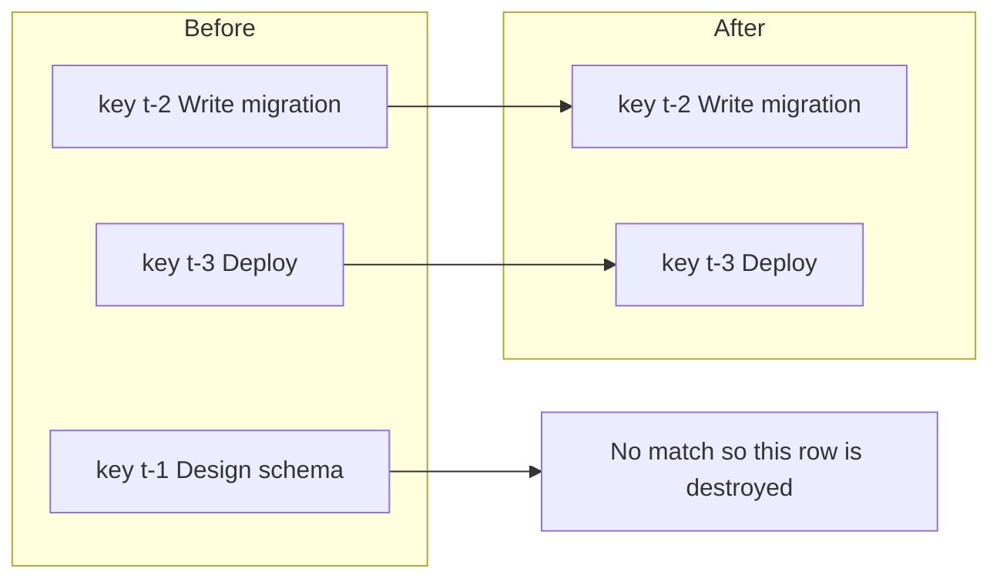
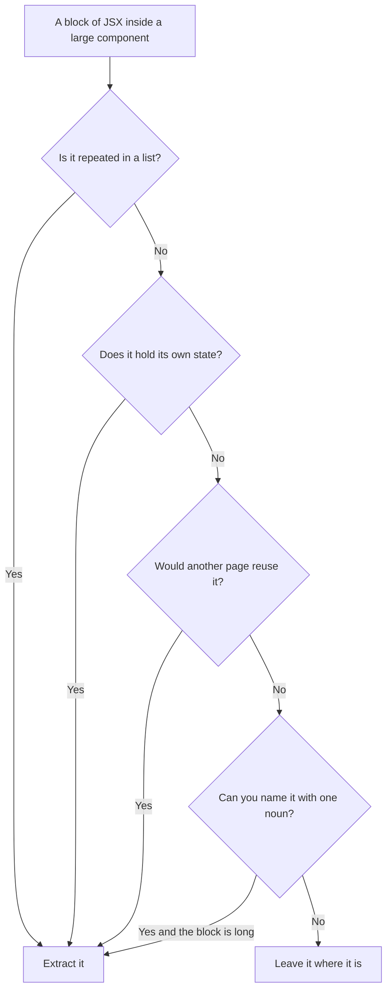

# Components and Props — Part 2

Part 1 showed that a component is a function and that JSX is a call. That is
enough to render one thing. Real screens render *many* things, conditionally,
from an array that changes while the user works.

This part covers the three skills that turn one component into a page: showing
something only sometimes, rendering a list correctly, and knowing where to draw
the line between one component and the next. It ends with the two decisions
that separate a component people reuse happily from one they copy and paste to
escape.

> **📌 In one line:** rendering a list is `map` plus a stable `key`, and almost
> every list bug in React is a wrong `key`.

> **⬅️ This continues [Part 1](./01-components-and-props-part-1.md).**

## Table of Contents

1. [Conditional Rendering](#conditional-rendering)
2. [Lists and the key Prop](#lists-and-the-key-prop)
3. [BROKEN vs FIXED: the Index Key That Corrupts a Row](#broken-vs-fixed-the-index-key-that-corrupts-a-row)
4. [Deciding Where the Boundaries Go](#deciding-where-the-boundaries-go)
5. [Advanced: Composition Beats Configuration](#advanced-composition-beats-configuration)
6. [Advanced: Generics in a Reusable Component](#advanced-generics-in-a-reusable-component)
7. [Common Mistakes](#common-mistakes)
8. [Questions to Test Yourself](#questions-to-test-yourself)
9. [Related](#related)

---

## Conditional Rendering

JSX holds expressions, so you use expressions, not statements.

```tsx
function InvoiceBadge({ invoice }: { invoice: Invoice }) {
  if (invoice.status === 'draft') return null        // render nothing at all

  return (
    <span>
      {invoice.status === 'overdue' ? 'Overdue' : 'Sent'}
      {invoice.amountCents > 100_000 && <strong> Large</strong>}
    </span>
  )
}
```

Three techniques, in order of preference:

1. **Early `return null`** when the whole component should disappear. Clearest,
   and it keeps the main return simple.
2. **Ternary `cond ? a : b`** when you are choosing between two things.
3. **`cond && element`** when you show something or nothing.

There is one trap in option 3. The `&&` operator returns the *left* value when
that value is falsy, and React renders the number `0` happily:

```tsx
// ❌ BROKEN - renders a bare "0" on the page when there are no open tasks
{openTasks.length && <TaskList tasks={openTasks} />}

// ✅ FIXED - compare first so the falsy branch is a boolean, which renders nothing
{openTasks.length > 0 && <TaskList tasks={openTasks} />}
```

React skips `false`, `null` and `undefined`, but `0` is a legal thing to
display, so it displays it. The rule is: **the left side of `&&` in JSX must be
a boolean.**

> **💡 Tip:** if a stray `0` appears on a page, search the file for `.length
> &&`. It is almost always that.

---

## Lists and the key Prop

You render a list by mapping an array to elements. It is the same `map` you use
on the server.

```tsx
function TaskList({ tasks }: { tasks: Task[] }) {
  return (
    <ul>
      {tasks.map((task) => (
        <TaskRow key={task.id} task={task} />
      ))}
    </ul>
  )
}
```

The `key` prop is not decoration, and it is not an id for you to use. React
re-runs your component on every update and receives a brand-new array of
element objects. It must answer one question before touching the DOM:

> *Which element in the new list is the same thing as which element in the old
> list?*

Without `key`, React falls back to position. Position is a poor identity.
Insert one row at the top and, by position, every single item has changed.

With `key`, React matches by that value instead.



`key={task.id}` says "this is task `t-2`". When task `t-2` moves from position
3 to position 1, React moves the existing DOM node — and everything attached to
it — instead of rebuilding anything.

| Key choice | Safe? | Why |
|---|---|---|
| `key={task.id}` | Yes | Stable, unique, tied to the real thing |
| `key={invoice.number}` | Yes, if unique | A natural business identifier works |
| `key={index}` | Usually no | Identity changes whenever the list changes shape |
| `key={Math.random()}` | Never | A new key every render destroys and rebuilds everything |
| No key, static list | Acceptable | A list that never changes has no identity problem |

Two more rules that catch people out:

- Keys must be unique **among siblings**, not globally. Two different lists on
  the same page may both use `key="t-1"`.
- The `key` goes on the outermost element produced by `map`, not inside the
  child component. `key` is consumed by React and never arrives in `props`.

---

## BROKEN vs FIXED: the Index Key That Corrupts a Row

Index keys look harmless, because at first the screen looks right. Here is the
case where it is not. Each row has its own internal state: a draft title the
user is editing.

```tsx
// ❌ BROKEN - key is the array position, so state follows the slot, not the task
function TaskList({ tasks, onDelete }: TaskListProps) {
  return (
    <ul>
      {tasks.map((task, index) => (
        <TaskRow key={index} task={task} onDelete={onDelete} />
      ))}
    </ul>
  )
}

function TaskRow({ task, onDelete }: TaskRowProps) {
  const [draftTitle, setDraftTitle] = useState(task.title)   // state inside the row
  return (
    <li>
      <input value={draftTitle} onChange={(e) => setDraftTitle(e.target.value)} />
      <button onClick={() => onDelete(task.id)}>Delete</button>
    </li>
  )
}
```

Walk through it slowly. The list is `[Design schema, Write migration, Deploy]`.
The user edits row 1 to "Write migration v2" but does not save. Then the user
deletes row 0.

The new array is `[Write migration, Deploy]`. React sees key `0` before and key
`0` after, concludes they are the same row, and keeps that row's state. So the
component that used to show "Design schema" now receives the task "Write
migration" — but it keeps its old `draftTitle`, which is still "Design schema".

The unsaved edit has jumped onto the wrong task, and the edit box now shows a
title belonging to a record that no longer exists. Nothing throws. No warning
appears in the console. The user presses save and overwrites real data with the
wrong value.

```tsx
// ✅ FIXED - key is the task's own identity, so state follows the task
{tasks.map((task) => (
  <TaskRow key={task.id} task={task} onDelete={onDelete} />
))}
```

Now React sees key `t-2` in both lists, matches them, keeps that row's state
intact, and throws away the state of the row that is gone. Correct.

> **⚠️ Warning:** index keys are only safe when the list never reorders, never
> has items inserted or removed anywhere but the end, and the rows hold no
> state and no focus. Four conditions, all of which quietly stop being true
> when someone adds a sort button six months later.

---

## Deciding Where the Boundaries Go

Beginners either write one 600-line page component, or split into forty
components that each render a single `div`. Both are painful to work in. Use
these practical signals instead of a philosophy.



Working rules:

- **One component, one noun.** `InvoiceRow`, `ProjectHeader`, `TaskFilterBar`.
  If the best name you can invent is `MiddleSection`, the boundary is in the
  wrong place.
- **Extract what repeats.** Anything inside a `map` is already a component in
  spirit. Give it a name and a props interface.
- **Extract what holds state.** A piece of UI with its own open/closed flag or
  draft value wants to be its own function, so that state lives next to the
  markup that uses it.
- **Do not extract for length alone.** A 120-line component that reads top to
  bottom is easier to work on than six components you must jump between to
  follow one idea.

A useful second question: *would this component make sense in a different
page?* If yes, it should not read from a global or know its page's layout. If
no, keep it in the same file as its parent. Not every component needs its own
file.

---

## Advanced: Composition Beats Configuration

A component that grows boolean props is a component being asked to be several
components at once.

```tsx
// ❌ BROKEN - a flag per variation; every new need adds another boolean
interface ModalProps {
  isOpen: boolean
  showHeader: boolean
  showFooter: boolean
  showCloseButton: boolean
  isDangerous: boolean
  isFullScreen: boolean
  hideOverlay: boolean
  title?: string
  // ...and seven more
}
```

Each flag multiplies the number of states that must work. Two booleans are four
combinations; eight booleans are 256, and nobody has ever rendered most of
them. The body fills with `{showHeader && ...}` and stops being readable.

```tsx
// ✅ FIXED - slots instead of flags; the caller composes exactly what it needs
interface DialogProps {
  onClose: () => void
  header?: React.ReactNode
  footer?: React.ReactNode
  children: React.ReactNode
}

<Dialog
  onClose={close}
  header={<DialogTitle>Delete project</DialogTitle>}
  footer={<DangerButton onClick={remove}>Delete</DangerButton>}
>
  <p>This removes all tasks and invoices in this project.</p>
</Dialog>
```

The caller supplies the parts; the component decides only layout and behaviour.
New requirements become new children, not new props.

| Signal | Configuration answer | Composition answer |
|---|---|---|
| "We need a version without a footer" | `showFooter={false}` | Do not pass `footer` |
| "This one needs two buttons" | `secondaryLabel`, `onSecondary` | Put both in `footer` |
| "Marketing wants an icon in the title" | `titleIcon` prop | Put the icon in `header` |
| "This one is a form" | `isForm`, `onSubmit` | Pass a `<form>` as `children` |

> **📌 Remember:** a boolean prop that switches *layout* usually wants to be a
> slot. A boolean prop that switches *behaviour*, like `disabled`, is fine.

---

## Advanced: Generics in a Reusable Component

A shared `DataTable` should not know whether it shows invoices or tasks, but it
should still type-check its columns against the row type. That is exactly what
generics are for — see
[Generics](../../typescript-fundamentals/generics/generics.md).

```tsx
interface Column<TRow> {
  header: string
  render: (row: TRow) => React.ReactNode
}

interface DataTableProps<TRow> {
  rows: readonly TRow[]
  columns: ReadonlyArray<Column<TRow>>
  rowKey: (row: TRow) => string     // the component cannot guess the id field
}

function DataTable<TRow>({ rows, columns, rowKey }: DataTableProps<TRow>) {
  return (
    <table>
      <thead>
        <tr>{columns.map((c) => <th key={c.header}>{c.header}</th>)}</tr>
      </thead>
      <tbody>
        {rows.map((row) => (
          <tr key={rowKey(row)}>
            {columns.map((c) => <td key={c.header}>{c.render(row)}</td>)}
          </tr>
        ))}
      </tbody>
    </table>
  )
}
```

At the call site `TRow` is inferred from `rows`, so `invoice` inside each
`render` is a fully typed `Invoice` with no annotation and no cast:

```tsx
<DataTable
  rows={invoices}
  rowKey={(invoice) => invoice.id}
  columns={[
    { header: 'Number', render: (invoice) => invoice.number },
    { header: 'Due',    render: (invoice) => formatDate(invoice.dueDate) },
  ]}
/>
```

Without the generic you would type `rows` as `unknown[]` and cast inside every
`render`, losing the check at the exact place where mistakes happen. Note also
`rowKey`: the component needs a key, cannot know which field is the id, and so
asks the caller. That is the honest design.

---

## Common Mistakes

| Mistake | Why it is wrong | Do this instead |
|---|---|---|
| `key={index}` on a list that can change | State and DOM follow the slot, not the item | Use a stable id from your data |
| `key={Math.random()}` | A new key each render rebuilds every row and loses focus | Use a stable id |
| Putting `key` on an inner element | React reads `key` on the element returned by `map` | Move it to the outermost mapped element |
| Reading `props.key` inside a component | React consumes `key`; it never reaches props | Pass the id again as a normal prop |
| `{count && <List />}` | Renders a bare `0` when the count is zero | `{count > 0 && <List />}` |
| A new boolean prop for every variation | Combination explosion nobody can test | Expose slots and compose |
| One file per tiny component | Navigation cost with no benefit | Keep small helpers beside their parent |
| `rows: unknown[]` in a shared table | Forces casts in every column renderer | Make the component generic |

---

## Questions to Test Yourself

1. Why does `{tasks.length && <TaskList />}` sometimes print `0` on the page,
   and what is the one-character class of fix?
2. In your own words, what question does React use `key` to answer?
3. A list uses `key={index}`. Each row has an open/closed detail panel. Give a
   sequence of user actions that leaves the wrong row open.
4. When is `key={index}` genuinely safe? List every condition.
5. Keys must be unique among siblings, not globally. Why is that enough?
6. You are given a `Modal` with twelve boolean props. What is the refactor, and
   what concretely does it buy you?
7. Why does `DataTable` ask for a `rowKey` function instead of looking for
   `row.id` itself?
8. Why does `DataTable<TRow>` need a type parameter instead of typing `rows` as
   `unknown[]`?

---

## Related

- [Components and Props — Part 1](01-components-and-props-part-1.md) — what a
  component is, JSX desugaring, props and `children`.
- [State and Rendering — Part 2](02-state-and-rendering-part-2.md) — using
  `key` deliberately to reset a component's state.
- [Generics](../../typescript-fundamentals/generics/generics.md) — how
  `DataTable<TRow>` stays type-safe across row types.
- [Interfaces](../../typescript-fundamentals/interfaces/interfaces.md) — the
  props contracts used throughout this file.
