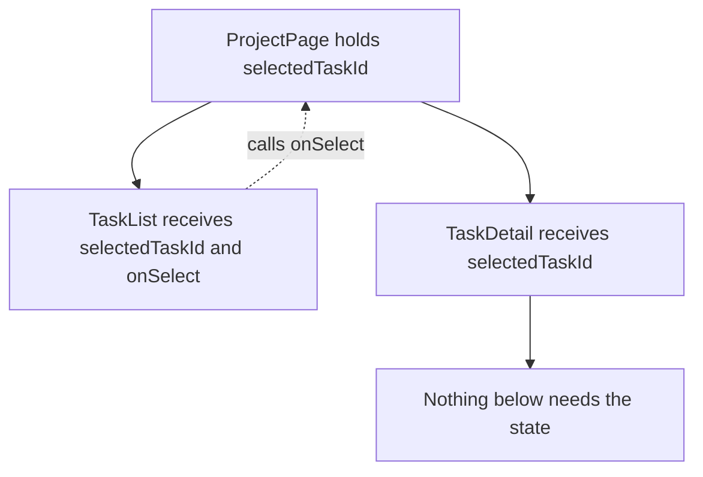

# State and Rendering — Part 2

Part 1 answered "what is state and why did my change not show". This part
answers the questions that come next, once a screen has more than one component
in it.

Which values deserve to be state at all? Where should a value live when two
components need it? And why does `setCount(c => c + 1)` exist when
`setCount(count + 1)` looks simpler? That last question is a closure question,
and you have already done the hard part of it.

> **📌 In one line:** keep as little in state as possible, put each value in the
> lowest component that needs it, and use the updater form whenever the next
> value depends on the previous one.

> **⬅️ This continues [Part 1](./02-state-and-rendering-part-1.md).**

## Table of Contents

1. [Derived State: Compute, Do Not Duplicate](#derived-state-compute-do-not-duplicate)
2. [BROKEN vs FIXED: Two Sources of One Truth](#broken-vs-fixed-two-sources-of-one-truth)
3. [Lifting State Up](#lifting-state-up)
4. [Passing a Setter Down](#passing-a-setter-down)
5. [The Function Initialiser](#the-function-initialiser)
6. [The Updater Form and Why It Exists](#the-updater-form-and-why-it-exists)
7. [Batching](#batching)
8. [Resetting a Component With key](#resetting-a-component-with-key)
9. [Advanced: Do You Need a State Library?](#advanced-do-you-need-a-state-library)
10. [Common Mistakes](#common-mistakes)
11. [Questions to Test Yourself](#questions-to-test-yourself)
12. [Related](#related)

---

## Derived State: Compute, Do Not Duplicate

Before adding a `useState`, ask one question: **can I compute this from
something I already have?** If yes, compute it. Every extra piece of state is
another value that can fall out of step with the others.

Your component function runs again on every render. That is the perfect moment
to recompute anything that depends on state or props. You do not need to store
the result; you need to produce it.

```tsx
function InvoiceList({ invoices }: { invoices: Invoice[] }) {
  const [search, setSearch] = useState('')
  const [status, setStatus] = useState<InvoiceStatus | 'all'>('all')

  // Derived during render. No second state, nothing to keep in sync.
  const visible = invoices.filter(
    (inv) =>
      (status === 'all' || inv.status === status) &&
      inv.number.toLowerCase().includes(search.toLowerCase()),
  )
  const overdueCount = invoices.filter((i) => i.status === 'overdue').length
  const totalCents = visible.reduce((sum, i) => sum + i.amountCents, 0)

  return <InvoiceTable rows={visible} total={totalCents} overdue={overdueCount} />
}
```

Three derived values, zero extra state. They are correct by construction,
because they are recalculated from the truth every time the truth is read.

| Should it be state? | Test | Example |
|---|---|---|
| Yes | The user or the server sets it, and nothing else implies it | `search`, `status`, `invoices` from the API |
| No | It is computable from state or props | `visible`, `overdueCount`, `totalCents` |
| No | It is a copy of a prop | `const [title, setTitle] = useState(props.title)` for display |
| No | It is a constant | Move it outside the component |

> **💡 Tip:** "Could I delete this `useState` and compute the value in the line
> above the `return`?" If the answer is yes, delete it.

---

## BROKEN vs FIXED: Two Sources of One Truth

Duplicated state does not look wrong when you write it. It looks tidy. Here is
why it is not.

```tsx
// ❌ BROKEN - the count is stored separately and must be updated everywhere
function TaskPanel({ initialTasks }: { initialTasks: Task[] }) {
  const [tasks, setTasks] = useState(initialTasks)
  const [openCount, setOpenCount] = useState(
    initialTasks.filter((t) => !t.done).length,
  )

  function completeTask(id: string) {
    setTasks(tasks.map((t) => (t.id === id ? { ...t, done: true } : t)))
    setOpenCount(openCount - 1)          // remembered here...
  }

  function deleteTask(id: string) {
    setTasks(tasks.filter((t) => t.id !== id))
    // ...and forgotten here. The badge is now wrong forever.
  }

  return <Badge>{openCount} open</Badge>
}
```

The badge and the list are two sources for one fact. They agree only as long as
every author of every future handler remembers to update both. Someone adds
"reopen task" next month, and the badge drifts.

```tsx
// ✅ FIXED - one source of truth; the count is computed from it
function TaskPanel({ initialTasks }: { initialTasks: Task[] }) {
  const [tasks, setTasks] = useState(initialTasks)
  const openCount = tasks.filter((t) => !t.done).length   // always correct

  function completeTask(id: string) {
    setTasks(tasks.map((t) => (t.id === id ? { ...t, done: true } : t)))
  }

  function deleteTask(id: string) {
    setTasks(tasks.filter((t) => t.id !== id))
  }

  return <Badge>{openCount} open</Badge>
}
```

Now no future handler can make the badge wrong, because no future handler can
write to it. This is the frontend version of a rule you already apply to
databases: store the fact once, and compute the rest.

> **⚠️ Warning:** "but recomputing on every render is slow" is nearly always
> false for a filter over a few hundred rows. Measure before you cache. When
> measurement really does say so, `useMemo` exists — see
> [Hooks That Matter — Part 2](03-hooks-that-matter-part-2.md).

---

## Lifting State Up

Two sibling components need the same value. Neither can see the other's state,
because state is local to one component instance.

The fix is mechanical: move the state to their **closest common parent**, and
pass it down to both.



```tsx
function ProjectPage({ tasks }: { tasks: Task[] }) {
  const [selectedTaskId, setSelectedTaskId] = useState<string | null>(null)
  const selected = tasks.find((t) => t.id === selectedTaskId) ?? null

  return (
    <div className="split">
      <TaskList
        tasks={tasks}
        selectedTaskId={selectedTaskId}
        onSelect={setSelectedTaskId}
      />
      <TaskDetail task={selected} />
    </div>
  )
}
```

`TaskList` no longer owns the selection; it reports clicks upward and renders
whatever it is told. `TaskDetail` only reads. The parent is the single owner.

The matching rule for *where* state belongs:

> Put each piece of state in the **lowest** component that still sits above
> everything that needs it.

Lifting too high is a real cost, not just untidiness. State at the top of the
tree re-renders the whole tree on every keystroke. A search box used by one
panel should keep its text in that panel.

---

## Passing a Setter Down

You can pass `setSelectedTaskId` straight to a child, as above. It is a
function; props can be functions. Two caveats worth knowing.

**Prefer a named intent over a raw setter** once the child does anything more
than set one value. Compare:

```tsx
// Works, but the child now knows the shape of the parent's state
<TaskRow onSetStatus={setStatus} />

// Better: the child reports what happened, the parent decides what that means
<TaskRow onComplete={(taskId) => completeTask(taskId)} />
```

The second version lets the parent later add an API call, a notification, or an
undo, without touching the child at all. The child's contract is "the user
completed this task", which stays true forever.

**Watch the arrow function in a handler.** `onClick={handleDelete(task.id)}`
calls the function during render. You want a function, not its result:

```tsx
// ❌ BROKEN - calls handleDelete immediately on every render
<button onClick={handleDelete(task.id)}>Delete</button>

// ✅ FIXED - passes a function that will call handleDelete on click
<button onClick={() => handleDelete(task.id)}>Delete</button>
```

---

## The Function Initialiser

The argument to `useState` is evaluated on **every** render, even though its
value is only used on the first one. For a cheap literal that does not matter.
For real work, it does.

```tsx
// ❌ BROKEN - reads and parses localStorage on every single render
const [draft, setDraft] = useState(JSON.parse(localStorage.getItem('draft') ?? '{}'))

// ✅ FIXED - the function is only called on the first render
const [draft, setDraft] = useState<TaskDraft>(() =>
  JSON.parse(localStorage.getItem('draft') ?? '{}'),
)
```

Pass a function and React calls it once, when this component instance is first
created. Note the difference carefully: `useState(expensive())` calls
`expensive` every render and throws the result away; `useState(expensive)` or
`useState(() => expensive())` calls it once.

---

## The Updater Form and Why It Exists

There are two ways to set state:

```ts
setCount(count + 1)        // value form: "the next value is this"
setCount((c) => c + 1)     // updater form: "the next value is a function of the current one"
```

They usually look the same. Here is where they are not:

```tsx
// ❌ BROKEN - three calls, one increment
function handleTripleClick() {
  setCount(count + 1)
  setCount(count + 1)
  setCount(count + 1)
}

// ✅ FIXED - three calls, three increments
function handleTripleClick() {
  setCount((c) => c + 1)
  setCount((c) => c + 1)
  setCount((c) => c + 1)
}
```

Part 1 explained why: `count` is a `const` captured by this render's closure.
All three lines read the same captured `0` and all three say "the next value is
`1`". The updater form does not read the captured variable at all. It hands
React a function, and React applies each queued function to the result of the
one before.

This is exactly the closure behaviour from
[Closures](../../typescript-fundamentals/closures/closures.md). The handler
captured the variable binding of *its* render. Any code that lives longer than
one render — a queued update, a `setInterval`, a `setTimeout`, a promise
callback — is looking at a snapshot that may already be old. That snapshot is
called a **stale closure**, and it is the single most common React bug. It gets
a full treatment in
[Hooks That Matter — Part 1](03-hooks-that-matter-part-1.md).

The practical rule:

> **📌 Remember:** if the next state depends on the previous state, use the
> updater form. If it does not — you are setting a value the user just typed —
> the value form is fine and reads better.

---

## Batching

React does not re-render once per setter call. It collects the setters called
during one event, applies them all, and renders once.

```tsx
function handleSubmitSuccess(created: Project) {
  setProjects([...projects, created])   // no render yet
  setDraft(emptyDraft)                  // no render yet
  setStatus('success')                  // no render yet
}                                       // event finishes -> exactly one render
```

Without batching, a handler that touches four state values would render four
times, and the screen could briefly show an inconsistent mixture — a success
message beside a form that still holds the old draft. Batching makes one event
produce one consistent screen.

In recent versions of React this batching also applies inside promises,
timeouts and native event handlers, not only inside React event handlers. If
you are on an older major version, check: there, updates in a `setTimeout`
callback may render separately.

Two consequences to remember:

- Reading state immediately after several setters still gives this render's
  values. Batching does not change the snapshot rule.
- Because setters are queued, the updater form matters more inside handlers
  that call the same setter twice.

---

## Resetting a Component With key

Sometimes you *want* all the state inside a subtree thrown away. Example: an
edit panel that keeps a draft, shown for whichever task is selected. Select a
different task and the draft from the previous task must not survive.

```tsx
// ❌ BROKEN - the panel keeps the previous task's unsaved draft
<TaskEditPanel task={selected} />

// ✅ FIXED - a different key means a different instance, so state starts fresh
<TaskEditPanel key={selected.id} task={selected} />
```

Part 2 of the components file explained `key` for lists. This is the same
mechanism used deliberately: React matches old and new elements by `key`, and
when the key differs it treats the new element as a different thing. The old
instance is unmounted, its state and effects are cleaned up, and the new one
mounts with fresh `useState` initial values.

This is far better than the alternative you will be tempted to write: an effect
that watches `task.id` and resets five pieces of state by hand. That version
renders once with the wrong data before correcting itself, and it must be
updated every time someone adds a sixth piece of state.

> **💡 Tip:** `key` on a component is "give me a new one". Use it for edit
> forms, detail panels, and anything that holds a draft tied to one record.

---

## Advanced: Do You Need a State Library?

Honest answer for your situation: **probably not yet.** Most of what people
reach for Redux or Zustand to solve is one of these three, and each has a
smaller fix:

| Symptom | What people reach for | What usually fixes it |
|---|---|---|
| Passing a prop through five layers | A global store | Component composition, or `useContext` for genuinely global values |
| Server data duplicated in many places | A global store | A data-fetching library — see [Talking to Your API — Part 1](05-talking-to-your-api-part-1.md) |
| Many interdependent fields in one component | A global store | `useReducer` — see [Hooks That Matter — Part 2](03-hooks-that-matter-part-2.md) |

The important distinction, and the one most tutorials blur: **server state is
not client state.** A list of invoices fetched from your API is a cache of
something that lives in PostgreSQL. It needs fetching, revalidation, retries
and invalidation — the same concerns as a server-side cache, covered in
[Invalidation in Practice — Part 1](../../caching-and-background-jobs/01-caching-in-practice/03-invalidation-in-practice-part-1.md).
Putting it in a general state store means hand-writing all of that.

Client state is different: which tab is open, what is typed in a filter, which
row is selected. That is small, local, and `useState` handles it.

Reach for a client-state library when you have genuinely global, frequently
changing, non-server state shared across unrelated parts of the app. Until
then, the cost of one is real and the benefit is theoretical.

---

## Common Mistakes

| Mistake | Why it is wrong | Do this instead |
|---|---|---|
| A `useState` holding a filtered copy of another state | Two sources of one truth; they drift | Compute it during render |
| A `useState` initialised from a prop, used as live data | It only reads the prop on the first render | Use the prop directly, or reset with `key` |
| `setCount(count + 1)` called twice in one handler | Both read the same snapshot; you get one increment | `setCount((c) => c + 1)` |
| `useState(JSON.parse(...))` | Runs the parse on every render | `useState(() => JSON.parse(...))` |
| `onClick={handleDelete(id)}` | Calls the handler during render | `onClick={() => handleDelete(id)}` |
| State lifted to the root "just in case" | Every keystroke re-renders the whole tree | Lowest common parent only |
| An effect that resets five state values when the id changes | Renders wrong data first, and rots | `key={record.id}` on the component |
| Adding Redux for a list fetched from your API | Server data needs caching, not a store | A data-fetching library |

---

## Questions to Test Yourself

1. Give the one-question test for whether a value deserves to be `useState`.
2. A badge shows `openCount` kept in its own state. Describe the exact future
   change that makes it wrong, and why the derived version cannot break.
3. Two sibling components need the same selected id. What is the mechanical
   fix, and what is the cost of overdoing it?
4. When should a child receive `setStatus` directly, and when should it receive
   `onComplete` instead?
5. Explain, in terms of closures, why three `setCount(count + 1)` calls in one
   handler increment by one.
6. What is the difference between `useState(buildDraft())` and
   `useState(buildDraft)`? When does it matter?
7. Why does batching exist? Describe the inconsistent screen it prevents.
8. An edit panel keeps the previous record's unsaved draft. Give the one-line
   fix and explain what React does when it sees it.
9. Name one kind of state that genuinely belongs in a library, and one kind
   that people wrongly put there.

---

## Related

- [State and Rendering — Part 1](02-state-and-rendering-part-1.md) — the
  rendering model and the mutation bug.
- [Hooks That Matter — Part 1](03-hooks-that-matter-part-1.md) — stale closures
  in `useEffect`, the long form of the updater-form story.
- [Closures](../../typescript-fundamentals/closures/closures.md) — the captured
  binding that makes the updater form necessary.
- [Components and Props — Part 2](01-components-and-props-part-2.md) — `key`
  for lists, the same mechanism used here for resets.
- [Invalidation in Practice — Part 1](../../caching-and-background-jobs/01-caching-in-practice/03-invalidation-in-practice-part-1.md)
  — why server data in a component is a cache, not state.
