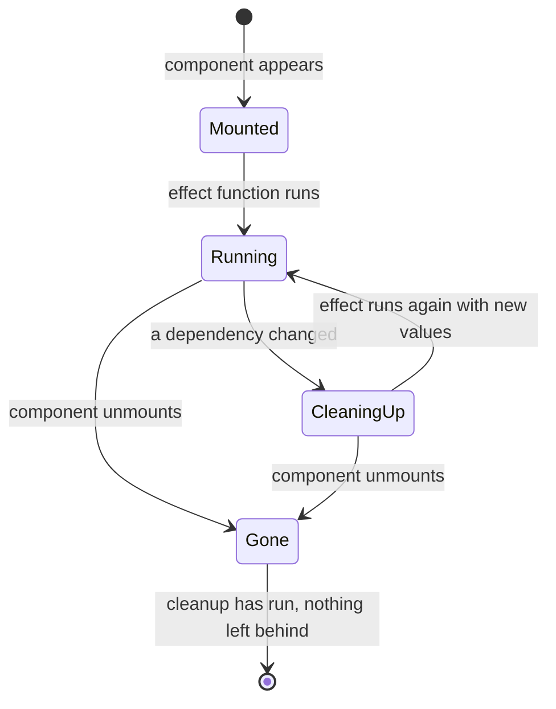

# Hooks That Matter — Part 1

A component function runs from top to bottom and then it is finished. Its local
variables are gone. Yet the same component must remember what the user typed,
hold a subscription open, and keep a timer running between renders.

Hooks are how a function does that. This part covers what a hook is, the one
rule that governs all of them, and then `useEffect` in detail — because it is
the hook people reach for when they should not, and the hook that produces the
bug you already know under another name: the stale closure.

Part 2 covers `useRef`, `useMemo`, `useCallback`, custom hooks, `useReducer`
and `useContext`.

> **📌 In one line:** a hook lets a component remember something or reach
> outside itself between renders, and `useEffect` is for synchronising with
> the world outside React — not for computing values.

## Table of Contents

1. [What a Hook Actually Is](#what-a-hook-actually-is)
2. [The Rules of Hooks, and the Reason](#the-rules-of-hooks-and-the-reason)
3. [What useEffect Is For](#what-useeffect-is-for)
4. [BROKEN vs FIXED: What useEffect Is Not For](#broken-vs-fixed-what-useeffect-is-not-for)
5. [The Dependency Array](#the-dependency-array)
6. [The Stale Closure](#the-stale-closure)
7. [Cleanup Functions and the Real Leak](#cleanup-functions-and-the-real-leak)
8. [Why Effects Run Twice in Development](#why-effects-run-twice-in-development)
9. [Common Mistakes](#common-mistakes)
10. [Questions to Test Yourself](#questions-to-test-yourself)
11. [Related](#related)

---

## What a Hook Actually Is

A hook is a function, provided by React or written by you, that a component
calls to do one of two things:

1. **Remember a value between renders** — `useState`, `useRef`, `useReducer`.
2. **Reach outside the component** — `useEffect` to touch the world,
   `useContext` to read a value from an ancestor.

Nothing more. `useState` is not a keyword. It is an imported function.

Where does the memory live, if the component's variables are thrown away? Not
in your function. React keeps a list attached to **this instance of this
component in the tree**, and each hook call takes the next slot in that list.

```text
<TaskPanel /> instance
  hook slot 0 -> useState   value: "overdue"
  hook slot 1 -> useState   value: [task objects]
  hook slot 2 -> useEffect  deps: ["p-14"], cleanup: fn
  hook slot 3 -> useRef     current: <input> element
```

When the component renders again, React walks that list in order and gives each
`useState` call back the value stored in its slot. The hook has no name
attached. It has a **position**.

That single implementation detail explains every rule in the next section.

---

## The Rules of Hooks, and the Reason

Two rules:

1. **Only call hooks at the top level** of a component or another hook. Never
   inside `if`, `for`, `while`, `try`, or after an early `return`.
2. **Only call hooks from React functions** — a component, or a custom hook.

Rule 1 exists entirely because of the slot list. Here is the break:

```tsx
// ❌ BROKEN - the hook list changes shape between renders
function InvoicePanel({ invoiceId }: { invoiceId: string | null }) {
  if (invoiceId === null) {
    return <EmptyState />       // returns before any hook is called
  }

  const [invoice, setInvoice] = useState<Invoice | null>(null)   // slot 0 ...sometimes
  const [notes, setNotes] = useState('')                          // slot 1 ...sometimes
  // ...
}
```

Render with `invoiceId = "inv-9"`: React stores `invoice` in slot 0 and `notes`
in slot 1. The user closes the invoice, `invoiceId` becomes `null`, and this
render calls **zero** hooks. React expected two and got none.

The mirror case is worse, because it does not crash — it silently swaps values:

```tsx
// ❌ BROKEN - a conditional hook shifts every slot after it
function TaskRow({ task, isEditing }: TaskRowProps) {
  const [hovered, setHovered] = useState(false)           // slot 0
  if (isEditing) {
    const [draft, setDraft] = useState(task.title)        // slot 1 only sometimes
  }
  const [menuOpen, setMenuOpen] = useState(false)         // slot 1 or slot 2?
}
```

When `isEditing` flips, `menuOpen` moves between slot 1 and slot 2 and starts
reading the draft title. You get a string where you expected a boolean.

```tsx
// ✅ FIXED - every hook runs on every render; the condition moves inside
function TaskRow({ task, isEditing }: TaskRowProps) {
  const [hovered, setHovered] = useState(false)
  const [draft, setDraft] = useState(task.title)
  const [menuOpen, setMenuOpen] = useState(false)

  if (!isEditing) return <ReadOnlyRow task={task} onHover={setHovered} />
  // early returns are fine AFTER all hooks have been called
}
```

The errors you will actually see in the console:

| Message | What really happened |
|---|---|
| `Rendered fewer hooks than expected` | An early `return` skipped hooks that ran last time |
| `Rendered more hooks than the previous render` | A condition turned a hook on this time |
| `React has detected a change in the order of Hooks` | A hook moved slots; React prints the before/after list |
| `Invalid hook call. Hooks can only be called inside the body of a function component` | You called a hook in a plain function, a handler, or you have two copies of React |

> **💡 Tip:** install `eslint-plugin-react-hooks` and leave both its rules on.
> It catches every one of these at the moment you type them, which is far
> cheaper than reading the console message above.

---

## What useEffect Is For

`useEffect` runs code **after** React has rendered and updated the DOM. Its one
real job: keep something outside React in step with your component's state.

"Outside React" means anything React does not own:

- A subscription — a WebSocket for notifications, an event emitter.
- A browser API — a `setInterval`, `document.title`, a `ResizeObserver`.
- A non-React widget — a chart library, a map, a rich-text editor.
- A network request, with the honest warning that there is a better tool; see
  [Talking to Your API — Part 1](05-talking-to-your-api-part-1.md).

```tsx
function NotificationBell({ userId }: { userId: string }) {
  const [unread, setUnread] = useState(0)

  useEffect(() => {
    const socket = new WebSocket(`wss://api.example.com/notifications/${userId}`)
    socket.onmessage = (event) => {
      const payload: { unread: number } = JSON.parse(event.data)
      setUnread(payload.unread)
    }
    return () => socket.close()        // cleanup: run before the next effect or on unmount
  }, [userId])                         // re-subscribe only when the user changes
}
```

Read the three parts: a function that sets something up, a returned function
that tears it down, and a list of values that decide when to do it again.



---

## BROKEN vs FIXED: What useEffect Is Not For

The most common misuse by far: using an effect to compute a value from props or
state.

```tsx
// ❌ BROKEN - an effect to derive a value; extra render, and wrong for one frame
function InvoiceSummary({ invoices }: { invoices: Invoice[] }) {
  const [overdueTotal, setOverdueTotal] = useState(0)

  useEffect(() => {
    const total = invoices
      .filter((i) => i.status === 'overdue')
      .reduce((sum, i) => sum + i.amountCents, 0)
    setOverdueTotal(total)
  }, [invoices])

  return <strong>{formatMoney(overdueTotal)}</strong>
}
```

Trace what happens when `invoices` arrives. React renders with
`overdueTotal = 0`, so the user sees `$0.00`. The DOM is updated. *Then* the
effect runs, calls `setOverdueTotal`, and React renders a second time with the
right number. Two renders, and one of them showed a wrong total.

Worse, the value is now state, so it can be set by anything else, and it is
stale whenever `invoices` changes but the effect has not run yet.

```tsx
// ✅ FIXED - compute during render; always correct, one render, no state
function InvoiceSummary({ invoices }: { invoices: Invoice[] }) {
  const overdueTotal = invoices
    .filter((i) => i.status === 'overdue')
    .reduce((sum, i) => sum + i.amountCents, 0)

  return <strong>{formatMoney(overdueTotal)}</strong>
}
```

The decision rule:

| Situation | Effect? |
|---|---|
| A value computable from props or state | No — compute it during render |
| Reset state when a prop changes | No — use `key` on the component |
| Run something because the user clicked | No — do it in the event handler |
| Send an analytics event on a click | No — event handler |
| Open a socket, start a timer, observe an element | Yes |
| Set `document.title` from state | Yes |
| Hand state to a chart library that owns its own DOM | Yes |

> **📌 Remember:** an effect answers "what else in the world must change
> because this component is on screen with these values?" If the answer is
> "nothing outside React", you do not want an effect.

---

## The Dependency Array

The second argument tells React when to run the effect again. After each
render, React compares each item in the array with the same item from the
previous render, using `Object.is` — the same reference comparison from
[Objects and References](../../typescript-fundamentals/objects-and-references/objects-and-references.md).

| Dependencies | When the effect runs |
|---|---|
| omitted entirely | After every render. Rarely what you want |
| `[]` | Once, after the first render, and cleanup on unmount |
| `[userId]` | On mount, and whenever `userId` changes |
| `[filters]` where `filters` is a new object each render | Every render — the reference always differs |

That last row is the trap. An object or array literal written inside the
component body is a **new reference on every render**, so it never compares
equal, so the effect never stops running.

```tsx
// ❌ BROKEN - a new object every render means the effect runs forever
const filters = { status: 'overdue', projectId }
useEffect(() => { void loadInvoices(filters) }, [filters])

// ✅ FIXED - depend on the primitive values the effect actually uses
useEffect(() => { void loadInvoices({ status: 'overdue', projectId }) }, [projectId])
```

The rule for filling the array honestly: **every value from inside the
component that the effect reads must be listed.** Props, state, and any
function or object defined in the component body. The ESLint rule
`react-hooks/exhaustive-deps` computes this list for you.

Do not silence it. The next section is what happens when you do.

---

## The Stale Closure

This is the centrepiece of the file, and you have already studied the
mechanism. A stale closure in a `useEffect` is not a new concept — it is the
captured-binding behaviour from
[Closures](../../typescript-fundamentals/closures/closures.md), meeting a
function that outlives the render that created it.

```tsx
// ❌ BROKEN - the counter reaches 1 and freezes there, forever
function SessionTimer() {
  const [seconds, setSeconds] = useState(0)

  useEffect(() => {
    const id = setInterval(() => {
      console.log('tick, seconds is', seconds)   // always logs 0
      setSeconds(seconds + 1)                    // always sets 1
    }, 1000)
    return () => clearInterval(id)
  }, [])          // the lie: the effect reads `seconds` but does not list it

  return <span>{seconds}s</span>
}
```

Why it freezes, step by step:

1. Render 1 runs. `seconds` is a `const` bound to `0` in this render's scope.
2. The effect runs. The arrow function passed to `setInterval` **closes over
   that scope**, so its `seconds` is permanently `0`.
3. One second later the interval fires: `setSeconds(0 + 1)` → state becomes 1.
4. React renders again. A *new* `seconds` const, bound to `1`, in a *new*
   scope. But `[]` says "do not run the effect again", so the old interval
   keeps running, still holding render 1's scope.
5. Every tick forever: `setSeconds(0 + 1)` → 1. React sees 1 is already 1, and
   does nothing.

The console proves it: `tick, seconds is 0` repeated every second.

Three fixes, and knowing which to use is the real skill.

**Fix A — the updater form.** Best when you only need to *write* the value.

```tsx
// ✅ FIXED - the updater never reads the captured variable, so [] is honest
useEffect(() => {
  const id = setInterval(() => setSeconds((s) => s + 1), 1000)
  return () => clearInterval(id)
}, [])
```

The function `(s) => s + 1` receives the current value from React. It closes
over nothing from the render. The empty dependency array is now true, not a
lie.

**Fix B — a ref holding the latest value.** Best when you must *read* something
current inside a long-lived callback, but re-subscribing would be wrong.

```tsx
// ✅ FIXED - the ref box is shared across renders, so .current is always fresh
function SessionTimer({ onIdle }: { onIdle: (seconds: number) => void }) {
  const [seconds, setSeconds] = useState(0)
  const onIdleRef = useRef(onIdle)

  useEffect(() => { onIdleRef.current = onIdle })   // keep the box up to date

  useEffect(() => {
    const id = setInterval(() => {
      setSeconds((s) => {
        if (s + 1 === 300) onIdleRef.current(s + 1)  // reads the latest callback
        return s + 1
      })
    }, 1000)
    return () => clearInterval(id)
  }, [])
}
```

A ref is one mutable box that survives every render. Reading `.current` always
gives the latest value written into it, because there is only one box — not one
per render. Part 2 covers `useRef` properly.

**Fix C — tell the truth and let it re-subscribe.** Add `seconds` to the array.
The effect then tears down and recreates the interval every second. Correct,
but wasteful here. For a socket keyed by `userId` it is exactly right.

| You need to... | Use |
|---|---|
| Write state based on the previous value | Updater form, `[]` deps |
| Read the newest prop or callback inside a long-lived listener | A ref |
| Actually re-subscribe when a value changes | Honest deps |

> **⚠️ Warning:** the fix is never "add the dependency and then silence the
> lint rule with a comment". Both halves of that are the bug.

---

## Cleanup Functions and the Real Leak

The function you return from an effect runs in two situations: before the
effect runs again, and when the component is removed from the screen.

Without it, things you started keep running after the component is gone.

```tsx
// ❌ BROKEN - the socket stays open after the user navigates away
useEffect(() => {
  const socket = new WebSocket(`wss://api.example.com/notifications/${userId}`)
  socket.onmessage = (e) => setUnread(JSON.parse(e.data).unread)
}, [userId])

// ✅ FIXED - the socket is closed when the component unmounts or userId changes
useEffect(() => {
  const socket = new WebSocket(`wss://api.example.com/notifications/${userId}`)
  socket.onmessage = (e) => setUnread(JSON.parse(e.data).unread)
  return () => socket.close()
}, [userId])
```

In the broken version, a user who opens ten project pages in a session leaves
ten sockets open. Each one holds `setUnread`, which holds the component's
scope, which holds everything that scope captured. The browser cannot collect
any of it. Memory grows, the server holds ten connections per user, and
eventually `setUnread` is called on a component that no longer exists.

This is the leak mechanism described in
[Closures — Advanced](../../typescript-fundamentals/closures/advanced.md): a
long-lived reference holding a scope alive. A listener, an interval and a
subscription are all long-lived references. The cleanup function is how you cut
them.

Checklist — if your effect does any of these, it needs a cleanup:

| Started in the effect | Cleanup |
|---|---|
| `setInterval` / `setTimeout` | `clearInterval` / `clearTimeout` |
| `addEventListener` | `removeEventListener` with the same function reference |
| `new WebSocket` / `EventSource` | `.close()` |
| `new ResizeObserver` / `IntersectionObserver` | `.disconnect()` |
| `fetch` | `AbortController.abort()` — see [Talking to Your API — Part 1](05-talking-to-your-api-part-1.md) |
| A third-party widget instance | Its own `destroy()` |

---

## Why Effects Run Twice in Development

In development, with StrictMode on (the default in a new Next.js or Vite React
app), React mounts each component, runs its effects, runs the cleanups, and
runs the effects again. Your socket opens, closes and reopens. Your console log
appears twice.

This is deliberate, it only happens in development, and it is useful.

React is simulating a component being removed and re-added. An effect that
cleans up properly survives this with no visible difference. An effect that
does not clean up shows its bug immediately, on your machine, instead of three
months later as a memory graph that climbs all afternoon.

```text
development, StrictMode     production
  effect runs                 effect runs
  cleanup runs                (nothing until deps change or unmount)
  effect runs again
```

> **💡 Tip:** if double-running breaks something — two POSTs created two
> invoices — the real problem is almost never StrictMode. It is that the work
> belongs in an event handler, or that the request needs an idempotency key.
> See [Idempotency in Distributed Systems](../../system-design/reliability/idempotency.md).

---

## Common Mistakes

| Mistake | Why it is wrong | Do this instead |
|---|---|---|
| A hook inside `if` or after an early `return` | Slot positions shift between renders | Call every hook unconditionally, branch after |
| An effect that computes a value into state | Extra render, and wrong output for one frame | Compute during render |
| An effect to reset state when a prop changes | Renders stale data first | `key` on the component |
| Empty deps while reading state in the callback | Stale closure: the callback sees the first render forever | Updater form, a ref, or honest deps |
| Silencing `exhaustive-deps` with a comment | Hides the bug instead of fixing it | Restructure so the honest list is small |
| An object literal in the dependency array | New reference every render; the effect never stops | Depend on the primitive fields |
| No cleanup for a socket, timer or listener | It keeps running and holds the whole scope alive | Return a teardown function |
| Removing StrictMode because effects run twice | It was showing you a real missing cleanup | Fix the cleanup |

---

## Questions to Test Yourself

1. Where does a `useState` value actually live, and what identifies it?
2. Explain the slot list, then explain why a hook inside an `if` can make a
   boolean variable hold a string.
3. Name three things an effect is for, and three things people use it for that
   it is not for.
4. An effect sets state computed from a prop. Describe exactly what the user
   sees on the frame before the effect runs.
5. `useEffect(fn, [filters])` where `filters = { status: 'overdue' }` is
   written in the component body. What happens, and why?
6. Walk through the frozen `setInterval` counter. At which step is the value
   captured, and what is captured?
7. When is the updater form the right fix for a stale closure, and when do you
   need a ref instead?
8. A component opens a WebSocket with no cleanup. Describe the chain of
   references that keeps memory alive after the user navigates away.
9. Why does React run effects twice in development, and what class of bug does
   that expose?

---

> **➡️ Continued in [Part 2](./03-hooks-that-matter-part-2.md)** — `useRef`,
> `useMemo` and `useCallback`, writing custom hooks, `useReducer`, and
> `useContext`.

## Related

- [Hooks That Matter — Part 2](03-hooks-that-matter-part-2.md) — refs,
  memoisation, custom hooks, reducers and context.
- [Closures](../../typescript-fundamentals/closures/closures.md) — the captured
  binding behind every stale-closure bug above.
- [Closures — Advanced](../../typescript-fundamentals/closures/advanced.md) —
  how a retained closure becomes a memory leak.
- [State and Rendering — Part 2](02-state-and-rendering-part-2.md) — the
  updater form, and `key` as the right way to reset state.
- [Objects and References](../../typescript-fundamentals/objects-and-references/objects-and-references.md)
  — why an object literal in a dependency array never compares equal.
