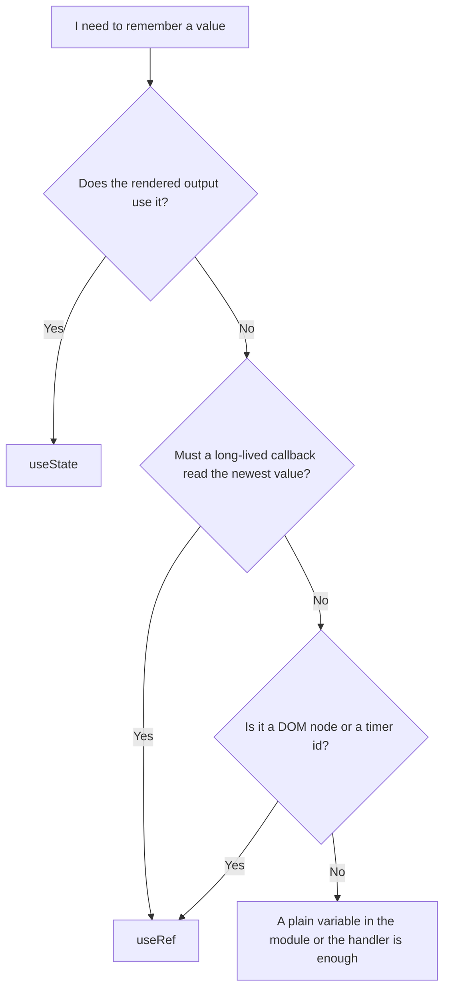
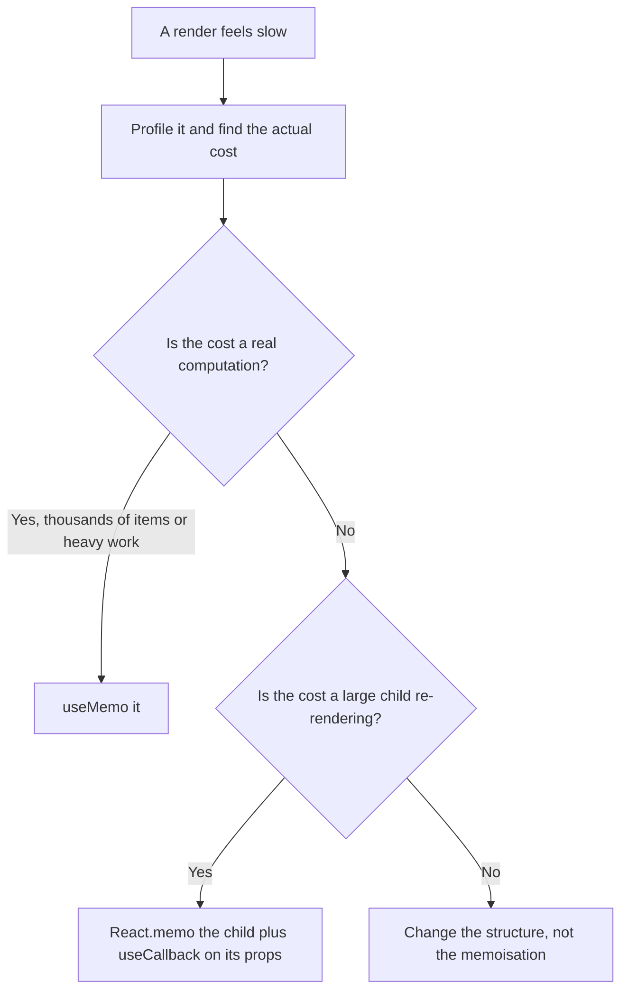

# Hooks That Matter — Part 2

Part 1 covered the rules every hook obeys, and `useEffect` in depth. This part
covers the rest of the set you will actually use at work: a box that survives
renders without causing them, two caching hooks that are easy to overuse, the
custom hooks that keep components readable, and two hooks for state that has
outgrown `useState`.

The order here is deliberate. `useRef` first, because Part 1 already used it to
fix a stale closure. Then memoisation, with an honest warning attached. Then
custom hooks, which are not a feature at all — just functions.

> **📌 In one line:** `useRef` remembers without re-rendering, `useMemo` and
> `useCallback` only buy you reference stability, and a custom hook is an
> ordinary function that happens to call other hooks.

> **⬅️ This continues [Part 1](./03-hooks-that-matter-part-1.md).**

## Table of Contents

1. [useRef, Purpose One: a Handle on a DOM Node](#useref-purpose-one-a-handle-on-a-dom-node)
2. [useRef, Purpose Two: a Box That Does Not Re-render](#useref-purpose-two-a-box-that-does-not-re-render)
3. [State or Ref?](#state-or-ref)
4. [BROKEN vs FIXED: a Timer Id in State](#broken-vs-fixed-a-timer-id-in-state)
5. [useMemo and useCallback](#usememo-and-usecallback)
6. [When Memoisation Is Worth It](#when-memoisation-is-worth-it)
7. [Custom Hooks Are Just Functions](#custom-hooks-are-just-functions)
8. [Advanced: useReducer for Interdependent Fields](#advanced-usereducer-for-interdependent-fields)
9. [Advanced: useContext for Genuinely Global Values](#advanced-usecontext-for-genuinely-global-values)
10. [Common Mistakes](#common-mistakes)
11. [Questions to Test Yourself](#questions-to-test-yourself)
12. [Related](#related)

---

## useRef, Purpose One: a Handle on a DOM Node

Normally you never touch the DOM. There is a short list of things the DOM can
do that state cannot describe: focusing an input, measuring an element,
scrolling, playing a video. For those you need the real node.

```tsx
function ProjectSearch() {
  const inputRef = useRef<HTMLInputElement>(null)

  useEffect(() => {
    inputRef.current?.focus()      // the node exists by the time effects run
  }, [])

  return <input ref={inputRef} placeholder="Search projects" />
}
```

`useRef(null)` returns an object `{ current: null }`. Passing it as `ref={...}`
tells React to put the real DOM node in `.current` after mounting, and `null`
again when the element is removed.

Two details that matter in TypeScript:

- Type the element: `useRef<HTMLInputElement>(null)`. Without it you get
  `unknown` and every use needs a cast.
- `.current` is `HTMLInputElement | null`, so use `?.` or a guard. It is `null`
  during the first render, before the DOM exists.

> **⚠️ Warning:** a ref is an escape hatch for things React does not model —
> focus, measurement, media playback. Setting `.textContent` or `.style` on a
> node React owns puts you back in the spreadsheet trap from
> [State and Rendering — Part 1](02-state-and-rendering-part-1.md): React will
> overwrite your change on the next render.

---

## useRef, Purpose Two: a Box That Does Not Re-render

The same hook, used with no DOM involved, gives you a value that survives
renders and never triggers one.

```tsx
function InvoiceAutoSave({ invoice }: { invoice: Invoice }) {
  const saveTimerRef = useRef<ReturnType<typeof setTimeout> | null>(null)
  const lastSavedRef = useRef<string>(invoice.notes)

  function handleNotesChange(notes: string) {
    if (saveTimerRef.current !== null) clearTimeout(saveTimerRef.current)
    saveTimerRef.current = setTimeout(() => {
      if (notes !== lastSavedRef.current) {
        void saveNotes(invoice.id, notes)
        lastSavedRef.current = notes
      }
    }, 800)
  }
  // ...
}
```

Neither value belongs on the screen. A timer id and "what we last saved" are
bookkeeping. Putting them in state would re-render the component for no visible
reason, and the re-render would create a new timer.

There is exactly **one box per component instance**, created on the first
render and handed back on every render after. That is why a ref fixes the stale
closure from Part 1: a callback created in render 1 and a callback created in
render 50 both read the same box, so both see whatever was written last.

> **📌 Remember:** state is "the screen depends on this". A ref is "I need to
> remember this, and the screen does not care".

---

## State or Ref?



| | `useState` | `useRef` |
|---|---|---|
| Survives re-renders | Yes | Yes |
| Changing it re-renders | Yes | No |
| Safe to read during render | Yes | No — it may differ from what was rendered |
| Safe to write during render | No | No — write it in an effect or a handler |
| Value you see in a stale closure | The one from that render | Always the newest |
| Typical use | Form field, selection, fetched data | DOM node, timer id, previous value, latest callback |

The "safe to read during render" row is the one people break. Reading
`ref.current` while rendering can give a value that the displayed output does
not reflect, because nothing re-rendered when it changed. If the output depends
on it, it was state all along.

---

## BROKEN vs FIXED: a Timer Id in State

```tsx
// ❌ BROKEN - storing the timer id in state re-renders and loses the id
function DraftAutoSave({ taskId }: { taskId: string }) {
  const [timerId, setTimerId] = useState<ReturnType<typeof setTimeout> | null>(null)
  const [draft, setDraft] = useState('')

  function handleChange(value: string) {
    setDraft(value)
    if (timerId) clearTimeout(timerId)          // reads this render's snapshot
    setTimerId(setTimeout(() => void saveDraft(taskId, value), 800))
  }
}
```

Type quickly and the handler for keystroke 2 runs with the `timerId` captured
at keystroke 1's render — which may still be `null`, because the state update
from keystroke 1 has not produced a new render yet. The old timer is never
cleared, and every keystroke fires its own save request. The debounce does
nothing.

```tsx
// ✅ FIXED - the id lives in a ref, so every handler sees the newest one
function DraftAutoSave({ taskId }: { taskId: string }) {
  const timerRef = useRef<ReturnType<typeof setTimeout> | null>(null)
  const [draft, setDraft] = useState('')

  function handleChange(value: string) {
    setDraft(value)
    if (timerRef.current) clearTimeout(timerRef.current)
    timerRef.current = setTimeout(() => void saveDraft(taskId, value), 800)
  }

  useEffect(() => () => {
    if (timerRef.current) clearTimeout(timerRef.current)   // cleanup on unmount
  }, [])
}
```

---

## useMemo and useCallback

Both hooks do the same thing — skip work when the dependencies have not
changed — for two different kinds of value.

```tsx
// useMemo: remember a computed VALUE between renders
const sortedInvoices = useMemo(
  () => [...invoices].sort((a, b) => a.dueDate.localeCompare(b.dueDate)),
  [invoices],
)

// useCallback: remember a FUNCTION between renders
const handleSelect = useCallback(
  (invoiceId: string) => setSelectedId(invoiceId),
  [],
)
```

`useCallback(fn, deps)` is exactly `useMemo(() => fn, deps)`. There is no other
difference.

What they are genuinely for is **reference stability**, not speed. A function
or object created in the component body is a new reference every render, and
that breaks three things:

1. A child wrapped in `React.memo` re-renders anyway, because its prop is a new
   function each time.
2. A `useEffect` that depends on it runs on every render.
3. A `useMemo` further down that depends on it recomputes every render.

```tsx
// ❌ BROKEN - a new onSelect every render defeats the memo on the child
const MemoRow = React.memo(InvoiceRow)
<MemoRow invoice={invoice} onSelect={(id) => setSelectedId(id)} />

// ✅ FIXED - a stable reference, so React.memo can actually skip the child
const handleSelect = useCallback((id: string) => setSelectedId(id), [])
<MemoRow invoice={invoice} onSelect={handleSelect} />
```

Note what makes the fixed version work: `React.memo` on the child *and* a
stable prop. Either one alone does nothing.

---

## When Memoisation Is Worth It

Here is the honest guidance, which most tutorials skip.

Memoisation is not free. `useMemo` stores the previous value and the previous
dependency array, compares the array on every render, and adds a line of noise
to every function it wraps. For a filter over 200 invoices, the comparison
costs more than the filter did.



Default position: **do not memoise.** Add it when you have measured a problem,
and keep the measurement in the commit message so the next person knows why the
noise is there.

Three cases where reaching for it first is reasonable:

- A genuinely expensive computation — parsing, a large sort, building a chart
  dataset from thousands of rows.
- A value used as a dependency of an effect that must not re-run, where the
  alternative is a loop.
- A stable callback passed into a context value, which every consumer depends
  on.

> **💡 Tip:** in recent React versions a compiler can insert this memoisation
> automatically. Check what your project uses before adding hundreds of
> `useCallback` calls by hand.

---

## Custom Hooks Are Just Functions

A custom hook is a function whose name starts with `use` and which calls other
hooks. There is no registration, no special type, no React API involved.

Take a component that has grown two concerns — fetching invoices, and
rendering them:

```tsx
// Before: fetching logic tangled into the component
function InvoicesPage({ companyId }: { companyId: string }) {
  const [invoices, setInvoices] = useState<Invoice[]>([])
  const [status, setStatus] = useState<'loading' | 'ready' | 'error'>('loading')

  useEffect(() => {
    const controller = new AbortController()
    setStatus('loading')
    fetch(`/api/companies/${companyId}/invoices`, { signal: controller.signal })
      .then((res) => res.json() as Promise<Invoice[]>)
      .then((data) => { setInvoices(data); setStatus('ready') })
      .catch((err: unknown) => { if (!controller.signal.aborted) setStatus('error') })
    return () => controller.abort()
  }, [companyId])

  return <InvoiceTable rows={invoices} />
}
```

Move the hooks into a function. Nothing else changes:

```tsx
interface UseInvoicesResult {
  invoices: Invoice[]
  status: 'loading' | 'ready' | 'error'
}

function useInvoices(companyId: string): UseInvoicesResult {
  const [invoices, setInvoices] = useState<Invoice[]>([])
  const [status, setStatus] = useState<'loading' | 'ready' | 'error'>('loading')

  useEffect(() => {
    /* exactly the body from above */
  }, [companyId])

  return { invoices, status }
}

function InvoicesPage({ companyId }: { companyId: string }) {
  const { invoices, status } = useInvoices(companyId)
  if (status === 'loading') return <Spinner />
  if (status === 'error') return <ErrorState />
  return <InvoiceTable rows={invoices} />
}
```

Three things to understand about this:

- **Each call gets its own state.** Two components calling `useInvoices` do not
  share anything. A custom hook shares *logic*, never *data*.
- **The rules still apply.** A custom hook must call its hooks at the top
  level, because its calls take slots in the calling component's list.
- **Return whatever shape suits the caller.** An object for three or more
  values, a tuple for two when order is obvious.

The same component looks different again once a data-fetching library is doing
this work — see
[Talking to Your API — Part 1](05-talking-to-your-api-part-1.md).

---

## Advanced: useReducer for Interdependent Fields

When several state values must change together according to rules, five
`useState` calls spread those rules across five handlers. `useReducer` puts
them in one function.

```ts
type WizardState = {
  step: 1 | 2 | 3
  project: { name: string; companyId: string | null }
  errors: Record<string, string>
  submitting: boolean
}

type WizardAction =
  | { type: 'field_changed'; field: 'name' | 'companyId'; value: string }
  | { type: 'next_step' }
  | { type: 'submit_started' }
  | { type: 'submit_failed'; errors: Record<string, string> }

function wizardReducer(state: WizardState, action: WizardAction): WizardState {
  switch (action.type) {
    case 'field_changed':
      return { ...state, project: { ...state.project, [action.field]: action.value },
               errors: { ...state.errors, [action.field]: '' } }   // typing clears the error
    case 'next_step':
      return state.step < 3 ? { ...state, step: (state.step + 1) as 1 | 2 | 3 } : state
    case 'submit_started':
      return { ...state, submitting: true, errors: {} }
    case 'submit_failed':
      return { ...state, submitting: false, errors: action.errors }
  }
}

const [state, dispatch] = useReducer(wizardReducer, initialWizardState)
```

The payoff is that every transition is in one place, the action union makes
illegal actions a compile error, and the reducer is a pure function you can
unit-test with no React at all. It is the same shape as a well-written service
method: current state plus an event in, next state out.

Use it when you have three or more values that change together, or when the
same handler has to touch several of them. For two independent values,
`useState` is clearer.

---

## Advanced: useContext for Genuinely Global Values

`useContext` lets a component read a value from an ancestor without the value
being passed through every layer between them. It is for things that are truly
ambient: the signed-in user, the theme, the locale.

```tsx
const CurrentUserContext = createContext<User | null>(null)

function useCurrentUser(): User {
  const user = useContext(CurrentUserContext)
  if (user === null) throw new Error('useCurrentUser used outside its provider')
  return user              // the guard means callers never handle null
}

<CurrentUserContext.Provider value={user}>{children}</CurrentUserContext.Provider>
```

Two warnings. Every consumer re-renders when the context value changes, so a
context holding a value that changes on every keystroke will re-render half the
app. And context is not a state manager: it only moves a value down the tree.
What produces that value is still `useState` or a data-fetching library.

---

## Common Mistakes

| Mistake | Why it is wrong | Do this instead |
|---|---|---|
| Keeping a timer id in state | Re-renders, and handlers read a stale id | Keep it in a ref |
| Reading `ref.current` during render to decide output | Nothing re-rendered when it changed | If output depends on it, use state |
| Writing `ref.current` during render | Breaks React's assumptions about pure renders | Write it in an effect or a handler |
| `useRef(null)` with no type argument | `.current` is not typed; every use needs a cast | `useRef<HTMLInputElement>(null)` |
| `useCallback` on every function "for performance" | Adds comparisons and noise with no measured gain | Memoise after profiling |
| `useCallback` without `React.memo` on the child | The child re-renders anyway | Both, or neither |
| Calling a custom hook inside a condition | It takes hook slots in the caller | Call it at the top level |
| Expecting two components to share a custom hook's state | Each call has its own state | Lift the state, or use context |
| Five `useState` calls that always change together | The rules are spread across five handlers | One `useReducer` |
| Context holding a value that changes every keystroke | Every consumer re-renders | Keep fast-changing state local |

---

## Questions to Test Yourself

1. Name the two distinct purposes of `useRef` and give a real example of each.
2. Why does a ref fix a stale closure when a state variable does not?
3. Fill in the row: "Safe to read during render" — which of state and ref, and
   why is the other one unsafe?
4. `useCallback(fn, deps)` is equivalent to which `useMemo` call?
5. You wrap a child in `React.memo` and it still re-renders every time. Give
   the most likely cause.
6. What is the real cost of adding `useMemo` to a filter over 200 rows?
7. Two components call `useInvoices('c-4')`. How many fetches happen, and how
   many copies of the state exist?
8. Give two signals that a group of `useState` calls should become a
   `useReducer`.
9. Why is context a poor place for a value that changes on every keystroke?

---

## Related

- [Hooks That Matter — Part 1](03-hooks-that-matter-part-1.md) — the rules of
  hooks, `useEffect`, stale closures and cleanup.
- [State and Rendering — Part 2](02-state-and-rendering-part-2.md) — derived
  state, which removes most reasons to memoise.
- [Talking to Your API — Part 1](05-talking-to-your-api-part-1.md) — what a
  real data-fetching hook looks like.
- [Closures](../../typescript-fundamentals/closures/closures.md) — the captured
  binding a ref works around.
- [Generics](../../typescript-fundamentals/generics/generics.md) — useful when
  a custom hook should work for more than one resource type.
