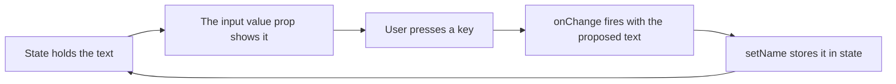
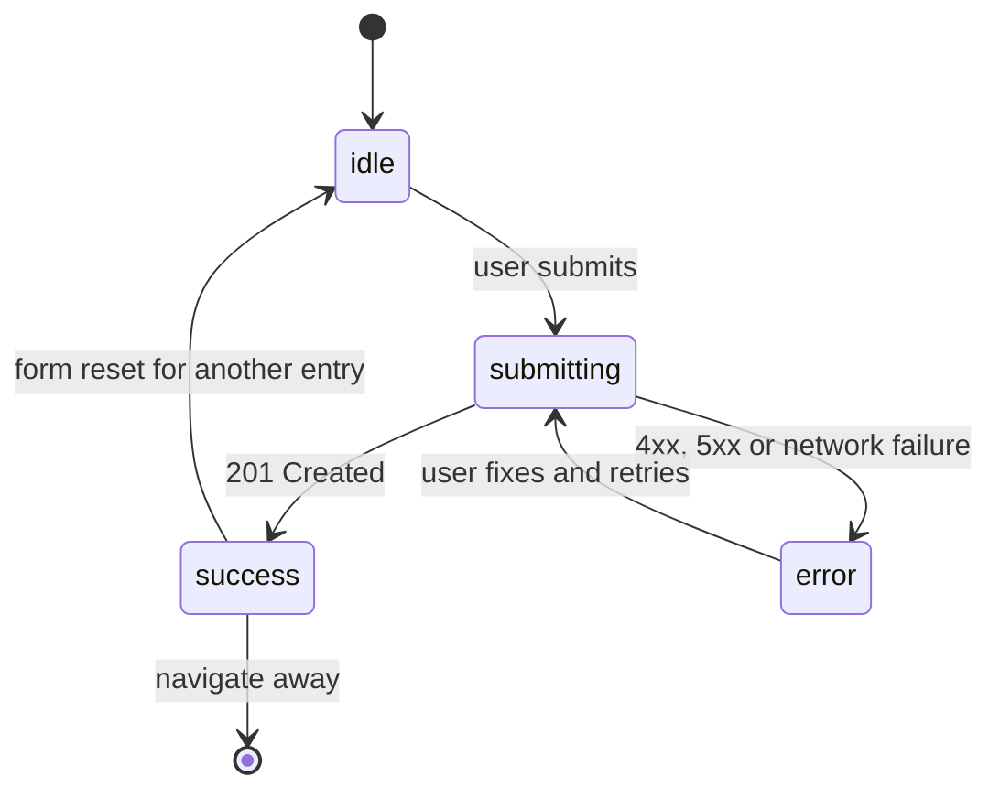

# Forms and User Input — Part 1

A form is where your frontend and your backend finally meet. The user types,
you send a request, and your validation layer answers. Most of the hard parts
are not the typing — they are everything around it: what the screen shows while
the request is in flight, what happens when the user presses the button twice,
and what you do with the errors your API sends back.

This part builds a real form from the SaaS domain — creating a project — and
gets the mechanics right: controlled inputs, typing, the submit handler, and a
proper set of submission states. Part 2 handles validation, server error
display, file uploads and optimistic updates.

> **📌 In one line:** in a controlled form the state is the truth and the input
> is only a view of it, and a submit button that is not disabled while
> submitting is a bug, not a detail.

## Table of Contents

1. [The Controlled Input Loop](#the-controlled-input-loop)
2. [Controlled or Uncontrolled](#controlled-or-uncontrolled)
3. [A Real Form: Create Project](#a-real-form-create-project)
4. [The Submit Handler](#the-submit-handler)
5. [Submission States Done Properly](#submission-states-done-properly)
6. [BROKEN vs FIXED: the Double Submit](#broken-vs-fixed-the-double-submit)
7. [Common Mistakes](#common-mistakes)
8. [Questions to Test Yourself](#questions-to-test-yourself)
9. [Related](#related)

---

## The Controlled Input Loop

A plain HTML input keeps its own text. You type, the browser stores the
characters, and your code has to go and ask for them later.

React inverts that. The value lives in **your state**, the input is told what to
display, and every keystroke asks you to update the state. The input stops
being a container and becomes a window onto a value you own.

```tsx
function ProjectNameField() {
  const [name, setName] = useState('')

  return (
    <input
      value={name}                                     // what to display
      onChange={(e) => setName(e.target.value)}        // what the user wants it to be
    />
  )
}
```



Follow the loop once. The user presses `a`. The browser does **not** put `a` in
the box by itself — React controls the box. `onChange` fires, you call
`setName('a')`, React re-renders, and the input is handed `value="a"`. The
letter appears because state said so.

This feels like a long way around until you need any of the following, all of
which are now free:

- Show the typed value somewhere else on the page at the same time.
- Force uppercase, strip spaces, or limit the length as the user types.
- Pre-fill the field from your API.
- Clear the whole form by setting one state object.
- Disable the submit button based on what is currently typed.

> **⚠️ Warning:** `value={name}` without `onChange` gives a read-only input and
> a console warning. If you want a genuinely read-only field, say so with
> `readOnly`, which is clearer to the user as well.

---

## Controlled or Uncontrolled

An **uncontrolled** input keeps its own value, exactly like plain HTML, and you
read it when you need it — usually through a ref or the form's `FormData`.

```tsx
function QuickSearch({ onSearch }: { onSearch: (term: string) => void }) {
  const inputRef = useRef<HTMLInputElement>(null)

  function handleSubmit(event: React.FormEvent<HTMLFormElement>) {
    event.preventDefault()
    onSearch(inputRef.current?.value ?? '')     // read it once, at submit time
  }

  return (
    <form onSubmit={handleSubmit}>
      <input ref={inputRef} defaultValue="" />
    </form>
  )
}
```

Note `defaultValue`, not `value`. That is the signal: `defaultValue` sets the
starting text and then leaves the input alone.

| | Controlled | Uncontrolled |
|---|---|---|
| Where the value lives | Your state | The DOM node |
| Re-render per keystroke | Yes | No |
| Live validation as the user types | Easy | Awkward |
| Reacting to the value elsewhere on screen | Easy | Not possible without extra wiring |
| Reset or pre-fill from code | Set state | Fiddly |
| File inputs | Not possible | The only option |
| Typical use | Almost every form you write | Big forms you only read at submit, file inputs, search boxes |

Default to controlled. Reach for uncontrolled when a form is large enough that
per-keystroke re-renders are measurably slow, when you are integrating a
non-React widget, and always for `<input type="file" />`, which the browser
does not let you set programmatically.

---

## A Real Form: Create Project

Build it properly, in one piece of state rather than five.

```ts
interface ProjectDraft {
  name: string
  companyId: string
  startDate: string          // "YYYY-MM-DD" from <input type="date">
  budgetCents: number
  notifyMembers: boolean
}

const emptyDraft: ProjectDraft = {
  name: '',
  companyId: '',
  startDate: '',
  budgetCents: 0,
  notifyMembers: true,
}
```

One object for the draft, because these fields are submitted together and reset
together. A single generic change handler keeps the markup short and stays
type-safe:

```tsx
const [draft, setDraft] = useState<ProjectDraft>(emptyDraft)

function setField<K extends keyof ProjectDraft>(field: K, value: ProjectDraft[K]) {
  setDraft((current) => ({ ...current, [field]: value }))
}
```

`K extends keyof ProjectDraft` ties the field name to its value type, so
`setField('budgetCents', 'abc')` is a compile error. This is the ordinary
generic-constraint pattern from
[Generics](../../typescript-fundamentals/generics/generics.md), applied to a
form.

```tsx
<form onSubmit={handleSubmit} noValidate>
  <label htmlFor="name">Project name</label>
  <input
    id="name"
    value={draft.name}
    onChange={(e) => setField('name', e.target.value)}
    aria-invalid={fieldErrors.name !== undefined}
  />

  <label htmlFor="budget">Budget</label>
  <input
    id="budget"
    type="number"
    value={draft.budgetCents / 100}
    onChange={(e) => setField('budgetCents', Math.round(Number(e.target.value) * 100))}
  />

  <label>
    <input
      type="checkbox"
      checked={draft.notifyMembers}
      onChange={(e) => setField('notifyMembers', e.target.checked)}
    />
    Notify members
  </label>
</form>
```

Three details worth copying:

- **Checkboxes use `checked`, not `value`**, and read `e.target.checked`.
- **Money stays in integer cents in state** and is only divided by 100 for
  display. Floating-point money is the same mistake on both sides of the wire.
- **`id` and `htmlFor` are paired** so clicking the label focuses the field.
  `aria-invalid` is what a screen reader uses to announce a bad field; Part 2
  fills in the error text.

---

## The Submit Handler

```tsx
async function handleSubmit(event: React.FormEvent<HTMLFormElement>) {
  event.preventDefault()           // stop the browser's full-page form POST
  if (phase === 'submitting') return

  setPhase('submitting')
  try {
    const response = await fetch('/api/projects', {
      method: 'POST',
      headers: { 'Content-Type': 'application/json' },
      body: JSON.stringify(draft),
    })
    if (!response.ok) {
      setPhase('error')
      return                       // Part 2 reads the error body here
    }
    const created: Project = await response.json()
    setPhase('success')
    onCreated(created)
  } catch (networkError: unknown) {
    setPhase('error')              // only thrown when the request never completed
  }
}
```

`event.preventDefault()` is not a formality. Without it the browser does what
HTML forms have always done: serialises the fields, sends its own request, and
navigates away — losing your React state and your `fetch` mid-flight.

Keep the form element and the `onSubmit` handler even though you are sending
the request yourself. The browser gives you Enter-to-submit, the implicit
submit button, and correct behaviour for assistive technology. A `<div>` with a
click handler gives you none of that.

> **💡 Tip:** `if (!response.ok)` is doing real work here. A `fetch` promise
> does **not** reject on a 422 or a 500 — that trap gets its own BROKEN/FIXED
> pair in [Talking to Your API — Part 1](05-talking-to-your-api-part-1.md).

---

## Submission States Done Properly

A form is a small state machine. Four states, and every one of them has a
visible consequence.



```ts
type SubmitPhase = 'idle' | 'submitting' | 'success' | 'error'
const [phase, setPhase] = useState<SubmitPhase>('idle')
```

| Phase | Button | What the user sees |
|---|---|---|
| `idle` | Enabled, "Create project" | The empty form |
| `submitting` | **Disabled**, "Creating…" | A spinner or a changed label; fields may stay editable |
| `success` | Enabled or gone | A confirmation, a redirect, or a cleared form |
| `error` | Enabled, "Try again" | A message saying what failed and what to do |

A union type rather than three booleans is deliberate. With
`isSubmitting`, `isSuccess` and `isError` you can represent
`submitting && success`, which is meaningless, and sooner or later a handler
produces it. The union makes the impossible states impossible.

> **📌 Remember:** every request has four outcomes, and a form that only draws
> two of them is not finished. The same four show up again for reads, as
> loading, success, empty and error.

---

## BROKEN vs FIXED: the Double Submit

```tsx
// ❌ BROKEN - nothing stops a second click while the first request is in flight
<button type="submit">Create project</button>
```

The user clicks "Create project". The network is slow — a phone on a train, or
your API waiting on a lock. Nothing on the screen changes, so the user clicks
again. Two POST requests leave the browser. Your API creates two projects.

Now the user is looking at a duplicate, your invoice count is wrong, and if the
endpoint also sent a notification, every member received it twice.

```tsx
// ✅ FIXED - the phase disables the button and the handler guards the entry
<button type="submit" disabled={phase === 'submitting'}>
  {phase === 'submitting' ? 'Creating…' : 'Create project'}
</button>
```

Both halves matter. The `disabled` attribute handles the mouse. The
`if (phase === 'submitting') return` guard at the top of the handler handles
the Enter key, a double-tap that fires before the re-render, and a script.

**And neither is enough on its own.** A disabled button is a hint inside one
browser tab. It does nothing about a retry after a timeout, a user who reloads
and resubmits, or a mobile network that delivers the same request twice. The
real protection is on the server: the client sends an idempotency key, and the
server returns the original result instead of creating a second project.

```ts
// Generated once per form instance, reused for every retry of the same submit
const idempotencyKeyRef = useRef(crypto.randomUUID())

await fetch('/api/projects', {
  method: 'POST',
  headers: {
    'Content-Type': 'application/json',
    'Idempotency-Key': idempotencyKeyRef.current,
  },
  body: JSON.stringify(draft),
})
```

The key lives in a ref so that it survives re-renders and stays the same across
retries of the same logical submission — exactly the behaviour described in
[Idempotency in Distributed Systems](../../system-design/reliability/idempotency.md).
Generate a new one only when the form is reset for a genuinely new project.

This is the shape of the whole relationship between the two halves of your
stack: **the frontend makes the mistake unlikely, the backend makes it
harmless.**

---

## Common Mistakes

| Mistake | Why it is wrong | Do this instead |
|---|---|---|
| `value={x}` with no `onChange` | The input is read-only and React warns | Add the handler, or use `readOnly` |
| `value={x ?? undefined}` flipping to `undefined` | The input switches from controlled to uncontrolled mid-life | Default to `''`, never `undefined` |
| Forgetting `event.preventDefault()` | The browser navigates away mid-request | Call it first in the handler |
| Using a `div` and a click handler instead of a form | No Enter key, no accessibility | Use `<form onSubmit={...}>` |
| A submit button with no disabled state | Duplicate records from double clicks | Disable on `submitting` and guard the handler |
| Relying only on the disabled button | It does nothing about retries or reloads | Send an idempotency key |
| `isLoading`, `isError`, `isSuccess` booleans | Impossible combinations become reachable | One union type |
| Money as a float in state | Rounding errors travel to your API | Integer cents, divide only to display |
| `checked={value}` read as `e.target.value` | A checkbox reports `checked`, not `value` | `e.target.checked` |

---

## Questions to Test Yourself

1. Describe the controlled-input loop in four steps, starting from a keystroke.
2. Why does the letter not appear in a controlled input until state updates?
3. Give two situations where an uncontrolled input is the right choice, and one
   where it is the only choice.
4. What exactly happens if you forget `event.preventDefault()` in a submit
   handler?
5. Why is `type SubmitPhase = 'idle' | 'submitting' | 'success' | 'error'`
   better than three booleans?
6. A user double-clicks submit on a slow network. Walk through what reaches
   your API, and name the two client-side fixes and the one server-side fix.
7. Why does the idempotency key live in a ref rather than in state, and when
   should it change?
8. Why is `setField<K extends keyof ProjectDraft>` better than
   `setField(field: string, value: unknown)`?

---

> **➡️ Continued in [Part 2](./04-forms-and-user-input-part-2.md)** —
> validation as UX, displaying the field errors your API returns, sharing a
> schema across the stack, file uploads and optimistic updates.

## Related

- [Forms and User Input — Part 2](04-forms-and-user-input-part-2.md) —
  validation, server errors, uploads, optimistic updates.
- [Talking to Your API — Part 1](05-talking-to-your-api-part-1.md) — why
  `response.ok` is required, and the four states of a request.
- [Idempotency in Distributed Systems](../../system-design/reliability/idempotency.md)
  — the server-side half of the double-submit problem.
- [State and Rendering — Part 2](02-state-and-rendering-part-2.md) — the
  updater form used in `setField`.
- [Hooks That Matter — Part 2](03-hooks-that-matter-part-2.md) — `useRef` for
  values the screen does not display.
