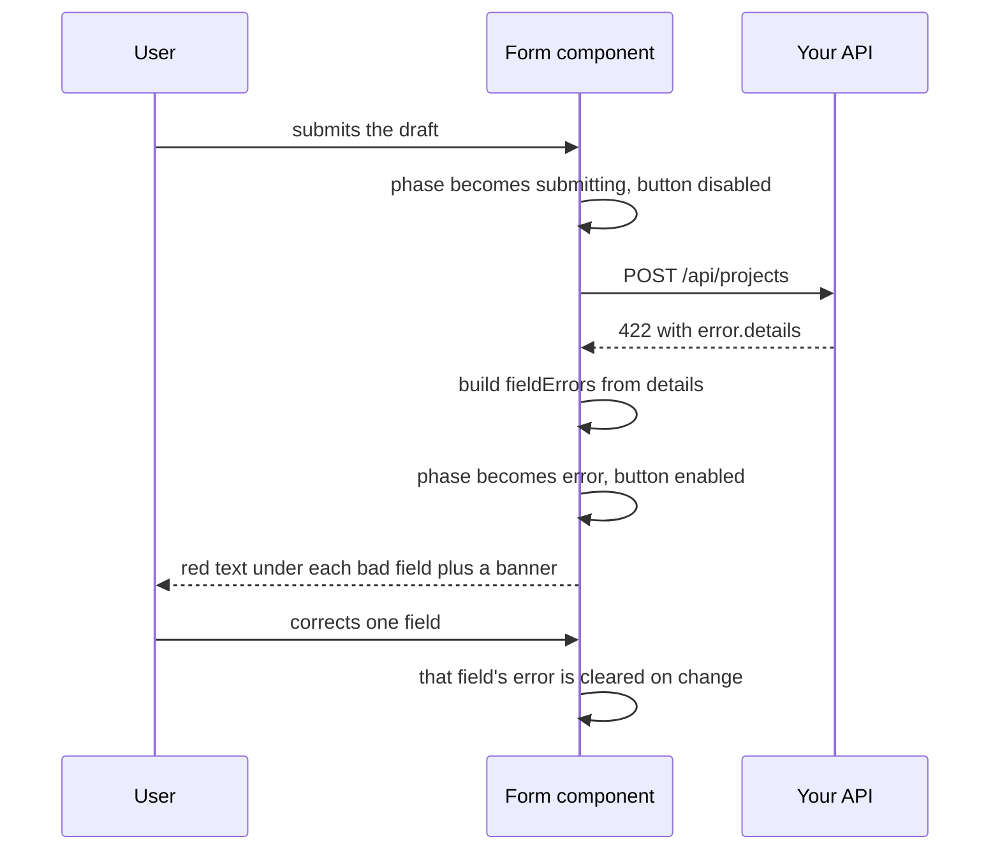
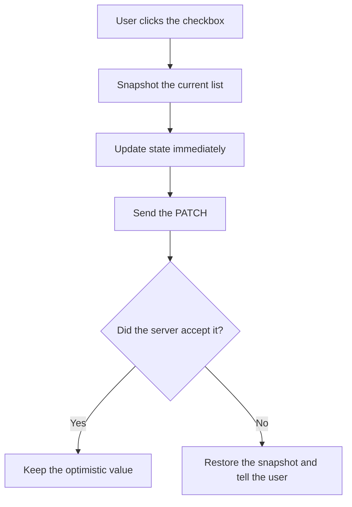

# Forms and User Input — Part 2

Part 1 built a working form: controlled fields, a typed draft, a submit handler
and four submission states. It stopped at the moment the API answers.

This part is about that answer. Your validation layer returns a precise,
structured description of what was wrong with each field — and most frontend
code throws all of it away and shows "Something went wrong". Turning that
response into red text under the right input is the part tutorials skip, and
the part that decides whether your form is usable at work.

> **📌 In one line:** the browser check is for the user's comfort and the server
> check is for your data's safety, so the form's real job is to display the
> server's answer field by field.

> **⬅️ This continues [Part 1](./04-forms-and-user-input-part-1.md).**

## Table of Contents

1. [Browser Validation Is UX, Not Security](#browser-validation-is-ux-not-security)
2. [The Error Shape Your API Already Returns](#the-error-shape-your-api-already-returns)
3. [Mapping Server Errors Onto Fields](#mapping-server-errors-onto-fields)
4. [BROKEN vs FIXED: the Toast That Throws Away the Detail](#broken-vs-fixed-the-toast-that-throws-away-the-detail)
5. [Sharing the Schema Across the Stack](#sharing-the-schema-across-the-stack)
6. [Hand-Rolled or a Form Library](#hand-rolled-or-a-form-library)
7. [Advanced: File Inputs and Upload Progress](#advanced-file-inputs-and-upload-progress)
8. [Advanced: Optimistic Updates with Rollback](#advanced-optimistic-updates-with-rollback)
9. [Common Mistakes](#common-mistakes)
10. [Questions to Test Yourself](#questions-to-test-yourself)
11. [Related](#related)

---

## Browser Validation Is UX, Not Security

You already know this from
[Why Validation Matters](../../backend-fundamentals/04-validation-and-input/01-why-validation-matters.md),
so one paragraph is enough.

The check in the browser exists to help the user: it tells them the email is
malformed before they wait for a round trip, and it keeps the submit button
honest. The check on the server exists to protect your data, because the
browser check can be removed by anyone with developer tools, and your API is
also called by cURL, by your mobile app, and by whoever found your endpoint.
Client validation is a convenience; server validation is the only validation.
Never move a rule from the server to the client — only ever duplicate it.

> **⚠️ Warning:** "the frontend already checks it" is the sentence that
> precedes a negative invoice amount in production.

---

## The Error Shape Your API Already Returns

Your backend returns one shape for every failure, defined in
[Error Response Design](../../backend-fundamentals/02-rest-api-design/05-error-response-design.md).
A `422` from the create-project endpoint looks like this:

```json
{
  "error": {
    "code": "validation_failed",
    "message": "Some fields need attention.",
    "details": [
      { "field": "name",       "code": "required",      "message": "Project name is required." },
      { "field": "startDate",  "code": "date_in_past",  "message": "Start date must be today or later." },
      { "field": "companyId",  "code": "not_a_member",  "message": "You are not a member of that company." }
    ],
    "request_id": "req_01JB70C2N4PQ"
  }
}
```

Type it once, in a file both your form and every other caller imports:

```ts
export interface ApiErrorDetail {
  field?: string          // absent for problems that belong to no single field
  code: string            // stable machine identifier, safe to branch on
  message: string         // human sentence, may change at any time
}

export interface ApiErrorBody {
  error: {
    code: string
    message: string
    details?: ApiErrorDetail[]
    request_id: string
  }
}
```

Three properties of this shape decide how the client uses it:

| Property | Consequence for the form |
|---|---|
| `details` is an **array**, not an object keyed by field | One field can carry two problems; iterate, do not index |
| `field` is **optional** | A detail with no `field` is a form-level banner, not red text under an input |
| `field` uses dotted and bracketed paths like `members[2].email` | Your lookup key must be the whole path string |
| `request_id` is always present | Show it on failure so support can find the exact log line |

---

## Mapping Server Errors Onto Fields



The mapping itself is small. Keep it in one shared function rather than in
every form:

```ts
export interface ParsedApiError {
  fieldErrors: Record<string, string>   // keyed by the exact `field` path
  formError: string | null              // details with no field, or the top message
  requestId: string | null
}

export async function parseApiError(response: Response): Promise<ParsedApiError> {
  let body: ApiErrorBody | null = null
  try {
    body = (await response.json()) as ApiErrorBody
  } catch {
    return { fieldErrors: {}, formError: 'The server response could not be read.',
             requestId: null }
  }

  const fieldErrors: Record<string, string> = {}
  const formMessages: string[] = []

  for (const detail of body.error.details ?? []) {
    if (detail.field === undefined) formMessages.push(detail.message)
    else if (fieldErrors[detail.field] === undefined) fieldErrors[detail.field] = detail.message
  }

  return {
    fieldErrors,
    formError: formMessages.join(' ') || (Object.keys(fieldErrors).length ? null : body.error.message),
    requestId: body.error.request_id ?? null,
  }
}
```

Two decisions inside it. Details **without** a `field` become the form-level
banner, because "your plan allows 3 projects" does not belong under the name
input. And the top-level `message` is used as the banner only when there is
nothing more specific to show, so the user never sees "Some fields need
attention" above three fields that already say what is wrong.

Wiring it into the handler from Part 1:

```tsx
const [fieldErrors, setFieldErrors] = useState<Record<string, string>>({})
const [formError, setFormError] = useState<string | null>(null)
const [requestId, setRequestId] = useState<string | null>(null)

if (!response.ok) {
  const parsed = await parseApiError(response)
  setFieldErrors(parsed.fieldErrors)
  setFormError(parsed.formError)
  setRequestId(parsed.requestId)
  setPhase('error')
  return
}
```

And in the markup, beside the field itself:

```tsx
<input
  id="name"
  value={draft.name}
  aria-invalid={fieldErrors.name !== undefined}
  aria-describedby={fieldErrors.name ? 'name-error' : undefined}
  onChange={(e) => {
    setField('name', e.target.value)
    setFieldErrors(({ name, ...rest }) => rest)   // clear this field's error on edit
  }}
/>
{fieldErrors.name && <p id="name-error" role="alert">{fieldErrors.name}</p>}
```

Clearing the error as the user types matters more than it looks. An error that
stays on screen after the user has fixed the field teaches people to ignore
your error messages.

---

## BROKEN vs FIXED: the Toast That Throws Away the Detail

```tsx
// ❌ BROKEN - the server said exactly what was wrong; the user is told nothing
if (!response.ok) {
  toast.error('Something went wrong')
  setPhase('error')
  return
}
```

The response carried three precise sentences and a request id. The user sees a
grey box. They retry the identical input, fail again, and open a support
ticket you cannot trace because the request id was never shown.

```tsx
// ✅ FIXED - every detail is placed where the user can act on it
if (!response.ok) {
  const { fieldErrors, formError, requestId } = await parseApiError(response)
  setFieldErrors(fieldErrors)
  setFormError(formError)
  setRequestId(requestId)
  setPhase('error')

  const firstBadField = Object.keys(fieldErrors)[0]
  if (firstBadField) document.getElementById(firstBadField)?.focus()
  return
}
```

Two extras in the fixed version. Focusing the first bad field scrolls a long
form to the problem instead of leaving the user hunting. And `requestId`, shown
in small text under the banner, is what turns "it did not work" into a log
search that takes ten seconds.

> **💡 Tip:** branch on `detail.code`, never on `detail.message`. The code is a
> stable contract; the message is wording that a product person will rewrite
> next month.

---

## Sharing the Schema Across the Stack

You wrote a schema on the server — see
[Schema Validation](../../backend-fundamentals/04-validation-and-input/02-schema-validation.md).
If your frontend and backend are in one repository, that schema can be imported
by both, and the duplication disappears.

```ts
// packages/contracts/src/project.ts — imported by the API and by the form
import { z } from 'zod'

export const createProjectSchema = z.object({
  name: z.string().min(1).max(120),
  companyId: z.string().uuid(),
  startDate: z.string().date(),
  budgetCents: z.number().int().min(0),
  notifyMembers: z.boolean(),
})

export type CreateProjectInput = z.infer<typeof createProjectSchema>
```

The server validates the request body with it. The form validates the draft
before sending, and uses the inferred type as its draft type, so a field
renamed on the server becomes a compile error in the form.

```ts
const result = createProjectSchema.safeParse(draft)
if (!result.success) {
  setFieldErrors(zodIssuesToFieldErrors(result.error))   // same Record shape
  return
}
```

Keep the mapping to the same `Record<string, string>` shape the server errors
produce, so the markup does not care which check failed.

| Setup | Share the schema? |
|---|---|
| Monorepo, same language | Yes — one package, imported by both |
| Separate repos, same language | Yes, as a published package, if release discipline exists |
| Different languages | No — generate client types from OpenAPI instead |
| Rules that need the database | Server only; the client learns about them from the error response |

That last row is important. `companyId` must be a company you belong to. The
browser cannot know that, so there is no client check to write — only an error
to display well.

---

## Hand-Rolled or a Form Library

| | Hand-rolled with `useState` | React Hook Form |
|---|---|---|
| Lines of setup | Almost none | A hook, a resolver, a `register` per field |
| Re-render per keystroke | Yes, the whole form | No, fields are uncontrolled by default |
| Validation wiring | You write it | Built in, with a Zod resolver |
| Field arrays (invoice line items) | Painful | `useFieldArray` |
| Touched, dirty, submit count | You track it | Provided |
| Server error injection | Your own `setFieldErrors` | `setError('name', { message })` |
| Worth it at | 1–3 simple fields | 4+ fields, or any field array |

Recommendation: hand-roll a two-field form, because a dependency to manage two
`useState` calls is not a trade worth making. Past four fields, or the first
time you need a repeating row, use the library. The shape of this file does not
change — you still parse the server error into field messages and hand them to
the form, just through `setError` instead of your own state.

---

## Advanced: File Inputs and Upload Progress

A file input is always uncontrolled: the browser will not let JavaScript set
its value, for obvious security reasons.

```tsx
function InvoiceAttachment({ invoiceId }: { invoiceId: string }) {
  const [file, setFile] = useState<File | null>(null)
  const [percent, setPercent] = useState(0)

  function handleChange(event: React.ChangeEvent<HTMLInputElement>) {
    const selected = event.target.files?.[0] ?? null
    if (selected && selected.size > 10 * 1024 * 1024) {
      setFormError('That file is larger than 10 MB.')   // a hint, not the real limit
      return
    }
    setFile(selected)
  }
  // ...
}
```

The size check in the browser saves the user a slow upload that was always
going to fail. The real limit is enforced by your server, along with the real
content-type check — see
[File Uploads — Part 1](../../backend-fundamentals/12-files-and-integrations/01-file-uploads-part-1.md).
A file's extension and the `type` the browser reports are both attacker-chosen.

For progress, `fetch` is the wrong tool: it reports download progress, not
upload progress. `XMLHttpRequest` still has the only upload progress event in
the platform.

```ts
const body = new FormData()
body.append('file', file)                       // no Content-Type header: the browser sets the boundary

const xhr = new XMLHttpRequest()
xhr.upload.onprogress = (e) => {
  if (e.lengthComputable) setPercent(Math.round((e.loaded / e.total) * 100))
}
xhr.onload = () => setPhase(xhr.status < 400 ? 'success' : 'error')
xhr.open('POST', `/api/invoices/${invoiceId}/attachments`)
xhr.send(body)
```

Never set `Content-Type` yourself on a `FormData` body. The browser must add
the multipart boundary, and setting the header by hand removes it and breaks
the parse on your server.

---

## Advanced: Optimistic Updates with Rollback

An optimistic update shows the result before the server has confirmed it. It
makes a checkbox feel instant on a slow connection. It is only safe when you
can undo it.

```tsx
async function toggleDone(task: Task) {
  const previous = tasks                                   // keep the old truth
  setTasks(tasks.map((t) => (t.id === task.id ? { ...t, done: !t.done } : t)))

  try {
    const response = await fetch(`/api/tasks/${task.id}`, {
      method: 'PATCH',
      headers: { 'Content-Type': 'application/json' },
      body: JSON.stringify({ done: !task.done }),
    })
    if (!response.ok) throw new Error('rejected')
  } catch {
    setTasks(previous)                                     // roll back
    setFormError('That change could not be saved. Please try again.')
  }
}
```



Three rules before you use this:

- **Only for changes that almost always succeed.** Toggling a checkbox, yes.
  Charging a card, no.
- **Always snapshot and always roll back.** An optimistic update without a
  rollback path is a lie the user will believe.
- **Say something when you roll back.** A value that silently flips back looks
  like a broken screen, not a failed request.

---

## Common Mistakes

| Mistake | Why it is wrong | Do this instead |
|---|---|---|
| Treating the browser check as the real check | It can be removed by anyone | Validate on the server, always |
| Showing a generic toast for a `422` | Discards three precise messages | Map `details` onto the fields |
| Branching on `detail.message` | Wording changes without warning | Branch on `detail.code` |
| Indexing `details` as an object by field | It is an array and can repeat a field | Iterate it |
| Dropping details with no `field` | Plan-limit and permission errors vanish | Render them as a form-level banner |
| Never showing `request_id` | Support cannot find the log line | Show it in the error banner |
| Leaving an error under a field the user fixed | Trains users to ignore errors | Clear it on change |
| Setting `Content-Type` on a `FormData` body | Removes the multipart boundary | Let the browser set it |
| `fetch` for upload progress | It has no upload progress event | `XMLHttpRequest` |
| An optimistic update with no snapshot | Nothing to restore when the call fails | Capture the previous state first |

---

## Questions to Test Yourself

1. In one sentence each: what is browser validation for, and what is server
   validation for?
2. Why is `error.details` an array rather than an object keyed by field name?
   Give two cases the array handles and the object cannot.
3. A detail arrives with no `field`. Where does it belong on screen, and why
   not under an input?
4. Why should the client branch on `code` rather than on `message`?
5. What does `request_id` in the error body buy you, and where must it appear?
6. Give a validation rule that *cannot* be checked in the browser, and say what
   the form does about it instead.
7. When is sharing a Zod schema between frontend and backend a good idea, and
   when is it not possible?
8. At how many fields would you reach for a form library, and what exactly does
   it give you?
9. Why must you not set `Content-Type` when sending `FormData`?
10. Name the three rules for a safe optimistic update.

---

## Related

- [Forms and User Input — Part 1](04-forms-and-user-input-part-1.md) —
  controlled inputs, the submit handler and submission states.
- [Error Response Design](../../backend-fundamentals/02-rest-api-design/05-error-response-design.md)
  — the exact error body this file consumes.
- [Why Validation Matters](../../backend-fundamentals/04-validation-and-input/01-why-validation-matters.md)
  — why the client check is never the real check.
- [Schema Validation](../../backend-fundamentals/04-validation-and-input/02-schema-validation.md)
  — the schema that both sides can share.
- [File Uploads — Part 1](../../backend-fundamentals/12-files-and-integrations/01-file-uploads-part-1.md)
  — what the server does with the file this form sends.
- [Talking to Your API — Part 2](05-talking-to-your-api-part-2.md) — sending
  data and refreshing the screen afterwards.
