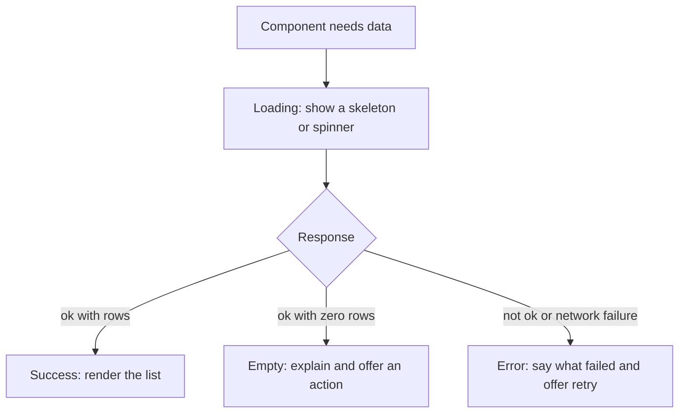
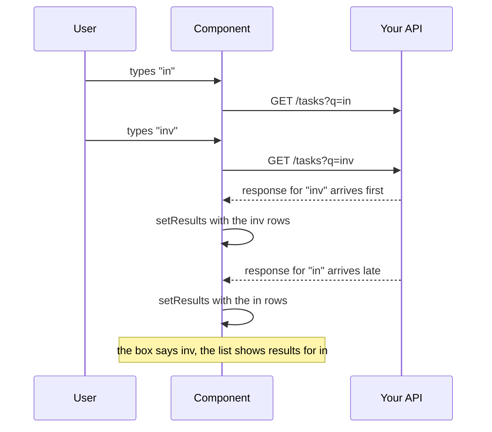

# Talking to Your API — Part 1

You have built the server side of this conversation already. You know the
methods, the status codes, the headers and the error bodies, because you chose
them. This file is the other end of the same wire.

That gives you an advantage and one blind spot. The advantage is that nothing
about the protocol is new. The blind spot is that `fetch` behaves differently
from the HTTP client you use in Node, in one specific way that catches every
backend developer exactly once.

This part covers reading data: typing a response, the states every request has,
and why the obvious `useEffect` plus `fetch` pattern is the wrong default. Part
2 covers sending data, CORS, credentials and environment variables.

> **📌 In one line:** `fetch` only rejects when the request never completed, so
> a 404 is a successful promise with `ok: false` — and every request has four
> outcomes to draw, not two.

## Table of Contents

1. [The Other End of What You Built](#the-other-end-of-what-you-built)
2. [fetch From a Component, Typed](#fetch-from-a-component-typed)
3. [BROKEN vs FIXED: a 404 Does Not Reject](#broken-vs-fixed-a-404-does-not-reject)
4. [The Four States of Every Request](#the-four-states-of-every-request)
5. [Why useEffect Plus fetch Is the Wrong Default](#why-useeffect-plus-fetch-is-the-wrong-default)
6. [The Race Condition, Concretely](#the-race-condition-concretely)
7. [The AbortController Fix](#the-abortcontroller-fix)
8. [The Practical Answer: a Data-Fetching Library](#the-practical-answer-a-data-fetching-library)
9. [Common Mistakes](#common-mistakes)
10. [Questions to Test Yourself](#questions-to-test-yourself)
11. [Related](#related)

---

## The Other End of What You Built

When your component calls `GET /api/projects/14/tasks`, everything you studied
in [HTTP Foundations](../../backend-fundamentals/01-http-foundations/) is in
play, unchanged:

| You already know | Where it shows up in the browser |
|---|---|
| [HTTP Methods](../../backend-fundamentals/01-http-foundations/03-http-methods.md) | `method` in the `fetch` options; `GET` is the default |
| [Status Codes](../../backend-fundamentals/01-http-foundations/04-status-codes.md) | `response.status` and `response.ok`, which is `status` in the 200s |
| [Headers](../../backend-fundamentals/01-http-foundations/05-headers.md) | `headers` going out, `response.headers` coming back |
| [Request and Response](../../backend-fundamentals/01-http-foundations/02-request-and-response.md) | Exactly the same message, now produced by the browser |

The difference is not the protocol. It is the environment. A browser adds three
things your Node client never had: a user who changes their mind mid-request, a
security layer (the same-origin policy) that your server must opt out of, and a
bundle of code that anyone can read.

Those three differences are what the rest of this file and Part 2 are about.

---

## fetch From a Component, Typed

```tsx
interface Task {
  id: string
  title: string
  done: boolean
  assigneeId: string | null
  dueDate: string | null
}

async function fetchTasks(projectId: string, signal?: AbortSignal): Promise<Task[]> {
  const response = await fetch(`/api/projects/${projectId}/tasks`, {
    headers: { Accept: 'application/json' },
    signal,
  })

  if (!response.ok) {
    throw new ApiError(response.status, await parseApiError(response))
  }

  return (await response.json()) as Task[]
}
```

Be honest about what the last line is. `response.json()` returns
`Promise<unknown>` at best, and the `as Task[]` is a promise *you* are making to
the compiler, not a check. The data came over a network from a server that may
have been deployed separately.

Three ways to handle that, in increasing order of safety:

1. **Cast, as above.** Acceptable when one team owns both sides and ships them
   together. Keep the cast in the one function that does the fetch, never
   scattered through components.
2. **Parse with the shared schema.** `taskSchema.array().parse(await
   response.json())` — the schema from
   [Schema Validation](../../backend-fundamentals/04-validation-and-input/02-schema-validation.md)
   works in the browser too, and turns a backend change into a clear error at
   the boundary instead of `undefined is not a function` three components deep.
3. **Generate the types from OpenAPI** when the two sides are separate
   services or separate teams.

> **⚠️ Warning:** never write `const data: any = await response.json()`. You
> lose every check at the exact point where the data is least trustworthy.

---

## BROKEN vs FIXED: a 404 Does Not Reject

This is the one. In Node, most HTTP clients throw on a 4xx or 5xx. `fetch` does
not.

```tsx
// ❌ BROKEN - the catch never runs for a 404, 422 or 500
async function loadTasks(projectId: string) {
  try {
    const response = await fetch(`/api/projects/${projectId}/tasks`)
    const tasks = (await response.json()) as Task[]
    setTasks(tasks)                 // on a 404 this is the ERROR BODY, not tasks
  } catch (error: unknown) {
    setPhase('error')               // only ever reached if the network failed
  }
}
```

What actually happens on a 404: the promise **resolves**. `response.ok` is
`false` and `response.status` is `404`, but nobody looked. `response.json()`
parses your error envelope, and `setTasks` is handed
`{ error: { code: 'not_found', ... } }`. The component then renders
`tasks.map(...)` over an object and crashes with a message that mentions
nothing about a 404.

```tsx
// ✅ FIXED - check response.ok; only a failed connection rejects
async function loadTasks(projectId: string) {
  try {
    const response = await fetch(`/api/projects/${projectId}/tasks`)
    if (!response.ok) {
      setPhase('error')
      setError(await parseApiError(response))   // your error shape, read properly
      return
    }
    setTasks((await response.json()) as Task[])
    setPhase('ready')
  } catch (networkError: unknown) {
    setPhase('error')                           // DNS failure, offline, CORS block
    setError({ formError: 'Could not reach the server.', fieldErrors: {}, requestId: null })
  }
}
```

The rule, stated once:

> **📌 Remember:** a `fetch` promise rejects only when **no HTTP response
> arrived at all** — the network is down, DNS failed, the request was aborted,
> or the browser blocked it before sending. Every real response, including
> `500`, is a resolved promise. The status lives in `response.ok`.

This is why every codebase ends up with one wrapper function that does the
`response.ok` check in one place. Write it on day one.

---

## The Four States of Every Request

A request has four outcomes the user can see. Internal tools are full of
screens that draw two of them.



| State | What happens if you forget it |
|---|---|
| Loading | The screen is blank or shows "0 tasks" for a second, then jumps |
| Success | — |
| **Empty** | A new user sees an empty table and assumes the app is broken |
| **Error** | A failed request looks identical to an empty result |

Empty and error are the two that get skipped, and they are the two that matter
most for a tool used inside a company. "No tasks yet. Create the first one." is
a different screen from "We could not load your tasks. Try again." Rendering
both as an empty table means your users cannot tell a working app from a broken
one.

```tsx
type Phase = 'loading' | 'ready' | 'error'

if (phase === 'loading') return <TaskListSkeleton />
if (phase === 'error')   return <ErrorState message={error.formError} onRetry={reload} />
if (tasks.length === 0)  return <EmptyState onCreate={openCreateDialog} />
return <TaskTable tasks={tasks} />
```

Note that "empty" is not a phase. It is a successful response with zero rows,
so it is derived from the data, not stored — the derived-state rule from
[State and Rendering — Part 2](02-state-and-rendering-part-2.md).

---

## Why useEffect Plus fetch Is the Wrong Default

The pattern everybody writes first:

```tsx
useEffect(() => {
  setPhase('loading')
  void loadTasks(projectId)
}, [projectId])
```

It works in a demo. In a real application it is missing five things, and you
will implement all five badly before accepting that:

| Missing | What the user experiences |
|---|---|
| Race protection | An old response overwrites a newer one |
| Caching | Every navigation back to a page refetches from scratch |
| Deduplication | Three components needing the same data send three requests |
| Retry and backoff | One blip on a train shows a permanent error screen |
| Revalidation | The tab was open for an hour and still shows stale data |

The first one is not a nicety. It is a correctness bug, and it shows the user
wrong data.

---

## The Race Condition, Concretely

A task search box. The user types `inv` quickly.



Nothing is broken on the server. Both requests were answered correctly. The
second one simply hit a warm cache and came back in 40 ms while the first hit a
cold index and took 300 ms. HTTP makes no promise that responses arrive in the
order the requests left.

The result is a list that does not match the search box, and no error anywhere.
The user retypes the last letter and it fixes itself, which is exactly why this
bug survives code review and lives in production for years.

This is the same ordering problem described in
[Promises and async/await — Advanced](../../typescript-fundamentals/async-await-promise/advanced.md):
two promises in flight, resolving in an order you do not control, both writing
to the same place.

---

## The AbortController Fix

An effect's cleanup function runs before the effect runs again. That is exactly
the hook you need: cancel the previous request when a new one starts.

```tsx
// ❌ BROKEN - no cleanup, so every in-flight request writes to state when it lands
useEffect(() => {
  setPhase('loading')
  void fetchTasks(projectId, query).then((rows) => {
    setResults(rows)
    setPhase('ready')
  })
}, [projectId, query])

// ✅ FIXED - the previous request is aborted and its result is ignored
useEffect(() => {
  const controller = new AbortController()
  setPhase('loading')

  fetchTasks(projectId, query, controller.signal)
    .then((rows) => { setResults(rows); setPhase('ready') })
    .catch((error: unknown) => {
      if (controller.signal.aborted) return      // we cancelled it on purpose
      setPhase('error')
    })

  return () => controller.abort()
}, [projectId, query])
```

Two things happen when `controller.abort()` is called. The browser cancels the
request, so the bytes are not even downloaded. And the `fetch` promise rejects
with an `AbortError`, which is why the `catch` must check
`signal.aborted` before showing an error — a cancelled request is not a failure.

> **💡 Tip:** this is the cleanup discipline from
> [Hooks That Matter — Part 1](03-hooks-that-matter-part-1.md) applied to
> network requests. A request is a subscription to a future value, and
> subscriptions need teardown.

This fixes the race. It does not fix caching, deduplication, retries or
revalidation — and you do not want to hand-write those in every component.

---

## The Practical Answer: a Data-Fetching Library

TanStack Query and SWR solve the same problem: they treat server data as a
**cache**, not as component state. You give them a key and a function; they own
everything else.

```tsx
function TaskList({ projectId }: { projectId: string }) {
  const { data, isPending, isError, error, refetch } = useQuery({
    queryKey: ['tasks', projectId],
    queryFn: ({ signal }) => fetchTasks(projectId, signal),
    staleTime: 30_000,                    // treat as fresh for 30 seconds
  })

  if (isPending) return <TaskListSkeleton />
  if (isError)   return <ErrorState message={error.message} onRetry={() => void refetch()} />
  if (data.length === 0) return <EmptyState onCreate={openCreateDialog} />
  return <TaskTable tasks={data} />
}
```

Four lines of configuration replace the whole effect, and you get:

| Feature | What it means for you |
|---|---|
| Keyed cache | Navigating back shows data instantly, then refreshes in the background |
| Deduplication | Three components with the same key produce one request |
| Race safety | A result for an old key cannot overwrite a newer one |
| Retry with backoff | A transient `503` recovers without a visible error |
| Revalidation | Refetch on window focus or reconnect, so a tab is never stale for long |
| Invalidation | After a mutation, mark keys stale and let them refetch |

Notice how familiar that list is. A key, a freshness window, revalidation,
invalidation after a write — this is the cache-aside pattern you already know
from the server side, running in the browser. The reasoning in
[Invalidation in Practice — Part 1](../../caching-and-background-jobs/01-caching-in-practice/03-invalidation-in-practice-part-1.md)
transfers directly, including the hard part: deciding what to invalidate after
a write. Part 2 picks that up.

> **📌 Remember:** server data is a cache of something that lives in your
> database. Client state is what the user is doing right now. Keeping those two
> ideas separate is the single most useful distinction in frontend data work.

---

## Common Mistakes

| Mistake | Why it is wrong | Do this instead |
|---|---|---|
| Assuming `fetch` throws on a 404 | It resolves; the error body is parsed as data | Check `response.ok` first |
| One `try/catch` with no `ok` check | The catch only ever sees network failures | Handle both paths |
| `const data: any = await response.json()` | No checking where the data is least trusted | Cast in one place, or parse with a schema |
| Drawing only loading and success | Empty looks broken, errors look empty | Draw all four states |
| Storing "is empty" in state | It is derived from the data | Compute `data.length === 0` |
| `useEffect` + `fetch` with no cleanup | An old response overwrites a newer one | `AbortController` in the cleanup |
| Treating an `AbortError` as a failure | Shows an error for a request you cancelled | Check `signal.aborted` in the catch |
| Hand-writing cache, retry and dedupe per component | Four hard problems, repeated badly | Use a data-fetching library |
| Putting fetched rows in a global store | Server data needs invalidation, not a store | Keep it in the query cache |

---

## Questions to Test Yourself

1. When does a `fetch` promise reject? Name three causes, and name three
   responses that do **not** reject.
2. On a 404 with no `ok` check, what exactly ends up in your `tasks` state, and
   where does the crash appear?
3. List the four states of a request. Which two are usually missing, and what
   does each omission look like to a user?
4. Why is "empty" not a phase in the state union?
5. Draw the timeline of the search-box race. Why does the server have no bug?
6. What two separate things does `controller.abort()` cause?
7. Why must the `catch` check `signal.aborted` before setting an error state?
8. Name four things `useEffect` plus `fetch` does not give you that a
   data-fetching library does.
9. In what sense is TanStack Query a cache rather than a state manager, and
   which server-side pattern does it resemble?

---

> **➡️ Continued in [Part 2](./05-talking-to-your-api-part-2.md)** — sending
> data and refreshing afterwards, reading your own error responses, CORS from
> the browser's side, credentials, and why nothing in a frontend bundle is
> secret.

## Related

- [Talking to Your API — Part 2](05-talking-to-your-api-part-2.md) — writes,
  CORS, credentials and environment variables.
- [Status Codes](../../backend-fundamentals/01-http-foundations/04-status-codes.md)
  — the numbers `response.ok` is really testing.
- [Promises and async/await — Advanced](../../typescript-fundamentals/async-await-promise/advanced.md)
  — out-of-order resolution, the mechanism behind the race.
- [Hooks That Matter — Part 1](03-hooks-that-matter-part-1.md) — effect cleanup,
  which is where the abort belongs.
- [Invalidation in Practice — Part 1](../../caching-and-background-jobs/01-caching-in-practice/03-invalidation-in-practice-part-1.md)
  — the cache reasoning that transfers straight to the browser.
