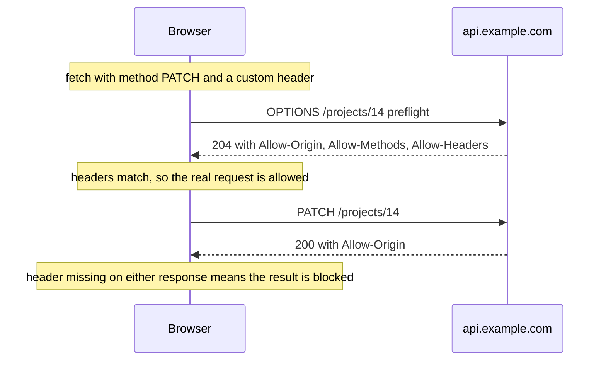

# Talking to Your API — Part 2

Part 1 covered reading. This part covers everything else the browser adds:
writing data and keeping the screen honest afterwards, reading your own error
envelope, the security layer that blocks your request before it leaves, how
credentials travel, and the one mistake in this file that is a real security
incident rather than a bug.

The theme throughout is the same as Part 1. The protocol is the one you already
built. The browser is what is new.

> **📌 In one line:** after a write you must decide what on screen is now
> wrong — and anything you put in a frontend bundle, including an environment
> variable, is readable by anyone who opens developer tools.

> **⬅️ This continues [Part 1](./05-talking-to-your-api-part-1.md).**

## Table of Contents

1. [Sending Data: POST, PATCH, DELETE](#sending-data-post-patch-delete)
2. [BROKEN vs FIXED: the Write That Left the Screen Stale](#broken-vs-fixed-the-write-that-left-the-screen-stale)
3. [Invalidation Is the Same Problem You Already Solved](#invalidation-is-the-same-problem-you-already-solved)
4. [Reading Your Own Error Responses](#reading-your-own-error-responses)
5. [CORS From the Browser's Side](#cors-from-the-browsers-side)
6. [Sending Credentials](#sending-credentials)
7. [Advanced: Environment Variables and the Public Bundle](#advanced-environment-variables-and-the-public-bundle)
8. [Common Mistakes](#common-mistakes)
9. [Questions to Test Yourself](#questions-to-test-yourself)
10. [Related](#related)

---

## Sending Data: POST, PATCH, DELETE

The call is the same shape you already know, with three options added.

```ts
async function createTask(projectId: string, input: CreateTaskInput): Promise<Task> {
  const response = await fetch(`/api/projects/${projectId}/tasks`, {
    method: 'POST',
    headers: {
      'Content-Type': 'application/json',
      Accept: 'application/json',
    },
    body: JSON.stringify(input),
  })

  if (!response.ok) throw new ApiError(response.status, await parseApiError(response))
  return (await response.json()) as Task
}
```

```ts
// PATCH: send only the fields that changed
await fetch(`/api/tasks/${taskId}`, {
  method: 'PATCH',
  headers: { 'Content-Type': 'application/json' },
  body: JSON.stringify({ done: true }),
})

// DELETE: usually no body, and usually a 204 with nothing to parse
const response = await fetch(`/api/tasks/${taskId}`, { method: 'DELETE' })
if (!response.ok) throw new ApiError(response.status, await parseApiError(response))
// do NOT call response.json() here — a 204 has no body and json() will throw
```

Four details that bite:

- **`body` must be a string** (or `FormData`, or a `Blob`). Passing an object
  sends the literal text `[object Object]`.
- **Set `Content-Type` for JSON**, and never set it for `FormData` — see
  [Forms and User Input — Part 2](04-forms-and-user-input-part-2.md).
- **A 204 has no body.** `response.json()` on it throws a parse error that
  looks like a server bug and is not.
- **`PUT` replaces, `PATCH` merges.** The semantics are the ones in
  [HTTP Methods](../../backend-fundamentals/01-http-foundations/03-http-methods.md);
  the browser does not change them.

---

## BROKEN vs FIXED: the Write That Left the Screen Stale

```tsx
// ❌ BROKEN - the server has the new task; the screen still shows the old list
async function handleCreate(input: CreateTaskInput) {
  await createTask(projectId, input)
  closeDialog()
}
```

The POST returned `201`. The database has the row. The list on screen was
fetched before the dialog opened and nothing told it to change, so the user
sees their new task missing. They reload the page, it appears, and they
conclude the app is unreliable.

Three ways to fix it, in increasing order of quality:

```tsx
// ✅ FIXED, option 1 - refetch the list after the write
async function handleCreate(input: CreateTaskInput) {
  await createTask(projectId, input)
  await reloadTasks()        // one extra round trip, always correct
  closeDialog()
}

// ✅ FIXED, option 2 - use the response body, which your API already returns
async function handleCreate(input: CreateTaskInput) {
  const created = await createTask(projectId, input)
  setTasks((current) => [...current, created])    // no extra request
  closeDialog()
}

// ✅ FIXED, option 3 - mark the cached keys stale and let the library refetch
const createMutation = useMutation({
  mutationFn: (input: CreateTaskInput) => createTask(projectId, input),
  onSuccess: () => {
    void queryClient.invalidateQueries({ queryKey: ['tasks', projectId] })
    void queryClient.invalidateQueries({ queryKey: ['project-stats', projectId] })
  },
})
```

Option 2 is why a `201` should return the created resource. Option 3 scales,
because one mutation can invalidate several keys — and a new task changes the
task list, the project's open-task count, and possibly a notification badge.

---

## Invalidation Is the Same Problem You Already Solved

Option 3 should feel familiar. You have a cache, you performed a write, and now
you must work out which cached entries the write made wrong. That is exactly
the question in
[Invalidation in Practice — Part 1](../../caching-and-background-jobs/01-caching-in-practice/03-invalidation-in-practice-part-1.md),
and the failure modes are the same on both sides of the wire.

| Server-side cache | Browser query cache |
|---|---|
| Cache key `project:14:tasks` | Query key `['tasks', '14']` |
| TTL before an entry is refreshed | `staleTime` before a refetch |
| Delete keys after a write | `invalidateQueries` after a mutation |
| Forgetting a derived key leaves stale data | Forgetting a key leaves a stale badge |
| Thundering herd on expiry | Many components refetching one key at once, which dedupe prevents |

The hard part is identical too: **listing every key a write affects.** Creating
a task changes the task list, the project's counters, the assignee's "my tasks"
view, and the activity feed. Miss one and a number on screen is quietly wrong.

> **💡 Tip:** when you add a mutation, write down every screen that displays
> anything derived from the thing you changed. That list is your invalidation
> list, and it is shorter to write now than to debug later.

---

## Reading Your Own Error Responses

Your API returns one envelope for every failure, the shape in
[Error Response Design](../../backend-fundamentals/02-rest-api-design/05-error-response-design.md).
One client-side function should understand it, and everything else should use
that function — the `parseApiError` built in
[Forms and User Input — Part 2](04-forms-and-user-input-part-2.md).

What the client does with each status is a short, fixed table:

| Status | Client behaviour |
|---|---|
| `400` / `422` | Show `details` under the matching fields; do not retry |
| `401` | The session is gone. Redirect to login, keep the current URL to return to |
| `403` | Show a clear "you do not have access" message; never a login screen |
| `404` | Show a not-found state for that record, not a generic error |
| `409` | The data changed under the user. Refetch and ask them to review |
| `429` | Read `Retry-After` and wait; do not loop immediately |
| `5xx` | Retry with backoff a small number of times, then show the error and the `request_id` |

```ts
class ApiError extends Error {
  constructor(readonly status: number, readonly parsed: ParsedApiError) {
    super(parsed.formError ?? `Request failed with status ${status}`)
    this.name = 'ApiError'
  }
  get isRetryable(): boolean {
    return this.status >= 500 || this.status === 429
  }
}
```

A typed error class means a component can ask `error.status === 404` instead of
matching on a message string. Always surface `request_id` in the error UI: it
is the one piece of data that turns a support message into a log search.

---

## CORS From the Browser's Side

You have read the server side in
[CORS](../../backend-fundamentals/11-api-security/03-cors.md), so this is only
about what the console message means.

When your page at `https://app.example.com` calls
`https://api.example.com/projects`, that is a **cross-origin** request: a
different origin, because origin means scheme plus host plus port. The browser
enforces the same-origin policy, which exists so that a malicious page cannot
read your bank's API using your cookies. Your server must explicitly say "this
origin may read my responses", and it says it with
`Access-Control-Allow-Origin`.

The message you will see is some version of:

```text
Access to fetch at 'https://api.example.com/projects' from origin
'https://app.example.com' has been blocked by CORS policy: No
'Access-Control-Allow-Origin' header is present on the requested resource.
```

Two things that message does **not** mean. It does not mean your request
failed — for a simple `GET` the request usually reached your server, which
answered normally; the browser then refused to hand the response to your
JavaScript. And it is not something you can fix in the client. There is no
`fetch` option that disables it. The only fixes are a server header, or making
the request same-origin.



The preflight is the part that surprises people. A plain `GET` or a form-style
`POST` goes straight out. But adding `Content-Type: application/json`, or an
`Authorization` header, makes the request "non-simple", and the browser first
sends an `OPTIONS` request to ask permission. If your route handles `GET` and
`POST` but not `OPTIONS`, the preflight 404s and the real request never
happens.

In development the usual answer is to avoid the problem: a dev-server proxy, or
Next.js rewrites, so the browser sees one origin. That is convenient and it
also hides misconfiguration until deployment, so test the real origins in
staging.

---

## Sending Credentials

Two mechanisms, and the choice was already made when you designed your auth —
see [Authentication](../../backend-fundamentals/05-authentication/).

**Cookies.** The browser attaches them automatically for same-origin requests.
For cross-origin requests it does not, unless you ask:

```ts
await fetch('https://api.example.com/me', {
  credentials: 'include',      // send cookies cross-origin
})
```

That option alone is not enough. The server must also return
`Access-Control-Allow-Credentials: true`, and its `Access-Control-Allow-Origin`
must name your exact origin — the wildcard `*` is rejected when credentials are
involved. The cookie itself needs `SameSite=None; Secure` to travel
cross-site at all. Three settings, and all three must agree, which is why the
cookie path in
[Cookies and Sessions — Part 1](../../backend-fundamentals/05-authentication/03-cookies-and-sessions-part-1.md)
is much simpler when the frontend and API share an origin.

**Tokens.** You attach them yourself:

```ts
await fetch('/api/projects', {
  headers: { Authorization: `Bearer ${accessToken}` },
})
```

Simple to send, harder to store. `localStorage` is readable by any JavaScript
on the page, so one cross-site scripting (XSS) flaw — in your code or in any
dependency — hands over every user's token. An `HttpOnly` cookie cannot be read
by JavaScript at all, which is why it remains the safer default for a web app
you control, with cross-site request forgery (CSRF) protection alongside it.

| | `HttpOnly` cookie | Token in `localStorage` |
|---|---|---|
| Readable by JavaScript | No | Yes |
| Exposure under XSS | Limited: the attacker can act, but cannot take the token | The token is stolen and reusable elsewhere |
| Sent automatically | Yes | No, you attach it |
| Needs CSRF protection | Yes | No |
| Cross-origin setup | Three settings must agree | One header |

The full flow — login form, API, cookie, the next request, refresh, logout — is
the subject of [Connecting the Stack](../03-connecting-the-stack/).

---

## Advanced: Environment Variables and the Public Bundle

On the server, `process.env.DATABASE_URL` is private. In a frontend build it is
not, and the distinction is the most dangerous thing in this file.

A bundler **inlines** the variables it is allowed to expose. `NEXT_PUBLIC_API_URL`
in your code becomes the literal string `"https://api.example.com"` in the
JavaScript file shipped to the browser. The prefix (`NEXT_PUBLIC_` in Next.js,
`VITE_` in Vite) is not a security boundary. It is a switch that says "copy
this into the public file".

```ts
// ❌ BROKEN - this string is now in a JS file that anyone can open and read
const stripe = new Stripe(process.env.NEXT_PUBLIC_STRIPE_SECRET_KEY!)

// ✅ FIXED - the secret stays on the server; the browser calls your endpoint
const response = await fetch('/api/billing/checkout-session', { method: 'POST' })
```

The broken line is not a style problem. It is a disclosed secret, and the fix
is key rotation plus an incident review, not a code change. Anyone can open
developer tools, search the bundle, and read it. Build logs, source maps and
your CDN's cache all hold copies.

| Safe in a public bundle | Never in a public bundle |
|---|---|
| Your API's base URL | Database connection strings |
| A publishable or client key designed to be public | Any key named secret, service, admin or private |
| Feature flags with no security meaning | JWT signing secrets, webhook signing secrets |
| Analytics site id, Sentry public DSN | SMTP credentials, cloud provider access keys |

Two rules that prevent the whole class of mistake:

1. **Anything the browser needs, the browser gets.** If a value must be used
   with a secret, the use belongs in an endpoint on your server, and the
   browser calls that endpoint.
2. **Never add a public prefix to make an error go away.** `undefined` in the
   browser means the value was correctly kept private. Adding the prefix is
   publishing it.

The handling rules, rotation and storage of secrets are in
[Secrets and Configuration — Part 1](../../backend-fundamentals/11-api-security/05-secrets-and-configuration-part-1.md).

> **⚠️ Warning:** server-rendered pages make this easy to get wrong. Code that
> reads a private variable but runs in a client component ships that variable
> into the bundle. The Next.js folder covers where each kind of code runs.

---

## Common Mistakes

| Mistake | Why it is wrong | Do this instead |
|---|---|---|
| `body: input` instead of `JSON.stringify(input)` | Sends the text `[object Object]` | Stringify it |
| `response.json()` after a `204` | There is no body; the parse throws | Check the status, or use `response.ok` alone |
| Not refreshing after a write | The screen shows data the server replaced | Refetch, use the response, or invalidate |
| Invalidating only the obvious key | Counters and badges stay stale | List every affected key |
| Showing a login screen on `403` | The user is logged in; they lack permission | Show a permission message |
| Retrying a `422` | It will fail identically forever | Retry only `5xx` and `429` |
| Trying to fix CORS in `fetch` options | The policy is enforced by the browser | Set the headers on the server |
| A route that handles `POST` but not `OPTIONS` | The preflight fails before the real request | Handle `OPTIONS` |
| `credentials: 'include'` with `Allow-Origin: *` | The browser rejects that combination | Echo the exact origin |
| A token in `localStorage` with no XSS plan | One script flaw steals every session | `HttpOnly` cookie, or accept the risk knowingly |
| Prefixing a secret to silence `undefined` | Publishes the secret to every visitor | Move the use to the server |

---

## Questions to Test Yourself

1. Why does `response.json()` throw after a successful `DELETE`?
2. A POST returns `201` and the list on screen does not change. Name the three
   fixes and say when each is right.
3. Creating a task invalidates which keys? List at least three screens
   affected.
4. Map the server-side cache vocabulary onto the browser query cache
   vocabulary, for four terms.
5. For a `401` and a `403`, what should the client do differently, and why does
   confusing them frustrate users?
6. Your console shows a CORS error. Did your request reach the server? Explain
   both possible answers.
7. What makes a request "non-simple", and what does the browser do before
   sending it?
8. `credentials: 'include'` is set and cookies still are not sent. Name the
   three server-side settings that must agree.
9. `NEXT_PUBLIC_STRIPE_SECRET_KEY` is in your code. What exactly has happened,
   and what do you do first?
10. Give the rule that decides whether a value may live in a frontend bundle.

---

## Related

- [Talking to Your API — Part 1](05-talking-to-your-api-part-1.md) — reading
  data, the four states, and the race condition.
- [CORS](../../backend-fundamentals/11-api-security/03-cors.md) — the server
  side of the error in your console.
- [Secrets and Configuration — Part 1](../../backend-fundamentals/11-api-security/05-secrets-and-configuration-part-1.md)
  — where secrets belong and how they are rotated.
- [Authentication](../../backend-fundamentals/05-authentication/) — the
  mechanism behind whichever credential you are sending.
- [Error Response Design](../../backend-fundamentals/02-rest-api-design/05-error-response-design.md)
  — the envelope `parseApiError` reads.
- [Invalidation in Practice — Part 1](../../caching-and-background-jobs/01-caching-in-practice/03-invalidation-in-practice-part-1.md)
  — the same invalidation problem, one tier down.
- [Connecting the Stack](../03-connecting-the-stack/) — the full auth flow from
  login form to the next request.
