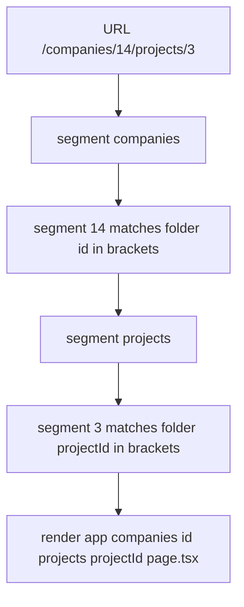

# Routing and Project Structure — Part 1

React gives you one thing: a way to turn state into a description of a screen.
It does not give you URLs. It does not give you a server. It does not tell you
how your code becomes files a browser can download. Those three gaps are the
reason frameworks exist, and Next.js fills them with conventions rather than
configuration.

The convention that matters most is this: **your folder tree is your URL
tree.** On the server you probably write routes by hand — a `routes.ts` file
that maps `GET /companies/:id` to a controller. Next.js reads the shape of your
`app/` directory instead. No route file exists, so a misplaced folder is a
misplaced URL.

This part covers the routing model from zero: folders as URL segments, the
realistic tree for our SaaS app, dynamic and catch-all segments, route groups,
and the small set of special filenames you must recognise. Part 2 covers
layouts, navigation, route-level loading and error handling, and the project
structure that survives two years of growth.

> **📌 In one line:** a folder is a URL segment and `page.tsx` is what makes
> that segment reachable — every other special file is a wrapper around it.

Everything here assumes the **App Router**, the current default model in
Next.js, where routes live under `app/`. The older **Pages Router** puts routes
under `pages/` and uses different filenames; where that difference matters for
reading an existing codebase, there is a one-line note.

## Table of Contents

1. [What a Framework Adds to React](#what-a-framework-adds-to-react)
2. [A Folder Is a URL Segment](#a-folder-is-a-url-segment)
3. [The Route Tree for Our SaaS App](#the-route-tree-for-our-saas-app)
4. [Dynamic Segments and Reading Params](#dynamic-segments-and-reading-params)
5. [Catch-All Routes](#catch-all-routes)
6. [Route Groups: Structure Without URLs](#route-groups-structure-without-urls)
7. [The Special Files Worth Knowing](#the-special-files-worth-knowing)
8. [Common Mistakes](#common-mistakes)
9. [Questions to Test Yourself](#questions-to-test-yourself)
10. [Related](#related)

---

## What a Framework Adds to React

Think about what you would need to ship a React app yourself, with no
framework. Four jobs appear immediately, and none of them is about components.

**Routing.** The browser URL changes. Something must decide which component
tree matches `/companies/14/projects/3` and render it, and must do so without
a full page reload when the user clicks a link.

**A server.** Somebody has to answer the very first HTTP request with real
HTML. If you skip this, the first response is an empty page plus a script tag,
and the user stares at white while JavaScript downloads and runs.

**A build pipeline.** Your TypeScript and JSX are not things a browser
understands. They must be compiled, split into chunks so the browser does not
download the whole app for one page, hashed for caching, and minified.

**Conventions.** Where do routes live? Where does page metadata go? How do you
declare that this page is slow and needs a loading state? Without an agreed
answer, every project invents its own, and nobody can read anybody else's.

> **💡 Tip:** you already accept exactly this trade in AdonisJS. You could wire
> a bare Node HTTP server, a router, a validator and an ORM yourself. You do
> not, because the convention is worth more than the freedom. Next.js is that
> same bargain for the browser half.

The price is also the same. A framework's conventions are invisible rules. When
something behaves strangely, the cause is usually a rule you did not know
existed, not a bug in your code. Learning the rules is the work.

---

## A Folder Is a URL Segment

Two sentences hold the entire routing model.

1. Every folder under `app/` is one segment of the URL.
2. A folder becomes a reachable page only when it contains a `page.tsx` file.

A folder with no `page.tsx` is not a 404 waiting to happen — it is simply not a
route. It can still hold a layout, shared components, or child folders that are
routes. This is why you can group files freely without accidentally creating
URLs.

```text
app/page.tsx                 ->  /
app/login/page.tsx           ->  /login
app/settings/page.tsx        ->  /settings
app/settings/billing/        ->  (no page.tsx: not a route)
app/settings/billing/page.tsx -> /settings/billing
```

The file itself is an ordinary React component with a default export.

```tsx
// app/login/page.tsx
export default function LoginPage() {
  return <h1>Sign in to Acme</h1>
}
```

> **📌 Remember:** `page.tsx` is the only file that creates a URL. Every other
> special file described later wraps, decorates or guards a `page.tsx`.

**Pages Router note:** under the older model the *file* was the route —
`pages/login.tsx` served `/login` — and there were no `layout` or `loading`
files. If you see a `pages/` folder, you are reading the old model.

---

## The Route Tree for Our SaaS App

Here is a realistic tree for the application used throughout this repository:
companies own projects, projects own tasks, and invoices belong to a company.

```text
app/
├── page.tsx                                   ->  /
├── login/
│   └── page.tsx                               ->  /login
├── companies/
│   ├── page.tsx                               ->  /companies
│   └── [id]/
│       ├── page.tsx                           ->  /companies/14
│       ├── invoices/
│       │   └── page.tsx                       ->  /companies/14/invoices
│       └── projects/
│           ├── page.tsx                       ->  /companies/14/projects
│           └── [projectId]/
│               ├── page.tsx                   ->  /companies/14/projects/3
│               └── tasks/
│                   └── page.tsx               ->  /companies/14/projects/3/tasks
└── layout.tsx                                 ->  wraps everything
```

Read one URL out loud against the tree and the rule becomes automatic.
`/companies/14/projects/3` is four segments: `companies`, then the dynamic
`[id]` matching `14`, then `projects`, then the dynamic `[projectId]` matching
`3`. The page rendered is the deepest `page.tsx` on that path.



Notice what this buys you: the shape of your product is visible in the file
tree. A new engineer can answer "where does the invoice list live?" by looking,
not by searching for a string.

---

## Dynamic Segments and Reading Params

A folder named with square brackets matches any single segment and captures it.

```text
app/companies/[id]/page.tsx        matches /companies/14, /companies/acme
app/companies/[id]/projects/[projectId]/page.tsx
```

The page component receives the captured values. In recent versions of Next.js
the `params` object arrives as a Promise and you `await` it; in earlier
versions it was a plain object. Check your version's docs, and read the shape
of existing pages in your codebase before copying this.

```tsx
// app/companies/[id]/projects/[projectId]/page.tsx

type PageProps = {
  params: Promise<{ id: string; projectId: string }>
  searchParams: Promise<Record<string, string | string[] | undefined>>
}

export default async function ProjectPage({ params, searchParams }: PageProps) {
  // Both values are always strings. The URL has no type system.
  const { id, projectId } = await params
  const { tab } = await searchParams

  return <ProjectDetail companyId={id} projectId={projectId} activeTab={tab} />
}
```

Two details catch backend developers.

**Params are always strings.** `/projects/3` gives you `"3"`, not `3`. This is
the same truth as `request.params` in AdonisJS: the URL is text. Validate and
convert at the edge, exactly as you do on the server.

**Query strings arrive separately.** `?tab=tasks&status=open` is not part of
`params`; it is `searchParams`. A value can be a string, an array when the key
repeats, or `undefined`. That union is why the type above is not simply
`Record<string, string>`.

```tsx
// ❌ BROKEN - trusting the URL to contain a number
const project = await getProject(Number(projectId))
// projectId = "abc" gives NaN, and the query matches nothing or throws

// ✅ FIXED - validate the segment, then behave like a real 404
import { notFound } from 'next/navigation'

const parsed = Number.parseInt(projectId, 10)
if (!Number.isInteger(parsed) || parsed <= 0) notFound()
const project = await getProject(parsed)
```

> **⚠️ Warning:** a dynamic segment is user input. It reaches you with exactly
> the same trust level as a request body. Everything you know about validation
> from [backend-fundamentals](../../backend-fundamentals/) applies unchanged.

---

## Catch-All Routes

Sometimes one page must serve an unknown number of segments: documentation
pages, a file browser, a nested category tree.

| Folder name | Matches | Value of the param |
|---|---|---|
| `[id]` | exactly one segment | `string` |
| `[...slug]` | one or more segments | `string[]` |
| `[[...slug]]` | zero or more segments | `string[]` or `undefined` |

```tsx
// app/docs/[...slug]/page.tsx  -> /docs/api, /docs/api/invoices/create

type DocsPageProps = { params: Promise<{ slug: string[] }> }

export default async function DocsPage({ params }: DocsPageProps) {
  const { slug } = await params
  const path = slug.join('/') // "api/invoices/create"
  return <Article path={path} />
}
```

The double-bracket form `[[...slug]]` also matches the parent URL itself
(`/docs`), which is useful when the index page and the nested pages share one
component. Use it only when they genuinely do; otherwise a separate
`app/docs/page.tsx` is clearer.

> **💡 Tip:** prefer explicit folders while you can. A catch-all route hides
> the product's structure, which is the main thing file-based routing was
> supposed to show you.

---

## Route Groups: Structure Without URLs

Now a practical problem. Your app has two kinds of pages: public marketing
pages with a simple header, and the logged-in application with a sidebar. You
want them organised separately and wrapped in different layouts, but you do not
want `/marketing/pricing` or `/app/companies` in the URL.

A folder whose name is wrapped in **round brackets** is a route group. It
organises files and can carry its own layout, but it contributes nothing to the
URL.

```text
app/
├── (marketing)/
│   ├── layout.tsx            ->  public header and footer
│   ├── page.tsx              ->  /            not /marketing
│   └── pricing/page.tsx      ->  /pricing
└── (dashboard)/
    ├── layout.tsx            ->  sidebar, company switcher
    ├── companies/page.tsx    ->  /companies   not /dashboard/companies
    └── settings/page.tsx     ->  /settings
```

This is the cleanest way to say "these routes share a shell and these others do
not" without inventing URL segments nobody asked for. It is also where you
would naturally put an authentication check that covers a whole section.

| Bracket style | Meaning | Appears in URL |
|---|---|---|
| `companies` | literal segment | yes |
| `[id]` | one dynamic segment | yes, as the matched value |
| `[...slug]` | one or more segments | yes, all of them |
| `[[...slug]]` | zero or more segments | yes, when present |
| `(dashboard)` | route group | no |
| `_internal` | private folder, not routed | no |

A folder prefixed with an underscore is excluded from routing entirely. It is
the right home for files that live near a route but are not routes themselves —
though Part 2 argues for colocation rules rather than relying on this.

> **⚠️ Warning:** two route groups must not produce the same URL. If both
> `(marketing)/page.tsx` and `(dashboard)/page.tsx` exist, both claim `/` and
> the build fails. Route groups hide the segment, not the collision.

---

## The Special Files Worth Knowing

These filenames are reserved. Dropping one into a route folder changes
behaviour with no import and no registration anywhere.

| File | What it is for | When it runs |
|---|---|---|
| `page.tsx` | The content of this URL. Required to make a route | On navigation to this exact URL |
| `layout.tsx` | A shell wrapping this segment and everything under it | Once, then kept across child navigations |
| `loading.tsx` | Fallback UI while this segment's data is pending | Immediately, while `page` awaits data |
| `error.tsx` | Catches render errors in this segment and below | When a child throws during rendering |
| `not-found.tsx` | UI for a missing resource in this segment | When `notFound()` is called, or no route matches |
| `template.tsx` | Like a layout, but remounted on every navigation | On every navigation within the segment |
| `route.ts` | An HTTP endpoint instead of a page, for this URL | On a request with a matching method |

Three of these deserve a sentence now, because they surprise people.

**`layout` versus `template`.** A layout is created once and kept. A template
is thrown away and rebuilt on every navigation. If a sidebar's scroll position
or an open accordion must survive navigation, use a layout. If an entry
animation must replay on every page, use a template.

**`error.tsx` must be a client component.** It needs state and an event handler
to offer a retry button, so it carries `'use client'`. File 02 explains why
that requirement exists.

**`route.ts` is not a page.** It exports functions named after HTTP methods and
returns a `Response`. It is a small API endpoint living inside your frontend
app, and the question of whether you want one at all is the subject of file 02.

```ts
// app/api/health/route.ts - an endpoint, not a page
export async function GET(): Promise<Response> {
  return Response.json({ status: 'ok' })
}
```

> **📌 Remember:** `page.tsx` and `route.ts` cannot both exist in one folder.
> One URL serves a page or an endpoint, never both.

---

## Common Mistakes

| Mistake | Why it is wrong | Do this instead |
|---|---|---|
| Making a folder and expecting a URL | A folder without `page.tsx` is not a route | Add `page.tsx` to the leaf folder |
| `Number(params.id)` with no check | The URL is user input and can be anything | Parse, validate, then call `notFound()` |
| Reading `?tab=` from `params` | Query strings live in `searchParams` | Destructure `searchParams` separately |
| Typing `searchParams` as `Record<string, string>` | A repeated key gives an array, a missing key gives `undefined` | Allow `string \| string[] \| undefined` |
| Adding a `marketing/` folder for grouping | It becomes a real URL segment | Use a route group `(marketing)` |
| Two route groups both defining `/` | Two files claim one URL and the build fails | Keep one owner per URL |
| Using `[...slug]` because it is flexible | It hides the product's real structure | Use explicit folders until you truly cannot |
| Putting `page.tsx` and `route.ts` together | One URL cannot be both a page and an endpoint | Give the endpoint its own path |

---

## Questions to Test Yourself

1. Name the four jobs a framework does that React alone does not, and say
   which of the four your AdonisJS app also does for you.
2. You create `app/settings/billing/` and get a 404. What single file is
   missing, and why is a missing route not an error at build time?
3. A URL is `/companies/14/projects/3/tasks`. Write the exact file path of the
   page that renders it.
4. What is the TypeScript type of `params` for
   `app/companies/[id]/projects/[projectId]/page.tsx`, and why is every value
   a `string`?
5. Why can a value in `searchParams` be an array? Give a URL that produces one.
6. Explain the difference between `[slug]`, `[...slug]` and `[[...slug]]` in
   one sentence each.
7. You want `/pricing` and `/companies` to use different shells without adding
   URL segments. Which routing feature does that, and what happens if two of
   them define the same URL?
8. A colleague says "use `template.tsx` instead of `layout.tsx`, it is the same
   thing". Give the one behavioural difference and a case where it matters.

---

> **➡️ Continued in [Part 2](./01-routing-and-project-structure-part-2.md)** —
> layouts and nesting, `<Link>` versus `<a>`, route-level loading and error
> boundaries, project structure, and middleware.

## Related

- [Routing and Project Structure — Part 2](01-routing-and-project-structure-part-2.md)
  — layouts, navigation, boundaries and folder structure.
- [Server and Client Components — Part 1](02-server-and-client-components-part-1.md)
  — which machine each of these files runs on.
- [React Fundamentals — Components and Props Part 1](../01-react-fundamentals/01-components-and-props-part-1.md)
  — every `page.tsx` is just a component with a default export.
- [backend-fundamentals/02-rest-api-design/02-resource-naming-and-urls.md](../../backend-fundamentals/02-rest-api-design/02-resource-naming-and-urls.md)
  — the URL design rules you already apply to your API apply to pages too.
