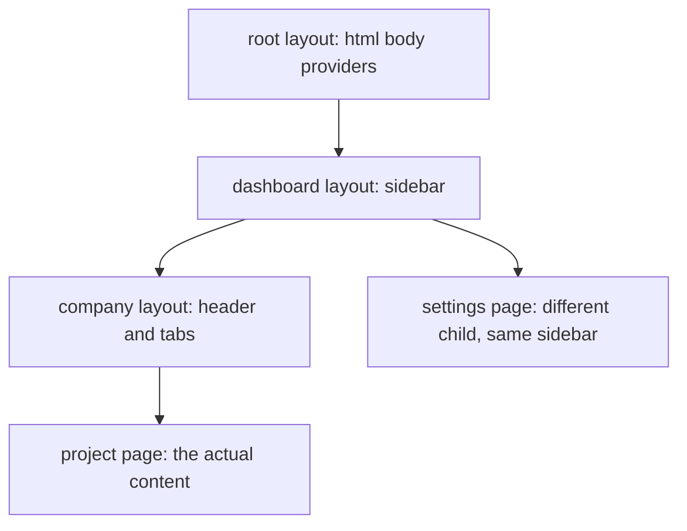

# Routing and Project Structure — Part 2

Part 1 gave you URLs. This part gives you everything wrapped around them: the
shell that stays while the content changes, the link that does not reload the
page, the two files that handle "still loading" and "it broke", and the folder
structure that stops a frontend repository turning into a pile of components
nobody can place.

The thread running through all of it is still the same question. A layout runs
somewhere. A middleware runs somewhere else, earlier. An `error.tsx` runs in
the browser. Knowing where each one sits is what lets you predict behaviour
instead of discovering it.

> **📌 In one line:** a layout is the part of the page that survives navigation,
> and `loading.tsx` plus `error.tsx` are the route-level answers to two of the
> four states every request has.

> **⬅️ This continues [Part 1](./01-routing-and-project-structure-part-1.md).**

## Table of Contents

1. [How a Layout Wraps Its Children](#how-a-layout-wraps-its-children)
2. [Why a Layout Does Not Re-render on Navigation](#why-a-layout-does-not-re-render-on-navigation)
3. [Navigation: Link Versus a](#navigation-link-versus-a)
4. [Programmatic Navigation and Prefetching](#programmatic-navigation-and-prefetching)
5. [loading and error as Route-Level Conventions](#loading-and-error-as-route-level-conventions)
6. [A Project Structure That Survives Growth](#a-project-structure-that-survives-growth)
7. [Advanced: Middleware Runs Before the Route](#advanced-middleware-runs-before-the-route)
8. [Advanced: Parallel and Intercepting Routes](#advanced-parallel-and-intercepting-routes)
9. [Common Mistakes](#common-mistakes)
10. [Questions to Test Yourself](#questions-to-test-yourself)
11. [Related](#related)

---

## How a Layout Wraps Its Children

A `layout.tsx` is a component that receives the page below it as a prop called
`children` and renders it inside something.

```tsx
// app/(dashboard)/layout.tsx
import type { ReactNode } from 'react'

export default function DashboardLayout({ children }: { children: ReactNode }) {
  return (
    <div className="dashboard">
      <Sidebar />
      <main>{children}</main>
    </div>
  )
}
```

Layouts nest. Every layout from the root down to the current page wraps the
page, outermost first. For `/companies/14/projects/3` the rendered tree is:

```text
app/layout.tsx                      <- html, body, fonts, providers
  app/(dashboard)/layout.tsx        <- sidebar, company switcher
    app/companies/[id]/layout.tsx   <- company header, tabs
      app/companies/[id]/projects/[projectId]/page.tsx
```

The root `app/layout.tsx` is special in one way: it must render the `<html>`
and `<body>` tags, because nothing above it does.



> **💡 Tip:** a layout is the right place for anything that should not flicker.
> If the sidebar disappears and reappears when you click a link, you put it in
> the page instead of the layout.

---

## Why a Layout Does Not Re-render on Navigation

This is the behaviour with real consequences, and it is easy to miss.

When you navigate from `/companies/14/projects/3` to
`/companies/14/projects/7`, Next.js works out which layouts are **shared**
between the old URL and the new one. Shared layouts are not unmounted. They are
not re-created. Their React state stays exactly as it was. Only the parts below
the shared boundary are swapped.

| Navigation | Root layout | Dashboard layout | Company layout | Page |
|---|---|---|---|---|
| `/projects/3` to `/projects/7` | kept | kept | kept | replaced |
| `/companies/14` to `/companies/21` | kept | kept | replaced | replaced |
| `/companies/14` to `/settings` | kept | kept | removed | replaced |
| Hard reload of any URL | rebuilt | rebuilt | rebuilt | rebuilt |

The practical consequence is that **state in a layout survives navigation**. A
collapsed sidebar stays collapsed. A scroll position in a long project list
stays where the user left it. An open notification panel stays open.

That is usually what you want. Sometimes it is not.

```tsx
// ❌ BROKEN - a draft comment box living in the company layout
// The user types a comment under project 3, clicks project 7,
// and their half-written text is still sitting there, now attached
// to the wrong project.
export default function CompanyLayout({ children }: { children: ReactNode }) {
  const [draft, setDraft] = useState('')
  return <div><CommentBox value={draft} onChange={setDraft} />{children}</div>
}

// ✅ FIXED - per-project state belongs in the page, which is replaced
export default function ProjectPage({ params }: PageProps) {
  const [draft, setDraft] = useState('')   // new page, new state
  return <CommentBox value={draft} onChange={setDraft} />
}
```

The rule that falls out: **put state in a layout only when it is about the
shell, not about the record being viewed.** Sidebar collapsed, theme, open
menu — shell. Draft text, selected rows, form input — record.

> **⚠️ Warning:** the same rule applies to data. A layout that fetches "the
> current company" is fine, because the company is part of the shell. A layout
> that fetches "the current project" will not refetch when the project changes
> under it, unless something forces it to.

---

## Navigation: Link Versus a

```tsx
import Link from 'next/link'

<Link href={`/companies/${company.id}/projects`}>Projects</Link>
```

A plain `<a href="...">` also works, and the user ends up on the right page.
What you lose is everything that makes it feel like an application:

| What happens | `<Link>` | `<a>` |
|---|---|---|
| Page reload | no, client-side transition | yes, full reload |
| Shared layouts | kept, with their state | destroyed and rebuilt |
| JavaScript bundle | already loaded, reused | downloaded and parsed again |
| Scroll and focus | managed by the router | reset by the browser |
| Prefetching | yes, in production | no |
| Perceived speed | near instant | a white flash |

`<Link>` renders a real `<a>` element underneath, so right-click, middle-click,
"open in new tab" and accessibility all keep working. You are not replacing the
anchor; you are intercepting the click.

Use a plain `<a>` deliberately in exactly two cases: linking to a different
site, and linking to something that is not a Next.js route, such as a file
download or your AdonisJS API served on another domain.

```tsx
// ❌ BROKEN - internal navigation that throws away the whole app
<a href={`/companies/${id}`}>Open company</a>

// ✅ FIXED - client-side transition, layouts and their state survive
<Link href={`/companies/${id}`}>Open company</Link>
```

---

## Programmatic Navigation and Prefetching

Sometimes the navigation follows an event rather than a click on a link: after
a successful login, after creating a project, after a failed permission check.

```tsx
'use client'
import { useRouter } from 'next/navigation'

export function CreateProjectButton({ companyId }: { companyId: string }) {
  const router = useRouter()

  async function handleClick(): Promise<void> {
    const project = await createProject(companyId)
    // router.replace(url) navigates without adding a history entry
    // router.back() goes back one entry
    // router.refresh() re-fetches server data for the current route
    router.push(`/companies/${companyId}/projects/${project.id}`)
  }

  return <button onClick={() => void handleClick()}>Create project</button>
}
```

Two notes. `useRouter` must be imported from `next/navigation` in the App
Router; the identically named hook from `next/router` belongs to the Pages
Router and will not work here. And `useRouter` is a hook, so the component
using it must be a client component — file 02 explains that constraint.

**Prefetching**, briefly: in production, a `<Link>` that becomes visible on
screen causes Next.js to quietly fetch what that route needs before the user
clicks. That is why navigation often feels instant. You rarely configure it;
you only need to know it exists, because it explains network requests you did
not write.

---

## loading and error as Route-Level Conventions

In [React Fundamentals](../01-react-fundamentals/05-talking-to-your-api-part-1.md)
you learned that every request has four outcomes, not two: loading, success,
empty, and error. Hand-rolling those four states in every component is the
tedious part of frontend work.

The App Router turns two of the four into files.

```text
app/companies/[id]/projects/
├── loading.tsx    <- shown while page.tsx is awaiting its data
├── error.tsx      <- shown when page.tsx or a child throws
└── page.tsx
```

```tsx
// app/companies/[id]/projects/loading.tsx
export default function Loading() {
  return <ProjectListSkeleton rows={6} />
}
```

```tsx
// app/companies/[id]/projects/error.tsx
'use client'

type ErrorProps = { error: Error & { digest?: string }; reset: () => void }

export default function ProjectsError({ error, reset }: ErrorProps) {
  // Do not render error.message: it may contain internals.
  return (
    <div role="alert">
      <p>We could not load these projects.</p>
      <button onClick={reset}>Try again</button>
    </div>
  )
}
```

| State from React Fundamentals | Where it lives now |
|---|---|
| Loading | `loading.tsx`, automatic |
| Error | `error.tsx`, automatic for render-time throws |
| Empty | still yours: zero rows is a success, not an error |
| Success | `page.tsx` |

Both files apply to their own segment and everything below it, and the nearest
one wins. A single `error.tsx` at the dashboard level is a safety net; a
specific one inside `projects/` gives a better message. Start with the net.

> **📌 Remember:** `error.tsx` catches errors thrown while rendering. It does
> not catch an error inside an event handler, and it does not catch an error
> thrown in the root layout above it. File 04 covers the gaps in detail.

---

## A Project Structure That Survives Growth

Two reasonable rules fight each other. "Keep a component next to the route that
uses it" is easy to navigate. "Put shared components in one folder" avoids
duplication. The honest answer is to use both, with a clear promotion rule.

```text
src/
├── app/                              routes only
│   ├── layout.tsx
│   └── (dashboard)/
│       └── companies/[id]/projects/
│           ├── page.tsx
│           ├── loading.tsx
│           ├── error.tsx
│           └── _components/          used by this route only
│               ├── project-row.tsx
│               └── project-filters.tsx
├── components/                       used by two or more routes
│   ├── ui/                           button, input, dialog
│   └── layout/                       sidebar, top bar
├── lib/
│   ├── api/                          one module per API resource
│   │   ├── client.ts                 base URL, headers, error envelope
│   │   ├── projects.ts               listProjects, getProject, createProject
│   │   └── invoices.ts
│   ├── auth/                         reading and forwarding the session
│   └── format/                       dates, currency, plural rules
└── types/
    └── api.ts                        Project, Task, Invoice, User, Company
```

The promotion rule is one sentence: **a component lives in `_components/` next
to its route until a second route needs it, then it moves to `components/`.**
Do not predict sharing. Wait for it.

Why `lib/api/` matters more than it looks. Every call to your AdonisJS backend
should go through one module that owns the base URL, attaches credentials,
checks `response.ok` and unwraps your error envelope. Scattering `fetch` calls
through components is the frontend version of writing SQL in a controller.

> **💡 Tip:** this is the same separation you already defend on the server. In
> [Layered Architecture](../../backend-fundamentals/09-application-architecture/01-layered-architecture.md)
> the controller handles HTTP, the service holds the rules and the repository
> talks to the database. Here `page.tsx` is the controller, `lib/api/` is the
> repository, and anything in between is your service layer. Same argument,
> same payoff: one place to change when the shape changes.

Keep `app/` for routes and route-only files. The moment you start importing
across route folders — `../../companies/_components/x` — the component has been
promoted and you have not noticed.

---

## Advanced: Middleware Runs Before the Route

A single `middleware.ts` at the project root runs for matching requests
**before** any route is resolved. It is the closest thing Next.js has to the
global middleware you write in AdonisJS, with one important restriction: it
runs in a limited runtime, close to the edge of the network, not in a full
Node.js process.

```ts
// middleware.ts
import { NextResponse, type NextRequest } from 'next/server'

export function middleware(request: NextRequest): NextResponse {
  const session = request.cookies.get('session_token')
  if (!session) {
    const login = new URL('/login', request.url)
    login.searchParams.set('next', request.nextUrl.pathname)
    return NextResponse.redirect(login)
  }
  return NextResponse.next()
}

export const config = { matcher: ['/companies/:path*', '/settings/:path*'] }
```

| Middleware can | Middleware cannot |
|---|---|
| Read cookies and headers | Open a database connection |
| Redirect or rewrite the URL | Use most Node-only libraries |
| Set a cookie or a header on the response | Render a page |
| Block a request early and cheaply | Be your only authorization check |

That last row is the one that matters. Middleware is a good place for a cheap
"is there a session cookie at all" gate. It is a bad place for "may this user
read company 14", because it has no cheap way to ask your database and it runs
on every matching request. Real authorization belongs where the data is
fetched, as
[authentication versus authorization](../../backend-fundamentals/06-authorization/01-authn-vs-authz.md)
sets out.

> **⚠️ Warning:** a redirect in middleware hides a page from the browser. It
> does not protect the data behind it. If your API trusts the frontend to have
> done the check, you have no check.

---

## Advanced: Parallel and Intercepting Routes

Two further conventions exist. You do not need them yet, but you should
recognise the folder names when you meet them in a codebase.

**Parallel routes** use folders prefixed with `@`, such as `@analytics` and
`@activity`. They let one layout render several independent route slots at
once, each with its own loading and error state — a dashboard where two panels
load separately rather than as one block.

**Intercepting routes** use `(.)`, `(..)` or `(...)` prefixes. They let a URL
render differently depending on how the user arrived: clicking an invoice in a
list opens it in a modal, while opening the same URL directly shows the full
page.

Both are genuinely useful and both add real complexity. Reach for them when a
specific product requirement demands them, not before.

---

## Common Mistakes

| Mistake | Why it is wrong | Do this instead |
|---|---|---|
| Putting the sidebar in every page | It unmounts and flickers on every navigation | Put it in a layout |
| Draft form state in a layout | Layouts survive navigation, so the draft follows the user | Keep record-specific state in the page |
| A layout fetching the current project | It will not refetch when the project changes beneath it | Fetch in the page that owns the record |
| `<a href="/companies/14">` for internal links | Full reload, layouts destroyed, bundle re-parsed | Use `<Link>` |
| `useRouter` from `next/router` | That is the Pages Router hook | Import from `next/navigation` |
| Rendering `error.message` to the user | It can leak stack traces and internals | Show a fixed message, log the detail |
| Treating an empty list as an error state | Zero rows is a successful response | Render an empty state in the page |
| Authorization in middleware only | It cannot see your database and the API stays open | Check at the data access point |
| Importing across route folders | The component is shared and in the wrong place | Promote it to `components/` |

---

## Questions to Test Yourself

1. Draw the chain of layouts that wraps `/companies/14/projects/3`. Which one
   must render `<html>` and `<body>`, and why?
2. You navigate from `/companies/14` to `/companies/21`. Which layouts keep
   their state and which are replaced? Explain the rule, not the answer.
3. Give one piece of state that belongs in a layout and one that does not, and
   state the rule that separates them.
4. List four concrete things you lose by using `<a>` instead of `<Link>` for an
   internal link.
5. Which two of the four request states does the App Router turn into files?
   Which two remain your job, and why is one of them not an error?
6. Why must `error.tsx` be a client component? Name two kinds of error it does
   not catch.
7. Where does a component live when only one route uses it, and what single
   event moves it to `components/`?
8. Middleware redirects an unauthenticated user away from `/companies`. Explain
   why this is still not an authorization control.

---

## Related

- [Routing and Project Structure — Part 1](01-routing-and-project-structure-part-1.md)
  — folders as URLs, dynamic segments and the special files.
- [Server and Client Components — Part 1](02-server-and-client-components-part-1.md)
  — why `error.tsx` and `useRouter` force a client component.
- [React Fundamentals — Talking to Your API Part 1](../01-react-fundamentals/05-talking-to-your-api-part-1.md)
  — the four request states that `loading.tsx` and `error.tsx` partly automate.
- [backend-fundamentals/09-application-architecture/01-layered-architecture.md](../../backend-fundamentals/09-application-architecture/01-layered-architecture.md)
  — the server-side version of the folder argument above.
- [backend-fundamentals/06-authorization/01-authn-vs-authz.md](../../backend-fundamentals/06-authorization/01-authn-vs-authz.md)
  — why a middleware redirect is not an authorization check.
