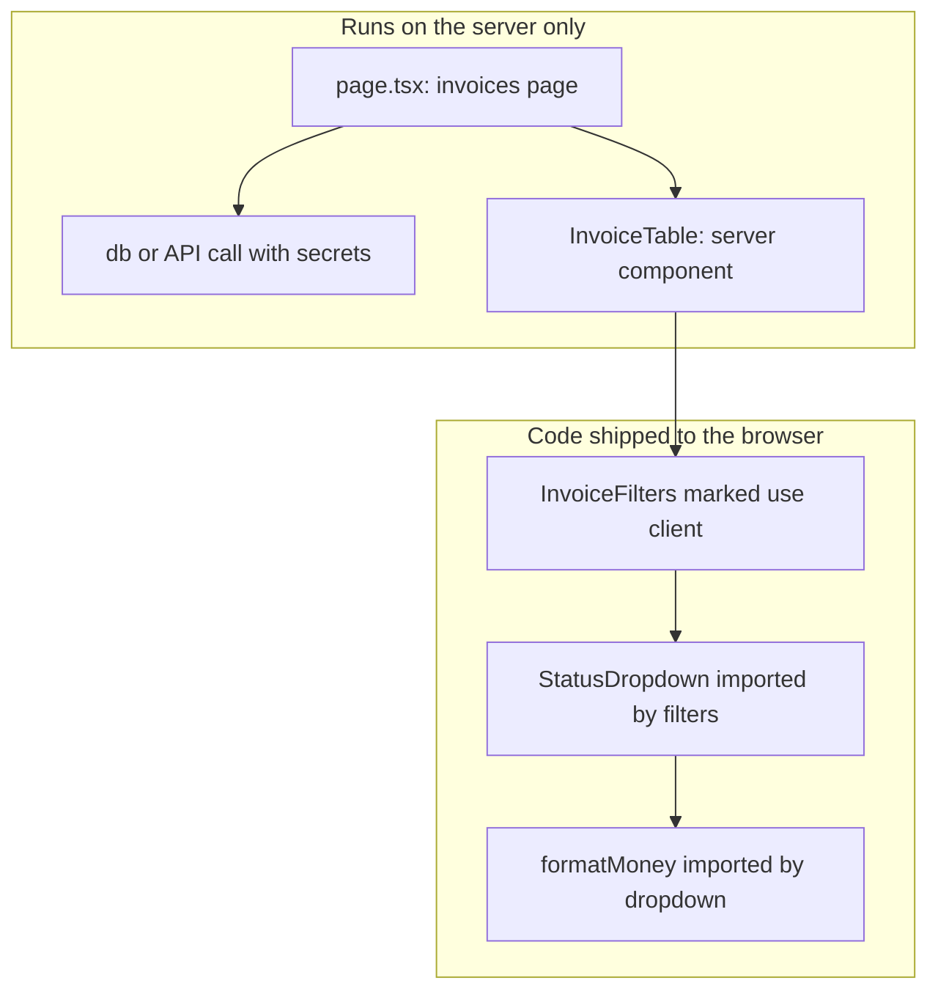
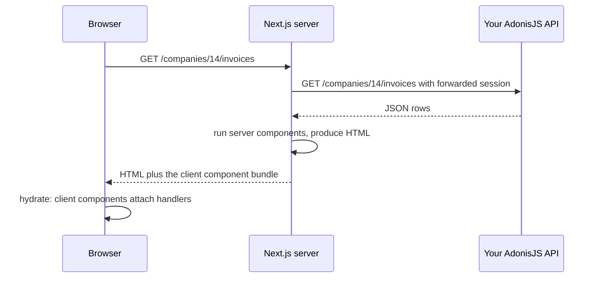

# Server and Client Components — Part 1

This is the most important file in the folder, and the reason is personal to
you. Everything you have studied so far — secrets, database connections, error
messages that must not leak, authorization checks that must not be skippable —
rests on one unspoken fact: you always knew which machine your code was running
on. Server code was server code. Browser code was browser code. They were
different projects, different repositories, often different languages.

Next.js removes that separation. Two files that look identical, sitting in the
same folder, written in the same TypeScript, can run on completely different
machines with completely different powers. One may open a database connection.
The other is downloaded by anyone who visits your site.

So the skill this file teaches is not a React skill. It is the skill you
already have, applied to a new place: **look at a file and know which machine
runs it, and therefore what it may touch and who can read it.**

Part 1 builds the mental model, the capability table, the error messages you
will actually hit, and the secret-leak risk. Part 2 covers composition
patterns, what can cross the boundary, and whether a server component should
talk to your database at all.

> **📌 In one line:** in the App Router every component runs on the server
> unless `'use client'` says otherwise — and `'use client'` means "also ship
> this code to the browser", where nothing in it is secret any more.

## Table of Contents

1. [The Only Question That Matters](#the-only-question-that-matters)
2. [Server by Default](#server-by-default)
3. [What 'use client' Actually Does](#what-use-client-actually-does)
4. [The Boundary, Drawn](#the-boundary-drawn)
5. [Capability Table](#capability-table)
6. [The Error Messages You Will Actually Hit](#the-error-messages-you-will-actually-hit)
7. [The Secret Leak](#the-secret-leak)
8. [NEXT_PUBLIC_ and What It Really Means](#next_public_-and-what-it-really-means)
9. [Common Mistakes](#common-mistakes)
10. [Questions to Test Yourself](#questions-to-test-yourself)
11. [Related](#related)

---

## The Only Question That Matters

Hold this list next to every component you read or write.

| If it runs on the server | If it runs in the browser |
|---|---|
| It can read `process.env.DATABASE_URL` | Its source code is downloadable by anyone |
| It can open a database connection | It can call `useState` and respond to clicks |
| Its code never reaches the user | It can read `window`, `localStorage`, the camera |
| It fails into a 500 you control | It fails into a blank area of somebody's screen |
| It adds to response time | It adds to download size |

Nothing in Next.js changes these facts. All it changes is how easy it is to
forget which column you are standing in.

> **💡 Tip:** when a Next.js behaviour confuses you, do not start by searching
> for the API. Start by asking which machine the code is on. The answer
> explains most of it.

---

## Server by Default

In the App Router, **a component is a server component unless something makes
it a client component.** Not a special file, not a special export — the plain
default.

```tsx
// app/companies/[id]/invoices/page.tsx
// No 'use client' line. This is a server component.

import { listInvoices } from '@/lib/api/invoices'

export default async function InvoicesPage({ params }: PageProps) {
  const { id } = await params
  const invoices = await listInvoices(id)   // awaited directly, on the server

  return (
    <ul>
      {invoices.map((invoice) => (
        <li key={invoice.id}>{invoice.number} — {invoice.total}</li>
      ))}
    </ul>
  )
}
```

Three things here are impossible in plain React, and all three come from the
same cause: this function runs on a server.

**It is `async`.** It awaits data and returns markup. There is no `useEffect`,
no loading state, no race condition, because there is no moment where the
component exists but the data does not.

**Its code is not sent to the browser.** The browser receives the resulting
HTML. The function body, the import of `listInvoices`, the URL it calls and any
credentials it used are not in the bundle.

**It can use server-only things.** Environment secrets, a database client, the
file system. The same things any AdonisJS controller can use.

> **📌 Remember:** "server component" does not mean "rendered once at build
> time". It means the component function executes on a server. File 03 covers
> *when* that execution happens — build time, per request, or somewhere in
> between.

**Pages Router note:** the older model has no server components. Everything
under `pages/` is browser code, and server work happens only in separate
exported functions such as `getServerSideProps`.

---

## What 'use client' Actually Does

`'use client'` is a string at the very top of a file, above the imports.

```tsx
'use client'

import { useState } from 'react'

export function InvoiceFilters({ onChange }: { onChange: (s: Status) => void }) {
  const [status, setStatus] = useState<Status>('all')
  // ...
}
```

Read it carefully, because the common mental model is wrong in two ways.

**It is not "render this in the browser instead of the server".** Client
components are usually still rendered on the server first, to produce the
initial HTML. The difference is that their code is *also* sent to the browser,
so it can run again there and become interactive.

**It is not a per-component switch.** It marks a **boundary**. The file it sits
in, and every component that file imports, and everything those files import,
all become part of the client bundle. One directive can pull a large subtree
across the line.

```text
'use client' in app/_components/dashboard-shell.tsx

dashboard-shell.tsx          -> client
  imports project-list.tsx   -> client
    imports task-row.tsx     -> client
      imports format-date.ts -> client
  imports charts-library     -> client, all of it
```

Nothing above it moves. A server component may *render* a client component.
That is how the boundary stays small: the directive travels down the import
tree, never up.

> **⚠️ Warning:** the directive must be the first line of the file. Put it
> after an import and it is just a string literal doing nothing, and you will
> get a confusing error somewhere else entirely.

---

## The Boundary, Drawn



The same picture as a sequence, for one page view:



Two things are worth noticing in that sequence. The call to your API happened
server to server, so its credentials never touched the browser. And the browser
received HTML it could display before any JavaScript ran.

---

## Capability Table

| Capability | Server component | Client component |
|---|---|---|
| `useState`, `useReducer` | no | yes |
| `useEffect`, `useRef` | no | yes |
| `onClick`, `onChange` and other handlers | no | yes |
| `async` component that awaits data | yes | no |
| Read `process.env.DATABASE_URL` | yes | no, and never try |
| Open a database connection | yes | no |
| Import a server-only package | yes | no |
| Read `window`, `document`, `localStorage` | no | yes, after mount |
| Use the browser's cookies automatically | no, must be forwarded | yes, the browser sends them |
| Code included in the downloaded bundle | no | yes |
| Can render the other kind | yes, can render client | only via `children` |
| Re-renders when state changes | no, it ran once | yes |

The last row is the one people underestimate. A server component does not
re-render. It produced output and finished, exactly like an HTTP handler. If
you want something on screen to change in response to a click, that part of the
screen must be a client component.

> **💡 Tip:** read the table as two job descriptions. Server components *fetch
> and shape data*. Client components *react to the user*. Most components do
> only one of those, which is why the boundary is usually obvious once you ask.

---

## The Error Messages You Will Actually Hit

Three errors account for most of the confusion. Each has one cause and one fix.

### "You're importing a component that needs useState"

```tsx
// ❌ BROKEN - a server component cannot hold state
export function TaskFilters() {
  const [status, setStatus] = useState<Status>('all')  // error
  return <select onChange={(e) => setStatus(e.target.value as Status)} />
}
```

**Cause.** Hooks need React to keep memory between renders in a browser. A
server component runs once and is gone, so there is no "between renders".

```tsx
// ✅ FIXED - mark only this interactive leaf as a client component
'use client'
import { useState } from 'react'

export function TaskFilters() {
  const [status, setStatus] = useState<Status>('all')
  return <select onChange={(e) => setStatus(e.target.value as Status)} />
}
```

Do not fix this by putting `'use client'` at the top of the page. That pulls
the data fetching and everything else across the boundary with it.

### "Functions cannot be passed directly to Client Components"

```tsx
// ❌ BROKEN - a function cannot be serialised and sent to the browser
export default async function ProjectPage() {
  const tasks = await listTasks()
  async function handleArchive(id: string) { await archiveTask(id) }

  return <TaskList tasks={tasks} onArchive={handleArchive} />  // error
}
```

**Cause.** Props crossing from server to client are serialised into the HTML
response. A function is code with a closure around it; there is no honest way
to turn it into text and rebuild it elsewhere.

```tsx
// ✅ FIXED - either the handler lives on the client side...
'use client'
export function TaskList({ tasks }: { tasks: Task[] }) {
  async function handleArchive(id: string) {
    await fetch(`/api/tasks/${id}/archive`, { method: 'POST' })
  }
  return <>{tasks.map((t) => <TaskRow key={t.id} task={t} onArchive={handleArchive} />)}</>
}
```

There is a second fix — a server action, which *is* a function that may cross
the boundary because what actually crosses is a reference to an endpoint. File
04 covers it, including why that endpoint is public and needs guarding.

### "window is not defined" / "document is not defined"

```tsx
// ❌ BROKEN - this runs on the server too, where window does not exist
'use client'
export function SidebarWidth() {
  const width = window.innerWidth   // crashes during server rendering
  return <aside style={{ width }} />
}
```

**Cause.** `'use client'` does not mean "server never runs this". Client
components are still rendered once on the server to produce initial HTML, and
that machine has no `window`.

```tsx
// ✅ FIXED - read the browser only after mounting in the browser
'use client'
import { useState, useEffect } from 'react'

export function SidebarWidth() {
  const [width, setWidth] = useState<number | null>(null)
  useEffect(() => { setWidth(window.innerWidth) }, [])
  return <aside style={width === null ? undefined : { width }} />
}
```

`useEffect` never runs on the server, which makes it the reliable place for
browser-only reads. File 03 explains why this also prevents a hydration
mismatch.

| Error message | Real cause | Fix |
|---|---|---|
| needs `useState` or `useEffect` | hook used in a server component | `'use client'` on that leaf file |
| functions cannot be passed | non-serialisable prop crossing the boundary | move the handler, or use a server action |
| `window is not defined` | browser API read during server rendering | read it inside `useEffect` |
| `'use client'` seems ignored | directive is not the first line | move it above all imports |

---

## The Secret Leak

This section matters more than the rest of the file. Read it twice.

A server component may read any environment variable, because its code never
leaves the server:

```tsx
// app/companies/[id]/page.tsx - server component
const db = createClient(process.env.DATABASE_URL)
const apiKey = process.env.ADONIS_SERVICE_TOKEN
```

Now a colleague adds a dropdown to that file and, to make the error go away,
puts `'use client'` at the top. Nothing else changes. No warning appears. The
page still works.

But the file is now client code. It is compiled into a JavaScript chunk, served
to every visitor, and sitting in their browser's network tab.

```tsx
// ❌ BROKEN - one directive turned a server file into a public file
'use client'
import { useState } from 'react'

const apiKey = process.env.ADONIS_SERVICE_TOKEN   // now in the bundle
export default function CompanyPage() {
  const [tab, setTab] = useState('overview')
  return <Dashboard apiKey={apiKey} activeTab={tab} onTab={setTab} />
}
```

```tsx
// ✅ FIXED - the page stays a server component; only the dropdown is client
import { getCompanyDashboard } from '@/lib/api/companies'   // uses the token server-side
import { DashboardTabs } from './_components/dashboard-tabs' // 'use client' lives there

export default async function CompanyPage({ params }: PageProps) {
  const { id } = await params
  const data = await getCompanyDashboard(id)   // secret used here, never shipped
  return <DashboardTabs data={data} />
}
```

> **⚠️ Warning:** anything in the client bundle is public. Minification is not
> encryption. A build hash is not a password. `process.env` lookups are
> replaced with literal strings at build time, so the value ends up written
> into the JavaScript file as plain text. Anyone can open developer tools and
> read it.

The practical defences, in order of value:

1. **Keep secrets in modules that only the server imports** — your `lib/api/`
   client, not your components. A leak then requires importing that module into
   a client file, which is a visible, reviewable change.
2. **Use the `server-only` package** at the top of such modules. Importing them
   from a client file becomes a build error instead of a silent leak.
3. **Rotate anything that has ever been in a bundle.** If a key shipped, it is
   compromised, even if you deployed a fix five minutes later.

[Secrets and Configuration](../../backend-fundamentals/11-api-security/05-secrets-and-configuration-part-1.md)
covers how to store and rotate these values properly. The rule it states —
secrets live in the environment, never in code, and never in anything a client
can fetch — is exactly the rule a stray `'use client'` breaks.

---

## NEXT_PUBLIC_ and What It Really Means

Next.js uses a naming convention to decide which environment variables may be
inlined into browser code.

| Variable | Available on the server | Available in the browser |
|---|---|---|
| `DATABASE_URL` | yes | no, becomes `undefined` |
| `ADONIS_SERVICE_TOKEN` | yes | no, becomes `undefined` |
| `NEXT_PUBLIC_API_BASE_URL` | yes | yes, inlined as a string |
| `NEXT_PUBLIC_SENTRY_DSN` | yes | yes, inlined as a string |

Read the prefix as a declaration, not a feature. `NEXT_PUBLIC_` does not make a
variable work in the browser. It means **"I accept that this value is
public."** Adding the prefix to silence an `undefined` is how secrets leak.

Three values are genuinely fine as public: your API's base URL, a client-side
error-reporting key designed to be public, and a feature flag that is not
itself sensitive. Everything else is not.

> **📌 Remember:** the test is not "does my code need it?" It is "am I happy for
> a stranger to read this value?" If the answer is no, the value must stay on
> the server, and the code that uses it must stay there too.

This is the same conclusion as
[Talking to Your API — Part 2](../01-react-fundamentals/05-talking-to-your-api-part-2.md),
reached from a new direction. There it was "a bundle holds no secrets". Here it
is "a directive can turn your server file into a bundle".

---

## Common Mistakes

| Mistake | Why it is wrong | Do this instead |
|---|---|---|
| `'use client'` at the top of a page to fix one hook | The whole page and its imports become browser code | Put the directive on the interactive leaf |
| Thinking `'use client'` means "runs only in the browser" | It is rendered on the server first too | Guard browser APIs with `useEffect` |
| Directive placed after the imports | It is then just an unused string | Make it the first line of the file |
| Passing `onSelect={fn}` from a server to a client component | Functions cannot be serialised | Define the handler inside the client component |
| Adding `NEXT_PUBLIC_` to fix `undefined` | You just published a secret | Keep the value and its code on the server |
| Assuming minified code hides a key | Minification is not encryption | Treat the bundle as public text |
| Expecting a server component to re-render on state change | It ran once and finished | Move the changing part into a client component |
| Importing the database client from a shared utils file | A client import drags it across the boundary | Mark such modules `server-only` |

---

## Questions to Test Yourself

1. A file has no `'use client'`. Which machine runs it, and name two things it
   can do that a client component cannot.
2. Explain why `'use client'` is a boundary rather than a switch, and what
   happens to the files that component imports.
3. A client component crashes with `window is not defined`. Which machine threw
   that error, and why is that machine running client code at all?
4. Why can a function not be passed as a prop from a server component to a
   client component? Answer in terms of what actually travels between them.
5. A page reads `process.env.STRIPE_SECRET_KEY` and someone adds `'use client'`
   to the top. Describe exactly what is now wrong and what you must do about
   the key itself.
6. What does `NEXT_PUBLIC_` actually mean? Give two values that deserve it and
   two that never do.
7. A server component cannot re-render. What does that imply about building a
   filter dropdown that updates a list?
8. You must stop anyone importing `lib/db.ts` into client code. What is the
   mechanism, and why is a code review comment not good enough?

---

> **➡️ Continued in [Part 2](./02-server-and-client-components-part-2.md)** —
> composition patterns, serialisation across the boundary, whether a server
> component should query your database, and measuring the client bundle.

## Related

- [Server and Client Components — Part 2](02-server-and-client-components-part-2.md)
  — keeping the boundary small and what may cross it.
- [backend-fundamentals/11-api-security/05-secrets-and-configuration-part-1.md](../../backend-fundamentals/11-api-security/05-secrets-and-configuration-part-1.md)
  — storing and rotating the values a stray directive can leak.
- [React Fundamentals — Talking to Your API Part 2](../01-react-fundamentals/05-talking-to-your-api-part-2.md)
  — the same bundle-is-public rule from the React side.
- [React Fundamentals — Hooks That Matter Part 1](../01-react-fundamentals/03-hooks-that-matter-part-1.md)
  — the hooks that force a component across the boundary.
- [03-rendering-strategies-part-1.md](03-rendering-strategies-part-1.md) — when
  the server actually runs these components.
