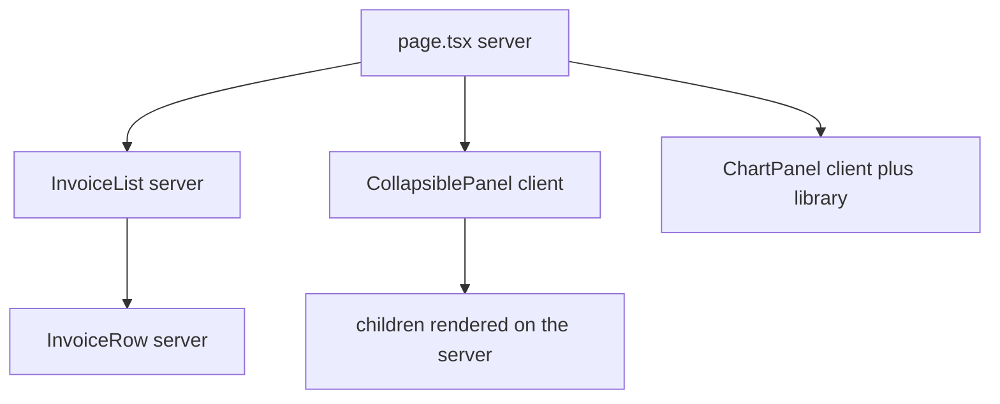
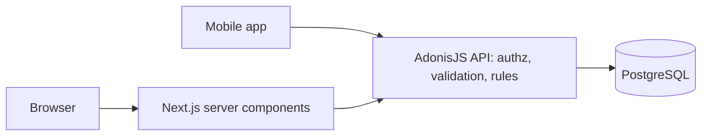

# Server and Client Components — Part 2

Part 1 drew the line. This part is about living with it: how to keep the
browser's share of your code small, what is allowed to travel across the
boundary, and the one architectural decision that genuinely matters for you —
whether a server component should talk to your database directly when you
already have an AdonisJS API sitting right there.

That last question is not a React question. It is the same question you answer
every time you decide whether a new consumer gets its own data access or goes
through the front door you already built. The answer here is not "whatever
Next.js tutorials do".

> **📌 In one line:** push `'use client'` as far down the tree as it will go,
> remember that only data crosses the boundary, and keep your API as the single
> front door to your data.

> **⬅️ This continues [Part 1](./02-server-and-client-components-part-1.md).**

## Table of Contents

1. [Keep the Directive at the Leaves](#keep-the-directive-at-the-leaves)
2. [Passing Server Content Through children](#passing-server-content-through-children)
3. [The Before and After Tree](#the-before-and-after-tree)
4. [Serialisation Across the Boundary](#serialisation-across-the-boundary)
5. [The Date That Became a String](#the-date-that-became-a-string)
6. [Database Directly, or Your Own API?](#database-directly-or-your-own-api)
7. [The Recommendation for Your Situation](#the-recommendation-for-your-situation)
8. [Advanced: The Bundle Is Measurable](#advanced-the-bundle-is-measurable)
9. [Common Mistakes](#common-mistakes)
10. [Questions to Test Yourself](#questions-to-test-yourself)
11. [Related](#related)

---

## Keep the Directive at the Leaves

The instinct when you hit the `useState` error is to mark the page
`'use client'`. It works, the error goes away, and you have quietly moved your
whole page into the browser.

The discipline is the opposite: find the smallest piece that truly needs
interactivity, and mark only that.

```tsx
// ❌ BROKEN - one dropdown pulled the entire page across the boundary
'use client'
import { useState } from 'react'
import { listProjects } from '@/lib/api/projects'   // now in the browser bundle

export default function ProjectsPage() {
  const [status, setStatus] = useState<ProjectStatus>('active')
  // and now the data must be fetched with useEffect, with loading and error
  // states, exactly the hand-rolled mess React Fundamentals warned about
}
```

```tsx
// ✅ FIXED - the page stays on the server; only the filter is client code
import { listProjects } from '@/lib/api/projects'
import { ProjectFilters } from './_components/project-filters'  // 'use client' there

export default async function ProjectsPage({ searchParams }: PageProps) {
  const { status } = await searchParams
  const projects = await listProjects({ status })

  return (
    <>
      <ProjectFilters current={status} />
      <ProjectTable projects={projects} />
    </>
  )
}
```

Notice what the fixed version gained beyond bundle size. The data fetch went
back to a single `await`. The loading state became `loading.tsx`. The filter
state moved into the URL, which means it can be bookmarked and shared.

> **💡 Tip:** "which part of this screen reacts to the user?" is a better
> question than "does this page need state?". Usually the answer is a button, a
> dropdown or an input — a few dozen lines, not a page.

---

## Passing Server Content Through children

A rule from Part 1: a client component cannot *import* a server component. Once
a file is client code, everything it imports is client code too.

But there is a gap in that rule, and it is the most useful pattern in the App
Router. A client component can **render** server-produced content if that
content arrives as a prop — usually `children`.

```tsx
// _components/collapsible-panel.tsx
'use client'
import { useState, type ReactNode } from 'react'

export function CollapsiblePanel({ title, children }: { title: string; children: ReactNode }) {
  const [open, setOpen] = useState(true)
  return (
    <section>
      <button onClick={() => setOpen((v) => !v)}>{title}</button>
      {open ? children : null}
    </section>
  )
}
```

```tsx
// app/companies/[id]/page.tsx - still a server component
export default async function CompanyPage({ params }: PageProps) {
  const { id } = await params

  return (
    <CollapsiblePanel title="Open invoices">
      {/* This is rendered on the server and passed in as finished output */}
      <InvoiceList invoices={await listInvoices(id)} />
    </CollapsiblePanel>
  )
}
```

`InvoiceList` never becomes client code. The panel does not know what its
children are; it only decides whether to show them. What travels to the browser
is the panel's own logic plus already-rendered output.

Think of it the way you think about a generic function on the server: the
wrapper handles control flow, the content is supplied by the caller. That is
all `children` is doing here.

> **📌 Remember:** the boundary travels down the *import* tree, not down the
> *render* tree. A client component rendering `{children}` does not drag those
> children across.

---

## The Before and After Tree

```text
BEFORE - 'use client' at the top of the page

app/companies/[id]/page.tsx            client  <- directive here
  ├─ lib/api/companies.ts              client  <- fetch logic shipped
  ├─ lib/format/money.ts               client
  ├─ _components/invoice-list.tsx      client  <- pure display, no need
  ├─ _components/invoice-row.tsx       client
  └─ _components/chart-panel.tsx       client  <- plus its charting library
```

```text
AFTER - directive pushed to the leaves

app/companies/[id]/page.tsx            server
  ├─ lib/api/companies.ts              server  <- credentials stay here
  ├─ _components/invoice-list.tsx      server
  │    └─ _components/invoice-row.tsx  server
  ├─ _components/collapsible-panel.tsx client  <- 20 lines
  └─ _components/chart-panel.tsx       client  <- charting library, unavoidable
```

Two files moved instead of six. The charting library still ships, because a
chart is interactive and there is no way around that — but it is now the only
large thing crossing, and you can see it.



---

## Serialisation Across the Boundary

When a server component passes props to a client component, those props are
turned into text, embedded in the response, and rebuilt in the browser. Only
things that survive that trip are allowed.

| Prop type | Crosses the boundary | Note |
|---|---|---|
| `string`, `number`, `boolean`, `null` | yes | unchanged |
| Plain objects and arrays of the above | yes | deeply, by value |
| `Date` | yes, but | arrives as a date-like value; treat the shape as not guaranteed |
| `Map`, `Set` | depends on your version | do not rely on it, send an array |
| Class instances with methods | no | methods are lost; only data could survive |
| Functions, including handlers | no | error at build or render time |
| A database client, a stream, a connection | no | these are live resources |

You have met this exact constraint before, in a place that has nothing to do
with React. When you enqueue a background job, the payload must be serialisable
too, for the same reason: it is written somewhere as text and rebuilt in a
different process later.
[Anatomy of a Job System](../../caching-and-background-jobs/03-background-jobs/02-anatomy-of-a-job-system-part-1.md)
makes the argument there — send identifiers and plain data, not live objects.
The rule here is identical, and so is the fix.

The deeper reason is the one from
[Objects and References](../../typescript-fundamentals/objects-and-references/objects-and-references.md):
a reference only means something inside the memory that holds it. Crossing a
process boundary — or a network — means copying values, and a function's
closure cannot be copied.

---

## The Date That Became a String

```tsx
// ❌ BROKEN - the client component assumes it received a real Date
// server component
<TaskRow task={{ id: t.id, title: t.title, dueAt: t.dueAt }} />

// client component
'use client'
export function TaskRow({ task }: { task: Task }) {
  // TypeScript says dueAt is a Date, so this compiles.
  // At runtime it may be a plain string, and the call explodes.
  return <span>{task.dueAt.toLocaleDateString()}</span>
}
```

```tsx
// ✅ FIXED - serialise deliberately at the boundary, and type it honestly
// server component
<TaskRow id={t.id} title={t.title} dueAtIso={t.dueAt.toISOString()} />

// client component
'use client'
type TaskRowProps = { id: string; title: string; dueAtIso: string }

export function TaskRow({ title, dueAtIso }: TaskRowProps) {
  const due = new Date(dueAtIso)
  return <span>{due.toLocaleDateString()}</span>
}
```

> **⚠️ Warning:** TypeScript cannot save you here. It type-checks both sides
> separately and knows nothing about the serialisation that happens in between.
> A prop typed `Date` that arrives as a string compiles perfectly and fails at
> runtime.

The habit worth forming: **define an explicit props type for every client
component, using only primitives and plain objects.** That type is a contract
at a process boundary, and it deserves the same care as the response body of an
API endpoint. This is the same argument as
[DTOs and Serialization](../../backend-fundamentals/09-application-architecture/04-dtos-and-serialization-part-1.md)
on the server.

---

## Database Directly, or Your Own API?

Now the architectural question. Next.js tutorials usually show a server
component importing an ORM and querying the database in the component body:

```tsx
export default async function ProjectsPage() {
  const projects = await db.select().from(projectsTable)   // tutorial style
  return <ProjectTable projects={projects} />
}
```

It works. It is fast. And for you, it is usually the wrong choice, because you
already have an AdonisJS backend that owns this data.

| Concern | Server component queries the database | Server component calls your API |
|---|---|---|
| Latency | lower, one hop | higher, two hops, usually a few milliseconds inside one network |
| Authorization rules | re-implemented in the frontend repo | written once, in the backend |
| Validation | re-implemented, or skipped | already enforced at the endpoint |
| Business rules on write | easy to bypass by accident | impossible to bypass |
| Mobile or third-party clients | get a different code path | get the same code path |
| Database schema changes | break two repositories | break one |
| Connection pool | a second pool, sized by frontend traffic | one pool, owned by the backend |
| Observability | two places produce query logs | one place, with your existing tracing |
| Team ownership | the data layer now has two owners | one owner |

The rows about authorization and business rules are the dangerous ones. In your
backend, "may this user see company 14's invoices?" is enforced inside a
service, as
[Service Layer](../../backend-fundamentals/09-application-architecture/02-service-layer-part-1.md)
describes, and as
[ownership and multi-tenancy](../../backend-fundamentals/06-authorization/03-ownership-abac-and-multi-tenancy-part-1.md)
sets out in detail. A frontend that queries the database directly must repeat
that logic. Two copies of an authorization rule means one of them is out of
date, and you will not find out from a test.

The connection pool row is the one that bites in production. Your frontend
scales with page views. Your database connection limit does not care why you
opened connections.

---

## The Recommendation for Your Situation

**Keep your AdonisJS API as the single front door to your data.** Server
components should `fetch` from it, not reach past it.

You still get almost everything that makes server components good:

- No `useEffect`, no client-side loading state, no race conditions.
- Credentials and tokens stay on the server.
- The browser downloads less JavaScript.
- Your authorization and validation stay in one place that every client shares.

What you give up is one network hop between two of your own services, usually
inside the same network. That is a small, predictable cost, and it is the same
cost every other consumer of your API already pays.



> **📌 Remember:** the question is not "can the frontend reach the database?"
> It is "how many places enforce the rules?" One door, one set of locks.

Two honest exceptions. A small internal tool with no other client and no
separate backend can query directly — there is no API to duplicate. And a
read-only, non-sensitive lookup such as a public list of countries is not worth
an endpoint. Everything that belongs to a user or a company goes through the
API.

---

## Advanced: The Bundle Is Measurable

The client bundle is not a vague worry. It is a number, and your build prints
it. A production build output lists each route with the JavaScript the browser
must download for it, plus a shared baseline.

```text
Route                                 Size     First Load JS
/                                    1.2 kB          92 kB
/companies                           3.4 kB          95 kB
/companies/[id]                      148 kB         240 kB   <- investigate
```

When a number jumps, the cause is almost always one of three things: a new
`'use client'` on a file that many others import, a heavy library imported into
a client component, or a utility module that happens to import something large.

The dangerous version is the shared file:

```ts
// lib/format/index.ts
'use client'                      // added so one hook could be used here
export { formatMoney } from './money'
export { formatDate } from './date'
export { useCurrencyInput } from './use-currency-input'
```

Every server component that imports `formatMoney` from this barrel file now
crosses the boundary, because the directive is at the top of the file they
import. One line in a shared utility can move a large part of the application
into the browser, and nothing fails — the app just gets slower and more of your
code becomes public.

Two defences. Keep hooks in their own files, separate from pure functions. And
read the build output after any change that touches shared modules, the same
way you would read a slow query log.

> **💡 Tip:** treat `'use client'` in a file under `lib/`, `utils/` or
> `components/ui/` as something that needs a reason in the commit message. In a
> route's own `_components/` folder it is routine.

---

## Common Mistakes

| Mistake | Why it is wrong | Do this instead |
|---|---|---|
| `'use client'` on the page to fix one dropdown | The data layer ships to the browser | Mark the dropdown's file only |
| Importing a server component into a client file | Imports cross the boundary, so it becomes client code | Pass it in as `children` |
| Passing a `Date` and calling a method on it | It arrives serialised and may not be a `Date` | Pass an ISO string, parse on the client |
| Typing a client prop as a class instance | Methods never survive serialisation | Use a plain object type |
| Querying the database from a server component | Authorization and validation get duplicated | Call your API |
| A second connection pool in the frontend | Pool size now scales with page views | Let the backend own the pool |
| `'use client'` in a shared barrel file | Every importer crosses the boundary | Split hooks into their own module |
| Ignoring the build's First Load JS column | Bundle growth is silent until it is large | Read it like a slow query log |

---

## Questions to Test Yourself

1. A client component needs to display a server-fetched invoice list. Why can
   it not import the list component, and what pattern solves it?
2. State the rule about which tree the `'use client'` boundary travels down,
   and give an example that depends on the distinction.
3. A prop typed `Date` compiles fine and crashes at runtime in the browser.
   Explain the mechanism and the fix.
4. Which earlier topic in this repository has the same serialisation rule, and
   why is the underlying reason identical?
5. Give three arguments against a server component querying your PostgreSQL
   database directly, and one honest argument for it.
6. Your backend enforces "a user may only see their own company's invoices".
   What happens to that rule if the frontend queries the database directly?
7. What single line in a shared utility file could double your JavaScript
   bundle, and why does nothing break when it is added?
8. Where in your build output would you notice that, and what would you compare
   it against?

---

## Related

- [Server and Client Components — Part 1](02-server-and-client-components-part-1.md)
  — the boundary, the capability table and the secret leak.
- [backend-fundamentals/09-application-architecture/02-service-layer-part-1.md](../../backend-fundamentals/09-application-architecture/02-service-layer-part-1.md)
  — where authorization and business rules belong, and why not twice.
- [caching-and-background-jobs/03-background-jobs/02-anatomy-of-a-job-system-part-1.md](../../caching-and-background-jobs/03-background-jobs/02-anatomy-of-a-job-system-part-1.md)
  — the same serialisable-payload rule, met in a different place.
- [typescript-fundamentals/objects-and-references](../../typescript-fundamentals/objects-and-references/objects-and-references.md)
  — why a reference cannot cross a process boundary.
- [04-data-fetching-and-mutations-part-1.md](04-data-fetching-and-mutations-part-1.md)
  — actually calling your API from a server component, with the session.
